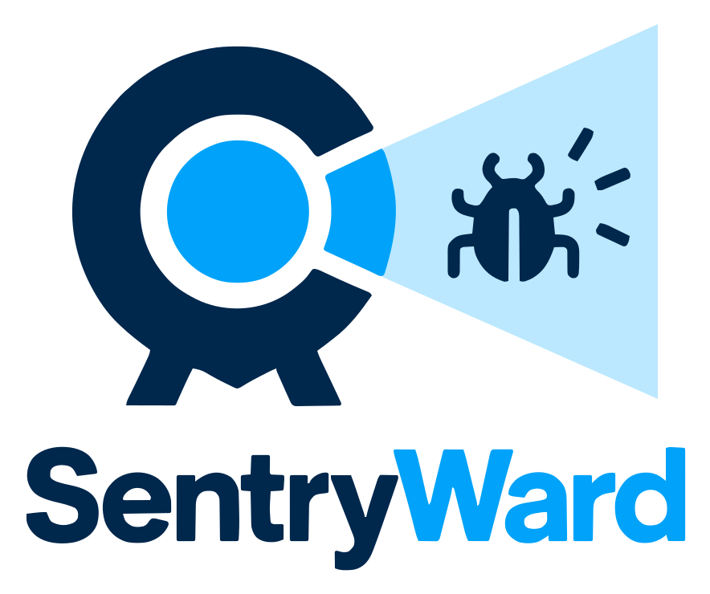
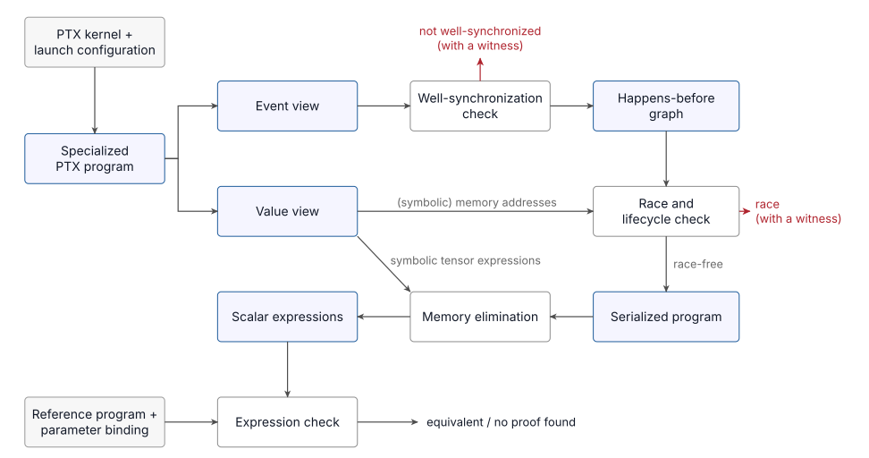

<div align="center">



# Formal verification of warp-specialized GPU kernels

*Reveal hidden bugs in GPU kernels.*

[](LICENSE)
[](pyproject.toml)
[](corpus/)
[](https://sentryward.io/slack/)

[Features](#features) ·
[Results](#results) ·
[Getting started](#getting-started) ·
[How it works](#how-it-works) ·
[Community](#community)

</div>

SentryWard is a static verifier for NVIDIA PTX kernels, built for the
warp-specialized kernels of Blackwell GPUs. Given a kernel's PTX and a launch
configuration, it proves that the kernel synchronizes correctly and is free of
data races in every schedule within the configured input scope and
[model assumptions](docs/assumptions.md). Given a PyTorch reference as well, it also proves
that the kernel computes the same function.

## Features

- **Well-synchronization.** Barriers and mbarriers, including TMA byte counts,
  behave the same way in every schedule. This also rules out deadlocks.
- **Race freedom.** Every pair of conflicting accesses to global, shared or
  tensor memory is ordered. Footprints follow exact layouts, including
  swizzling, and an SMT solver decides overlap for symbolic addresses.
- **Resource lifetimes.** Tensor memory and barriers are never used after they
  are freed or invalidated.
- **Equivalence to a reference.** The kernel's outputs equal those of a
  PyTorch reference, in real arithmetic.
- **Witnesses.** Every failed check comes with evidence, such as the two
  unordered accesses of a race. Inconclusive checks retain their specific
  result category and diagnostics; they are never reported as a pass.
- **Blackwell coverage.** TMA, `tcgen05` MMA and tensor memory, mbarriers,
  thread-block clusters and asynchronous copies.

## Results

Results for every kernel in our benchmark, with diagnostics and evidence, are
in [Kernel verification results](https://sentryward.io/results/).

### Bugs in popular kernel libraries

SentryWard has found synchronization bugs in popular kernel libraries, such as
a signal sent before the asynchronous write it announces has completed, and a
buffer reused while the tensor core is still reading it. We have reported some
of them upstream.

### Removing redundant synchronization

Because SentryWard checks every schedule, it can also show that a
synchronization operation is unnecessary: if the kernel still verifies without
it, the operation is redundant. We applied this test greedily, one operation at a time.

[Per-kernel synchronization removal results](https://sentryward.io/results/)
include removable operation counts and B200 timings for both recorded and larger
inputs. Experiments are saved in [examples/results.json](examples/results.json), with
their sources, methodology, and limitations. These results hold for the tested
input shapes; other shapes may require synchronization that was removable here.

## Getting started

### Install

```bash
pip install sentryward                # the synchronization check, including race freedom
pip install "sentryward[reference]"   # adds PyTorch for reference equivalence
```

Wheels include the native verifier. Building from source needs CMake 3.27+, a
C++20 compiler, OpenSSL, Boost headers and, optionally, Z3.

### Verify a kernel

```bash
# Run the synchronization check, including race freedom
sentryward kernel.ptx --input input.json --output output.json

# Compact listing on stdout; JSON still goes to --output
sentryward kernel.ptx --input input.json --output output.json --format summary --fail-on findings

# Override one analysis assumption for this invocation
sentryward kernel.ptx --input input.json --assume order_independent_atomics

# Accepted keys and repository defaults
sentryward --list-assumptions

# Also check equivalence to a PyTorch reference
sentryward kernel.ptx \
  --input input.json \
  --reference reference.py \
  --reference-binding reference_binding.json \
  --timeout 500 \
  --memory-limit-mib 81920 > output.json
```

The same check from Python. `summarize` returns compact text for a result
dictionary; it does not change the JSON object.

```python
from sentryward import summarize, verify

result = verify(
    "kernel.ptx",
    input="input.json",
    reference="reference.py",                    # optional
    reference_binding="reference_binding.json",  # optional
    timeout_seconds=500,
    memory_limit_mib=None,                       # unlimited
    assumptions={"order_independent_atomics": True},  # optional
)
print(result["result"], result["checks"])
print(summarize(result), end="")
```

| CLI | Python | Description |
| --- | --- | --- |
| `--input` | `input` | Required. The kernel's input configuration (JSON). |
| `--reference` | `reference` | Optional. A Python file that defines a `reference(...)` function. |
| `--reference-binding` | `reference_binding` | Optional. Maps the reference to the kernel's inputs and outputs. Defaults to `reference_binding.json` next to the reference, then in its parent directory. |
| `--timeout` | `timeout_seconds` | Total budget for the whole call, including reference capture. Default: 600 seconds. |
| `--memory-limit-mib` | `memory_limit_mib` | Memory budget as a positive integer in MiB, e.g. 81920 for 80 GiB. Default: unlimited. |
| `--output` | | Optional. Write the JSON result object to this path. stdout still prints `--format`. |
| `--format` | `summarize(result)` | Optional. `json` (default) writes the result object to stdout. `summary` writes a compact text listing of `result`, `checks`, diagnostics, and warning counts. |
| `--fail-on` | | Optional, repeatable. Exit 1 when `result` matches a public category. `findings` selects `not_wellsynced`, `potential_race`, `invalid_lifecycle`, and `equivalence_not_proven`. `any` selects every category other than `verified` and `race_free`. Default exit codes are unchanged. |
| `--assume` / `--no-assume` | `assumptions` | Optional. Enable or disable a named analysis assumption for this invocation. Overrides the same key in the kernel input. Repeatable; each key may appear only once. |
| `--list-assumptions` | | Print accepted assumption keys and repository defaults as JSON. Does not verify a kernel. |

The reference takes no separate input file. Its arguments are derived from the
kernel's input configuration and the binding; anything that cannot be derived
goes in the binding's `reference` section. The binding's optional `provenance` object
supplies source metadata and recorded input scope; see the
[binding format](docs/reference-binding-json.md#reference-provenance).

Python paths accept strings or `pathlib.Path`. A reference binding requires a
reference function. Timeout values must be positive and finite; explicit memory
limits must be positive integers and apply to both capture and verification.
The reference function executes as Python code during capture.
The public Python package exports `verify` and `summarize`; the CLI accepts the
PTX path directly, without a subcommand, except `--list-assumptions`, which
prints the assumption pool and does not take a PTX path. Assumption flags are
documented in [assumptions.md](docs/assumptions.md#invocation-overrides).

### Read the result

The CLI prints a JSON result to stdout, and `verify` returns the same structure
as a dictionary:

- `result` is the overall verdict. `race_free` means the synchronization check
  passed and no reference was given; `verified` means equivalence to the
  reference was proved as well. Other values name a finding, such as
  `potential_race`, or the reason the analysis stopped, such as `unsupported`
  or `timeout`.
- `checks` gives the status of the two checks: `synchronization`
  (synchronization, memory races and resource lifecycles) and `equivalence`.
- `diagnostics` and `warnings` hold the details; `evidence` holds race and
  synchronization witnesses.
- `internal` holds analysis details such as equivalence receipts; it is not a
  stable interface.

CLI exit code 0 can also accompany findings or inconclusive checks; inspect
`result` and `checks` instead of using the exit code as a correctness verdict.
`--fail-on findings` or `--fail-on any` makes those categories a nonzero exit
without changing the JSON object. `--output` writes that object to a file;
`--format summary` prints the compact listing on stdout.
See [output.json](docs/output-json.md) for the complete result format.

## Build from source

Install a C++20 compiler, CMake 3.27+, Boost headers, OpenSSL and Z3 development
libraries, then install from the repository root:

```sh
python -m pip install ".[reference]"
```

For a standalone native build, use `make build-cpp`. To rerun the saved examples:

```sh
make venv
build/venv/bin/python -m pip install ".[reference,dev]"
make rerun-examples
```

The default build contains the verifier only. Example reruns preserve previous
outputs; `make rerun-examples-performance` includes historical timeout cases.

To select one example and set its total time budget:

```sh
make rerun-examples EXAMPLE_RUN_ARGS="--name pytorch__aten_MultiMarginLoss__sm_100a --timeout 500"
```

The runner reuses inputs unchanged and checks reference equivalence after
verification prerequisites pass. Current results are saved in
`examples/<kernel>/output.json`; previous outputs and run summaries are retained
under `build/artifacts/`. Narrative reports are not included; use the
[generate-kernel-report skill](skills/generate-kernel-report/SKILL.md) to generate
a report from the current output when needed.


## How it works

<p align="center">
  
</p>

## Limitations

- Problem sizes and the launch configuration are fixed.
- Branches and loop bounds may depend on the launch configuration, but not on
  tensor data, with two exceptions. Integer comparisons decided by stated
  [tensor property](docs/input-json.md#tensor-properties) bounds take the
  decided outcome. A forward branch over a straight-line block of register
  and tensor-memory operations can be [merged](docs/assumptions.md#merged-forward-branches).
  Other data-dependent control needs the representative-control assumptions;
  see [Representative branches](docs/assumptions.md#representative-branches),
  off by default.
- Atomics (`atom`, `red`) are analyzed only under
  [Order-independent atomics](docs/assumptions.md#order-independent-atomics),
  off by default.
- Fences and the full PTX memory model are not modeled. The hardware model
  follows our reading of the PTX documentation, which does not specify every
  detail.
- Equivalence treats floating-point values as real numbers, and the check is
  incomplete: finding no proof does not mean the kernel is wrong.

## Documentation

- [Assumptions and limitations](docs/assumptions.md): configurable assumptions and trusted address constraints.
- [input.json](docs/input-json.md): launch configuration, ABI arguments, tensor maps, pointer tables, tensor properties and assumptions.
- [reference_binding.json](docs/reference-binding-json.md): reference arguments, input/output correspondence and the equivalence contract.
- [output.json](docs/output-json.md): result categories, checks, diagnostics and warnings.

## Repository layout

```text
cpp/                C++ frontend, verifier and equivalence engine
sentryward/         Python CLI and process interface
corpus/             Compiled Blackwell PTX kernels of the benchmark
examples/<kernel>/  input.json, output.json, and reference.py/reference_binding.json where available
examples/_reference/ Shared mathematical helpers used by example references
config/             Default and available analysis assumptions
skills/             Agent skills for preparing inputs and explaining results
tools/              Example regression tooling
```

## Community

Questions, bug reports and feedback are welcome in the [SentryWard Slack workspace](https://sentryward.io/slack/)
and in [GitHub issues](https://github.com/gpu-verifier/sentryward/issues).

## License

Apache License 2.0; see [LICENSE](LICENSE).
