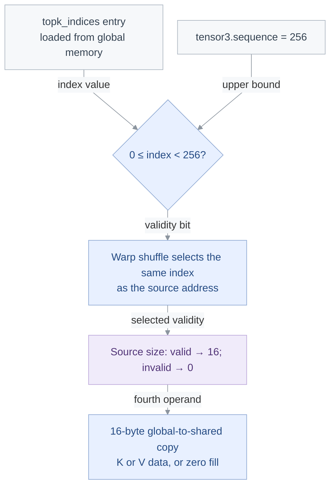
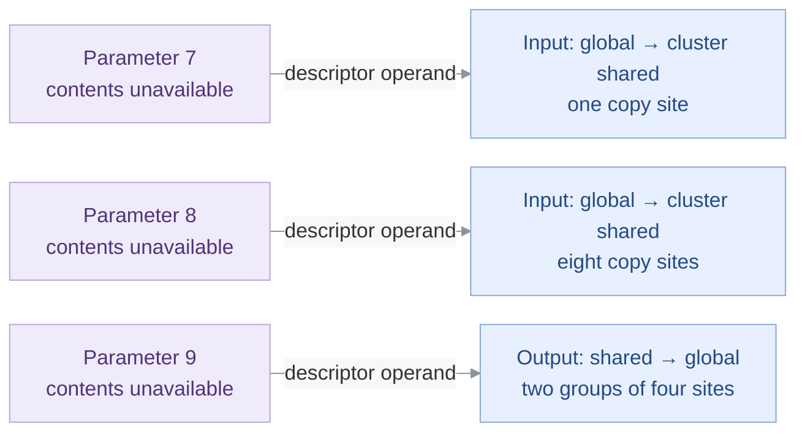

<!-- report-layout:v2 -->

<!-- verifier-result:start -->
<p align="center">Sparse MLA: startup synchronization and copy-model boundaries</p>
<h1 align="center">LIFECYCLE CHECK FAILED</h1>

**Inputs:** [PTX](https://github.com/gpu-verifier/sentryward/blob/94a6b26b1990a4b9df7ded3727acc4b4cc36f23c/corpus/flash_attention__fwd_mla_sparse_bf16__sm_100a.ptx) · analyzed code; [input.json](https://github.com/gpu-verifier/sentryward/blob/94a6b26b1990a4b9df7ded3727acc4b4cc36f23c/examples/flash_attention__fwd_mla_sparse_bf16__sm_100a/input.json) · launch, arguments and assumptions.

**Result:** [output.json](https://github.com/gpu-verifier/sentryward/blob/94a6b26b1990a4b9df7ded3727acc4b4cc36f23c/examples/flash_attention__fwd_mla_sparse_bf16__sm_100a/output.json) · saved verifier findings.

<details>
<summary><strong>Analysis records — open the saved evidence</strong></summary>

Each record link opens its field in the original `output.json`. Model summaries are not full execution traces.

**Check the finding**

- [Diagnostic messages and details · `diagnostics`](https://github.com/gpu-verifier/sentryward/blob/94a6b26b1990a4b9df7ded3727acc4b4cc36f23c/examples/flash_attention__fwd_mla_sparse_bf16__sm_100a/output.json#L44)
- [Individual check outcomes · `checks`](https://github.com/gpu-verifier/sentryward/blob/94a6b26b1990a4b9df7ded3727acc4b4cc36f23c/examples/flash_attention__fwd_mla_sparse_bf16__sm_100a/output.json#L39)

**Check how the model was built**

- [PTX translation · `frontend`](https://github.com/gpu-verifier/sentryward/blob/94a6b26b1990a4b9df7ded3727acc4b4cc36f23c/examples/flash_attention__fwd_mla_sparse_bf16__sm_100a/output.json#L3635)
- [Model and source bindings · `semantic_program`](https://github.com/gpu-verifier/sentryward/blob/94a6b26b1990a4b9df7ded3727acc4b4cc36f23c/examples/flash_attention__fwd_mla_sparse_bf16__sm_100a/output.json#L3922)

**Check values separately**

- [Value-analysis status · `value_analysis`](https://github.com/gpu-verifier/sentryward/blob/94a6b26b1990a4b9df7ded3727acc4b4cc36f23c/examples/flash_attention__fwd_mla_sparse_bf16__sm_100a/output.json#L3972)
- [Numerical comparison · `equivalence`](https://github.com/gpu-verifier/sentryward/blob/94a6b26b1990a4b9df7ded3727acc4b4cc36f23c/examples/flash_attention__fwd_mla_sparse_bf16__sm_100a/output.json#L1827)

For the records explained in this report, see the [Evidence appendix](#evidence-appendix).

</details>

## 1. Verifier result

Saved findings and analysis scope, formatted directly from the verifier output.

### 1.1 Lifecycle diagnostics

Lifecycle checking did not complete successfully. The saved diagnostics identify the reported problems.

**Saved result:** <code>invalid_lifecycle</code> · <code>output.json#/result</code>.

**Checks:** Synchronization <code>incomplete</code> · Memory <code>not_run</code> · Equivalence <code>not_run</code>.

**Operation:** <code>kernel_verification</code>.

**4 diagnostic categories · 87 retained records.**

Grouped by saved stage and code, not by inferred root cause or severity. Record counts are not counts of independent bugs.

| Saved diagnostic | Records | Reported extent |
| --- | ---: | --- |
| **Cluster protocol**<br/>thread arrived twice before wait | 1 | PTX <code>360</code> |
| **Cluster protocol**<br/>cluster wait without arrival | 1 | PTX <code>362</code> |
| **Tensor-map capture missing**<br/>tensor operand has no matching captured map | 17 | 17 reported PTX sites |
| **Model needs a fixed copy-control value**<br/>Operand must have a statically determined integer value | 68 | 68 reported PTX sites |

Category codes, locations and array indices: Evidence appendix → Diagnostic records.

### 1.2 Analysis scope

**Coverage:** Memory analysis complete: **no** · Search complete: <code>not saved</code> · Exhaustive search: <code>not saved</code>.

This result applies to the supplied launch, arguments and enabled assumptions.
<!-- verifier-result:end -->

<!-- code-explanation:start -->

---

## 2. Code explanation

Interpretation from the PTX and saved inputs: how the reported operations fit together and what remains to check.

### 2.1 Where the concerns occur

The affected code prepares shared-memory synchronization objects, gathers selected K/V entries into shared tiles, and uses tensor descriptors for input and output transfers. The input file names `K`, `V`, and `topk_indices`; the descriptor-defined tensors have no captured contents from which to recover their logical identities. The following accounts separate three concerns:

- **Cluster startup:** the order of cluster-wide arrivals and waits before worker dispatch.
- **Index-controlled copies:** sparse-index values select whether a shared tile receives source data or zeros.
- **Tensor-map binding:** descriptor addresses are traceable, but their tensor layouts and global bindings are not supplied.

The source walkthrough uses physical PTX locations and static thread guards. It does not turn the saved diagnostic actor ranges into a hardware execution trace.

<details>
<summary><strong>Check how the named objects enter the code</strong></summary>

#### Pointer objects and descriptor objects are separate inputs

Parameters 2, 3, 4 and 6 are declared pointers to K, V, V and <code>topk_indices</code>. Their initial loads supply the ordinary gather path. Parameters 7, 8 and 9 are instead declared tensor maps and are addressed directly in parameter memory. The latter declarations do not bind their global backing tensors to K or V. This is why the discussion uses “descriptor-defined input tiles” instead of guessing query/key names for those transfers.

<details>
<summary><strong>Exact source references</strong></summary>

##### Pointer objects and descriptor objects are separate inputs

- `input.json#/declarations/26`: <code>{&quot;parameter&quot;:7,&quot;type&quot;:&quot;tensor_map&quot;}</code>
- `input.json#/declarations/27`: <code>{&quot;parameter&quot;:8,&quot;type&quot;:&quot;tensor_map&quot;}</code>
- `input.json#/declarations/28`: <code>{&quot;parameter&quot;:9,&quot;type&quot;:&quot;tensor_map&quot;}</code>
- `input.json#/declarations/29`: <code>{&quot;parameter&quot;:2,&quot;offset&quot;:0,&quot;type&quot;:&quot;pointer&quot;,&quot;object&quot;:&quot;K&quot;}</code>
- `input.json#/declarations/30`: <code>{&quot;parameter&quot;:3,&quot;offset&quot;:0,&quot;type&quot;:&quot;pointer&quot;,&quot;object&quot;:&quot;V&quot;}</code>
- `input.json#/declarations/31`: <code>{&quot;parameter&quot;:4,&quot;offset&quot;:0,&quot;type&quot;:&quot;pointer&quot;,&quot;object&quot;:&quot;V&quot;}</code>
- `input.json#/declarations/32`: <code>{&quot;parameter&quot;:6,&quot;offset&quot;:0,&quot;type&quot;:&quot;pointer&quot;,&quot;object&quot;:&quot;topk_indices&quot;}</code>
- physical PTX 51-69: <code>%rd39</code>, <code>%rd43</code>, <code>%rd47</code>, <code>%rd51</code>, <code>%rd3</code>, <code>%rd2</code>, <code>%rd1</code>

##### Additional section references

- physical PTX 338-366: <a href="https://docs.nvidia.com/cuda/archive/13.3.0/parallel-thread-execution/index.html#parallel-synchronization-and-communication-instructions-barrier-cluster"><code>barrier.cluster.arrive.relaxed</code></a>, <a href="https://docs.nvidia.com/cuda/archive/13.3.0/parallel-thread-execution/index.html#parallel-synchronization-and-communication-instructions-barrier-cluster"><code>barrier.cluster.wait</code></a>
- physical PTX 707-762: <code>ld.global.b32</code>, <a href="https://docs.nvidia.com/cuda/archive/13.3.0/parallel-thread-execution/index.html#data-movement-and-conversion-instructions-cp-async"><code>cp.async.cg.shared.global</code></a>
- physical PTX 1258-1262,1286-1290,5178-5187,5525-5536: <code>cvta.param.u64</code>
- `input.json#/declarations`: <code>list, 33 entries; see original artifact</code>
- `output.json#/diagnostics`: <code>list, 87 entries; see original artifact</code>

</details>

</details>

### 2.2 Cluster startup: both arrivals precede both waits

The startup sequence is `arrive → arrive → wait → wait`. Both arrivals address the implicit cluster barrier, not either of the shared-memory `mbarrier` objects initialized between them. All threads take this sequence before worker dispatch. A fast warp can therefore make its second arrival while another warp has not made its first; the intervening initialization fences do not establish completion of that first cluster round. The consecutive waits also contain no new arrival between them. These source relations explain the two startup diagnostics without asserting that a GPU hang was observed.

**Possible interleaving.** Steps run downward; they are not a measured GPU clock or a hardware trace.

| Step | CTA 0, warp 12 — local threads 384–415 | CTA 0, warp 13 — local threads 416–447 |
| --- | --- | --- |
| 1 | — | Still in startup before the first cluster arrival. |
| 2 | Issue the first cluster arrival at L339. | — |
| 3 | Skip warp-0-only initialization; issue the second arrival at L360 while the first round is still incomplete. | — |

<p><strong>The complete cluster-barrier sequence; the omitted interval contains initialization, not a cluster wait</strong> · <a href="https://github.com/gpu-verifier/sentryward/blob/94a6b26b1990a4b9df7ded3727acc4b4cc36f23c/corpus/flash_attention__fwd_mla_sparse_bf16__sm_100a.ptx#L338-L362" title="Open the original PTX">physical PTX 338–339, 359–362</a></p>

<pre><code><strong>fence.mbarrier_init.release.cluster</strong>;
<a href="https://docs.nvidia.com/cuda/archive/13.3.0/parallel-thread-execution/index.html#parallel-synchronization-and-communication-instructions-barrier-cluster"><strong>barrier.cluster.arrive.relaxed</strong></a>;
…
<strong>fence.mbarrier_init.release.cluster</strong>;
<a href="https://docs.nvidia.com/cuda/archive/13.3.0/parallel-thread-execution/index.html#parallel-synchronization-and-communication-instructions-barrier-cluster"><strong>barrier.cluster.arrive.relaxed</strong></a>;
<a href="https://docs.nvidia.com/cuda/archive/13.3.0/parallel-thread-execution/index.html#parallel-synchronization-and-communication-instructions-barrier-cluster"><strong>barrier.cluster.wait</strong></a>;
<a href="https://docs.nvidia.com/cuda/archive/13.3.0/parallel-thread-execution/index.html#parallel-synchronization-and-communication-instructions-barrier-cluster"><strong>barrier.cluster.wait</strong></a>;</code></pre>


- **Participants:** These are two concrete warps of the first 512-thread CTA. All their lanes are non-exited at startup; the other CTA and warps remain participants in the cluster barrier. The schedule is source-derived and is not an actor-ID reconstruction.
- **Branches:** Both selected warps have warp ID different from zero. At L341 and L350 they take the branches to L347 and L356, skipping only the two mbarrier initializations. No intervening instruction waits for another warp.
- **Iterations:** This is straight-line startup before the work loops and role dispatch at L363–366. Sparse indices, topk, and later cluster-launch cancellation decisions do not guard it.
- **Completion:** The first cluster round cannot complete while warp 13 has not arrived. The second arrival is the boundary of this possible schedule; no hardware behavior after that protocol violation is assumed.

<details>
<summary><strong>Timeline support</strong></summary>

- physical PTX 72-81: <code>%tid.x</code>
- `input.json#/launch/block_dim`: <code>[512,1,1]</code>
- `input.json#/launch`: <code>{&quot;grid_dim&quot;:[2,1,1],&quot;block_dim&quot;:[512,1,1],&quot;cluster_dim&quot;:[2,1,1],&quot;dynamic_shared_bytes&quot;:232448}</code>
- physical PTX 44,72-81,88-362: <code>.reqntid</code>, <a href="https://docs.nvidia.com/cuda/archive/13.3.0/parallel-thread-execution/index.html#parallel-synchronization-and-communication-instructions-barrier-cluster"><code>barrier.cluster.wait</code></a>
- physical PTX 337-362: <code>@%p72</code>, <code>@%p75</code>, <code>$L__BB0_72:</code>, <code>$L__BB0_75:</code>
- physical PTX 335-366: <a href="https://docs.nvidia.com/cuda/archive/13.3.0/parallel-thread-execution/index.html#parallel-synchronization-and-communication-instructions-barrier-cluster"><code>barrier.cluster.arrive.relaxed</code></a>, <code>%p78</code>, <code>%p79</code>
- physical PTX 339-362: <a href="https://docs.nvidia.com/cuda/archive/13.3.0/parallel-thread-execution/index.html#parallel-synchronization-and-communication-instructions-barrier-cluster"><code>barrier.cluster.arrive.relaxed</code></a>, <a href="https://docs.nvidia.com/cuda/archive/13.3.0/parallel-thread-execution/index.html#parallel-synchronization-and-communication-instructions-barrier-cluster"><code>barrier.cluster.wait</code></a>
- `input.json#/launch/cluster_dim`: <code>[2,1,1]</code>
- physical PTX 72-339: <a href="https://docs.nvidia.com/cuda/archive/13.3.0/parallel-thread-execution/index.html#parallel-synchronization-and-communication-instructions-barrier-cluster"><code>barrier.cluster.arrive.relaxed</code></a>
- physical PTX 339: <a href="https://docs.nvidia.com/cuda/archive/13.3.0/parallel-thread-execution/index.html#parallel-synchronization-and-communication-instructions-barrier-cluster"><code>barrier.cluster.arrive.relaxed</code></a>
- physical PTX 337-360: <code>%p72</code>, <code>%p75</code>, <a href="https://docs.nvidia.com/cuda/archive/13.3.0/parallel-thread-execution/index.html#parallel-synchronization-and-communication-instructions-barrier-cluster"><code>barrier.cluster.arrive.relaxed</code></a>

</details>

<details>
<summary><strong>Check the startup path and the barrier round</strong></summary>

#### Every startup path rejoins before the second arrival

The role value is the linear thread index divided by 32, broadcast within each warp. With a 512×1×1 block it is <code>tid.x</code> / 32. The earlier role/election branches select setup work and rejoin before L339; there is no return or work-loop exit before the four cluster-barrier instructions. Between L339 and L360, the first branch skips to L347 and the second to L356. Thus neither taken edge bypasses the second arrival or either wait.

<p><strong>Warp-0 initialization branches rejoin above the second arrival</strong> · <a href="https://github.com/gpu-verifier/sentryward/blob/94a6b26b1990a4b9df7ded3727acc4b4cc36f23c/corpus/flash_attention__fwd_mla_sparse_bf16__sm_100a.ptx#L337-L362" title="Open the original PTX">physical PTX 337–362</a></p>

<pre><code><strong>setp.ne.b32</strong> %p72, %r3, 0;
<strong>fence.mbarrier_init.release.cluster</strong>;
<a href="https://docs.nvidia.com/cuda/archive/13.3.0/parallel-thread-execution/index.html#parallel-synchronization-and-communication-instructions-barrier-cluster"><strong>barrier.cluster.arrive.relaxed</strong></a>;
<strong>mov.u32</strong> %r2136, %ctaid.z;
<strong>@%p72</strong> <strong>bra</strong> $L__BB0_72;
<strong>elect.sync</strong> %r265|%p73, -1;
<strong>not.pred</strong> %p74, %p73;
@%p74 <strong>bra</strong> $L__BB0_72;
<strong>mov.b32</strong> %r266, 1;
<a href="https://docs.nvidia.com/cuda/archive/13.3.0/parallel-thread-execution/index.html#parallel-synchronization-and-communication-instructions-mbarrier-init">mbarrier.init.shared.b64</a> [%r290], %r266;
$L__BB0_72:
<strong>setp.ne.b32</strong> %p75, %r3, 0;
<strong>add.s32</strong> %r296, %r1, 376;
<strong>@%p75</strong> <strong>bra</strong> $L__BB0_75;
<strong>elect.sync</strong> %r267|%p76, -1;
<strong>not.pred</strong> %p77, %p76;
@%p77 <strong>bra</strong> $L__BB0_75;
<strong>mov.b32</strong> %r268, 1024;
<a href="https://docs.nvidia.com/cuda/archive/13.3.0/parallel-thread-execution/index.html#parallel-synchronization-and-communication-instructions-mbarrier-init">mbarrier.init.shared.b64</a> [%r296], %r268;
$L__BB0_75:
<strong>add.s32</strong> %r19, %r1, 384;
<strong>and.b32</strong> %r20, %r2, 31;
<strong>fence.mbarrier_init.release.cluster</strong>;
<a href="https://docs.nvidia.com/cuda/archive/13.3.0/parallel-thread-execution/index.html#parallel-synchronization-and-communication-instructions-barrier-cluster"><strong>barrier.cluster.arrive.relaxed</strong></a>;
<a href="https://docs.nvidia.com/cuda/archive/13.3.0/parallel-thread-execution/index.html#parallel-synchronization-and-communication-instructions-barrier-cluster"><strong>barrier.cluster.wait</strong></a>;
<a href="https://docs.nvidia.com/cuda/archive/13.3.0/parallel-thread-execution/index.html#parallel-synchronization-and-communication-instructions-barrier-cluster"><strong>barrier.cluster.wait</strong></a>;</code></pre>


#### The initialization counts belong to different barriers

The intermediate shared objects are base+368, initialized to count 1, and base+376, initialized to count 1024. Those counts belong to mbarriers used later by the cluster-work scheduler. They neither name nor reset the implicit cluster barrier. The cluster instructions have no address, explicit participant count or parity operand. Consequently, no phase-1 completion can be inferred from the second arrival merely because it is second in source order.

| Source point | Cluster-round fact |
| --- | --- |
| L339: first arrival | No earlier cluster arrival in this entry |
| L360: second arrival | No cluster wait since L339 |
| L361: first wait | First completion-detection site |
| L362: second wait | No intervening cluster arrival |

#### Completion must precede reuse of a cluster round

The [PTX 9.3 cluster-barrier contract](https://docs.nvidia.com/cuda/archive/13.3.0/parallel-thread-execution/index.html#parallel-synchronization-and-communication-instructions-barrier-cluster) says a round completes after all non-exited cluster threads arrive, and each thread must arrive only once before completion. A wait detects completion before the thread arrives again. The source admits the fast/lagging-warp example above; it does not establish that every schedule fails. The `.relaxed` qualifier changes memory-ordering guarantees, not the requirement that the first round complete before another arrival. No async-copy completion or TMEM-release claim is needed to explain this startup issue.

<details>
<summary><strong>Exact source references</strong></summary>

##### Every startup path rejoins before the second arrival

- physical PTX 72-81: <code>%r3</code>
- physical PTX 88-339: <a href="https://docs.nvidia.com/cuda/archive/13.3.0/parallel-thread-execution/index.html#parallel-synchronization-and-communication-instructions-mbarrier-init"><code>mbarrier.init.shared.b64</code></a>
- physical PTX 337-362: <code>@%p72</code>, <code>@%p75</code>

##### The initialization counts belong to different barriers

- physical PTX 336-355: <code>%r290</code>, <code>%r296</code>, <a href="https://docs.nvidia.com/cuda/archive/13.3.0/parallel-thread-execution/index.html#parallel-synchronization-and-communication-instructions-mbarrier-init"><code>mbarrier.init.shared.b64</code></a>
- physical PTX 359-362: <a href="https://docs.nvidia.com/cuda/archive/13.3.0/parallel-thread-execution/index.html#parallel-synchronization-and-communication-instructions-barrier-cluster"><code>barrier.cluster.wait</code></a>

##### Completion must precede reuse of a cluster round

- physical PTX 338-362: <code>fence.mbarrier_init.release.cluster</code>, <a href="https://docs.nvidia.com/cuda/archive/13.3.0/parallel-thread-execution/index.html#parallel-synchronization-and-communication-instructions-barrier-cluster"><code>barrier.cluster.arrive.relaxed</code></a>
- `output.json#/diagnostics/0/details`: <code>{&quot;actor_ranges&quot;:[[0,1023]],&quot;occurrence_count&quot;:1024,&quot;ptx_line&quot;:360}</code>
- `output.json#/diagnostics/1/details`: <code>{&quot;actor_ranges&quot;:[[0,1023]],&quot;occurrence_count&quot;:1024,&quot;ptx_line&quot;:362}</code>

##### Additional section references

- physical PTX 88-362: <a href="https://docs.nvidia.com/cuda/archive/13.3.0/parallel-thread-execution/index.html#parallel-synchronization-and-communication-instructions-barrier-cluster"><code>barrier.cluster.arrive.relaxed</code></a>, <a href="https://docs.nvidia.com/cuda/archive/13.3.0/parallel-thread-execution/index.html#parallel-synchronization-and-communication-instructions-barrier-cluster"><code>barrier.cluster.wait</code></a>
- physical PTX 72-81: <code>%tid.x</code>, <code>%ntid.x</code>
- `input.json#/launch`: <code>{&quot;grid_dim&quot;:[2,1,1],&quot;block_dim&quot;:[512,1,1],&quot;cluster_dim&quot;:[2,1,1],&quot;dynamic_shared_bytes&quot;:232448}</code>
- `output.json#/diagnostics/0`: <code>dict, 4 entries; see original artifact</code>
- `output.json#/diagnostics/1`: <code>dict, 4 entries; see original artifact</code>

</details>

</details>

### 2.3 Index-controlled copies: the unknown is the selected index value

The gather workers stage K and V data for the sparse attention computation. Each 16-byte copy uses a separate source-size operand: a selected index in `[0, 256)` chooses 16 source bytes; an invalid index chooses zero source bytes, producing zeros in the shared destination. That choice comes from global `topk_indices` data, not from the known scalar `topk=128`. The supplied configuration fixes the bound and addressing strides but supplies no index-array contents. This explains why a model requiring a statically determined source size stops here; the diagnostic alone does not establish an out-of-bounds access or an illegal hardware copy.



Arrows are value dependencies. They do not represent instruction completion or a saved execution. The bound is configured; the index values are not supplied.

<p><strong>The first retained site: index validity becomes the copy source size</strong> · <a href="https://github.com/gpu-verifier/sentryward/blob/94a6b26b1990a4b9df7ded3727acc4b4cc36f23c/corpus/flash_attention__fwd_mla_sparse_bf16__sm_100a.ptx#L707-L736" title="Open the original PTX">physical PTX 707–736 (selected lines; gaps marked)</a></p>

<p><strong>Operands:</strong> Sparse index loaded from <code>topk_indices</code> (<code>%r329</code>) · Configured upper bound, tensor3.sequence = 256 (<code>%r191</code>) · Source bytes selected as 0 or 16; the copy size is the preceding literal 16 (<code>%r337</code>)</p>

<pre><code><strong>ld.global.b32</strong> %r329, [%rd5];
…
<strong>setp.gt.s32</strong> %p99, %r329, -1;
<strong>setp.gt.s32</strong> %p100, %r191, %r329;
<strong>and.pred</strong> %p101, %p99, %p100;
<strong>selp.b32</strong> %r331, 1, 0, %p101;
…
<strong>shfl.sync.idx.b32</strong> %r332, %r331, %r32, 6175, -1;
<strong>setp.eq.b32</strong> %p102, %r332, 0;
…
<strong>selp.b32</strong> <strong>%r337</strong>, 0, 16, %p102;
<a href="https://docs.nvidia.com/cuda/archive/13.3.0/parallel-thread-execution/index.html#data-movement-and-conversion-instructions-cp-async"><strong>cp.async.cg.shared.global</strong></a> [%r33], [%rd87], 16, <strong>%r337</strong>;</code></pre>


<details>
<summary><strong>Trace the index, participants and repeated copy sites</strong></summary>

#### Which threads stage the sparse inputs?

After the special-register derivation of warp ID, the test `(warp_id & -4) != 12` branches over the gather block. Its fallthrough admits warps 12–15, local threads 384–511, in each CTA. These workers bypass the warp-10/11 scheduler branches and enter the gather loop directly. There is no election around the copies: every lane in those four warps participates. The configured cluster-launch cancellation assumption makes the back edge at L1171 false after the first work item; it does not skip the initial gather.

<p><strong>Fallthrough selects the four gather warps</strong> · <a href="https://github.com/gpu-verifier/sentryward/blob/94a6b26b1990a4b9df7ded3727acc4b4cc36f23c/corpus/flash_attention__fwd_mla_sparse_bf16__sm_100a.ptx#L634-L638" title="Open the original PTX">physical PTX 634–638</a></p>

<pre><code><strong>and.b32</strong> %r297, %r3, -4;
<strong>setp.ne.b32</strong> %p97, %r297, 12;
<strong>@%p97</strong> <strong>bra</strong> $L__BB0_106;
<strong>setmaxnreg.dec.sync.aligned.u32</strong> 80;
<strong>and.b32</strong> %r30, %r2, 127;</code></pre>


#### The scalar shape does not determine sparse-index contents

Parameter 6 provides the <code>topk_indices</code> pointer and its strides. Initially <code>ctaid.x</code> is 0 or 1, so <code>ctaid.x</code> >> 1 is zero; <code>ctaid.y</code> and <code>ctaid.z</code> are also zero. The gather addresses therefore select entries within the initial index list, using the permutation `16 × (tid.x & 7) + ((tid.x & 127) >> 3)`. This covers indices 0–127 across the gather group. L707 loads the selected value, while L940 reloads the same address for the later V path. Parameter 3 at offset 8 supplies the independent bound 256. No supplied scalar provides the loaded index values, and no `topk` branch removes this dependency.

#### The shuffle selects validity and address together

The first copy uses the same shuffle selector for the index-valid bit and the two halves of its K source pointer. The [PTX 9.3 shuffle semantics](https://docs.nvidia.com/cuda/archive/13.3.0/parallel-thread-execution/index.html#data-movement-and-conversion-instructions-shfl-sync) decode 6175 as 0x181f: an eight-lane segment mask with a valid lane clamp. For cluster ranks 0 and 1, the first selector is respectively 0 or 4 within each eight-lane segment; the next three selectors add 1, 2 and 3. Thus a lane uses the validity of the index supplying its address, not necessarily its own originally loaded index. `setp.eq` makes the predicate true for an invalid selection, and `selp` then selects 0, not 16.

<p><strong>Validity and pointer halves share the selector</strong> · <a href="https://github.com/gpu-verifier/sentryward/blob/94a6b26b1990a4b9df7ded3727acc4b4cc36f23c/corpus/flash_attention__fwd_mla_sparse_bf16__sm_100a.ptx#L724-L736" title="Open the original PTX">physical PTX 724–736</a></p>

<pre><code><strong>cvt.s64.s32</strong> %rd81, %r329;
<strong>mad.lo.s64</strong> %rd82, %rd40, %rd81, %rd71;
<strong>shl.b64</strong> %rd83, %rd82, 1;
<strong>add.s64</strong> %rd84, %rd39, %rd83;
<strong>shfl.sync.idx.b32</strong> %r332, %r331, <strong>%r32</strong>, 6175, -1;
<strong>setp.eq.b32</strong> %p102, %r332, 0;
<strong>mov.b64</strong> {%r333, %r334}, %rd84;
<strong>shfl.sync.idx.b32</strong> %r335, %r333, <strong>%r32</strong>, 6175, -1;
<strong>shfl.sync.idx.b32</strong> %r336, %r334, <strong>%r32</strong>, 6175, -1;
<strong>mov.b64</strong> %rd85, {%r335, %r336};
<strong>add.s64</strong> %rd87, %rd85, %rd86;
<strong>selp.b32</strong> <strong>%r337</strong>, 0, 16, %p102;
<a href="https://docs.nvidia.com/cuda/archive/13.3.0/parallel-thread-execution/index.html#data-movement-and-conversion-instructions-cp-async">cp.async.cg.shared.global</a> [%r33], [%rd87], 16, <strong>%r337</strong>;</code></pre>


#### Both V paths use the same kind of dynamic source-size choice

The first group copies from parameter 2 (K). The next two groups use parameter 3 (V) and the original index-valid bit. The last two groups use parameter 4, also declared V, after reloading the index and testing the same 0–255 range. Every reported source-size register in these groups is selected between 0 and 16; the later groups differ in selected lanes and address offsets, not in the reason the source-size choice is dynamic. Their commits and mbarrier notifications are present, so this diagnostic is not evidence that a completion instruction is missing.

| Source object | Copy interval | Index value | Commit / notification |
| --- | --- | --- | --- |
| K, parameter 2 | L736–760 | L707 load | L761 / L762 |
| V, parameter 3 | L785–821 | L707 load | L822 / L823 |
| V, parameter 3 | L844–880 | L707 load | L881 / L882 |
| V, parameter 4 | L971–1035 | L940 reload | L1036 / L1037 |
| V, parameter 4 | L1058–1122 | L940 reload | L1123 / L1124 |

<details>
<summary><strong>Exact source references</strong></summary>

##### Which threads stage the sparse inputs?

- physical PTX 72-81,363-366,633-639: <code>%r3</code>, <code>%p97</code>
- physical PTX 1136-1171: <code>%p136</code>
- `input.json#/launch`: <code>{&quot;grid_dim&quot;:[2,1,1],&quot;block_dim&quot;:[512,1,1],&quot;cluster_dim&quot;:[2,1,1],&quot;dynamic_shared_bytes&quot;:232448}</code>
- `input.json#/assumptions/clc_always_fails`: <code>true</code>

##### The scalar shape does not determine sparse-index contents

- `input.json#/arguments`: <code>list, 26 entries; see original artifact</code>
- `input.json#/declarations/9`: <code>{&quot;name&quot;:&quot;tensor3.sequence&quot;,&quot;parameter&quot;:3,&quot;offset&quot;:8,&quot;type&quot;:&quot;s32&quot;}</code>
- `input.json#/declarations/24`: <code>{&quot;name&quot;:&quot;index.sequence_stride&quot;,&quot;parameter&quot;:6,&quot;offset&quot;:24,&quot;type&quot;:&quot;s64&quot;}</code>
- `input.json#/declarations/25`: <code>{&quot;name&quot;:&quot;index.batch_stride&quot;,&quot;parameter&quot;:6,&quot;offset&quot;:32,&quot;type&quot;:&quot;s64&quot;}</code>
- `input.json#/declarations/32`: <code>{&quot;parameter&quot;:6,&quot;offset&quot;:0,&quot;type&quot;:&quot;pointer&quot;,&quot;object&quot;:&quot;topk_indices&quot;}</code>
- physical PTX 58,64-66,132,340,638-639,675-707,940: <code>%rd51</code>, <code>%r329</code>, <code>%r411</code>

##### The shuffle selects validity and address together

- physical PTX 82-87,646-666,720-760: <code>%r32</code>, <code>%r34</code>, <code>%r35</code>, <code>%r36</code>, <code>6175</code>, <code>%r337</code>

##### Both V paths use the same kind of dynamic source-size choice

- physical PTX 54-63,724-762,774-882,940-1124: <code>cp.async.commit_group</code>, <code>cp.async.mbarrier.arrive.noinc.shared.b64</code>
- `input.json#/declarations/29`: <code>{&quot;parameter&quot;:2,&quot;offset&quot;:0,&quot;type&quot;:&quot;pointer&quot;,&quot;object&quot;:&quot;K&quot;}</code>
- `input.json#/declarations/30`: <code>{&quot;parameter&quot;:3,&quot;offset&quot;:0,&quot;type&quot;:&quot;pointer&quot;,&quot;object&quot;:&quot;V&quot;}</code>
- `input.json#/declarations/31`: <code>{&quot;parameter&quot;:4,&quot;offset&quot;:0,&quot;type&quot;:&quot;pointer&quot;,&quot;object&quot;:&quot;V&quot;}</code>

##### Additional section references

- `input.json#/arguments/0`: <code>{&quot;field&quot;:&quot;topk&quot;,&quot;value&quot;:128}</code>
- `input.json#/arguments/9`: <code>{&quot;field&quot;:&quot;tensor3.sequence&quot;,&quot;value&quot;:256}</code>
- physical PTX 58,64-66,690-736: <code>%r191</code>, <code>%rd51</code>, <code>%r329</code>, <code>%r337</code>
- `output.json#/diagnostics/19`: <code>dict, 4 entries; see original artifact</code>
- `output.json#/semantic_program/value_diagnostics/0`: <code>{&quot;code&quot;:&quot;unsupported_async_copy&quot;,&quot;line&quot;:736,&quot;message&quot;:&quot;cp.async size/source-size must be statically determined legal byte counts&quot;}</code>

</details>

</details>

### 2.4 Tensor-map binding: input and output descriptors lack captured contents

The TMA operand addresses have concrete parameter origins: parameters 7 and 8 describe global-to-cluster-shared input transfers, and parameter 9 describes shared-to-global output transfers. The output source is a shared staging area populated with BF16 values after normalizing TMEM-loaded accumulators. The saved input declares all three parameters as `tensor_map`, but contains no captured descriptor payload or map-to-object binding. Consequently, the source identifies the direction and staging buffers, while the descriptor-defined global footprints and tensor layouts remain unresolved. This is a capture/binding gap, not evidence that the descriptors supplied to a real launch were invalid.



Each arrow maps a parameter address to the operations that use it as their tensor descriptor. The arrows are not data-flow or completion edges; copy counts here describe static instruction sites.

<p><strong>Descriptor addresses enter both transfer directions</strong> · <a href="https://github.com/gpu-verifier/sentryward/blob/94a6b26b1990a4b9df7ded3727acc4b4cc36f23c/corpus/flash_attention__fwd_mla_sparse_bf16__sm_100a.ptx#L1258-L5181" title="Open the original PTX">physical PTX 1258–5181 (selected lines; gaps marked)</a> · display wrapping added</p>

<p><strong>Operands:</strong> Address of descriptor parameter 7 (<code>%rd3</code>) · Address of descriptor parameter 8 (<code>%rd2</code>) · Address of descriptor parameter 9 (<code>%rd1</code>)</p>

<pre><code><strong>cvta.param.u64</strong> %rd161, %rd3;
…
<a href="https://docs.nvidia.com/cuda/archive/13.3.0/parallel-thread-execution/index.html#data-movement-and-conversion-instructions-cp-async-bulk-tensor"><strong>cp.async.bulk.tensor.4d.shared::cluster.global.tile.mbarrier::complete_tx::bytes.L2::cache_hint.cta_group::2</strong></a>
    [%r43], [%rd161, {%r507, %r56, %r2137, %r2136}], [%r42], %rd162;
…
<strong>cvta.param.u64</strong> %rd164, %rd2;
…
<a href="https://docs.nvidia.com/cuda/archive/13.3.0/parallel-thread-execution/index.html#data-movement-and-conversion-instructions-cp-async-bulk-tensor"><strong>cp.async.bulk.tensor.4d.shared::cluster.global.tile.mbarrier::complete_tx::bytes.L2::cache_hint.cta_group::2</strong></a>
    [%r45], [%rd164, {%r511, %r56, %r2137, %r2136}], [%r44], %rd165;
…
<strong>cvta.param.u64</strong> %rd447, %rd1;
…
<a href="https://docs.nvidia.com/cuda/archive/13.3.0/parallel-thread-execution/index.html#data-movement-and-conversion-instructions-cp-async-bulk-tensor"><strong>cp.async.bulk.tensor.4d.global.shared::cta.tile.bulk_group.L2::cache_hint</strong></a>
    [%rd447, {%r1730, %r189, %r188, %r2170}], [%r1+149504], %rd448;</code></pre>


<details>
<summary><strong>Check the descriptor origins and the issuing paths</strong></summary>

#### Parameter identity is established; descriptor contents are not

L67–69 take the addresses of parameters 7, 8 and 9 into `%rd3`, `%rd2` and `%rd1`; these registers have no later assignments. The `cvta.param` instructions convert those addresses for the TMA operand. The input records only the `tensor_map` type for these three parameters. Its named K/V pointer and stride declarations are separate inputs and cannot substitute for a captured tensor map. The PTX coordinates therefore cannot be renamed logical rows or columns without additional mapping evidence.

| Descriptor | Relevant physical PTX sites | Direction |
| --- | --- | --- |
| Parameter 7 | L1262 | Global to cluster shared |
| Parameter 8 | L1290, 1299, 1308, 1317, 1344, 1353, 1362, 1371 | Global to cluster shared |
| Parameter 9 | L5181, 5183, 5185, 5187; L5528, 5530, 5532, 5534 | Shared to global |

#### Input transfers are issued by an elected lane of warp 8

The warp-ID test at L1204–1205 admits only warp 8, local threads 256–287. Each input-copy site then has its own election and branches around the copy for non-elected lanes. Under the saved representative-election assumption, lane zero issues each copy. The CTA-parity tests control `arrive.expect_tx` setup separately; their branches rejoin before the copy elections, so they do not remove the copies in the peer CTA. The first input transfer starts at shared offset 67584. Parameter 8 transfers use offsets 2048 through 59392 and first descriptor-axis coordinates 0 through 448 in increments of 64. These are source operands, not inferred tensor extents.

<p><strong>The arrival-setup branch rejoins before the independent copy election</strong> · <a href="https://github.com/gpu-verifier/sentryward/blob/94a6b26b1990a4b9df7ded3727acc4b4cc36f23c/corpus/flash_attention__fwd_mla_sparse_bf16__sm_100a.ptx#L1248-L1262" title="Open the original PTX">physical PTX 1248–1262</a> · display wrapping added</p>

<pre><code><strong>@%p142</strong> <strong>bra</strong> $L__BB0_111;
<strong>elect.sync</strong> %r504|%p143, -1;
<strong>not.pred</strong> %p144, %p143;
<strong>@%p144</strong> <strong>bra</strong> $L__BB0_111;
<strong>mov.b32</strong> %r505, 16384;
<a href="https://docs.nvidia.com/cuda/archive/13.3.0/parallel-thread-execution/index.html#parallel-synchronization-and-communication-instructions-mbarrier-arrive">mbarrier.arrive.expect_tx.shared.b64</a> %rd160, [%r1], %r505;
$L__BB0_111:
<strong>elect.sync</strong> %r506|%p145, -1;
<strong>not.pred</strong> %p146, %p145;
<strong>@%p146</strong> <strong>bra</strong> $L__BB0_113;
<strong>cvta.param.u64</strong> %rd161, %rd3;
<strong>mov.b64</strong> %rd162, 0;
<strong>mov.b16</strong> %rs2, 0;
<strong>mov.b32</strong> %r507, 0;
<a href="https://docs.nvidia.com/cuda/archive/13.3.0/parallel-thread-execution/index.html#data-movement-and-conversion-instructions-cp-async-bulk-tensor">cp.async.bulk.tensor.4d.shared::cluster.global.tile.mbarrier::complete_tx::bytes.L2::cache_hint.cta_group::2</a>
    [%r43], [%rd161, {%r507, %r56, %r2137, %r2136}], [%r42], %rd162;</code></pre>


#### Output transfers use all lanes of warp 4, after four warps stage data

The epilogue admits warps 4–7, local threads 128–255, by `(warp_id & -4) == 4`. They load TMEM accumulators, multiply by a reciprocal normalization factor, convert to BF16, and stage values in shared memory. After a 128-thread barrier, `(warp_id & 3) != 0` skips the TMA group for warps 5–7; warp 4 falls through with no election before either group of stores. Both output groups therefore have the same warp-4 issuer scope. The election after the final wait selects only the later mbarrier arrival, not the copies. The first bulk-read wait leaves at most one group with pending source reads; the second waits for source reads of all groups issued by that thread. Neither statement asserts global-write completion. Those waits do not resolve the absent tensor-map payload.

<p><strong>The warp selector controls both output-copy groups; election comes afterwards</strong> · <a href="https://github.com/gpu-verifier/sentryward/blob/94a6b26b1990a4b9df7ded3727acc4b4cc36f23c/corpus/flash_attention__fwd_mla_sparse_bf16__sm_100a.ptx#L4810-L5541" title="Open the original PTX">physical PTX 4810–5541 (selected lines; gaps marked)</a> · display wrapping added</p>

<pre><code><strong>setp.ne.b32</strong> %p363, %r182, 0;
…
<strong>fence.proxy.async.shared::cta</strong>;
<strong>bar.sync</strong> 1, 128;
<strong>@%p363</strong> <strong>bra</strong> $L__BB0_239;
<strong>cvta.param.u64</strong> %rd447, %rd1;
<strong>mov.b64</strong> %rd448, 0;
<strong>mov.b32</strong> %r1730, 0;
<a href="https://docs.nvidia.com/cuda/archive/13.3.0/parallel-thread-execution/index.html#data-movement-and-conversion-instructions-cp-async-bulk-tensor">cp.async.bulk.tensor.4d.global.shared::cta.tile.bulk_group.L2::cache_hint</a>
    [%rd447, {%r1730, %r189, %r188, %r2170}], [%r1+149504], %rd448;
<strong>mov.b32</strong> %r1731, 64;
<a href="https://docs.nvidia.com/cuda/archive/13.3.0/parallel-thread-execution/index.html#data-movement-and-conversion-instructions-cp-async-bulk-tensor">cp.async.bulk.tensor.4d.global.shared::cta.tile.bulk_group.L2::cache_hint</a>
    [%rd447, {%r1731, %r189, %r188, %r2170}], [%r1+157696], %rd448;
<strong>mov.b32</strong> %r1732, 128;
<a href="https://docs.nvidia.com/cuda/archive/13.3.0/parallel-thread-execution/index.html#data-movement-and-conversion-instructions-cp-async-bulk-tensor">cp.async.bulk.tensor.4d.global.shared::cta.tile.bulk_group.L2::cache_hint</a>
    [%rd447, {%r1732, %r189, %r188, %r2170}], [%r1+165888], %rd448;
<strong>mov.b32</strong> %r1733, 192;
<a href="https://docs.nvidia.com/cuda/archive/13.3.0/parallel-thread-execution/index.html#data-movement-and-conversion-instructions-cp-async-bulk-tensor">cp.async.bulk.tensor.4d.global.shared::cta.tile.bulk_group.L2::cache_hint</a>
    [%rd447, {%r1733, %r189, %r188, %r2170}], [%r1+174080], %rd448;
<a href="https://docs.nvidia.com/cuda/archive/13.3.0/parallel-thread-execution/index.html#data-movement-and-conversion-instructions-cp-async-bulk-commit-group">cp.async.bulk.commit_group</a>;
<a href="https://docs.nvidia.com/cuda/archive/13.3.0/parallel-thread-execution/index.html#data-movement-and-conversion-instructions-cp-async-bulk-wait-group"><strong>cp.async.bulk.wait_group.read</strong></a> <strong>1</strong>;
…
<strong>setp.ne.b32</strong> %p365, %r182, 0;
…
<strong>fence.proxy.async.shared::cta</strong>;
<strong>bar.sync</strong> 1, 128;
<strong>@%p365</strong> <strong>bra</strong> $L__BB0_242;
<strong>cvta.param.u64</strong> %rd577, %rd1;
<strong>mov.b64</strong> %rd578, 0;
<strong>mov.b32</strong> %r2098, 256;
<a href="https://docs.nvidia.com/cuda/archive/13.3.0/parallel-thread-execution/index.html#data-movement-and-conversion-instructions-cp-async-bulk-tensor">cp.async.bulk.tensor.4d.global.shared::cta.tile.bulk_group.L2::cache_hint</a>
    [%rd577, {%r2098, %r189, %r188, %r2170}], [%r1+182272], %rd578;
<strong>mov.b32</strong> %r2099, 320;
<a href="https://docs.nvidia.com/cuda/archive/13.3.0/parallel-thread-execution/index.html#data-movement-and-conversion-instructions-cp-async-bulk-tensor">cp.async.bulk.tensor.4d.global.shared::cta.tile.bulk_group.L2::cache_hint</a>
    [%rd577, {%r2099, %r189, %r188, %r2170}], [%r1+190464], %rd578;
<strong>mov.b32</strong> %r2100, 384;
<a href="https://docs.nvidia.com/cuda/archive/13.3.0/parallel-thread-execution/index.html#data-movement-and-conversion-instructions-cp-async-bulk-tensor">cp.async.bulk.tensor.4d.global.shared::cta.tile.bulk_group.L2::cache_hint</a>
    [%rd577, {%r2100, %r189, %r188, %r2170}], [%r1+198656], %rd578;
<strong>mov.b32</strong> %r2101, 448;
<a href="https://docs.nvidia.com/cuda/archive/13.3.0/parallel-thread-execution/index.html#data-movement-and-conversion-instructions-cp-async-bulk-tensor">cp.async.bulk.tensor.4d.global.shared::cta.tile.bulk_group.L2::cache_hint</a>
    [%rd577, {%r2101, %r189, %r188, %r2170}], [%r1+206848], %rd578;
<a href="https://docs.nvidia.com/cuda/archive/13.3.0/parallel-thread-execution/index.html#data-movement-and-conversion-instructions-cp-async-bulk-commit-group">cp.async.bulk.commit_group</a>;
<a href="https://docs.nvidia.com/cuda/archive/13.3.0/parallel-thread-execution/index.html#data-movement-and-conversion-instructions-cp-async-bulk-wait-group"><strong>cp.async.bulk.wait_group.read</strong></a> <strong>0</strong>;
<strong>elect.sync</strong> %r2102|%p366, -1;
<strong>not.pred</strong> %p367, %p366;
@%p367 <strong>bra</strong> $L__BB0_242;
<strong>mov.b32</strong> %r2103, 1;
<a href="https://docs.nvidia.com/cuda/archive/13.3.0/parallel-thread-execution/index.html#parallel-synchronization-and-communication-instructions-mbarrier-arrive">mbarrier.arrive.shared.b64</a> %rd579, [%r1+400], %r2103;</code></pre>


#### Configured work reaches the initial copy groups

The input-producer work coordinates begin with <code>ctaid.x</code> >> 1 and <code>ctaid.z</code>, which are zero for this launch; the two CTA ranks set the second descriptor-axis coordinate to 0 or 64. The output path similarly begins with third/fourth coordinates zero and second coordinate 0 or 64. All listed copies occur before the respective cancellation-dependent loop back edges. With `clc_always_fails=true`, those back edges at L1414 and L5595 are not taken, so later work-item coordinates are not needed for this configured explanation. Earlier startup rejection still prevents treating these static paths as a validated hardware execution.

<details>
<summary><strong>Exact source references</strong></summary>

##### Parameter identity is established; descriptor contents are not

- physical PTX 24-26,67-69: <code>_param_7</code>, <code>_param_8</code>, <code>_param_9</code>
- physical PTX 1258,1286,1295,1304,1313,1340,1349,1358,1367,5178,5525: <code>cvta.param.u64</code>
- `input.json#/declarations`: <code>list, 33 entries; see original artifact</code>

##### Input transfers are issued by an elected lane of warp 8

- physical PTX 72-83,1204-1237,1248-1371: <code>%p141</code>, <code>elect.sync</code>, <code>%rd2</code>, <code>%rd3</code>
- `input.json#/assumptions/representative_election`: <code>true</code>

##### Output transfers use all lanes of warp 4, after four warps stage data

- physical PTX 3986-3987,4781-4810,4835-4860,4928-4929,5116-5131,5175-5195,5522-5547: <code>%p363</code>, <code>%p365</code>, <a href="https://docs.nvidia.com/cuda/archive/13.3.0/parallel-thread-execution/index.html#data-movement-and-conversion-instructions-cp-async-bulk-wait-group"><code>cp.async.bulk.wait_group.read</code></a>, <code>elect.sync</code>

##### Configured work reaches the initial copy groups

- `input.json#/launch`: <code>{&quot;grid_dim&quot;:[2,1,1],&quot;block_dim&quot;:[512,1,1],&quot;cluster_dim&quot;:[2,1,1],&quot;dynamic_shared_bytes&quot;:232448}</code>
- `input.json#/assumptions/clc_always_fails`: <code>true</code>
- physical PTX 82-87,132-133,340,1207,1231-1237,1384-1414,4785-4792,4811-4834,5561-5595: <code>%r2137</code>, <code>%r2171</code>, <code>%p169</code>, <code>%p369</code>

##### Additional section references

- `input.json#/declarations/26`: <code>{&quot;parameter&quot;:7,&quot;type&quot;:&quot;tensor_map&quot;}</code>
- `input.json#/declarations/27`: <code>{&quot;parameter&quot;:8,&quot;type&quot;:&quot;tensor_map&quot;}</code>
- `input.json#/declarations/28`: <code>{&quot;parameter&quot;:9,&quot;type&quot;:&quot;tensor_map&quot;}</code>
- physical PTX 67-69,1258-1262,1286-1290,5178-5187,5525-5536: <code>cvta.param.u64</code>
- physical PTX 4840-4860,4928-4929,5116-5131: <code>rcp.approx.ftz.f32</code>, <code>cvt.rn.bf16x2.f32</code>
- `output.json#/diagnostics/2`: <code>dict, 4 entries; see original artifact</code>
- `output.json#/diagnostics/10`: <code>dict, 4 entries; see original artifact</code>
- `output.json#/diagnostics/11`: <code>dict, 4 entries; see original artifact</code>

</details>

</details>

### 2.5 Next check

First resolve whether the generated startup should contain two distinct cluster rounds, and make each round’s completion boundary explicit before reusing it. Separately, check the capture/binding path for descriptor parameters 7–9 and the frontend’s handling of a source-size value selected from sparse-index data. The missing evidence is the descriptor payload/binding and the index contents or supported value semantics—not the already supplied shape scalars. These source findings identify where to investigate; no corrected kernel or successful verification is claimed.

<details>
<summary><strong>Basis for next inspection</strong></summary>

- physical PTX 339-362: <a href="https://docs.nvidia.com/cuda/archive/13.3.0/parallel-thread-execution/index.html#parallel-synchronization-and-communication-instructions-barrier-cluster"><code>barrier.cluster.arrive.relaxed</code></a>, <a href="https://docs.nvidia.com/cuda/archive/13.3.0/parallel-thread-execution/index.html#parallel-synchronization-and-communication-instructions-barrier-cluster"><code>barrier.cluster.wait</code></a>
- physical PTX 707-736: <code>%r337</code>
- `input.json#/declarations/26`: <code>{&quot;parameter&quot;:7,&quot;type&quot;:&quot;tensor_map&quot;}</code>
- `input.json#/declarations/27`: <code>{&quot;parameter&quot;:8,&quot;type&quot;:&quot;tensor_map&quot;}</code>
- `input.json#/declarations/28`: <code>{&quot;parameter&quot;:9,&quot;type&quot;:&quot;tensor_map&quot;}</code>
- `output.json#/semantic_program`: <code>dict, 14 entries; see original artifact</code>
- `output.json#/checks`: <code>{&quot;equivalence&quot;:&quot;not_run&quot;,&quot;memory&quot;:&quot;not_run&quot;,&quot;synchronization&quot;:&quot;incomplete&quot;}</code>

</details>

<!-- code-explanation:end -->

<!-- verifier-evidence:start -->
## Evidence appendix

Use these records to check the verifier result and source explanation above. JSON pointers refer to the original saved files. Identical prerequisite copies use `same_records_as` to refer to the diagnostic evidence shown once; their original locations and content hashes remain recorded.

<details>
<summary><strong>Diagnostic records — verify the finding</strong></summary>

These are saved verifier records. Truncation flags describe missing records in the original result, not merely collapsed presentation.

#### Diagnostics

##### cluster barrier arrive repeated without wait

**Saved code:** <code>cluster_barrier_arrive_repeated_without_wait</code> · **Stage:** <code>event_view_construction</code>.

thread arrived twice before wait

**Diagnostic array indices:** <code>0</code>.

**Reported PTX lines:** <code>360</code>. These diagnostic coordinates do not by themselves establish a source-file binding.

##### cluster wait without arrive

**Saved code:** <code>cluster_wait_without_arrive</code> · **Stage:** <code>event_view_construction</code>.

cluster wait without arrival

**Diagnostic array indices:** <code>1</code>.

**Reported PTX lines:** <code>362</code>. These diagnostic coordinates do not by themselves establish a source-file binding.

##### missing tma descriptor

**Saved code:** <code>missing_tma_descriptor</code> · **Stage:** <code>event_view_construction</code>.

tensor operand has no matching captured map

**Diagnostic array indices:** <code>2–18</code>.

**Reported PTX lines:** <code>1262</code>, <code>1290</code>, <code>1299</code>, <code>1308</code>, <code>1317</code>, <code>1344</code>, <code>1353</code>, <code>1362</code>, <code>1371</code>, <code>5181</code>, <code>5183</code>, <code>5185</code>, <code>5187</code>, <code>5528</code>, <code>5530</code>, <code>5532</code>, <code>5534</code>. These diagnostic coordinates do not by themselves establish a source-file binding.

##### async copy source control not static

**Saved code:** <code>async_copy_source_control_not_static</code> · **Stage:** <code>event_view_construction</code>.

Operand must have a statically determined integer value

**Diagnostic array indices:** <code>19–86</code>.

**Reported PTX lines:** <code>736</code>, <code>744</code>, <code>752</code>, <code>760</code>, <code>785–788</code>, <code>796–799</code>, <code>807–810</code>, <code>818–821</code>, <code>844–847</code>, <code>855–858</code>, <code>866–869</code>, <code>877–880</code>, <code>971–972</code>, <code>980–981</code>, <code>989–990</code>, <code>998–999</code>, <code>1007–1008</code>, <code>1016–1017</code>, <code>1025–1026</code>, <code>1034–1035</code>, <code>1058–1059</code>, <code>1067–1068</code>, <code>1076–1077</code>, <code>1085–1086</code>, <code>1094–1095</code>, <code>1103–1104</code>, <code>1112–1113</code>, <code>1121–1122</code>. These diagnostic coordinates do not by themselves establish a source-file binding.


<details>
<summary><strong>Exact diagnostic records and metadata</strong></summary>

##### Diagnostics

<code>output.json#/diagnostics</code>

**Retained records:** 87.

```json
[
  {
    "code": "cluster_barrier_arrive_repeated_without_wait",
    "details": {
      "actor_ranges": [
        [
          0,
          1023
        ]
      ],
      "occurrence_count": 1024,
      "ptx_line": 360
    },
    "message": "thread arrived twice before wait",
    "stage": "event_view_construction"
  },
  {
    "code": "cluster_wait_without_arrive",
    "details": {
      "actor_ranges": [
        [
          0,
          1023
        ]
      ],
      "occurrence_count": 1024,
      "ptx_line": 362
    },
    "message": "cluster wait without arrival",
    "stage": "event_view_construction"
  },
  {
    "code": "missing_tma_descriptor",
    "details": {
      "actor_ranges": [
        [
          128,
          159
        ],
        [
          640,
          671
        ]
      ],
      "occurrence_count": 64,
      "ptx_line": 5181
    },
    "message": "tensor operand has no matching captured map",
    "stage": "event_view_construction"
  },
  {
    "code": "missing_tma_descriptor",
    "details": {
      "actor_ranges": [
        [
          128,
          159
        ],
        [
          640,
          671
        ]
      ],
      "occurrence_count": 64,
      "ptx_line": 5183
    },
    "message": "tensor operand has no matching captured map",
    "stage": "event_view_construction"
  },
  {
    "code": "missing_tma_descriptor",
    "details": {
      "actor_ranges": [
        [
          128,
          159
        ],
        [
          640,
          671
        ]
      ],
      "occurrence_count": 64,
      "ptx_line": 5185
    },
    "message": "tensor operand has no matching captured map",
    "stage": "event_view_construction"
  },
  {
    "code": "missing_tma_descriptor",
    "details": {
      "actor_ranges": [
        [
          128,
          159
        ],
        [
          640,
          671
        ]
      ],
      "occurrence_count": 64,
      "ptx_line": 5187
    },
    "message": "tensor operand has no matching captured map",
    "stage": "event_view_construction"
  },
  {
    "code": "missing_tma_descriptor",
    "details": {
      "actor_ranges": [
        [
          128,
          159
        ],
        [
          640,
          671
        ]
      ],
      "occurrence_count": 64,
      "ptx_line": 5528
    },
    "message": "tensor operand has no matching captured map",
    "stage": "event_view_construction"
  },
  {
    "code": "missing_tma_descriptor",
    "details": {
      "actor_ranges": [
        [
          128,
          159
        ],
        [
          640,
          671
        ]
      ],
      "occurrence_count": 64,
      "ptx_line": 5530
    },
    "message": "tensor operand has no matching captured map",
    "stage": "event_view_construction"
  },
  {
    "code": "missing_tma_descriptor",
    "details": {
      "actor_ranges": [
        [
          128,
          159
        ],
        [
          640,
          671
        ]
      ],
      "occurrence_count": 64,
      "ptx_line": 5532
    },
    "message": "tensor operand has no matching captured map",
    "stage": "event_view_construction"
  },
  {
    "code": "missing_tma_descriptor",
    "details": {
      "actor_ranges": [
        [
          128,
          159
        ],
        [
          640,
          671
        ]
      ],
      "occurrence_count": 64,
      "ptx_line": 5534
    },
    "message": "tensor operand has no matching captured map",
    "stage": "event_view_construction"
  },
  {
    "code": "missing_tma_descriptor",
    "details": {
      "actor_ranges": [
        [
          256,
          256
        ],
        [
          768,
          768
        ]
      ],
      "occurrence_count": 2,
      "ptx_line": 1262
    },
    "message": "tensor operand has no matching captured map",
    "stage": "event_view_construction"
  },
  {
    "code": "missing_tma_descriptor",
    "details": {
      "actor_ranges": [
        [
          256,
          256
        ],
        [
          768,
          768
        ]
      ],
      "occurrence_count": 2,
      "ptx_line": 1290
    },
    "message": "tensor operand has no matching captured map",
    "stage": "event_view_construction"
  },
  {
    "code": "missing_tma_descriptor",
    "details": {
      "actor_ranges": [
        [
          256,
          256
        ],
        [
          768,
          768
        ]
      ],
      "occurrence_count": 2,
      "ptx_line": 1299
    },
    "message": "tensor operand has no matching captured map",
    "stage": "event_view_construction"
  },
  {
    "code": "missing_tma_descriptor",
    "details": {
      "actor_ranges": [
        [
          256,
          256
        ],
        [
          768,
          768
        ]
      ],
      "occurrence_count": 2,
      "ptx_line": 1308
    },
    "message": "tensor operand has no matching captured map",
    "stage": "event_view_construction"
  },
  {
    "code": "missing_tma_descriptor",
    "details": {
      "actor_ranges": [
        [
          256,
          256
        ],
        [
          768,
          768
        ]
      ],
      "occurrence_count": 2,
      "ptx_line": 1317
    },
    "message": "tensor operand has no matching captured map",
    "stage": "event_view_construction"
  },
  {
    "code": "missing_tma_descriptor",
    "details": {
      "actor_ranges": [
        [
          256,
          256
        ],
        [
          768,
          768
        ]
      ],
      "occurrence_count": 2,
      "ptx_line": 1344
    },
    "message": "tensor operand has no matching captured map",
    "stage": "event_view_construction"
  },
  {
    "code": "missing_tma_descriptor",
    "details": {
      "actor_ranges": [
        [
          256,
          256
        ],
        [
          768,
          768
        ]
      ],
      "occurrence_count": 2,
      "ptx_line": 1353
    },
    "message": "tensor operand has no matching captured map",
    "stage": "event_view_construction"
  },
  {
    "code": "missing_tma_descriptor",
    "details": {
      "actor_ranges": [
        [
          256,
          256
        ],
        [
          768,
          768
        ]
      ],
      "occurrence_count": 2,
      "ptx_line": 1362
    },
    "message": "tensor operand has no matching captured map",
    "stage": "event_view_construction"
  },
  {
    "code": "missing_tma_descriptor",
    "details": {
      "actor_ranges": [
        [
          256,
          256
        ],
        [
          768,
          768
        ]
      ],
      "occurrence_count": 2,
      "ptx_line": 1371
    },
    "message": "tensor operand has no matching captured map",
    "stage": "event_view_construction"
  },
  {
    "code": "async_copy_source_control_not_static",
    "details": {
      "actor_ranges": [
        [
          384,
          511
        ],
        [
          896,
          1023
        ]
      ],
      "occurrence_count": 256,
      "operand": "%r337",
      "operand_role": "source size/ignore source",
      "ptx_line": 736
    },
    "message": "Operand must have a statically determined integer value",
    "stage": "event_view_construction"
  },
  {
    "code": "async_copy_source_control_not_static",
    "details": {
      "actor_ranges": [
        [
          384,
          511
        ],
        [
          896,
          1023
        ]
      ],
      "occurrence_count": 256,
      "operand": "%r341",
      "operand_role": "source size/ignore source",
      "ptx_line": 744
    },
    "message": "Operand must have a statically determined integer value",
    "stage": "event_view_construction"
  },
  {
    "code": "async_copy_source_control_not_static",
    "details": {
      "actor_ranges": [
        [
          384,
          511
        ],
        [
          896,
          1023
        ]
      ],
      "occurrence_count": 256,
      "operand": "%r345",
      "operand_role": "source size/ignore source",
      "ptx_line": 752
    },
    "message": "Operand must have a statically determined integer value",
    "stage": "event_view_construction"
  },
  {
    "code": "async_copy_source_control_not_static",
    "details": {
      "actor_ranges": [
        [
          384,
          511
        ],
        [
          896,
          1023
        ]
      ],
      "occurrence_count": 256,
      "operand": "%r349",
      "operand_role": "source size/ignore source",
      "ptx_line": 760
    },
    "message": "Operand must have a statically determined integer value",
    "stage": "event_view_construction"
  },
  {
    "code": "async_copy_source_control_not_static",
    "details": {
      "actor_ranges": [
        [
          384,
          511
        ],
        [
          896,
          1023
        ]
      ],
      "occurrence_count": 256,
      "operand": "%r355",
      "operand_role": "source size/ignore source",
      "ptx_line": 785
    },
    "message": "Operand must have a statically determined integer value",
    "stage": "event_view_construction"
  },
  {
    "code": "async_copy_source_control_not_static",
    "details": {
      "actor_ranges": [
        [
          384,
          511
        ],
        [
          896,
          1023
        ]
      ],
      "occurrence_count": 256,
      "operand": "%r355",
      "operand_role": "source size/ignore source",
      "ptx_line": 786
    },
    "message": "Operand must have a statically determined integer value",
    "stage": "event_view_construction"
  },
  {
    "code": "async_copy_source_control_not_static",
    "details": {
      "actor_ranges": [
        [
          384,
          511
        ],
        [
          896,
          1023
        ]
      ],
      "occurrence_count": 256,
      "operand": "%r355",
      "operand_role": "source size/ignore source",
      "ptx_line": 787
    },
    "message": "Operand must have a statically determined integer value",
    "stage": "event_view_construction"
  },
  {
    "code": "async_copy_source_control_not_static",
    "details": {
      "actor_ranges": [
        [
          384,
          511
        ],
        [
          896,
          1023
        ]
      ],
      "occurrence_count": 256,
      "operand": "%r355",
      "operand_role": "source size/ignore source",
      "ptx_line": 788
    },
    "message": "Operand must have a statically determined integer value",
    "stage": "event_view_construction"
  },
  {
    "code": "async_copy_source_control_not_static",
    "details": {
      "actor_ranges": [
        [
          384,
          511
        ],
        [
          896,
          1023
        ]
      ],
      "occurrence_count": 256,
      "operand": "%r359",
      "operand_role": "source size/ignore source",
      "ptx_line": 796
    },
    "message": "Operand must have a statically determined integer value",
    "stage": "event_view_construction"
  },
  {
    "code": "async_copy_source_control_not_static",
    "details": {
      "actor_ranges": [
        [
          384,
          511
        ],
        [
          896,
          1023
        ]
      ],
      "occurrence_count": 256,
      "operand": "%r359",
      "operand_role": "source size/ignore source",
      "ptx_line": 797
    },
    "message": "Operand must have a statically determined integer value",
    "stage": "event_view_construction"
  },
  {
    "code": "async_copy_source_control_not_static",
    "details": {
      "actor_ranges": [
        [
          384,
          511
        ],
        [
          896,
          1023
        ]
      ],
      "occurrence_count": 256,
      "operand": "%r359",
      "operand_role": "source size/ignore source",
      "ptx_line": 798
    },
    "message": "Operand must have a statically determined integer value",
    "stage": "event_view_construction"
  },
  {
    "code": "async_copy_source_control_not_static",
    "details": {
      "actor_ranges": [
        [
          384,
          511
        ],
        [
          896,
          1023
        ]
      ],
      "occurrence_count": 256,
      "operand": "%r359",
      "operand_role": "source size/ignore source",
      "ptx_line": 799
    },
    "message": "Operand must have a statically determined integer value",
    "stage": "event_view_construction"
  },
  {
    "code": "async_copy_source_control_not_static",
    "details": {
      "actor_ranges": [
        [
          384,
          511
        ],
        [
          896,
          1023
        ]
      ],
      "occurrence_count": 256,
      "operand": "%r363",
      "operand_role": "source size/ignore source",
      "ptx_line": 807
    },
    "message": "Operand must have a statically determined integer value",
    "stage": "event_view_construction"
  },
  {
    "code": "async_copy_source_control_not_static",
    "details": {
      "actor_ranges": [
        [
          384,
          511
        ],
        [
          896,
          1023
        ]
      ],
      "occurrence_count": 256,
      "operand": "%r363",
      "operand_role": "source size/ignore source",
      "ptx_line": 808
    },
    "message": "Operand must have a statically determined integer value",
    "stage": "event_view_construction"
  },
  {
    "code": "async_copy_source_control_not_static",
    "details": {
      "actor_ranges": [
        [
          384,
          511
        ],
        [
          896,
          1023
        ]
      ],
      "occurrence_count": 256,
      "operand": "%r363",
      "operand_role": "source size/ignore source",
      "ptx_line": 809
    },
    "message": "Operand must have a statically determined integer value",
    "stage": "event_view_construction"
  },
  {
    "code": "async_copy_source_control_not_static",
    "details": {
      "actor_ranges": [
        [
          384,
          511
        ],
        [
          896,
          1023
        ]
      ],
      "occurrence_count": 256,
      "operand": "%r363",
      "operand_role": "source size/ignore source",
      "ptx_line": 810
    },
    "message": "Operand must have a statically determined integer value",
    "stage": "event_view_construction"
  },
  {
    "code": "async_copy_source_control_not_static",
    "details": {
      "actor_ranges": [
        [
          384,
          511
        ],
        [
          896,
          1023
        ]
      ],
      "occurrence_count": 256,
      "operand": "%r367",
      "operand_role": "source size/ignore source",
      "ptx_line": 818
    },
    "message": "Operand must have a statically determined integer value",
    "stage": "event_view_construction"
  },
  {
    "code": "async_copy_source_control_not_static",
    "details": {
      "actor_ranges": [
        [
          384,
          511
        ],
        [
          896,
          1023
        ]
      ],
      "occurrence_count": 256,
      "operand": "%r367",
      "operand_role": "source size/ignore source",
      "ptx_line": 819
    },
    "message": "Operand must have a statically determined integer value",
    "stage": "event_view_construction"
  },
  {
    "code": "async_copy_source_control_not_static",
    "details": {
      "actor_ranges": [
        [
          384,
          511
        ],
        [
          896,
          1023
        ]
      ],
      "occurrence_count": 256,
      "operand": "%r367",
      "operand_role": "source size/ignore source",
      "ptx_line": 820
    },
    "message": "Operand must have a statically determined integer value",
    "stage": "event_view_construction"
  },
  {
    "code": "async_copy_source_control_not_static",
    "details": {
      "actor_ranges": [
        [
          384,
          511
        ],
        [
          896,
          1023
        ]
      ],
      "occurrence_count": 256,
      "operand": "%r367",
      "operand_role": "source size/ignore source",
      "ptx_line": 821
    },
    "message": "Operand must have a statically determined integer value",
    "stage": "event_view_construction"
  },
  {
    "code": "async_copy_source_control_not_static",
    "details": {
      "actor_ranges": [
        [
          384,
          511
        ],
        [
          896,
          1023
        ]
      ],
      "occurrence_count": 256,
      "operand": "%r373",
      "operand_role": "source size/ignore source",
      "ptx_line": 844
    },
    "message": "Operand must have a statically determined integer value",
    "stage": "event_view_construction"
  },
  {
    "code": "async_copy_source_control_not_static",
    "details": {
      "actor_ranges": [
        [
          384,
          511
        ],
        [
          896,
          1023
        ]
      ],
      "occurrence_count": 256,
      "operand": "%r373",
      "operand_role": "source size/ignore source",
      "ptx_line": 845
    },
    "message": "Operand must have a statically determined integer value",
    "stage": "event_view_construction"
  },
  {
    "code": "async_copy_source_control_not_static",
    "details": {
      "actor_ranges": [
        [
          384,
          511
        ],
        [
          896,
          1023
        ]
      ],
      "occurrence_count": 256,
      "operand": "%r373",
      "operand_role": "source size/ignore source",
      "ptx_line": 846
    },
    "message": "Operand must have a statically determined integer value",
    "stage": "event_view_construction"
  },
  {
    "code": "async_copy_source_control_not_static",
    "details": {
      "actor_ranges": [
        [
          384,
          511
        ],
        [
          896,
          1023
        ]
      ],
      "occurrence_count": 256,
      "operand": "%r373",
      "operand_role": "source size/ignore source",
      "ptx_line": 847
    },
    "message": "Operand must have a statically determined integer value",
    "stage": "event_view_construction"
  },
  {
    "code": "async_copy_source_control_not_static",
    "details": {
      "actor_ranges": [
        [
          384,
          511
        ],
        [
          896,
          1023
        ]
      ],
      "occurrence_count": 256,
      "operand": "%r377",
      "operand_role": "source size/ignore source",
      "ptx_line": 855
    },
    "message": "Operand must have a statically determined integer value",
    "stage": "event_view_construction"
  },
  {
    "code": "async_copy_source_control_not_static",
    "details": {
      "actor_ranges": [
        [
          384,
          511
        ],
        [
          896,
          1023
        ]
      ],
      "occurrence_count": 256,
      "operand": "%r377",
      "operand_role": "source size/ignore source",
      "ptx_line": 856
    },
    "message": "Operand must have a statically determined integer value",
    "stage": "event_view_construction"
  },
  {
    "code": "async_copy_source_control_not_static",
    "details": {
      "actor_ranges": [
        [
          384,
          511
        ],
        [
          896,
          1023
        ]
      ],
      "occurrence_count": 256,
      "operand": "%r377",
      "operand_role": "source size/ignore source",
      "ptx_line": 857
    },
    "message": "Operand must have a statically determined integer value",
    "stage": "event_view_construction"
  },
  {
    "code": "async_copy_source_control_not_static",
    "details": {
      "actor_ranges": [
        [
          384,
          511
        ],
        [
          896,
          1023
        ]
      ],
      "occurrence_count": 256,
      "operand": "%r377",
      "operand_role": "source size/ignore source",
      "ptx_line": 858
    },
    "message": "Operand must have a statically determined integer value",
    "stage": "event_view_construction"
  },
  {
    "code": "async_copy_source_control_not_static",
    "details": {
      "actor_ranges": [
        [
          384,
          511
        ],
        [
          896,
          1023
        ]
      ],
      "occurrence_count": 256,
      "operand": "%r381",
      "operand_role": "source size/ignore source",
      "ptx_line": 866
    },
    "message": "Operand must have a statically determined integer value",
    "stage": "event_view_construction"
  },
  {
    "code": "async_copy_source_control_not_static",
    "details": {
      "actor_ranges": [
        [
          384,
          511
        ],
        [
          896,
          1023
        ]
      ],
      "occurrence_count": 256,
      "operand": "%r381",
      "operand_role": "source size/ignore source",
      "ptx_line": 867
    },
    "message": "Operand must have a statically determined integer value",
    "stage": "event_view_construction"
  },
  {
    "code": "async_copy_source_control_not_static",
    "details": {
      "actor_ranges": [
        [
          384,
          511
        ],
        [
          896,
          1023
        ]
      ],
      "occurrence_count": 256,
      "operand": "%r381",
      "operand_role": "source size/ignore source",
      "ptx_line": 868
    },
    "message": "Operand must have a statically determined integer value",
    "stage": "event_view_construction"
  },
  {
    "code": "async_copy_source_control_not_static",
    "details": {
      "actor_ranges": [
        [
          384,
          511
        ],
        [
          896,
          1023
        ]
      ],
      "occurrence_count": 256,
      "operand": "%r381",
      "operand_role": "source size/ignore source",
      "ptx_line": 869
    },
    "message": "Operand must have a statically determined integer value",
    "stage": "event_view_construction"
  },
  {
    "code": "async_copy_source_control_not_static",
    "details": {
      "actor_ranges": [
        [
          384,
          511
        ],
        [
          896,
          1023
        ]
      ],
      "occurrence_count": 256,
      "operand": "%r385",
      "operand_role": "source size/ignore source",
      "ptx_line": 877
    },
    "message": "Operand must have a statically determined integer value",
    "stage": "event_view_construction"
  },
  {
    "code": "async_copy_source_control_not_static",
    "details": {
      "actor_ranges": [
        [
          384,
          511
        ],
        [
          896,
          1023
        ]
      ],
      "occurrence_count": 256,
      "operand": "%r385",
      "operand_role": "source size/ignore source",
      "ptx_line": 878
    },
    "message": "Operand must have a statically determined integer value",
    "stage": "event_view_construction"
  },
  {
    "code": "async_copy_source_control_not_static",
    "details": {
      "actor_ranges": [
        [
          384,
          511
        ],
        [
          896,
          1023
        ]
      ],
      "occurrence_count": 256,
      "operand": "%r385",
      "operand_role": "source size/ignore source",
      "ptx_line": 879
    },
    "message": "Operand must have a statically determined integer value",
    "stage": "event_view_construction"
  },
  {
    "code": "async_copy_source_control_not_static",
    "details": {
      "actor_ranges": [
        [
          384,
          511
        ],
        [
          896,
          1023
        ]
      ],
      "occurrence_count": 256,
      "operand": "%r385",
      "operand_role": "source size/ignore source",
      "ptx_line": 880
    },
    "message": "Operand must have a statically determined integer value",
    "stage": "event_view_construction"
  },
  {
    "code": "async_copy_source_control_not_static",
    "details": {
      "actor_ranges": [
        [
          384,
          511
        ],
        [
          896,
          1023
        ]
      ],
      "occurrence_count": 256,
      "operand": "%r418",
      "operand_role": "source size/ignore source",
      "ptx_line": 971
    },
    "message": "Operand must have a statically determined integer value",
    "stage": "event_view_construction"
  },
  {
    "code": "async_copy_source_control_not_static",
    "details": {
      "actor_ranges": [
        [
          384,
          511
        ],
        [
          896,
          1023
        ]
      ],
      "occurrence_count": 256,
      "operand": "%r418",
      "operand_role": "source size/ignore source",
      "ptx_line": 972
    },
    "message": "Operand must have a statically determined integer value",
    "stage": "event_view_construction"
  },
  {
    "code": "async_copy_source_control_not_static",
    "details": {
      "actor_ranges": [
        [
          384,
          511
        ],
        [
          896,
          1023
        ]
      ],
      "occurrence_count": 256,
      "operand": "%r422",
      "operand_role": "source size/ignore source",
      "ptx_line": 980
    },
    "message": "Operand must have a statically determined integer value",
    "stage": "event_view_construction"
  },
  {
    "code": "async_copy_source_control_not_static",
    "details": {
      "actor_ranges": [
        [
          384,
          511
        ],
        [
          896,
          1023
        ]
      ],
      "occurrence_count": 256,
      "operand": "%r422",
      "operand_role": "source size/ignore source",
      "ptx_line": 981
    },
    "message": "Operand must have a statically determined integer value",
    "stage": "event_view_construction"
  },
  {
    "code": "async_copy_source_control_not_static",
    "details": {
      "actor_ranges": [
        [
          384,
          511
        ],
        [
          896,
          1023
        ]
      ],
      "occurrence_count": 256,
      "operand": "%r426",
      "operand_role": "source size/ignore source",
      "ptx_line": 989
    },
    "message": "Operand must have a statically determined integer value",
    "stage": "event_view_construction"
  },
  {
    "code": "async_copy_source_control_not_static",
    "details": {
      "actor_ranges": [
        [
          384,
          511
        ],
        [
          896,
          1023
        ]
      ],
      "occurrence_count": 256,
      "operand": "%r426",
      "operand_role": "source size/ignore source",
      "ptx_line": 990
    },
    "message": "Operand must have a statically determined integer value",
    "stage": "event_view_construction"
  },
  {
    "code": "async_copy_source_control_not_static",
    "details": {
      "actor_ranges": [
        [
          384,
          511
        ],
        [
          896,
          1023
        ]
      ],
      "occurrence_count": 256,
      "operand": "%r430",
      "operand_role": "source size/ignore source",
      "ptx_line": 998
    },
    "message": "Operand must have a statically determined integer value",
    "stage": "event_view_construction"
  },
  {
    "code": "async_copy_source_control_not_static",
    "details": {
      "actor_ranges": [
        [
          384,
          511
        ],
        [
          896,
          1023
        ]
      ],
      "occurrence_count": 256,
      "operand": "%r430",
      "operand_role": "source size/ignore source",
      "ptx_line": 999
    },
    "message": "Operand must have a statically determined integer value",
    "stage": "event_view_construction"
  },
  {
    "code": "async_copy_source_control_not_static",
    "details": {
      "actor_ranges": [
        [
          384,
          511
        ],
        [
          896,
          1023
        ]
      ],
      "occurrence_count": 256,
      "operand": "%r434",
      "operand_role": "source size/ignore source",
      "ptx_line": 1007
    },
    "message": "Operand must have a statically determined integer value",
    "stage": "event_view_construction"
  },
  {
    "code": "async_copy_source_control_not_static",
    "details": {
      "actor_ranges": [
        [
          384,
          511
        ],
        [
          896,
          1023
        ]
      ],
      "occurrence_count": 256,
      "operand": "%r434",
      "operand_role": "source size/ignore source",
      "ptx_line": 1008
    },
    "message": "Operand must have a statically determined integer value",
    "stage": "event_view_construction"
  },
  {
    "code": "async_copy_source_control_not_static",
    "details": {
      "actor_ranges": [
        [
          384,
          511
        ],
        [
          896,
          1023
        ]
      ],
      "occurrence_count": 256,
      "operand": "%r438",
      "operand_role": "source size/ignore source",
      "ptx_line": 1016
    },
    "message": "Operand must have a statically determined integer value",
    "stage": "event_view_construction"
  },
  {
    "code": "async_copy_source_control_not_static",
    "details": {
      "actor_ranges": [
        [
          384,
          511
        ],
        [
          896,
          1023
        ]
      ],
      "occurrence_count": 256,
      "operand": "%r438",
      "operand_role": "source size/ignore source",
      "ptx_line": 1017
    },
    "message": "Operand must have a statically determined integer value",
    "stage": "event_view_construction"
  },
  {
    "code": "async_copy_source_control_not_static",
    "details": {
      "actor_ranges": [
        [
          384,
          511
        ],
        [
          896,
          1023
        ]
      ],
      "occurrence_count": 256,
      "operand": "%r442",
      "operand_role": "source size/ignore source",
      "ptx_line": 1025
    },
    "message": "Operand must have a statically determined integer value",
    "stage": "event_view_construction"
  },
  {
    "code": "async_copy_source_control_not_static",
    "details": {
      "actor_ranges": [
        [
          384,
          511
        ],
        [
          896,
          1023
        ]
      ],
      "occurrence_count": 256,
      "operand": "%r442",
      "operand_role": "source size/ignore source",
      "ptx_line": 1026
    },
    "message": "Operand must have a statically determined integer value",
    "stage": "event_view_construction"
  },
  {
    "code": "async_copy_source_control_not_static",
    "details": {
      "actor_ranges": [
        [
          384,
          511
        ],
        [
          896,
          1023
        ]
      ],
      "occurrence_count": 256,
      "operand": "%r446",
      "operand_role": "source size/ignore source",
      "ptx_line": 1034
    },
    "message": "Operand must have a statically determined integer value",
    "stage": "event_view_construction"
  },
  {
    "code": "async_copy_source_control_not_static",
    "details": {
      "actor_ranges": [
        [
          384,
          511
        ],
        [
          896,
          1023
        ]
      ],
      "occurrence_count": 256,
      "operand": "%r446",
      "operand_role": "source size/ignore source",
      "ptx_line": 1035
    },
    "message": "Operand must have a statically determined integer value",
    "stage": "event_view_construction"
  },
  {
    "code": "async_copy_source_control_not_static",
    "details": {
      "actor_ranges": [
        [
          384,
          511
        ],
        [
          896,
          1023
        ]
      ],
      "occurrence_count": 256,
      "operand": "%r452",
      "operand_role": "source size/ignore source",
      "ptx_line": 1058
    },
    "message": "Operand must have a statically determined integer value",
    "stage": "event_view_construction"
  },
  {
    "code": "async_copy_source_control_not_static",
    "details": {
      "actor_ranges": [
        [
          384,
          511
        ],
        [
          896,
          1023
        ]
      ],
      "occurrence_count": 256,
      "operand": "%r452",
      "operand_role": "source size/ignore source",
      "ptx_line": 1059
    },
    "message": "Operand must have a statically determined integer value",
    "stage": "event_view_construction"
  },
  {
    "code": "async_copy_source_control_not_static",
    "details": {
      "actor_ranges": [
        [
          384,
          511
        ],
        [
          896,
          1023
        ]
      ],
      "occurrence_count": 256,
      "operand": "%r456",
      "operand_role": "source size/ignore source",
      "ptx_line": 1067
    },
    "message": "Operand must have a statically determined integer value",
    "stage": "event_view_construction"
  },
  {
    "code": "async_copy_source_control_not_static",
    "details": {
      "actor_ranges": [
        [
          384,
          511
        ],
        [
          896,
          1023
        ]
      ],
      "occurrence_count": 256,
      "operand": "%r456",
      "operand_role": "source size/ignore source",
      "ptx_line": 1068
    },
    "message": "Operand must have a statically determined integer value",
    "stage": "event_view_construction"
  },
  {
    "code": "async_copy_source_control_not_static",
    "details": {
      "actor_ranges": [
        [
          384,
          511
        ],
        [
          896,
          1023
        ]
      ],
      "occurrence_count": 256,
      "operand": "%r460",
      "operand_role": "source size/ignore source",
      "ptx_line": 1076
    },
    "message": "Operand must have a statically determined integer value",
    "stage": "event_view_construction"
  },
  {
    "code": "async_copy_source_control_not_static",
    "details": {
      "actor_ranges": [
        [
          384,
          511
        ],
        [
          896,
          1023
        ]
      ],
      "occurrence_count": 256,
      "operand": "%r460",
      "operand_role": "source size/ignore source",
      "ptx_line": 1077
    },
    "message": "Operand must have a statically determined integer value",
    "stage": "event_view_construction"
  },
  {
    "code": "async_copy_source_control_not_static",
    "details": {
      "actor_ranges": [
        [
          384,
          511
        ],
        [
          896,
          1023
        ]
      ],
      "occurrence_count": 256,
      "operand": "%r464",
      "operand_role": "source size/ignore source",
      "ptx_line": 1085
    },
    "message": "Operand must have a statically determined integer value",
    "stage": "event_view_construction"
  },
  {
    "code": "async_copy_source_control_not_static",
    "details": {
      "actor_ranges": [
        [
          384,
          511
        ],
        [
          896,
          1023
        ]
      ],
      "occurrence_count": 256,
      "operand": "%r464",
      "operand_role": "source size/ignore source",
      "ptx_line": 1086
    },
    "message": "Operand must have a statically determined integer value",
    "stage": "event_view_construction"
  },
  {
    "code": "async_copy_source_control_not_static",
    "details": {
      "actor_ranges": [
        [
          384,
          511
        ],
        [
          896,
          1023
        ]
      ],
      "occurrence_count": 256,
      "operand": "%r468",
      "operand_role": "source size/ignore source",
      "ptx_line": 1094
    },
    "message": "Operand must have a statically determined integer value",
    "stage": "event_view_construction"
  },
  {
    "code": "async_copy_source_control_not_static",
    "details": {
      "actor_ranges": [
        [
          384,
          511
        ],
        [
          896,
          1023
        ]
      ],
      "occurrence_count": 256,
      "operand": "%r468",
      "operand_role": "source size/ignore source",
      "ptx_line": 1095
    },
    "message": "Operand must have a statically determined integer value",
    "stage": "event_view_construction"
  },
  {
    "code": "async_copy_source_control_not_static",
    "details": {
      "actor_ranges": [
        [
          384,
          511
        ],
        [
          896,
          1023
        ]
      ],
      "occurrence_count": 256,
      "operand": "%r472",
      "operand_role": "source size/ignore source",
      "ptx_line": 1103
    },
    "message": "Operand must have a statically determined integer value",
    "stage": "event_view_construction"
  },
  {
    "code": "async_copy_source_control_not_static",
    "details": {
      "actor_ranges": [
        [
          384,
          511
        ],
        [
          896,
          1023
        ]
      ],
      "occurrence_count": 256,
      "operand": "%r472",
      "operand_role": "source size/ignore source",
      "ptx_line": 1104
    },
    "message": "Operand must have a statically determined integer value",
    "stage": "event_view_construction"
  },
  {
    "code": "async_copy_source_control_not_static",
    "details": {
      "actor_ranges": [
        [
          384,
          511
        ],
        [
          896,
          1023
        ]
      ],
      "occurrence_count": 256,
      "operand": "%r476",
      "operand_role": "source size/ignore source",
      "ptx_line": 1112
    },
    "message": "Operand must have a statically determined integer value",
    "stage": "event_view_construction"
  },
  {
    "code": "async_copy_source_control_not_static",
    "details": {
      "actor_ranges": [
        [
          384,
          511
        ],
        [
          896,
          1023
        ]
      ],
      "occurrence_count": 256,
      "operand": "%r476",
      "operand_role": "source size/ignore source",
      "ptx_line": 1113
    },
    "message": "Operand must have a statically determined integer value",
    "stage": "event_view_construction"
  },
  {
    "code": "async_copy_source_control_not_static",
    "details": {
      "actor_ranges": [
        [
          384,
          511
        ],
        [
          896,
          1023
        ]
      ],
      "occurrence_count": 256,
      "operand": "%r480",
      "operand_role": "source size/ignore source",
      "ptx_line": 1121
    },
    "message": "Operand must have a statically determined integer value",
    "stage": "event_view_construction"
  },
  {
    "code": "async_copy_source_control_not_static",
    "details": {
      "actor_ranges": [
        [
          384,
          511
        ],
        [
          896,
          1023
        ]
      ],
      "occurrence_count": 256,
      "operand": "%r480",
      "operand_role": "source size/ignore source",
      "ptx_line": 1122
    },
    "message": "Operand must have a statically determined integer value",
    "stage": "event_view_construction"
  }
]
```

</details>

</details>

<details>
<summary><strong>Assumptions — what qualifies the result</strong></summary>

Enabled and triggered answer different questions: whether a rule was selected, and whether its applicability was recorded. `triggered: null` means unknown or unmeasured, not inactive.

#### Duplicate TMA stores

**Key:** <code>duplicate_tma_store_benign</code>

**Enabled:** <code>true</code> · **Triggered:** <code>null</code>

Matching same-warp duplicate TMA stores are races in the model, but are reported as warnings under the assumption that their stored values agree.

#### Representative election

**Key:** <code>representative_election</code>

**Enabled:** <code>true</code> · **Triggered:** <code>null</code>

Election selects lane zero when participating, otherwise the lowest participating lane.

#### Failed launch cancellation

**Key:** <code>clc_always_fails</code>

**Enabled:** <code>true</code> · **Triggered:** <code>null</code>

Every cluster launch cancellation request fails.

#### Representative branches

**Key:** <code>representative_branches</code>

**Enabled:** <code>false</code> · **Triggered:** <code>false</code>

Choose fallthrough for an unresolved structured if/else; unknown ordinary instruction guards execute. Terminal control uses CFG classification. Known control and explicit choices take precedence.

#### Bounded computation loops

**Key:** <code>bounded_computation_loops</code>

**Enabled:** <code>false</code> · **Triggered:** <code>false</code>

Execute a configured number of body iterations for unresolved recognized computation loops, counted separately per invocation. Polling and unclassified loops are never forced to complete.

<details>
<summary><strong>Exact assumption settings</strong></summary>

```json
{
  "assumptions": [
    {
      "enabled": true,
      "key": "duplicate_tma_store_benign",
      "label": "Duplicate TMA stores",
      "text": "Matching same-warp duplicate TMA stores are races in the model, but are reported as warnings under the assumption that their stored values agree.",
      "triggered": null
    },
    {
      "enabled": true,
      "key": "representative_election",
      "label": "Representative election",
      "text": "Election selects lane zero when participating, otherwise the lowest participating lane.",
      "triggered": null
    },
    {
      "enabled": true,
      "key": "clc_always_fails",
      "label": "Failed launch cancellation",
      "text": "Every cluster launch cancellation request fails.",
      "triggered": null
    },
    {
      "enabled": false,
      "key": "representative_branches",
      "label": "Representative branches",
      "text": "Choose fallthrough for an unresolved structured if/else; unknown ordinary instruction guards execute. Terminal control uses CFG classification. Known control and explicit choices take precedence.",
      "triggered": false
    },
    {
      "enabled": false,
      "key": "bounded_computation_loops",
      "label": "Bounded computation loops",
      "text": "Execute a configured number of body iterations for unresolved recognized computation loops, counted separately per invocation. Polling and unclassified loops are never forced to complete.",
      "triggered": false
    }
  ],
  "semantic_assumptions": {
    "bounded_computation_loops": false,
    "clc_always_fails": true,
    "duplicate_tma_store_benign": true,
    "representative_branches": false,
    "representative_election": true
  }
}
```

</details>

</details>

<details>
<summary><strong>Value analysis — independent status</strong></summary>

Memory safety and numerical equivalence are separate results.

**Value analysis:** <code>unsupported</code> · <code>output.json#/value_analysis</code>

**Checks:** Synchronization <code>not_requested</code> · Memory <code>not_requested</code> · Equivalence <code>not_requested</code>.

- **Prerequisite status:** <code>program_constraint_violation</code>
- **Scope:** {&quot;operation&quot;:&quot;<code>value_analysis</code>&quot;}
- **Diagnostic:** <code>prerequisite_check_not_passed</code> · <code>pipeline</code> · <code>output.json#/value_analysis/diagnostics/0</code>

**Equivalence:** <code>unsupported</code> · <code>output.json#/equivalence</code>

**Checks:** Synchronization <code>not_requested</code> · Memory <code>not_requested</code> · Equivalence <code>not_run</code>.

- **Scope:** {&quot;operation&quot;:&quot;equivalence&quot;}
- **Diagnostic:** <code>prerequisite_check_not_passed</code> · <code>pipeline</code> · <code>output.json#/equivalence/diagnostics/0</code>

<details>
<summary><strong>Exact value-analysis fields and large-data references</strong></summary>

##### Value analysis

```json
{
  "equivalence_check": "blocked",
  "prerequisite_status": "program_constraint_violation",
  "result": "unsupported",
  "checks": {
    "equivalence": "not_requested",
    "memory": "not_requested",
    "synchronization": "not_requested"
  },
  "diagnostics": {
    "artifact_reference": {
      "stored_at": "output.json#/value_analysis/diagnostics",
      "size": "1 items",
      "canonical_json_bytes": 24632,
      "canonical_json_sha256": "07de6613007e66c255423bb394b30214cc9945d9fedb65f22aaedf6a6d447864"
    }
  },
  "scalar_fold": {
    "checks": {
      "equivalence": "not_requested",
      "memory": "not_requested",
      "synchronization": "not_requested"
    },
    "diagnostics": [
      {
        "code": "memory_elimination_not_completed",
        "stage": "pipeline"
      }
    ],
    "result": "unsupported",
    "scope": {
      "operation": "scalar_fold"
    }
  },
  "scope": {
    "operation": "value_analysis"
  }
}
```

##### Equivalence

```json
{
  "result": "unsupported",
  "checks": {
    "equivalence": "not_run",
    "memory": "not_requested",
    "synchronization": "not_requested"
  },
  "diagnostics": {
    "artifact_reference": {
      "stored_at": "output.json#/equivalence/diagnostics",
      "size": "1 items",
      "canonical_json_bytes": 24579,
      "canonical_json_sha256": "c20f94949d20ae1af29f6645edb245c949adc8356da3f8a6fc34286089b4a709"
    }
  },
  "scope": {
    "operation": "equivalence"
  }
}
```

</details>

</details>

<details>
<summary><strong>Input configuration — reproduce this run</strong></summary>

**Launch and arguments define this run.** Tuple coordinates use `(x, y, z)`; grid and cluster dimensions count blocks, while block dimensions count threads.

| Launch quantity | Saved value |
| --- | --- |
| Grid · blocks | <code>[2,1,1]</code> |
| Block · threads | <code>[512,1,1]</code> |
| Cluster · blocks | <code>[2,1,1]</code> |
| Dynamic shared memory · bytes | <code>232448</code> |

**Arguments:** 26 retained entries. Exact parameter bindings, descriptors and entry name: <code>input.json#</code>.

<details>
<summary><strong>Exact input configuration</strong></summary>

```json
{
  "schema": "spverify.kernel-input/v1",
  "entry": "kernel_cutlass_kernel_flash_attncuteflash_fwd_mla_sm100FlashAttentionMLAForwardSm100_object_at__tensor0000_o_1281111210013_tensor0000o1281111210013_tensorptrbf16_gmem_align16_o_i64_div81i_0",
  "launch": {
    "grid_dim": [
      2,
      1,
      1
    ],
    "block_dim": [
      512,
      1,
      1
    ],
    "cluster_dim": [
      2,
      1,
      1
    ],
    "dynamic_shared_bytes": 232448
  },
  "arguments": [
    {
      "field": "topk",
      "value": 128
    },
    {
      "field": "scale",
      "value": 0.125
    },
    {
      "field": "scale_log2",
      "value": 0.1803368801
    },
    {
      "field": "tensor2.sequence",
      "value": 256
    },
    {
      "field": "tensor2.heads",
      "value": 1
    },
    {
      "field": "tensor2.batch",
      "value": 1
    },
    {
      "field": "tensor2.sequence_stride",
      "value": 64
    },
    {
      "field": "tensor2.head_stride",
      "value": 64
    },
    {
      "field": "tensor2.batch_stride",
      "value": 16384
    },
    {
      "field": "tensor3.sequence",
      "value": 256
    },
    {
      "field": "tensor3.heads",
      "value": 1
    },
    {
      "field": "tensor3.batch",
      "value": 1
    },
    {
      "field": "tensor3.sequence_stride",
      "value": 512
    },
    {
      "field": "tensor3.head_stride",
      "value": 512
    },
    {
      "field": "tensor3.batch_stride",
      "value": 131072
    },
    {
      "field": "tensor4.sequence",
      "value": 256
    },
    {
      "field": "tensor4.heads",
      "value": 1
    },
    {
      "field": "tensor4.batch",
      "value": 1
    },
    {
      "field": "tensor4.sequence_stride",
      "value": 512
    },
    {
      "field": "tensor4.head_stride",
      "value": 512
    },
    {
      "field": "tensor4.batch_stride",
      "value": 131072
    },
    {
      "field": "index.topk",
      "value": 128
    },
    {
      "field": "index.sequence",
      "value": 1
    },
    {
      "field": "index.batch",
      "value": 1
    },
    {
      "field": "index.sequence_stride",
      "value": 128
    },
    {
      "field": "index.batch_stride",
      "value": 128
    }
  ],
  "declarations": [
    {
      "name": "topk",
      "parameter": 15,
      "offset": 0,
      "type": "u32"
    },
    {
      "name": "scale",
      "parameter": 13,
      "offset": 0,
      "type": "f32"
    },
    {
      "name": "scale_log2",
      "parameter": 14,
      "offset": 0,
      "type": "f32"
    },
    {
      "name": "tensor2.sequence",
      "parameter": 2,
      "offset": 8,
      "type": "s32"
    },
    {
      "name": "tensor2.heads",
      "parameter": 2,
      "offset": 12,
      "type": "s32"
    },
    {
      "name": "tensor2.batch",
      "parameter": 2,
      "offset": 16,
      "type": "s32"
    },
    {
      "name": "tensor2.sequence_stride",
      "parameter": 2,
      "offset": 24,
      "type": "s64"
    },
    {
      "name": "tensor2.head_stride",
      "parameter": 2,
      "offset": 32,
      "type": "s64"
    },
    {
      "name": "tensor2.batch_stride",
      "parameter": 2,
      "offset": 40,
      "type": "s64"
    },
    {
      "name": "tensor3.sequence",
      "parameter": 3,
      "offset": 8,
      "type": "s32"
    },
    {
      "name": "tensor3.heads",
      "parameter": 3,
      "offset": 12,
      "type": "s32"
    },
    {
      "name": "tensor3.batch",
      "parameter": 3,
      "offset": 16,
      "type": "s32"
    },
    {
      "name": "tensor3.sequence_stride",
      "parameter": 3,
      "offset": 24,
      "type": "s64"
    },
    {
      "name": "tensor3.head_stride",
      "parameter": 3,
      "offset": 32,
      "type": "s64"
    },
    {
      "name": "tensor3.batch_stride",
      "parameter": 3,
      "offset": 40,
      "type": "s64"
    },
    {
      "name": "tensor4.sequence",
      "parameter": 4,
      "offset": 8,
      "type": "s32"
    },
    {
      "name": "tensor4.heads",
      "parameter": 4,
      "offset": 12,
      "type": "s32"
    },
    {
      "name": "tensor4.batch",
      "parameter": 4,
      "offset": 16,
      "type": "s32"
    },
    {
      "name": "tensor4.sequence_stride",
      "parameter": 4,
      "offset": 24,
      "type": "s64"
    },
    {
      "name": "tensor4.head_stride",
      "parameter": 4,
      "offset": 32,
      "type": "s64"
    },
    {
      "name": "tensor4.batch_stride",
      "parameter": 4,
      "offset": 40,
      "type": "s64"
    },
    {
      "name": "index.topk",
      "parameter": 6,
      "offset": 8,
      "type": "s32"
    },
    {
      "name": "index.sequence",
      "parameter": 6,
      "offset": 12,
      "type": "s32"
    },
    {
      "name": "index.batch",
      "parameter": 6,
      "offset": 16,
      "type": "s32"
    },
    {
      "name": "index.sequence_stride",
      "parameter": 6,
      "offset": 24,
      "type": "s64"
    },
    {
      "name": "index.batch_stride",
      "parameter": 6,
      "offset": 32,
      "type": "s64"
    },
    {
      "parameter": 7,
      "type": "tensor_map"
    },
    {
      "parameter": 8,
      "type": "tensor_map"
    },
    {
      "parameter": 9,
      "type": "tensor_map"
    },
    {
      "parameter": 2,
      "offset": 0,
      "type": "pointer",
      "object": "K"
    },
    {
      "parameter": 3,
      "offset": 0,
      "type": "pointer",
      "object": "V"
    },
    {
      "parameter": 4,
      "offset": 0,
      "type": "pointer",
      "object": "V"
    },
    {
      "parameter": 6,
      "offset": 0,
      "type": "pointer",
      "object": "topk_indices"
    }
  ],
  "assumptions": {
    "duplicate_tma_store_benign": true,
    "representative_election": true,
    "clc_always_fails": true
  }
}
```

</details>

</details>

<details>
<summary><strong>Provenance and coverage — check the saved run</strong></summary>

Use the original-file hashes to identify the run. Coverage flags describe what this result establishes; implementation statistics remain separate below.

**Coverage:** Memory analysis complete: **no** · Search complete: <code>not saved</code> · Exhaustive search: <code>not saved</code>.


#### Original artifacts

- **Input configuration:** [input.json](https://github.com/gpu-verifier/sentryward/blob/94a6b26b1990a4b9df7ded3727acc4b4cc36f23c/examples/flash_attention__fwd_mla_sparse_bf16__sm_100a/input.json) · <code>examples/flash_attention__fwd_mla_sparse_bf16__sm_100a/input.json</code> · SHA-256 <code>271c5393893849659b0a203cce0916a054ebd7d2fbede2e77e7b8493ae596b42</code>
- **Verifier output:** [output.json](https://github.com/gpu-verifier/sentryward/blob/94a6b26b1990a4b9df7ded3727acc4b4cc36f23c/examples/flash_attention__fwd_mla_sparse_bf16__sm_100a/output.json) · <code>examples/flash_attention__fwd_mla_sparse_bf16__sm_100a/output.json</code> · SHA-256 <code>694a101277756a91274b96629cd82ea1be36242bad55d9db5cf48aa7ba0211e8</code>
- **PTX:** [flash_attention__fwd_mla_sparse_bf16__sm_100a.ptx](https://github.com/gpu-verifier/sentryward/blob/94a6b26b1990a4b9df7ded3727acc4b4cc36f23c/corpus/flash_attention__fwd_mla_sparse_bf16__sm_100a.ptx) · <code>corpus/flash_attention__fwd_mla_sparse_bf16__sm_100a.ptx</code> · SHA-256 <code>4a8d56f3afe07bf96b087b8d54618ba02b74dc5afeb1c186e9c23c3a4bc4d54f</code>

Large structures are referenced by exact JSON pointer, item count and SHA-256 of their canonical JSON (UTF-8, sorted keys, compact separators). Original-artifact hashes above are hashes of the file bytes.

<details>
<summary><strong>Exact coverage, implementation and provenance fields</strong></summary>

```json
{
  "checks": {
    "equivalence": "not_run",
    "memory": "not_run",
    "synchronization": "incomplete"
  },
  "frontend": {
    "address_value_bridge": {
      "diagnostics": [
        {
          "code": "unsupported_async_copy",
          "details": {
            "cta": 0,
            "instruction": "cp.async.cg.shared.global [%r33], [%rd87], 16, %r337;",
            "instruction_index": 521,
            "location": {
              "file": "corpus/flash_attention__fwd_mla_sparse_bf16__sm_100a.ptx",
              "line": 736
            },
            "occurrence": 0,
            "thread": 392
          },
          "message": "cp.async size/source-size must be statically determined legal byte counts",
          "stage": "value_lowering"
        }
      ],
      "first_unavailable_reason": "",
      "queries": 0,
      "resolved": 0,
      "source": "value_lowering",
      "unavailable": 0,
      "value_view_complete": false
    },
    "cluster_completion_joins": 1,
    "cta_count": 2,
    "dependency_compression": {
      "bulk_read_wait": {
        "consumers": 128,
        "emitted_references": 0,
        "original_references": 0,
        "prefix_effects": 0
      },
      "cp_async_mbarrier": {
        "consumers": 1280,
        "emitted_references": 2304,
        "original_references": 0,
        "prefix_effects": 1280
      },
      "tcgen_commit": {
        "consumers": 12,
        "emitted_references": 87,
        "original_references": 992,
        "prefix_effects": 12
      },
      "tcgen_load_wait": {
        "consumers": 512,
        "emitted_references": 2560,
        "original_references": 2560,
        "prefix_effects": 0
      }
    },
    "diagnostic_sample_count": 87,
    "discharged_codes": [
      "mma_memory_effect_refinement",
      "tcgen_pipeline_effect_refinement",
      "tcgen_commit_notification_order_refinement"
    ],
    "executed_records": 659228,
    "frontend_assumptions": {
      "assertion_failure_forms": [
        "trap",
        "__assertfail"
      ],
      "assertion_uses": 0,
      "bounded_loop_uses": 0,
      "clc_failure": true,
      "clc_uses": 2433,
      "data_branch_decisions": [],
      "election_policy": {
        "fallback": "lowest_member",
        "preferred_lane": 0,
        "strategy": "preferred_member"
      },
      "election_uses": 3360,
      "fixed_election": true,
      "isolated_launch": true,
      "noalias_unbounded": false,
      "opaque_compute_regions": [],
      "pointer_contract": {
        "aliasing": "distinct_objects_noalias",
        "extent_bytes": "unbounded"
      },
      "representative_branch_uses": 0,
      "trap_only_equality_assertions_hold": true
    },
    "group2_progress": {
      "blocked": [],
      "checked_pairs": 3,
      "premises": [
        "Baseline synchronization and asynchronous work must independently make progress.",
        "Resident peer CTAs must be scheduled fairly and have admitted TMEM capacity.",
        "Allocation placement and retirement RequiredOrders are separate obligations.",
        "Source references, actor ordering, and collective participation must be validated."
      ]
    },
    "implementation": "cpp",
    "input_objects": [
      {
        "bytes": 8,
        "object": "K",
        "offset": 0,
        "parameter": "kernel_cutlass_kernel_flash_attncuteflash_fwd_mla_sm100FlashAttentionMLAForwardSm100_object_at__tensor0000_o_1281111210013_tensor0000o1281111210013_tensorptrbf16_gmem_align16_o_i64_div81i_0_param_2",
        "source": "declaration"
      },
      {
        "bytes": 8,
        "object": "V",
        "offset": 0,
        "parameter": "kernel_cutlass_kernel_flash_attncuteflash_fwd_mla_sm100FlashAttentionMLAForwardSm100_object_at__tensor0000_o_1281111210013_tensor0000o1281111210013_tensorptrbf16_gmem_align16_o_i64_div81i_0_param_3",
        "source": "declaration"
      },
      {
        "bytes": 8,
        "object": "V",
        "offset": 0,
        "parameter": "kernel_cutlass_kernel_flash_attncuteflash_fwd_mla_sm100FlashAttentionMLAForwardSm100_object_at__tensor0000_o_1281111210013_tensor0000o1281111210013_tensorptrbf16_gmem_align16_o_i64_div81i_0_param_4",
        "source": "declaration"
      },
      {
        "bytes": 8,
        "object": "topk_indices",
        "offset": 0,
        "parameter": "kernel_cutlass_kernel_flash_attncuteflash_fwd_mla_sm100FlashAttentionMLAForwardSm100_object_at__tensor0000_o_1281111210013_tensor0000o1281111210013_tensorptrbf16_gmem_align16_o_i64_div81i_0_param_6",
        "source": "declaration"
      }
    ],
    "lowered_instruction_count": 273483,
    "mma_refinement": {
      "blocked": [],
      "discharged": 52
    },
    "reached_opcodes": {
      "add.f32": 512,
      "add.rn.f32x2": 7936,
      "add.s32": 52744,
      "add.s64": 9728,
      "add.u32": 3008,
      "and.b32": 35048,
      "and.pred": 2304,
      "bar.arrive": 1024,
      "bar.sync": 2432,
      "barrier.cluster.arrive.relaxed": 2048,
      "barrier.cluster.wait": 2048,
      "bra": 27602,
      "bra.uni": 64,
      "clusterlaunchcontrol.query_cancel.get_first_ctaid::x.b32.b128": 576,
      "clusterlaunchcontrol.query_cancel.get_first_ctaid::y.b32.b128": 256,
      "clusterlaunchcontrol.query_cancel.get_first_ctaid::z.b32.b128": 576,
      "clusterlaunchcontrol.query_cancel.is_canceled.pred.b128": 1024,
      "clusterlaunchcontrol.try_cancel.async.shared::cta.mbarrier::complete_tx::bytes.multicast::cluster::all.b128": 1,
      "cp.async.bulk.commit_group": 128,
      "cp.async.bulk.tensor.4d.global.shared::cta.tile.bulk_group.L2::cache_hint": 512,
      "cp.async.bulk.tensor.4d.shared::cluster.global.tile.mbarrier::complete_tx::bytes.L2::cache_hint.cta_group::2": 18,
      "cp.async.bulk.wait_group.read": 128,
      "cp.async.cg.shared.global": 17408,
      "cp.async.commit_group": 1280,
      "cp.async.mbarrier.arrive.noinc.shared.b64": 1280,
      "cvt.rn.bf16x2.f32": 40960,
      "cvt.s64.s32": 1280,
      "cvt.u16.u32": 1024,
      "cvt.u32.u64": 64,
      "cvt.u64.u32": 64,
      "cvta.param.u64": 338,
      "cvta.shared.u64": 64,
      "cvta.to.shared::cluster.u64": 64,
      "elect.sync": 3360,
      "ex2.approx.ftz.f32": 16384,
      "fence.mbarrier_init.release.cluster": 3072,
      "fence.proxy.async.shared::cta": 1792,
      "fma.rn.f32x2": 8192,
      "ld.global.b32": 768,
      "ld.param.b32": 320,
      "ld.param.b64": 15360,
      "ld.param.v2.b32": 1024,
      "ld.shared.b32": 2112,
      "ld.shared.v2.b64": 1024,
      "mad.lo.s32": 2048,
      "mad.lo.s64": 1536,
      "mapa.shared::cluster.u32": 2464,
      "max.f32": 8704,
      "mbarrier.arrive.expect_tx.shared.b64": 3,
      "mbarrier.arrive.expect_tx.shared::cluster.b64": 2,
      "mbarrier.arrive.shared.b64": 1026,
      "mbarrier.arrive.shared::cluster.b64": 2122,
      "mbarrier.init.shared.b64": 158,
      "mbarrier.try_wait.parity.shared.b64": 7520,
      "mov.b128": 2432,
      "mov.b16": 27,
      "mov.b32": 12665,
      "mov.b64": 122514,
      "mov.u32": 9984,
      "mul.f32": 256,
      "mul.f32x2": 32768,
      "mul.lo.s64": 1280,
      "mul.wide.s32": 256,
      "mul.wide.u32": 1024,
      "neg.s32": 64,
      "not.pred": 3296,
      "or.b32": 3528,
      "prefetch.tensormap": 192,
      "rcp.approx.ftz.f32": 256,
      "ret": 1024,
      "selp.b32": 13888,
      "selp.f32": 17408,
      "setmaxnreg.dec.sync.aligned.u32": 512,
      "setmaxnreg.inc.sync.aligned.u32": 256,
      "setp.eq.b32": 25600,
      "setp.gt.s32": 1920,
      "setp.gt.u32": 1312,
      "setp.le.f32": 256,
      "setp.lt.s32": 1952,
      "setp.nan.f32": 256,
      "setp.ne.b32": 28064,
      "setp.ne.f32": 256,
      "setp.neu.f32": 256,
      "shfl.sync.bfly.b32": 1280,
      "shfl.sync.idx.b32": 26048,
      "shl.b32": 11024,
      "shl.b64": 1536,
      "shr.s32": 1280,
      "shr.u32": 12288,
      "st.shared.b32": 648,
      "st.shared.v4.b32": 10240,
      "sub.f32": 256,
      "sub.s32": 2368,
      "tcgen05.alloc.cta_group::2.sync.aligned.shared::cta.b32": 64,
      "tcgen05.commit.cta_group::2.mbarrier::arrive::one.shared::cluster.multicast::cluster.b64": 12,
      "tcgen05.dealloc.cta_group::2.sync.aligned.b32": 64,
      "tcgen05.ld.sync.aligned.32x32b.x32.b32": 2560,
      "tcgen05.mma.cta_group::2.kind::f16": 52,
      "tcgen05.relinquish_alloc_permit.cta_group::2.sync.aligned": 64,
      "tcgen05.wait::ld.sync.aligned": 512,
      "xor.b32": 12896
    },
    "shared_constant_propagation": {
      "read_from_dependencies": 0,
      "representation": "sparse_known_bytes",
      "validation": "pending_backend"
    },
    "source_binding_storage": {
      "binding_templates": 56,
      "generated_address_rows": 0,
      "generated_body_rows": 0,
      "generated_memory_instances": 0,
      "logical_instructions": 273483,
      "stored_bindings": 18359
    },
    "source_edge_storage": {
      "binding_templates": 1189,
      "logical_edges": 272459,
      "stored_bindings": 1190
    },
    "tcgen_history_refinement": {
      "blocked": [],
      "notifications": 12,
      "operations": 52
    },
    "thread_count": 1024,
    "unsupported_occurrence_counts": {
      "async_copy_source_control_not_static": 17408,
      "cluster_arrive_without_wait": 1024,
      "cluster_wait_without_arrive": 1024,
      "missing_tma_descriptor": 530
    },
    "user_branch_decisions": []
  },
  "implementation": "cpp",
  "memory_analysis_complete": false,
  "peak_footprint_mib": 226.38671875,
  "peak_rss_mib": 248.76171875,
  "pipeline_elapsed_seconds": 1.581065937,
  "result": "invalid_lifecycle",
  "rss_limit_mib": null,
  "scope": {
    "operation": "kernel_verification"
  },
  "semantic_program": {
    "binding_diagnostic_count": 1,
    "binding_diagnostics": [
      {
        "code": "incomplete_value_semantics",
        "message": "unsupported_async_copy: cp.async size/source-size must be statically determined legal byte counts"
      }
    ],
    "execution_cohorts": 66,
    "mapping_complete": false,
    "memory_binding_stored_rows": 0,
    "memory_binding_templates": 0,
    "memory_bindings": 0,
    "memory_linking_templates_used": false,
    "synchronization_groups": 4349,
    "synchronization_groups_materialized": true,
    "synthetic_synchronization_nodes": 83,
    "thread_prefix_groups": 7435,
    "value_diagnostic_count": 1,
    "value_diagnostics": [
      {
        "code": "unsupported_async_copy",
        "line": 736,
        "message": "cp.async size/source-size must be statically determined legal byte counts"
      }
    ]
  },
  "stage": "cluster_barrier_check",
  "template_execution": {
    "completed_ctas": 2,
    "coordinate_bindings": 0,
    "logical_thread_steps": 665558,
    "path_entries": 20132,
    "record_bindings": 12353,
    "record_nodes": 12563,
    "splits": 34,
    "template_steps": 12874,
    "thread_memberships": 1024,
    "value_nodes": 6911
  },
  "thread_record_compression": {
    "completed_ctas": 2,
    "enabled": true,
    "estimated_pool_bytes_sum": 0,
    "intern_calls": 0,
    "logical_records": 659228,
    "record_handle_bytes": 32,
    "templates": 0,
    "unique_bindings": 0
  },
  "value_ir_instance_count": 108955,
  "value_ir_node_count": 3512,
  "value_view_complete": false,
  "verification_performed": false,
  "wellsync_timeout_seconds": 500.0,
  "whole_pipeline_timeout_seconds": 500.0
}
```

</details>

</details>

<!-- verifier-evidence:end -->
