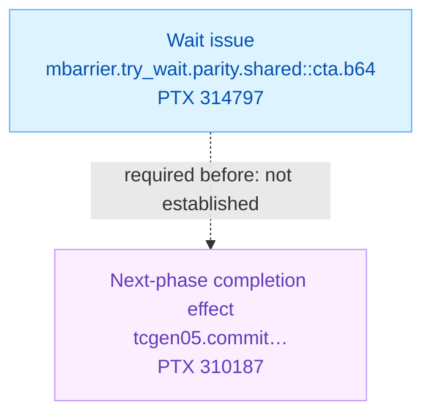

<!-- report-layout:v2 -->

<!-- verifier-result:start -->
<p align="center">cutlass77_blackwell_fmha_fp16.compute_100a</p>
<h1 align="center">SYNCHRONIZATION CANDIDATE</h1>

**Inputs:** [PTX](https://github.com/gpu-verifier/sentryward/blob/94a6b26b1990a4b9df7ded3727acc4b4cc36f23c/corpus/cutlass77_blackwell_fmha_fp16.compute_100a.ptx) · analyzed code; [input.json](https://github.com/gpu-verifier/sentryward/blob/94a6b26b1990a4b9df7ded3727acc4b4cc36f23c/examples/cutlass77_blackwell_fmha_fp16.compute_100a/input.json) · launch, arguments and assumptions.

**Result:** [output.json](https://github.com/gpu-verifier/sentryward/blob/94a6b26b1990a4b9df7ded3727acc4b4cc36f23c/examples/cutlass77_blackwell_fmha_fp16.compute_100a/output.json) · saved verifier findings.

<details>
<summary><strong>Analysis records — open the saved evidence</strong></summary>

Each record link opens its field in the original `output.json`. Model summaries are not full execution traces.

**Check the finding**

- [Diagnostic messages and details · `diagnostics`](https://github.com/gpu-verifier/sentryward/blob/94a6b26b1990a4b9df7ded3727acc4b4cc36f23c/examples/cutlass77_blackwell_fmha_fp16.compute_100a/output.json#L202)
- [Individual check outcomes · `checks`](https://github.com/gpu-verifier/sentryward/blob/94a6b26b1990a4b9df7ded3727acc4b4cc36f23c/examples/cutlass77_blackwell_fmha_fp16.compute_100a/output.json#L56)
- [Rejected synchronization requirement · `rejection`](https://github.com/gpu-verifier/sentryward/blob/94a6b26b1990a4b9df7ded3727acc4b4cc36f23c/examples/cutlass77_blackwell_fmha_fp16.compute_100a/output.json#L593)
- [Saved model replay · `counterexample`](https://github.com/gpu-verifier/sentryward/blob/94a6b26b1990a4b9df7ded3727acc4b4cc36f23c/examples/cutlass77_blackwell_fmha_fp16.compute_100a/output.json#L61)
- [Event-to-source mappings · `source_events`](https://github.com/gpu-verifier/sentryward/blob/94a6b26b1990a4b9df7ded3727acc4b4cc36f23c/examples/cutlass77_blackwell_fmha_fp16.compute_100a/output.json#L653)

**Check how the model was built**

- [PTX translation · `frontend`](https://github.com/gpu-verifier/sentryward/blob/94a6b26b1990a4b9df7ded3727acc4b4cc36f23c/examples/cutlass77_blackwell_fmha_fp16.compute_100a/output.json#L269)
- [Model and source bindings · `semantic_program`](https://github.com/gpu-verifier/sentryward/blob/94a6b26b1990a4b9df7ded3727acc4b4cc36f23c/examples/cutlass77_blackwell_fmha_fp16.compute_100a/output.json#L625)
- [Synchronization-check setup · `synchronization_input`](https://github.com/gpu-verifier/sentryward/blob/94a6b26b1990a4b9df7ded3727acc4b4cc36f23c/examples/cutlass77_blackwell_fmha_fp16.compute_100a/output.json#L972)

**Check values separately**

- [Value-analysis status · `value_analysis`](https://github.com/gpu-verifier/sentryward/blob/94a6b26b1990a4b9df7ded3727acc4b4cc36f23c/examples/cutlass77_blackwell_fmha_fp16.compute_100a/output.json#L1001)
- [Numerical comparison · `equivalence`](https://github.com/gpu-verifier/sentryward/blob/94a6b26b1990a4b9df7ded3727acc4b4cc36f23c/examples/cutlass77_blackwell_fmha_fp16.compute_100a/output.json#L223)

For the records explained in this report, see the [Evidence appendix](#evidence-appendix).

</details>

## 1. Verifier result

Saved findings and analysis scope, formatted directly from the verifier output.

### 1.1 Synchronization requirement

A synchronization check rejected the candidate model execution.

**Saved result:** <code>not_wellsynced</code> · <code>output.json#/result</code>.

**Checks:** Synchronization <code>failed</code> · Memory <code>not_run</code> · Equivalence <code>not_run</code>.

**Operation:** <code>kernel_verification</code>.

**First diagnostic:** <code>issue_not_ordered_before_next_phase</code> · <code>synchronization_check</code> · <code>output.json#/diagnostics/0</code>.

This finding concerns **barrier reuse**. The model could not establish that the wait is issued before at least one completion effect of the next barrier phase. The failed requirement is shown below.

**Checked phase:** barrier 1 · generation 0.



The dashed arrow names the failed requirement: issue before at least one listed phase effect. It does not show an observed order.

**Model replay — not an observed GPU trace:** 32 event IDs retained from an executed prefix of 1,318,836. First unexecuted event: <code>1290360</code>.

**Replay gap: 1,318,804 events not listed**; do not join the retained prefix directly to the stop point.

**Other truncated sequences:** candidate order, replayed candidate order.

<details>
<summary><strong>Locate the wait, phase effect and replay stop</strong></summary>

**Saved check:** requirement details · <code>output.json#/rejection</code>.

The listed required events are next-phase completion effects, not predecessors that the wait must follow.

| Role | Source operation | Model event / instruction |
| --- | --- | --- |
| Wait issue | <code>mbarrier.try_wait.parity.shared::cta.b64</code><br/>PTX line <code>314797</code> | <code>1290359</code> / <code>330050</code> |
| Phase effect | <code>tcgen05.commit.cta_group::1.mbarrier::arrive::one.shared::cluster.b64</code><br/>PTX line <code>310187</code> | <code>1239648</code> / <code>316627</code> |
| First unexecuted | <code>mbarrier.try_wait.parity.shared::cta.b64</code><br/>PTX line <code>314797</code> | <code>1290360</code> / <code>330050</code> |

Event and instruction IDs are model identifiers; only the separately saved source location identifies a file and line.

**Recorded source anchors.** These lines locate the saved events. Their guards and surrounding control flow belong to the code explanation.

<p><strong>Wait issue event 1290359 · saved source location</strong> · physical PTX 314797</p>

<pre><code><strong>mbarrier.try_wait.parity.shared::cta.b64</strong> P1, [%r235], %r236, %r237;</code></pre>


<p><strong>Phase effect event 1239648 · saved source location</strong> · physical PTX 310187 · display wrapping added</p>

<pre><code><strong>tcgen05.commit.cta_group::1.mbarrier::arrive::one.shared::cluster.b64</strong>
    [%r2047];</code></pre>


The saved witness does not map its events to CUDA participant columns. Exact retained sequences, candidate order and source mappings: Evidence appendix → Diagnostic records.

</details>

### 1.2 Analysis scope

**Coverage:** Memory analysis complete: **no** · Search complete: <code>not saved</code> · Exhaustive search: <code>not saved</code>.

**Assumption-dependent:** <code>true</code>. Triggered rules: Representative election.

This result applies to the supplied launch, arguments and enabled assumptions.
<!-- verifier-result:end -->

<!-- verifier-evidence:start -->
## Evidence appendix

Use these records to check the verifier result and source explanation above. JSON pointers refer to the original saved files. Identical prerequisite copies use `same_records_as` to refer to the diagnostic evidence shown once; their original locations and content hashes remain recorded.

<details>
<summary><strong>Diagnostic records — verify the finding</strong></summary>

These are saved verifier records. Truncation flags describe missing records in the original result, not merely collapsed presentation.

#### Rejected check

Wait check failed: <code>issue_not_ordered_before_next_phase</code>.

**Issue event:** <code>1290359</code> · **Barrier phase:** <code>{&quot;barrier&quot;:1,&quot;generation&quot;:0}</code> · <code>output.json#/rejection</code>

#### Model replay coverage

Each row describes one saved sequence. Truncation means events are missing from the original result; the sequences cannot be joined into an uninterrupted timeline.

| Sequence | Retained / total events | Truncated |
| --- | --- | --- |
| <code>candidate_order</code> | 32 / <code>1318900</code> | <code>true</code> |
| <code>executed_prefix</code> | 32 / <code>1318836</code> | <code>true</code> |
| <code>replayed_candidate_order</code> | 32 / <code>1318491</code> | <code>true</code> |
| <code>unexecuted_candidate</code> | 11 / <code>11</code> | <code>false</code> |

**Replay stop:** first unexecuted event <code>1290360</code>. Exact arrays and flags: <code>output.json#/counterexample</code>.

#### Event-to-source lookup

Event IDs below are lookup sets, **not execution order**. Each file is named once.

- **File 1:** <code>corpus/cutlass77_blackwell_fmha_fp16.compute_100a.ptx</code>

| File · source line / column | Event IDs | Instruction IDs |
| --- | --- | --- |
| 1 · <code>307808</code> / <code>1</code> | <code>0–6</code>, <code>3675–3681</code>, <code>7322–7328</code>, <code>10969–10975</code>, <code>14616–14619</code> | <code>0–2</code>, <code>1001–1003</code>, <code>1974–1976</code>, <code>2947–2949</code>, <code>3920</code> |
| 1 · <code>310187</code> / <code>1</code> | <code>1239648</code> | <code>316627</code> |
| 1 · <code>314797</code> / <code>1</code> | <code>1290359–1290360</code> | <code>330050</code> |
| 1 · <code>314833</code> / <code>1</code> | <code>1290361–1290362</code> | <code>330051</code> |
| 1 · <code>314870</code> / <code>1</code> | <code>1290363–1290364</code> | <code>330052</code> |
| 1 · <code>314908</code> / <code>1</code> | <code>1290365–1290366</code> | <code>330053</code> |
| 1 · <code>315329</code> / <code>1</code> | <code>1290367–1290368</code> | <code>330054</code> |
| 1 · <code>315371</code> / <code>1</code> | <code>1290369–1290370</code> | <code>330055</code> |

Exact per-event associations: <code>output.json#/source_events</code>.

#### Diagnostics

- <code>issue_not_ordered_before_next_phase</code>: Wait check failed: <code>issue_not_ordered_before_next_phase</code>.

<details>
<summary><strong>Exact diagnostic records and metadata</strong></summary>

##### Flags and empty collections

These retain their original top-level keys in `output.json`.

```json
{
  "rejection_kind": "wait_condition",
  "witness_event_lists_truncated": true,
  "witness_event_list_limit": 32,
  "source_event_scope": "reported_witness_events",
  "unmapped_witness_events": [],
  "synthetic_events": [],
  "warnings": [],
  "source_violations": [],
  "verification_limitations": []
}
```

##### Rejection

<code>output.json#/rejection</code>

```json
{
  "code": "issue_not_ordered_before_next_phase",
  "issue": 1290359,
  "message": "Wait check failed: issue_not_ordered_before_next_phase.",
  "phase": {
    "barrier": 1,
    "generation": 0
  },
  "required_events": {
    "events": [
      1239648
    ],
    "total": 1,
    "truncated": false
  }
}
```

##### Counterexample

<code>output.json#/counterexample</code>

```json
{
  "candidate_order": {
    "events": [
      0,
      3,
      1,
      2,
      4,
      5,
      6,
      3675,
      3678,
      3676,
      3677,
      3679,
      3680,
      3681,
      7322,
      7325,
      7323,
      7324,
      7326,
      7327,
      7328,
      10969,
      10972,
      10970,
      10971,
      10973,
      10974,
      10975,
      14616,
      14619,
      14617,
      14618
    ],
    "total": 1318900,
    "truncated": true
  },
  "candidate_order_preserved": true,
  "executed_prefix": {
    "events": [
      0,
      3,
      1,
      2,
      4,
      5,
      6,
      3675,
      3678,
      3676,
      3677,
      3679,
      3680,
      3681,
      7322,
      7325,
      7323,
      7324,
      7326,
      7327,
      7328,
      10969,
      10972,
      10970,
      10971,
      10973,
      10974,
      10975,
      14616,
      14619,
      14617,
      14618
    ],
    "total": 1318836,
    "truncated": true
  },
  "first_unexecuted": 1290360,
  "replayed_candidate_order": {
    "events": [
      0,
      3,
      1,
      2,
      4,
      5,
      6,
      3675,
      3678,
      3676,
      3677,
      3679,
      3680,
      3681,
      7322,
      7325,
      7323,
      7324,
      7326,
      7327,
      7328,
      10969,
      10972,
      10970,
      10971,
      10973,
      10974,
      10975,
      14616,
      14619,
      14617,
      14618
    ],
    "total": 1318491,
    "truncated": true
  },
  "unexecuted_candidate": {
    "events": [
      1290360,
      1290361,
      1290362,
      1290363,
      1290364,
      1290365,
      1290366,
      1290367,
      1290368,
      1290369,
      1290370
    ],
    "total": 11,
    "truncated": false
  }
}
```

##### Source events

<code>output.json#/source_events</code>

**Retained records:** 45.

```json
[
  {
    "column": 1,
    "event": 0,
    "file": "corpus/cutlass77_blackwell_fmha_fp16.compute_100a.ptx",
    "instruction": 0,
    "line": 307808
  },
  {
    "column": 1,
    "event": 1,
    "file": "corpus/cutlass77_blackwell_fmha_fp16.compute_100a.ptx",
    "instruction": 0,
    "line": 307808
  },
  {
    "column": 1,
    "event": 2,
    "file": "corpus/cutlass77_blackwell_fmha_fp16.compute_100a.ptx",
    "instruction": 0,
    "line": 307808
  },
  {
    "column": 1,
    "event": 3,
    "file": "corpus/cutlass77_blackwell_fmha_fp16.compute_100a.ptx",
    "instruction": 0,
    "line": 307808
  },
  {
    "column": 1,
    "event": 4,
    "file": "corpus/cutlass77_blackwell_fmha_fp16.compute_100a.ptx",
    "instruction": 1,
    "line": 307808
  },
  {
    "column": 1,
    "event": 5,
    "file": "corpus/cutlass77_blackwell_fmha_fp16.compute_100a.ptx",
    "instruction": 1,
    "line": 307808
  },
  {
    "column": 1,
    "event": 6,
    "file": "corpus/cutlass77_blackwell_fmha_fp16.compute_100a.ptx",
    "instruction": 2,
    "line": 307808
  },
  {
    "column": 1,
    "event": 3675,
    "file": "corpus/cutlass77_blackwell_fmha_fp16.compute_100a.ptx",
    "instruction": 1001,
    "line": 307808
  },
  {
    "column": 1,
    "event": 3676,
    "file": "corpus/cutlass77_blackwell_fmha_fp16.compute_100a.ptx",
    "instruction": 1001,
    "line": 307808
  },
  {
    "column": 1,
    "event": 3677,
    "file": "corpus/cutlass77_blackwell_fmha_fp16.compute_100a.ptx",
    "instruction": 1001,
    "line": 307808
  },
  {
    "column": 1,
    "event": 3678,
    "file": "corpus/cutlass77_blackwell_fmha_fp16.compute_100a.ptx",
    "instruction": 1001,
    "line": 307808
  },
  {
    "column": 1,
    "event": 3679,
    "file": "corpus/cutlass77_blackwell_fmha_fp16.compute_100a.ptx",
    "instruction": 1002,
    "line": 307808
  },
  {
    "column": 1,
    "event": 3680,
    "file": "corpus/cutlass77_blackwell_fmha_fp16.compute_100a.ptx",
    "instruction": 1002,
    "line": 307808
  },
  {
    "column": 1,
    "event": 3681,
    "file": "corpus/cutlass77_blackwell_fmha_fp16.compute_100a.ptx",
    "instruction": 1003,
    "line": 307808
  },
  {
    "column": 1,
    "event": 7322,
    "file": "corpus/cutlass77_blackwell_fmha_fp16.compute_100a.ptx",
    "instruction": 1974,
    "line": 307808
  },
  {
    "column": 1,
    "event": 7323,
    "file": "corpus/cutlass77_blackwell_fmha_fp16.compute_100a.ptx",
    "instruction": 1974,
    "line": 307808
  },
  {
    "column": 1,
    "event": 7324,
    "file": "corpus/cutlass77_blackwell_fmha_fp16.compute_100a.ptx",
    "instruction": 1974,
    "line": 307808
  },
  {
    "column": 1,
    "event": 7325,
    "file": "corpus/cutlass77_blackwell_fmha_fp16.compute_100a.ptx",
    "instruction": 1974,
    "line": 307808
  },
  {
    "column": 1,
    "event": 7326,
    "file": "corpus/cutlass77_blackwell_fmha_fp16.compute_100a.ptx",
    "instruction": 1975,
    "line": 307808
  },
  {
    "column": 1,
    "event": 7327,
    "file": "corpus/cutlass77_blackwell_fmha_fp16.compute_100a.ptx",
    "instruction": 1975,
    "line": 307808
  },
  {
    "column": 1,
    "event": 7328,
    "file": "corpus/cutlass77_blackwell_fmha_fp16.compute_100a.ptx",
    "instruction": 1976,
    "line": 307808
  },
  {
    "column": 1,
    "event": 10969,
    "file": "corpus/cutlass77_blackwell_fmha_fp16.compute_100a.ptx",
    "instruction": 2947,
    "line": 307808
  },
  {
    "column": 1,
    "event": 10970,
    "file": "corpus/cutlass77_blackwell_fmha_fp16.compute_100a.ptx",
    "instruction": 2947,
    "line": 307808
  },
  {
    "column": 1,
    "event": 10971,
    "file": "corpus/cutlass77_blackwell_fmha_fp16.compute_100a.ptx",
    "instruction": 2947,
    "line": 307808
  },
  {
    "column": 1,
    "event": 10972,
    "file": "corpus/cutlass77_blackwell_fmha_fp16.compute_100a.ptx",
    "instruction": 2947,
    "line": 307808
  },
  {
    "column": 1,
    "event": 10973,
    "file": "corpus/cutlass77_blackwell_fmha_fp16.compute_100a.ptx",
    "instruction": 2948,
    "line": 307808
  },
  {
    "column": 1,
    "event": 10974,
    "file": "corpus/cutlass77_blackwell_fmha_fp16.compute_100a.ptx",
    "instruction": 2948,
    "line": 307808
  },
  {
    "column": 1,
    "event": 10975,
    "file": "corpus/cutlass77_blackwell_fmha_fp16.compute_100a.ptx",
    "instruction": 2949,
    "line": 307808
  },
  {
    "column": 1,
    "event": 14616,
    "file": "corpus/cutlass77_blackwell_fmha_fp16.compute_100a.ptx",
    "instruction": 3920,
    "line": 307808
  },
  {
    "column": 1,
    "event": 14617,
    "file": "corpus/cutlass77_blackwell_fmha_fp16.compute_100a.ptx",
    "instruction": 3920,
    "line": 307808
  },
  {
    "column": 1,
    "event": 14618,
    "file": "corpus/cutlass77_blackwell_fmha_fp16.compute_100a.ptx",
    "instruction": 3920,
    "line": 307808
  },
  {
    "column": 1,
    "event": 14619,
    "file": "corpus/cutlass77_blackwell_fmha_fp16.compute_100a.ptx",
    "instruction": 3920,
    "line": 307808
  },
  {
    "column": 1,
    "event": 1239648,
    "file": "corpus/cutlass77_blackwell_fmha_fp16.compute_100a.ptx",
    "instruction": 316627,
    "line": 310187
  },
  {
    "column": 1,
    "event": 1290359,
    "file": "corpus/cutlass77_blackwell_fmha_fp16.compute_100a.ptx",
    "instruction": 330050,
    "line": 314797
  },
  {
    "column": 1,
    "event": 1290360,
    "file": "corpus/cutlass77_blackwell_fmha_fp16.compute_100a.ptx",
    "instruction": 330050,
    "line": 314797
  },
  {
    "column": 1,
    "event": 1290361,
    "file": "corpus/cutlass77_blackwell_fmha_fp16.compute_100a.ptx",
    "instruction": 330051,
    "line": 314833
  },
  {
    "column": 1,
    "event": 1290362,
    "file": "corpus/cutlass77_blackwell_fmha_fp16.compute_100a.ptx",
    "instruction": 330051,
    "line": 314833
  },
  {
    "column": 1,
    "event": 1290363,
    "file": "corpus/cutlass77_blackwell_fmha_fp16.compute_100a.ptx",
    "instruction": 330052,
    "line": 314870
  },
  {
    "column": 1,
    "event": 1290364,
    "file": "corpus/cutlass77_blackwell_fmha_fp16.compute_100a.ptx",
    "instruction": 330052,
    "line": 314870
  },
  {
    "column": 1,
    "event": 1290365,
    "file": "corpus/cutlass77_blackwell_fmha_fp16.compute_100a.ptx",
    "instruction": 330053,
    "line": 314908
  },
  {
    "column": 1,
    "event": 1290366,
    "file": "corpus/cutlass77_blackwell_fmha_fp16.compute_100a.ptx",
    "instruction": 330053,
    "line": 314908
  },
  {
    "column": 1,
    "event": 1290367,
    "file": "corpus/cutlass77_blackwell_fmha_fp16.compute_100a.ptx",
    "instruction": 330054,
    "line": 315329
  },
  {
    "column": 1,
    "event": 1290368,
    "file": "corpus/cutlass77_blackwell_fmha_fp16.compute_100a.ptx",
    "instruction": 330054,
    "line": 315329
  },
  {
    "column": 1,
    "event": 1290369,
    "file": "corpus/cutlass77_blackwell_fmha_fp16.compute_100a.ptx",
    "instruction": 330055,
    "line": 315371
  },
  {
    "column": 1,
    "event": 1290370,
    "file": "corpus/cutlass77_blackwell_fmha_fp16.compute_100a.ptx",
    "instruction": 330055,
    "line": 315371
  }
]
```

##### Diagnostics

<code>output.json#/diagnostics</code>

**Retained records:** 1.

```json
[
  {
    "code": "issue_not_ordered_before_next_phase",
    "details": {
      "issue": 1290359,
      "phase": {
        "barrier": 1,
        "generation": 0
      },
      "required_events": {
        "events": [
          1239648
        ],
        "total": 1,
        "truncated": false
      }
    },
    "message": "Wait check failed: issue_not_ordered_before_next_phase.",
    "stage": "synchronization_check"
  }
]
```

</details>

</details>

<details>
<summary><strong>Assumptions — what qualifies the result</strong></summary>

Enabled and triggered answer different questions: whether a rule was selected, and whether its applicability was recorded. `triggered: null` means unknown or unmeasured, not inactive.

#### Duplicate TMA stores

**Key:** <code>duplicate_tma_store_benign</code>

**Enabled:** <code>true</code> · **Triggered:** <code>null</code>

Matching same-warp duplicate TMA stores are races in the model, but are reported as warnings under the assumption that their stored values agree.

#### Representative election

**Key:** <code>representative_election</code>

**Enabled:** <code>true</code> · **Triggered:** <code>true</code>

Election selects lane zero when participating, otherwise the lowest participating lane.

#### Failed launch cancellation

**Key:** <code>clc_always_fails</code>

**Enabled:** <code>true</code> · **Triggered:** <code>false</code>

Every cluster launch cancellation request fails.

#### Representative branches

**Key:** <code>representative_branches</code>

**Enabled:** <code>false</code> · **Triggered:** <code>false</code>

Choose fallthrough for an unresolved structured if/else; unknown ordinary instruction guards execute. Terminal control uses CFG classification. Known control and explicit choices take precedence.

#### Bounded computation loops

**Key:** <code>bounded_computation_loops</code>

**Enabled:** <code>false</code> · **Triggered:** <code>false</code>

Execute a configured number of body iterations for unresolved recognized computation loops, counted separately per invocation. Polling and unclassified loops are never forced to complete.

<details>
<summary><strong>Exact assumption settings</strong></summary>

```json
{
  "assumptions": [
    {
      "category": "analysis assumption",
      "enabled": true,
      "key": "duplicate_tma_store_benign",
      "label": "Duplicate TMA stores",
      "text": "Matching same-warp duplicate TMA stores are races in the model, but are reported as warnings under the assumption that their stored values agree.",
      "triggered": null
    },
    {
      "category": "analysis assumption",
      "enabled": true,
      "key": "representative_election",
      "label": "Representative election",
      "text": "Election selects lane zero when participating, otherwise the lowest participating lane.",
      "triggered": true
    },
    {
      "category": "analysis assumption",
      "enabled": true,
      "key": "clc_always_fails",
      "label": "Failed launch cancellation",
      "text": "Every cluster launch cancellation request fails.",
      "triggered": false
    },
    {
      "category": "analysis assumption",
      "enabled": false,
      "key": "representative_branches",
      "label": "Representative branches",
      "text": "Choose fallthrough for an unresolved structured if/else; unknown ordinary instruction guards execute. Terminal control uses CFG classification. Known control and explicit choices take precedence.",
      "triggered": false
    },
    {
      "category": "analysis assumption",
      "enabled": false,
      "key": "bounded_computation_loops",
      "label": "Bounded computation loops",
      "text": "Execute a configured number of body iterations for unresolved recognized computation loops, counted separately per invocation. Polling and unclassified loops are never forced to complete.",
      "triggered": false
    }
  ],
  "semantic_assumptions": {
    "bounded_computation_loops": false,
    "clc_always_fails": true,
    "duplicate_tma_store_benign": true,
    "representative_branches": false,
    "representative_election": true
  },
  "frontend_assumptions": {
    "assertion_failure_forms": [
      "trap",
      "__assertfail"
    ],
    "assertion_uses": 0,
    "bounded_loop_uses": 0,
    "clc_failure": true,
    "clc_uses": 0,
    "data_branch_decisions": [],
    "election_policy": {
      "fallback": "lowest_member",
      "preferred_lane": 0,
      "strategy": "preferred_member"
    },
    "election_uses": 3936,
    "fixed_election": true,
    "isolated_launch": true,
    "noalias_unbounded": false,
    "opaque_compute_regions": [],
    "pointer_contract": {
      "aliasing": "distinct_objects_noalias",
      "extent_bytes": "unbounded"
    },
    "representative_branch_uses": 0,
    "trap_only_equality_assertions_hold": true
  },
  "assumption_reporting": "triggered=null means applicability was not measured or analysis was not reached",
  "assumption_dependent": true
}
```

</details>

</details>

<details>
<summary><strong>Value analysis — independent status</strong></summary>

Memory safety and numerical equivalence are separate results.

**Value analysis:** <code>unsupported</code> · <code>output.json#/value_analysis</code>

**Checks:** Synchronization <code>not_requested</code> · Memory <code>not_requested</code> · Equivalence <code>not_requested</code>.

- **Prerequisite status:** <code>not_wellsynced</code>
- **Scope:** {&quot;operation&quot;:&quot;<code>value_analysis</code>&quot;}
- **Diagnostic:** <code>prerequisite_check_not_passed</code> · <code>pipeline</code> · <code>output.json#/value_analysis/diagnostics/0</code>

**Equivalence:** <code>unsupported</code> · <code>output.json#/equivalence</code>

**Checks:** Synchronization <code>not_requested</code> · Memory <code>not_requested</code> · Equivalence <code>not_run</code>.

- **Scope:** {&quot;operation&quot;:&quot;equivalence&quot;}
- **Diagnostic:** <code>prerequisite_check_not_passed</code> · <code>pipeline</code> · <code>output.json#/equivalence/diagnostics/0</code>

<details>
<summary><strong>Exact value-analysis fields and large-data references</strong></summary>

##### Value analysis

```json
{
  "equivalence_check": "blocked",
  "prerequisite_status": "not_wellsynced",
  "result": "unsupported",
  "checks": {
    "equivalence": "not_requested",
    "memory": "not_requested",
    "synchronization": "not_requested"
  },
  "diagnostics": [
    {
      "code": "prerequisite_check_not_passed",
      "details": {
        "prerequisite_checks": {
          "equivalence": "not_run",
          "memory": "not_run",
          "synchronization": "failed"
        },
        "prerequisite_diagnostics": {
          "same_records_as": "output.json#/diagnostics",
          "stored_at": "output.json#/value_analysis/diagnostics/0/details/prerequisite_diagnostics",
          "size": "1 items",
          "canonical_json_bytes": 280,
          "canonical_json_sha256": "eb524abf84f8d8d0b466b7239b728e39df9e34502bb81925d41dc2f18ebe000d"
        },
        "prerequisite_result": "not_wellsynced",
        "prerequisite_status": "not_wellsynced"
      },
      "stage": "pipeline"
    }
  ],
  "scalar_fold": {
    "checks": {
      "equivalence": "not_requested",
      "memory": "not_requested",
      "synchronization": "not_requested"
    },
    "diagnostics": [
      {
        "code": "memory_elimination_not_completed",
        "stage": "pipeline"
      }
    ],
    "result": "unsupported",
    "scope": {
      "operation": "scalar_fold"
    }
  },
  "scope": {
    "operation": "value_analysis"
  }
}
```

##### Equivalence

```json
{
  "result": "unsupported",
  "checks": {
    "equivalence": "not_run",
    "memory": "not_requested",
    "synchronization": "not_requested"
  },
  "diagnostics": [
    {
      "code": "prerequisite_check_not_passed",
      "details": {
        "prerequisite_checks": {
          "equivalence": "not_run",
          "memory": "not_run",
          "synchronization": "failed"
        },
        "prerequisite_diagnostics": {
          "same_records_as": "output.json#/diagnostics",
          "stored_at": "output.json#/equivalence/diagnostics/0/details/prerequisite_diagnostics",
          "size": "1 items",
          "canonical_json_bytes": 280,
          "canonical_json_sha256": "eb524abf84f8d8d0b466b7239b728e39df9e34502bb81925d41dc2f18ebe000d"
        },
        "prerequisite_result": "not_wellsynced"
      },
      "stage": "pipeline"
    }
  ],
  "scope": {
    "operation": "equivalence"
  }
}
```

</details>

</details>

<details>
<summary><strong>Input configuration — reproduce this run</strong></summary>

**Launch and arguments define this run.** Tuple coordinates use `(x, y, z)`; grid and cluster dimensions count blocks, while block dimensions count threads.

| Launch quantity | Saved value |
| --- | --- |
| Grid · blocks | <code>[1,1,1]</code> |
| Block · threads | <code>[512,1,1]</code> |
| Cluster · blocks | <code>[1,1,1]</code> |
| Dynamic shared memory · bytes | <code>232448</code> |

**Arguments:** 9 retained entries. Exact parameter bindings, descriptors and entry name: <code>input.json#</code>.

<details>
<summary><strong>Exact input configuration</strong></summary>

```json
{
  "schema": "spverify.kernel-input/v1",
  "entry": "_ZN7cutlass13device_kernelINS_4fmha6kernel36Sm100FmhaFwdKernelTmaWarpspecializedIN4cute5tupleIJiiiNS5_IJNS5_IJiiEEEiEEEEEENS1_10collective38Sm100FmhaFwdMainloopTmaWarpspecializedINS_6half_tEffNS5_IJNS4_1CILi256EEENSC_ILi128EEENSC_ILi64EEEEEENS5_IJiNSC_ILi1EEES7_EEENS5_IJiSH_NS5_IJNS5_IJNSC_ILi0EEEiEEEiEEEEEESM_NS9_6NoMaskENS5_IJNSC_ILi2EEESH_SH_EEENSC_ILb0EEEEENS9_38Sm100FmhaFwdEpilogueTmaWarpspecializedISB_fNS5_IJSE_SF_SE_EEESI_NS5_IJSH_S7_EEESQ_EENS2_23IndividualTileSchedulerENS2_41Sm100FmhaCtxKernelWarpspecializedScheduleEEEEEvNT_6ParamsE",
  "launch": {
    "dynamic_shared_bytes": 232448,
    "block_dim": [
      512,
      1,
      1
    ],
    "grid_dim": [
      1,
      1,
      1
    ],
    "cluster_dim": [
      1,
      1,
      1
    ]
  },
  "arguments": [
    {
      "parameter": 0,
      "offset": 0,
      "type": "s32",
      "value": 256
    },
    {
      "parameter": 0,
      "offset": 4,
      "type": "s32",
      "value": 256
    },
    {
      "parameter": 0,
      "offset": 8,
      "type": "s32",
      "value": 64
    },
    {
      "parameter": 0,
      "offset": 12,
      "type": "s32",
      "value": 1
    },
    {
      "parameter": 0,
      "offset": 16,
      "type": "s32",
      "value": 1
    },
    {
      "parameter": 0,
      "offset": 20,
      "type": "s32",
      "value": 1
    },
    {
      "parameter": 0,
      "offset": 1288,
      "type": "s32",
      "value": 256
    },
    {
      "parameter": 0,
      "offset": 1292,
      "type": "s32",
      "value": 256
    },
    {
      "parameter": 0,
      "offset": 1296,
      "type": "s32",
      "value": 256
    }
  ],
  "declarations": [
    {
      "parameter": 0,
      "offset": 128,
      "type": "tensor_map",
      "object": "tma.q"
    },
    {
      "parameter": 0,
      "offset": 384,
      "type": "tensor_map",
      "object": "tma.k"
    },
    {
      "parameter": 0,
      "offset": 640,
      "type": "tensor_map",
      "object": "tma.v"
    },
    {
      "parameter": 0,
      "offset": 1024,
      "type": "tensor_map",
      "object": "tma.o"
    },
    {
      "parameter": 0,
      "offset": 1280,
      "type": "pointer",
      "space": "global",
      "object": "softmax_lse"
    }
  ],
  "tma_descriptors": [
    {
      "parameter": 0,
      "offset": 128,
      "object": "q",
      "element_type": "f16",
      "global_shape": [
        64,
        256,
        1,
        1,
        1
      ],
      "coordinate_strides_bytes": [
        2,
        128,
        128,
        128,
        32768
      ],
      "box_shape": [
        64,
        128,
        1,
        1,
        1
      ],
      "element_strides": [
        1,
        1,
        1,
        1,
        1
      ],
      "interleave": "none",
      "swizzle": "128B",
      "oob_fill": "zero"
    },
    {
      "parameter": 0,
      "offset": 384,
      "object": "k",
      "element_type": "f16",
      "global_shape": [
        64,
        256,
        1,
        1
      ],
      "coordinate_strides_bytes": [
        2,
        128,
        128,
        32768
      ],
      "box_shape": [
        64,
        128,
        1,
        1
      ],
      "element_strides": [
        1,
        1,
        1,
        1
      ],
      "interleave": "none",
      "swizzle": "128B",
      "oob_fill": "zero"
    },
    {
      "parameter": 0,
      "offset": 640,
      "object": "v",
      "element_type": "f16",
      "global_shape": [
        64,
        256,
        1,
        1
      ],
      "coordinate_strides_bytes": [
        2,
        128,
        128,
        32768
      ],
      "box_shape": [
        64,
        128,
        1,
        1
      ],
      "element_strides": [
        1,
        1,
        1,
        1
      ],
      "interleave": "none",
      "swizzle": "128B",
      "oob_fill": "zero"
    },
    {
      "parameter": 0,
      "offset": 1024,
      "object": "o",
      "element_type": "f16",
      "global_shape": [
        64,
        256,
        1,
        1,
        1
      ],
      "coordinate_strides_bytes": [
        2,
        128,
        128,
        128,
        32768
      ],
      "box_shape": [
        64,
        128,
        1,
        1,
        1
      ],
      "element_strides": [
        1,
        1,
        1,
        1,
        1
      ],
      "interleave": "none",
      "swizzle": "128B",
      "oob_fill": "zero"
    }
  ],
  "assumptions": {
    "duplicate_tma_store_benign": true,
    "representative_election": true,
    "clc_always_fails": true
  },
  "branch_decisions": [
    {
      "line": 313216,
      "taken": false,
      "note": "Always execute softmax correction; do not jump over the TMEM rescale update. User-enabled pattern-based scenario; analysis is conditional on this branch choice. Revisit when dynamic branch analysis is supported."
    },
    {
      "line": 313227,
      "taken": false,
      "note": "Always execute the per-lane correction multiplication; do not jump over the rescale update. User-enabled pattern-based scenario; analysis is conditional on this branch choice. Revisit when dynamic branch analysis is supported."
    },
    {
      "line": 313286,
      "taken": false,
      "note": "Always execute the per-lane correction multiplication; do not jump over the rescale update. User-enabled pattern-based scenario; analysis is conditional on this branch choice. Revisit when dynamic branch analysis is supported."
    },
    {
      "line": 313345,
      "taken": false,
      "note": "Always execute the per-lane correction multiplication; do not jump over the rescale update. User-enabled pattern-based scenario; analysis is conditional on this branch choice. Revisit when dynamic branch analysis is supported."
    },
    {
      "line": 313400,
      "taken": false,
      "note": "Always execute the per-lane correction multiplication; do not jump over the rescale update. User-enabled pattern-based scenario; analysis is conditional on this branch choice. Revisit when dynamic branch analysis is supported."
    },
    {
      "line": 313519,
      "taken": false,
      "note": "Always execute softmax correction; do not jump over the TMEM rescale update. User-enabled pattern-based scenario; analysis is conditional on this branch choice. Revisit when dynamic branch analysis is supported."
    },
    {
      "line": 313530,
      "taken": false,
      "note": "Always execute the per-lane correction multiplication; do not jump over the rescale update. User-enabled pattern-based scenario; analysis is conditional on this branch choice. Revisit when dynamic branch analysis is supported."
    },
    {
      "line": 313589,
      "taken": false,
      "note": "Always execute the per-lane correction multiplication; do not jump over the rescale update. User-enabled pattern-based scenario; analysis is conditional on this branch choice. Revisit when dynamic branch analysis is supported."
    },
    {
      "line": 313648,
      "taken": false,
      "note": "Always execute the per-lane correction multiplication; do not jump over the rescale update. User-enabled pattern-based scenario; analysis is conditional on this branch choice. Revisit when dynamic branch analysis is supported."
    },
    {
      "line": 313703,
      "taken": false,
      "note": "Always execute the per-lane correction multiplication; do not jump over the rescale update. User-enabled pattern-based scenario; analysis is conditional on this branch choice. Revisit when dynamic branch analysis is supported."
    }
  ]
}
```

</details>

</details>

<details>
<summary><strong>Provenance and coverage — check the saved run</strong></summary>

Use the original-file hashes to identify the run. Coverage flags describe what this result establishes; implementation statistics remain separate below.

**Coverage:** Memory analysis complete: **no** · Search complete: <code>not saved</code> · Exhaustive search: <code>not saved</code>.

**Assumption-dependent:** <code>true</code>. Triggered rules: Representative election.


#### Original artifacts

- **Input configuration:** [input.json](https://github.com/gpu-verifier/sentryward/blob/94a6b26b1990a4b9df7ded3727acc4b4cc36f23c/examples/cutlass77_blackwell_fmha_fp16.compute_100a/input.json) · <code>examples/cutlass77_blackwell_fmha_fp16.compute_100a/input.json</code> · SHA-256 <code>1f0595b78f7237a5dd8e3446aaaecd2fec5dc8ca0b898ff0e021ab6c562f0646</code>
- **Verifier output:** [output.json](https://github.com/gpu-verifier/sentryward/blob/94a6b26b1990a4b9df7ded3727acc4b4cc36f23c/examples/cutlass77_blackwell_fmha_fp16.compute_100a/output.json) · <code>examples/cutlass77_blackwell_fmha_fp16.compute_100a/output.json</code> · SHA-256 <code>11725de9e0a2a53ec6571e6b4c7cd264b7d49c8909e322f84e382a254d847df1</code>
- **PTX:** [cutlass77_blackwell_fmha_fp16.compute_100a.ptx](https://github.com/gpu-verifier/sentryward/blob/94a6b26b1990a4b9df7ded3727acc4b4cc36f23c/corpus/cutlass77_blackwell_fmha_fp16.compute_100a.ptx) · <code>corpus/cutlass77_blackwell_fmha_fp16.compute_100a.ptx</code> · SHA-256 <code>0a33644edd13e4ab2bc599e8a79a0acb2634b6caf224742df8a3a55730197404</code>

Large structures are referenced by exact JSON pointer, item count and SHA-256 of their canonical JSON (UTF-8, sorted keys, compact separators). Original-artifact hashes above are hashes of the file bytes.

<details>
<summary><strong>Exact coverage, implementation and provenance fields</strong></summary>

```json
{
  "address_model": {
    "address_invariants": [],
    "kind": "symbolic",
    "layers": [
      0,
      2
    ],
    "solver": "z3",
    "solver_timeout_ms": 100
  },
  "checks": {
    "equivalence": "not_run",
    "memory": "not_run",
    "synchronization": "failed"
  },
  "counts": {
    "edges": 2981284,
    "events": 1318847,
    "instructions": 339091,
    "threads": 512
  },
  "frontend": {
    "address_value_bridge": {
      "diagnostics": [
        {
          "code": "opaque_compute_diamond",
          "details": {
            "cta": 0,
            "instruction": "@%p89 bra $L__BB37_206;",
            "instruction_index": 3060,
            "location": {
              "file": "corpus/cutlass77_blackwell_fmha_fp16.compute_100a.ptx",
              "line": 313193
            },
            "occurrence": 0,
            "thread": 257
          },
          "message": "Execution skipped an unresolved compute diamond; its values and any private-memory reads are not exported",
          "stage": "value_lowering"
        }
      ],
      "first_unavailable_reason": "",
      "queries": 0,
      "resolved": 0,
      "source": "value_lowering",
      "unavailable": 0,
      "value_view_complete": false
    },
    "branch_scope_capture": {
      "reason": "branch scope requires complete original emission",
      "status": "unavailable"
    },
    "cluster_completion_joins": 0,
    "cta_count": 1,
    "dependency_compression": {
      "bulk_read_wait": {
        "consumers": 64,
        "emitted_references": 2,
        "original_references": 3,
        "prefix_effects": 0
      },
      "tcgen_commit": {
        "consumers": 16,
        "emitted_references": 79,
        "original_references": 488,
        "prefix_effects": 16
      },
      "tcgen_load_wait": {
        "consumers": 256,
        "emitted_references": 2560,
        "original_references": 4480,
        "prefix_effects": 0
      },
      "tcgen_store_wait": {
        "consumers": 768,
        "emitted_references": 2560,
        "original_references": 3840,
        "prefix_effects": 0
      }
    },
    "diagnostic_sample_count": 0,
    "discharged_codes": [
      "mma_memory_effect_refinement",
      "tcgen_pipeline_effect_refinement",
      "tcgen_commit_notification_order_refinement"
    ],
    "executed_records": 568524,
    "frontend_assumptions": {
      "assertion_failure_forms": [
        "trap",
        "__assertfail"
      ],
      "assertion_uses": 0,
      "bounded_loop_uses": 0,
      "clc_failure": true,
      "clc_uses": 0,
      "data_branch_decisions": [],
      "election_policy": {
        "fallback": "lowest_member",
        "preferred_lane": 0,
        "strategy": "preferred_member"
      },
      "election_uses": 3936,
      "fixed_election": true,
      "isolated_launch": true,
      "noalias_unbounded": false,
      "opaque_compute_regions": [],
      "pointer_contract": {
        "aliasing": "distinct_objects_noalias",
        "extent_bytes": "unbounded"
      },
      "representative_branch_uses": 0,
      "trap_only_equality_assertions_hold": true
    },
    "implementation": "cpp",
    "input_objects": [
      {
        "bytes": 8,
        "object": "softmax_lse",
        "offset": 1280,
        "parameter": "_ZN7cutlass13device_kernelINS_4fmha6kernel36Sm100FmhaFwdKernelTmaWarpspecializedIN4cute5tupleIJiiiNS5_IJNS5_IJiiEEEiEEEEEENS1_10collective38Sm100FmhaFwdMainloopTmaWarpspecializedINS_6half_tEffNS5_IJNS4_1CILi256EEENSC_ILi128EEENSC_ILi64EEEEEENS5_IJiNSC_ILi1EEES7_EEENS5_IJiSH_NS5_IJNS5_IJNSC_ILi0EEEiEEEiEEEEEESM_NS9_6NoMaskENS5_IJNSC_ILi2EEESH_SH_EEENSC_ILb0EEEEENS9_38Sm100FmhaFwdEpilogueTmaWarpspecializedISB_fNS5_IJSE_SF_SE_EEESI_NS5_IJSH_S7_EEESQ_EENS2_23IndividualTileSchedulerENS2_41Sm100FmhaCtxKernelWarpspecializedScheduleEEEEEvNT_6ParamsE_param_0",
        "source": "declaration"
      }
    ],
    "lowered_instruction_count": 339091,
    "mma_refinement": {
      "blocked": [],
      "discharged": 48
    },
    "reached_opcodes": {
      "add.f32x2": 34304,
      "add.ftz.f32": 512,
      "add.s32": 18470,
      "add.s64": 2378,
      "and.b32": 1120,
      "and.b64": 2048,
      "bar.sync": 512,
      "bar.warp.sync": 32,
      "bra": 11815,
      "bra.uni": 769,
      "cp.async.bulk.commit_group": 64,
      "cp.async.bulk.tensor.4d.shared::cluster.global.mbarrier::complete_tx::bytes.L2::cache_hint": 4,
      "cp.async.bulk.tensor.5d.global.shared::cta.bulk_group": 2,
      "cp.async.bulk.tensor.5d.shared::cluster.global.mbarrier::complete_tx::bytes.L2::cache_hint": 2,
      "cp.async.bulk.wait_group.read": 64,
      "cvt.rn.f16x2.f32": 40960,
      "cvt.u64.u32": 192,
      "cvta.local.u64": 512,
      "cvta.param.u64": 40,
      "cvta.shared.u64": 128,
      "cvta.to.global.u64": 128,
      "div.approx.ftz.f32": 256,
      "div.u32": 320,
      "elect.sync": 3936,
      "ex2.approx.ftz.f32": 65536,
      "fence.mbarrier_init.release.cluster": 4608,
      "fence.proxy.async.shared::cta": 256,
      "fma.rn.f32x2": 32768,
      "fma.rn.ftz.f32": 256,
      "ld.param.b32": 1376,
      "ld.param.b64": 416,
      "ld.param.v2.b32": 160,
      "ld.param.v4.b32": 128,
      "ld.shared.b32": 32,
      "lg2.approx.ftz.f32": 256,
      "mad.lo.s32": 768,
      "mapa.shared::cluster.u32": 2112,
      "max.ftz.f32": 67072,
      "mbarrier.arrive.expect_tx.shared::cta.b64": 6,
      "mbarrier.arrive.shared::cluster.b64": 2112,
      "mbarrier.arrive.shared::cta.b64": 1536,
      "mbarrier.init.shared::cta.b64": 28,
      "mbarrier.try_wait.parity.shared::cta.b64": 4608,
      "min.s32": 32,
      "mov.b32": 24625,
      "mov.b64": 137117,
      "mov.pred": 4608,
      "mov.s32": 4059,
      "mov.u32": 12128,
      "mul.f32x2": 16384,
      "mul.ftz.f32": 1280,
      "mul.lo.s32": 320,
      "mul.wide.u16": 256,
      "mul.wide.u32": 384,
      "neg.ftz.f32": 512,
      "neg.s32": 32,
      "not.pred": 1792,
      "or.b32": 2304,
      "or.b64": 96,
      "or.pred": 1824,
      "prefetch.tensormap": 4,
      "ret": 512,
      "selp.b16": 256,
      "selp.b32": 9280,
      "selp.f32": 512,
      "setmaxnreg.dec.sync.aligned.u32": 256,
      "setmaxnreg.inc.sync.aligned.u32": 256,
      "setp.eq.b32": 6080,
      "setp.eq.b64": 256,
      "setp.eq.ftz.f32": 2304,
      "setp.ge.s32": 256,
      "setp.ge.u32": 448,
      "setp.gt.s32": 544,
      "setp.gt.u32": 640,
      "setp.lt.s32": 448,
      "setp.lt.u32": 480,
      "setp.ne.b32": 5648,
      "setp.neu.ftz.f32": 256,
      "shfl.sync.idx.b32": 7168,
      "shl.b32": 1893,
      "shr.s32": 1152,
      "shr.u32": 1536,
      "shr.u64": 2048,
      "st.global.b32": 256,
      "st.v4.b32": 2048,
      "sub.s32": 352,
      "tcgen05.alloc.cta_group::1.sync.aligned.shared::cta.b32": 32,
      "tcgen05.commit.cta_group::1.mbarrier::arrive::one.shared::cluster.b64": 16,
      "tcgen05.dealloc.cta_group::1.sync.aligned.b32": 32,
      "tcgen05.ld.sync.aligned.32x32b.x16.b32": 2048,
      "tcgen05.ld.sync.aligned.32x32b.x2.b32": 512,
      "tcgen05.ld.sync.aligned.32x32b.x32.b32": 2048,
      "tcgen05.mma.cta_group::1.kind::f16": 48,
      "tcgen05.st.sync.aligned.32x32b.x16.b32": 1024,
      "tcgen05.st.sync.aligned.32x32b.x2.b32": 768,
      "tcgen05.st.sync.aligned.32x32b.x32.b32": 1024,
      "tcgen05.wait::ld.sync.aligned": 256,
      "tcgen05.wait::st.sync.aligned": 768,
      "vote.sync.any.pred": 256,
      "xor.b32": 2400,
      "xor.b64": 2048
    },
    "shared_constant_propagation": {
      "read_from_dependencies": 0,
      "representation": "sparse_known_bytes",
      "validation": "pending_backend"
    },
    "source_binding_storage": {
      "binding_templates": 33,
      "generated_address_rows": 0,
      "generated_body_rows": 0,
      "generated_memory_instances": 0,
      "logical_instructions": 339091,
      "stored_bindings": 21526
    },
    "source_edge_storage": {
      "binding_templates": 946,
      "logical_edges": 338579,
      "stored_bindings": 946
    },
    "tcgen_history_refinement": {
      "blocked": [],
      "notifications": 16,
      "operations": 48
    },
    "thread_count": 512,
    "unsupported_occurrence_counts": {},
    "user_branch_decisions": [
      {
        "line": 313216,
        "note": "Always execute softmax correction; do not jump over the TMEM rescale update. User-enabled pattern-based scenario; analysis is conditional on this branch choice. Revisit when dynamic branch analysis is supported.",
        "taken": false
      },
      {
        "line": 313227,
        "note": "Always execute the per-lane correction multiplication; do not jump over the rescale update. User-enabled pattern-based scenario; analysis is conditional on this branch choice. Revisit when dynamic branch analysis is supported.",
        "taken": false
      },
      {
        "line": 313286,
        "note": "Always execute the per-lane correction multiplication; do not jump over the rescale update. User-enabled pattern-based scenario; analysis is conditional on this branch choice. Revisit when dynamic branch analysis is supported.",
        "taken": false
      },
      {
        "line": 313345,
        "note": "Always execute the per-lane correction multiplication; do not jump over the rescale update. User-enabled pattern-based scenario; analysis is conditional on this branch choice. Revisit when dynamic branch analysis is supported.",
        "taken": false
      },
      {
        "line": 313400,
        "note": "Always execute the per-lane correction multiplication; do not jump over the rescale update. User-enabled pattern-based scenario; analysis is conditional on this branch choice. Revisit when dynamic branch analysis is supported.",
        "taken": false
      },
      {
        "line": 313519,
        "note": "Always execute softmax correction; do not jump over the TMEM rescale update. User-enabled pattern-based scenario; analysis is conditional on this branch choice. Revisit when dynamic branch analysis is supported.",
        "taken": false
      },
      {
        "line": 313530,
        "note": "Always execute the per-lane correction multiplication; do not jump over the rescale update. User-enabled pattern-based scenario; analysis is conditional on this branch choice. Revisit when dynamic branch analysis is supported.",
        "taken": false
      },
      {
        "line": 313589,
        "note": "Always execute the per-lane correction multiplication; do not jump over the rescale update. User-enabled pattern-based scenario; analysis is conditional on this branch choice. Revisit when dynamic branch analysis is supported.",
        "taken": false
      },
      {
        "line": 313648,
        "note": "Always execute the per-lane correction multiplication; do not jump over the rescale update. User-enabled pattern-based scenario; analysis is conditional on this branch choice. Revisit when dynamic branch analysis is supported.",
        "taken": false
      },
      {
        "line": 313703,
        "note": "Always execute the per-lane correction multiplication; do not jump over the rescale update. User-enabled pattern-based scenario; analysis is conditional on this branch choice. Revisit when dynamic branch analysis is supported.",
        "taken": false
      }
    ]
  },
  "implementation": "cpp",
  "memory_analysis_complete": false,
  "mma_operand_ordering": {},
  "mode": "verify",
  "peak_footprint_mib": 885.3125,
  "peak_rss_mib": 885.68359375,
  "pipeline_elapsed_seconds": 7.435162335,
  "provenance_events_total": 1318900,
  "required_order_domains": 7706,
  "required_orders": 246592,
  "result": "not_wellsynced",
  "rss_limit_mib": null,
  "schema": "spverify.native-result/v1",
  "scope": {
    "operation": "kernel_verification"
  },
  "semantic_program": {
    "binding_diagnostic_count": 1,
    "binding_diagnostics": [
      {
        "code": "incomplete_value_semantics",
        "message": "opaque_compute_diamond: Execution skipped an unresolved compute diamond; its values and any private-memory reads are not exported"
      }
    ],
    "execution_cohorts": 31,
    "mapping_complete": false,
    "memory_binding_stored_rows": 0,
    "memory_binding_templates": 0,
    "memory_bindings": 0,
    "memory_linking_templates_used": false,
    "synchronization_groups": 8230,
    "synchronization_groups_materialized": true,
    "synthetic_synchronization_nodes": 233,
    "thread_prefix_groups": 7193,
    "value_diagnostic_count": 1,
    "value_diagnostics": [
      {
        "code": "opaque_compute_diamond",
        "line": 313193,
        "message": "Execution skipped an unresolved compute diamond; its values and any private-memory reads are not exported"
      }
    ]
  },
  "stage": "synchronization_check",
  "synchronization_input": {
    "compute_access_binding": "after_happens_before",
    "kind": "ordering_endpoints",
    "memory_address_payloads": false
  },
  "template_execution": {
    "completed_ctas": 1,
    "coordinate_bindings": 0,
    "logical_thread_steps": 576522,
    "path_entries": 14702,
    "record_bindings": 25009,
    "record_nodes": 14272,
    "splits": 15,
    "template_steps": 14556,
    "thread_memberships": 512,
    "value_nodes": 13317
  },
  "thread_record_compression": {
    "completed_ctas": 1,
    "enabled": true,
    "estimated_pool_bytes_sum": 0,
    "intern_calls": 0,
    "logical_records": 568524,
    "record_handle_bytes": 32,
    "templates": 0,
    "unique_bindings": 0
  },
  "value_ir_instance_count": 70590,
  "value_ir_node_count": 4678,
  "value_view_complete": false,
  "wellsync_timeout_seconds": 500.0,
  "whole_pipeline_timeout_seconds": 500.0
}
```

</details>

</details>

<!-- verifier-evidence:end -->
