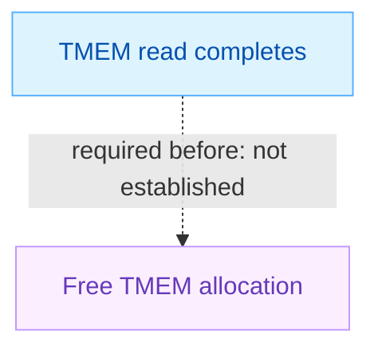
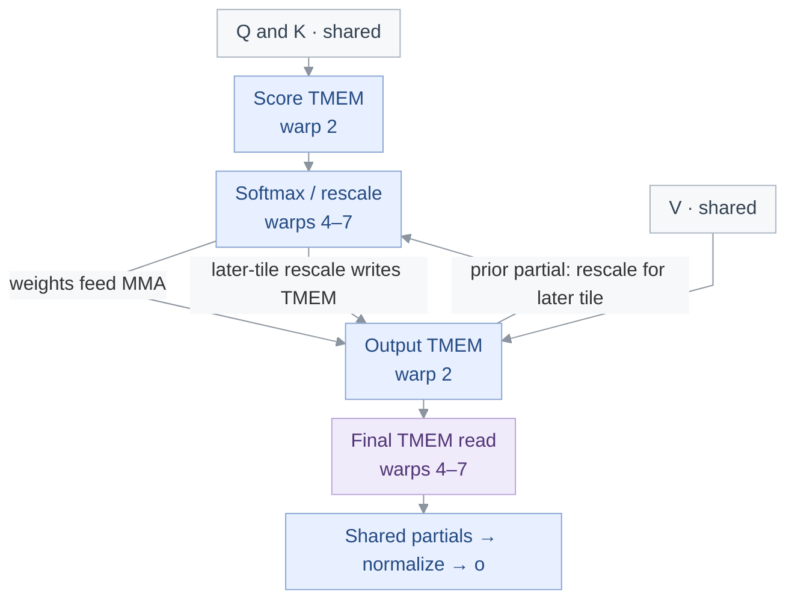
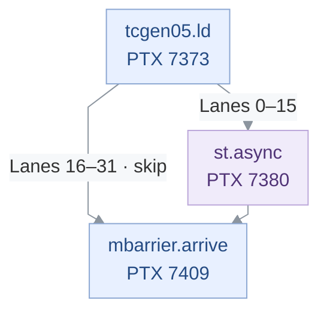
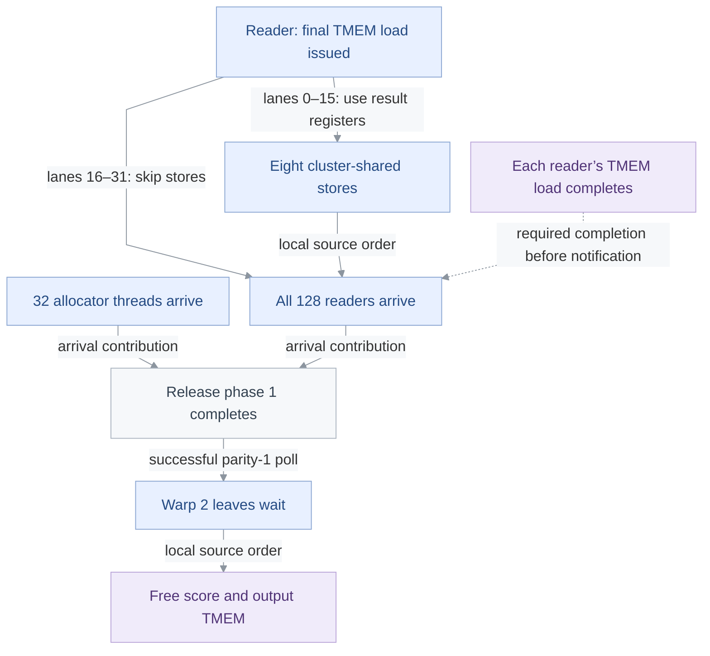
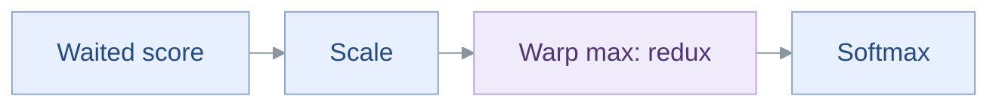

<!-- report-layout:v2 -->

<!-- verifier-result:start -->
<p align="center">Blackwell low-latency GQA</p>
<h1 align="center">LIFECYCLE ORDERING MISSING</h1>

**Inputs:** [PTX](https://github.com/gpu-verifier/sentryward/blob/94a6b26b1990a4b9df7ded3727acc4b4cc36f23c/corpus/cutlass93_blackwell_low_latency_gqa.compute_100a.ptx) · analyzed code; [input.json](https://github.com/gpu-verifier/sentryward/blob/94a6b26b1990a4b9df7ded3727acc4b4cc36f23c/examples/cutlass93_blackwell_low_latency_gqa.compute_100a/input.json) · launch, arguments and assumptions.

**Result:** [output.json](https://github.com/gpu-verifier/sentryward/blob/94a6b26b1990a4b9df7ded3727acc4b4cc36f23c/examples/cutlass93_blackwell_low_latency_gqa.compute_100a/output.json) · saved verifier findings.

<details>
<summary><strong>Analysis records — open the saved evidence</strong></summary>

Each record link opens its field in the original `output.json`. Model summaries are not full execution traces.

**Check the finding**

- [Diagnostic messages and details · `diagnostics`](https://github.com/gpu-verifier/sentryward/blob/94a6b26b1990a4b9df7ded3727acc4b4cc36f23c/examples/cutlass93_blackwell_low_latency_gqa.compute_100a/output.json#L67)
- [Individual check outcomes · `checks`](https://github.com/gpu-verifier/sentryward/blob/94a6b26b1990a4b9df7ded3727acc4b4cc36f23c/examples/cutlass93_blackwell_low_latency_gqa.compute_100a/output.json#L56)
- [Failed lifecycle orders · `failed_required_orders`](https://github.com/gpu-verifier/sentryward/blob/94a6b26b1990a4b9df7ded3727acc4b4cc36f23c/examples/cutlass93_blackwell_low_latency_gqa.compute_100a/output.json#L1340)

**Check how the model was built**

- [PTX translation · `frontend`](https://github.com/gpu-verifier/sentryward/blob/94a6b26b1990a4b9df7ded3727acc4b4cc36f23c/examples/cutlass93_blackwell_low_latency_gqa.compute_100a/output.json#L1953)
- [Model and source bindings · `semantic_program`](https://github.com/gpu-verifier/sentryward/blob/94a6b26b1990a4b9df7ded3727acc4b4cc36f23c/examples/cutlass93_blackwell_low_latency_gqa.compute_100a/output.json#L2292)
- [Synchronization-check setup · `synchronization_input`](https://github.com/gpu-verifier/sentryward/blob/94a6b26b1990a4b9df7ded3727acc4b4cc36f23c/examples/cutlass93_blackwell_low_latency_gqa.compute_100a/output.json#L2321)

**Check values separately**

- [Value-analysis status · `value_analysis`](https://github.com/gpu-verifier/sentryward/blob/94a6b26b1990a4b9df7ded3727acc4b4cc36f23c/examples/cutlass93_blackwell_low_latency_gqa.compute_100a/output.json#L2348)
- [Numerical comparison · `equivalence`](https://github.com/gpu-verifier/sentryward/blob/94a6b26b1990a4b9df7ded3727acc4b4cc36f23c/examples/cutlass93_blackwell_low_latency_gqa.compute_100a/output.json#L689)

For the records explained in this report, see the [Evidence appendix](#evidence-appendix).

</details>

## 1. Verifier result

Saved findings and analysis scope, formatted directly from the verifier output.

### 1.1 Required lifecycle order

A required lifecycle happens-before relation is absent in the analyzed model.

**Saved result:** <code>invalid_lifecycle</code> · <code>output.json#/result</code>.

**Checks:** Synchronization <code>incomplete</code> · Memory <code>not_run</code> · Equivalence <code>not_run</code>.

**Operation:** <code>kernel_verification</code>.

**First diagnostic:** <code>access_completion_before_deallocation_not_proven</code> · <code>lifecycle_check</code> · <code>output.json#/diagnostics/0</code>.

tcgen05.load must complete before the allocation is deallocated



The dashed arrow is a failed requirement in the analyzed model, not a recorded execution sequence.

**Failed orders:** 131,072 reported; 32 records retained; truncated: <code>true</code>.

**Source attribution:** the retained orders do not map these model instructions to physical PTX sites or CUDA issuers.

<details>
<summary><strong>Check the required order and retained instruction IDs</strong></summary>

**Requirement:** <code>access_completion_before_dealloc</code> · <code>output.json#/failed_required_orders/0</code>.

| Required role | Model instruction |
| --- | --- |
| TMEM read completes | <code>15736</code> |
| Free TMEM allocation | <code>3546</code> |

Instruction IDs refer to model instructions, not physical PTX lines. The operation roles above come from the saved requirement and message. All retained orders and effect lists are in Evidence appendix → Diagnostic records.

</details>

### 1.2 Analysis scope

**Coverage:** Memory analysis complete: **no** · Search complete: <code>not saved</code> · Exhaustive search: <code>not saved</code>.

**Assumption-dependent:** <code>true</code>. Triggered rules: Representative election.

This result applies to the supplied launch, arguments and enabled assumptions.
<!-- verifier-result:end -->

<!-- code-explanation:start -->

---

## 2. Code explanation

Interpretation from the PTX and saved inputs: how the reported operations fit together and what remains to check.

### 2.1 Where the TMEM read fits in attention

This GQA kernel forms query–key scores, converts them into softmax weights, and accumulates weighted values in tensor memory (TMEM). Warp 2 allocates and frees the score and output accumulators; warps 4–7 read them. The final output-accumulator read is the useful source focus for the release question. The retained model instruction IDs have no supplied PTX or issuer binding, so this walkthrough does not identify them with that site. With the saved sequence length and scalar inputs, every CTA has two 128-key tiles to process; the zero-work exits are not taken.



Arrows show data dependencies, not execution order or completion. The feedback edge is the later-tile rescaling of the existing output accumulator. TMEM release occurs after the final-read notification while shared-memory output processing can still continue.

<details>
<summary><strong>Check the workload, roles and accumulator journey</strong></summary>

#### Why two tiles really execute

The batch index is `ctaid.x / 8 = 0`, so thread 0 stages `seq_len[0] = 2048` at shared offset `108148`; its copy wait and the cluster barrier precede the shared read. Parameter 12 is zero. Substitution in the partition arithmetic gives `r205 = 2048`, `r210 = 16`, `r213 = 2`, `r217 = 0`, and therefore work count `r11 = 2` and start tile `r14 = 2 × ctaid.z`. The eight z positions cover keys `256z…256z+255`. In the reader loop the counter starts at −2 and reaches zero after two iterations. Thus the exits at 5496–5501, 6583 and 6801 do not bypass this work.

#### Which threads own the protocol

The thread selector comes from `%tid.x`, shifted right by five and broadcast within a warp. The dispatch selects warp 2 for allocation/MMA/release, warp 1 for K/V loads, warp 0 for Q loads, and warps 4–7 for the reader path; warp 3 branches to the final CTA barrier. With a 256-thread block, the release handshake therefore includes 32 allocator threads and 128 readers. Allocation and arrival are outside the elected-lane blocks used for individual MMA/commit instructions.

<p><strong>Thread-derived roles</strong> · <a href="https://github.com/gpu-verifier/sentryward/blob/94a6b26b1990a4b9df7ded3727acc4b4cc36f23c/corpus/cutlass93_blackwell_low_latency_gqa.compute_100a.ptx#L4135-L6575" title="Open the original PTX">physical PTX 4135–6575 (selected lines; gaps marked)</a></p>

<pre><code><strong>mov.u32</strong> %r5, <strong>%tid.x</strong>;
…
<strong>shr.u32</strong> %r133, %r5, 5;
<strong>shfl.sync.idx.b32</strong> <strong>%r6</strong>|%p2, %r133, 0, 31, -1;
<strong>setp.ne.b32</strong> %p3, <strong>%r6</strong>, 0;
@%p3 <strong>bra</strong> $L__BB4_21;
…
<strong>setp.eq.b32</strong> %p19, <strong>%r6</strong>, 2;
@%p19 <strong>bra</strong> $L__BB4_80;
<strong>setp.eq.b32</strong> %p20, <strong>%r6</strong>, 1;
@%p20 <strong>bra</strong> $L__BB4_46;
<strong>setp.ne.b32</strong> %p21, <strong>%r6</strong>, 0;
@%p21 <strong>bra</strong> $L__BB4_150;
<strong>setp.lt.s32</strong> %p86, %r11, 1;
@%p86 <strong>bra</strong> $L__BB4_219;
…
<strong>setp.lt.s32</strong> %p103, <strong>%r6</strong>, 4;
@%p103 <strong>bra</strong> $L__BB4_219;
<strong>setp.lt.s32</strong> %p104, %r11, 1;</code></pre>


#### How the two accumulators are used

Q and K TMA destinations feed the first MMA accumulator, whose handle is stored at shared offset `108128`; the output accumulator handle is at `108144`. Each allocation requests 32 TMEM columns, not 32 bytes. Score MMA starts with accumulation disabled for each tile. Readers explicitly wait for the score load, scale the values, compute maxima and exponentials, and stage BF16 weights in shared memory. The first weighted-value MMA initializes the output accumulator; the final tile accumulates into it. Between tiles, readers load, rescale and write the previous output partial. The final read stages cluster-shared partials; the subsequent shared reductions and division produce the global BF16 output `o`.

<details>
<summary><strong>Exact source references</strong></summary>

##### Why two tiles really execute

- `input.json#/arguments/10`: <code>{&quot;parameter&quot;:0,&quot;offset&quot;:8,&quot;type&quot;:&quot;s32&quot;,&quot;value&quot;:8}</code>
- `input.json#/arguments/15`: <code>{&quot;parameter&quot;:12,&quot;type&quot;:&quot;u32&quot;,&quot;value&quot;:0}</code>
- `input.json#/shape_arrays/0/shapes`: <code>[[2048]]</code>
- `input.json#/launch/grid_dim`: <code>[8,1,8]</code>
- physical PTX 4119-4143: <code>ld.param.b32</code>, <code>cp.async.ca.shared.global.L2::128B</code>
- physical PTX 4426-4480: <code>@%p13</code>, <code>add.s32</code>
- physical PTX 5496-5501: <code>setp.gt.s32</code>, <code>bra.uni</code>
- physical PTX 6573-6605: <code>setp.lt.s32</code>, <code>bra</code>
- physical PTX 6790-6801: <code>setp.lt.s32</code>, <code>@%p110</code>
- physical PTX 6870-6894: <code>neg.s32</code>, <code>mov.b32</code>
- physical PTX 7277-7294: <code>add.s32</code>, <code>@%p144</code>

##### Which threads own the protocol

- `input.json#/launch/block_dim`: <code>[256,1,1]</code>
- physical PTX 4135-4150: <code>mov.u32</code>, <code>@%p3</code>
- physical PTX 4486-4493: <code>setp.eq.b32</code>, <code>@%p86</code>
- physical PTX 4805-4807: <code>setp.lt.s32</code>, <code>@%p61</code>
- physical PTX 5495-5536: <code>setp.gt.s32</code>, <a href="https://docs.nvidia.com/cuda/archive/13.2.0/parallel-thread-execution/index.html#parallel-synchronization-and-communication-instructions-mbarrier-arrive"><code>mbarrier.arrive.shared::cta.b64</code></a>
- physical PTX 6571-6589: <code>bra.uni</code>, <a href="https://docs.nvidia.com/cuda/archive/13.2.0/parallel-thread-execution/index.html#parallel-synchronization-and-communication-instructions-mbarrier-arrive"><code>mbarrier.arrive.shared::cta.b64</code></a>

##### How the two accumulators are used

- `input.json#/declarations`: <code>list, 5 entries; see original artifact</code>
- `input.json#/tma_descriptors`: <code>list, 3 entries; see original artifact</code>
- physical PTX 4121-4132: <code>ld.param.b64</code>, <code>ld.param.b32</code>
- physical PTX 4534-4539: <code>cvta.param.u64</code>, <a href="https://docs.nvidia.com/cuda/archive/13.2.0/parallel-thread-execution/index.html#data-movement-and-conversion-instructions-cp-async-bulk-tensor"><code>cp.async.bulk.tensor.5d.shared::cluster.global.mbarrier::complete_tx::bytes.L2::cache_hint</code></a>
- physical PTX 4845-4857: <code>cvta.param.u64</code>
- physical PTX 4992: <a href="https://docs.nvidia.com/cuda/archive/13.2.0/parallel-thread-execution/index.html#data-movement-and-conversion-instructions-cp-async-bulk-tensor"><code>cp.async.bulk.tensor.4d.shared::cluster.global.mbarrier::complete_tx::bytes.L2::cache_hint</code></a>
- physical PTX 5503-5544: <code>mov.b32</code>, <code>ld.shared.b32</code>
- physical PTX 5575-5579: <code>setp.ne.b32</code>, <a href="https://docs.nvidia.com/cuda/archive/13.2.0/parallel-thread-execution/index.html#tcgen05-mma-instructions"><code>tcgen05.mma.cta_group::1.kind::f16</code></a>
- physical PTX 5781-5786: <code>mov.b32</code>, <a href="https://docs.nvidia.com/cuda/archive/13.2.0/parallel-thread-execution/index.html#tcgen05-mma-instructions"><code>tcgen05.mma.cta_group::1.kind::f16</code></a>
- physical PTX 5740-5745: <code>neg.s32</code>, <code>mov.b32</code>
- physical PTX 5952-5961: <code>setp.ne.b32</code>, <a href="https://docs.nvidia.com/cuda/archive/13.2.0/parallel-thread-execution/index.html#tcgen05-mma-instructions"><code>tcgen05.mma.cta_group::1.kind::f16</code></a>
- physical PTX 6258-6267: <code>setp.ne.b32</code>, <a href="https://docs.nvidia.com/cuda/archive/13.2.0/parallel-thread-execution/index.html#tcgen05-mma-instructions"><code>tcgen05.mma.cta_group::1.kind::f16</code></a>
- physical PTX 6607-6616: <code>ld.shared.b32</code>, <code>add.s32</code>
- physical PTX 6910-6915: <a href="https://docs.nvidia.com/cuda/archive/13.2.0/parallel-thread-execution/index.html#tcgen05-instructions-tcgen05-ld"><code>tcgen05.ld.sync.aligned.32x32b.x8.b32</code></a>, <a href="https://docs.nvidia.com/cuda/archive/13.2.0/parallel-thread-execution/index.html#tcgen05-instructions-tcgen05-wait"><code>tcgen05.wait::ld.sync.aligned</code></a>
- physical PTX 6960-6973: <code>mul.f32</code>, <code>st.shared.b32</code>
- physical PTX 7115-7247: <code>shfl.sync.idx.b32</code>, <a href="https://docs.nvidia.com/cuda/archive/13.2.0/parallel-thread-execution/index.html#tcgen05-instructions-tcgen05-wait"><code>tcgen05.wait::st.sync.aligned</code></a>
- physical PTX 7373-7409: <a href="https://docs.nvidia.com/cuda/archive/13.2.0/parallel-thread-execution/index.html#tcgen05-instructions-tcgen05-ld"><code>tcgen05.ld.sync.aligned.32x32b.x8.b32</code></a>, <a href="https://docs.nvidia.com/cuda/archive/13.2.0/parallel-thread-execution/index.html#parallel-synchronization-and-communication-instructions-mbarrier-arrive"><code>mbarrier.arrive.shared::cta.b64</code></a>
- physical PTX 7424-7510: <a href="https://docs.nvidia.com/cuda/archive/13.2.0/parallel-thread-execution/index.html#parallel-synchronization-and-communication-instructions-mbarrier-test-wait-try-wait"><code>mbarrier.try_wait.parity.shared::cta.b64</code></a>, <code>st.global.b16</code>

##### Additional section references

- physical PTX 4121-4135: <code>ld.param.b64</code>, <code>mov.u32</code>
- physical PTX 5523-5544: <code>add.s32</code>, <code>ld.shared.b32</code>
- physical PTX 5960-5961: <code>setp.ne.b32</code>, <a href="https://docs.nvidia.com/cuda/archive/13.2.0/parallel-thread-execution/index.html#tcgen05-mma-instructions"><code>tcgen05.mma.cta_group::1.kind::f16</code></a>
- physical PTX 6573-6608: <code>setp.lt.s32</code>, <code>ld.shared.b32</code>
- physical PTX 7373-7512: <a href="https://docs.nvidia.com/cuda/archive/13.2.0/parallel-thread-execution/index.html#tcgen05-instructions-tcgen05-ld"><code>tcgen05.ld.sync.aligned.32x32b.x8.b32</code></a>, <code>bar.sync</code>
- `output.json#/failed_required_orders/0`: <code>dict, 8 entries; see original artifact</code>

</details>

</details>

### 2.2 Final read: half the lanes bypass result use

After the final output MMA is ready, all four reader warps issue the TMEM load. Lanes 0–15 in each warp use its eight result registers in cluster-shared stores; lanes 16–31 skip those stores. Both paths reach the same release arrival, with no intervening load-completion wait. This establishes a load-issue-to-arrival path, but the skipped stores cannot establish completion of the bypassing lanes’ reads. Another lane receiving its result registers does not establish completion of the bypassing lanes’ reads. The relevant question is whether those reads complete before their release arrivals.



Local source paths: the branch at PTX 7378 tests `%r960 ≠ 0`. Both paths reach PTX 7409. Intervening instructions are omitted; arrows do not establish asynchronous completion or cross-thread order.

<p><strong>Final read, conditional transfer, common release arrival</strong> · <a href="https://github.com/gpu-verifier/sentryward/blob/94a6b26b1990a4b9df7ded3727acc4b4cc36f23c/corpus/cutlass93_blackwell_low_latency_gqa.compute_100a.ptx#L7373-L7410" title="Open the original PTX">physical PTX 7373–7383, 7398–7410</a> · display wrapping added</p>

<p><strong>Operands:</strong> Output-accumulator TMEM handle (<code>%r958</code>) · First loaded partial result (<code>%r962</code>) · Release barrier address (<code>%r985</code>)</p>

<pre><code><a href="https://docs.nvidia.com/cuda/archive/13.2.0/parallel-thread-execution/index.html#tcgen05-instructions-tcgen05-ld"><strong>tcgen05.ld.sync.aligned.32x32b.x8.b32</strong></a>{%r962, %r965, %r968, %r971,%r974,
    %r977, %r980, %r983},[%r958];


<strong>and.b32</strong> <strong>%r960</strong>, %r5, 16;
<strong>setp.ne.b32</strong> %p154, <strong>%r960</strong>, 0;
<strong>@%p154</strong> <strong>bra</strong> $L__BB4_215;

<a href="https://docs.nvidia.com/cuda/archive/13.2.0/parallel-thread-execution/index.html#data-movement-and-conversion-instructions-st-async"><strong>st.async.shared::cluster.mbarrier::complete_tx::bytes.f32</strong></a> [%r961],
    %r962, [%r963];


<a href="https://docs.nvidia.com/cuda/archive/13.2.0/parallel-thread-execution/index.html#data-movement-and-conversion-instructions-st-async"><strong>st.async.shared::cluster.mbarrier::complete_tx::bytes.f32</strong></a> [%r964],
    %r965, [%r966];
…
<a href="https://docs.nvidia.com/cuda/archive/13.2.0/parallel-thread-execution/index.html#data-movement-and-conversion-instructions-st-async"><strong>st.async.shared::cluster.mbarrier::complete_tx::bytes.f32</strong></a> [%r979],
    %r980, [%r981];


<a href="https://docs.nvidia.com/cuda/archive/13.2.0/parallel-thread-execution/index.html#data-movement-and-conversion-instructions-st-async"><strong>st.async.shared::cluster.mbarrier::complete_tx::bytes.f32</strong></a> [%r982],
    %r983, [%r984];

$L__BB4_215:
<strong>mov.b32</strong> %r986, _ZN3TGV3gqa13shared_memoryE;
<strong>add.s32</strong> %r985, %r986, 108080;

{
.reg .b64 state;
<a href="https://docs.nvidia.com/cuda/archive/13.2.0/parallel-thread-execution/index.html#parallel-synchronization-and-communication-instructions-mbarrier-arrive"><strong>mbarrier.arrive.shared::cta.b64</strong></a> state, [%r985];
}</code></pre>


<details>
<summary><strong>Check the branch and compare every TMEM read site</strong></summary>

#### Why the split is exactly half of each reader warp

The mask is applied to `%r5 = %tid.x`, not a model actor ID. Within reader threads 128–255, `tid.x & 16` is zero for lanes 0–15 and nonzero for lanes 16–31. The `setp.ne` and taken branch skip all eight stores at 7380–7401 and land immediately before the common barrier-address setup and arrival. The diagram displays the first store as the representative transfer. Neither edge skips the final load or the arrival.

#### What the other load sites establish

The score read has an explicit <a href="https://docs.nvidia.com/cuda/archive/13.2.0/parallel-thread-execution/index.html#tcgen05-instructions-tcgen05-wait"><code>tcgen05.wait::ld</code></a> on every iteration. The later-tile rescale read instead uses all eight loaded values in arithmetic, writes them back to TMEM, and performs <a href="https://docs.nvidia.com/cuda/archive/13.2.0/parallel-thread-execution/index.html#tcgen05-instructions-tcgen05-wait"><code>tcgen05.wait::st</code></a>; that wait tracks stores, not loads. It is therefore inaccurate to call the final read the only load without an adjacent load wait. At the final read, the lane-dependent bypass additionally removes the local result use for half the lanes. The PTX 9.2 <a href="https://docs.nvidia.com/cuda/archive/13.2.0/parallel-thread-execution/index.html#tcgen05-instructions-tcgen05-ld"><code>tcgen05.ld</code></a> specification describes an asynchronous operation: `.sync.aligned` coordinates warp issuance and is not itself a completion wait.

| Read site | Configured occurrence | Following operation |
| --- | --- | --- |
| Score · L6910 | Both tiles | Load wait · L6915 |
| Output rescale · L7230 | Second tile only | Use all results → store → store wait |
| Final output · L7373 | After both tiles | Conditional result stores → arrival |

<p><strong>Explicit load wait versus result-dependent rescaling</strong> · <a href="https://github.com/gpu-verifier/sentryward/blob/94a6b26b1990a4b9df7ded3727acc4b4cc36f23c/corpus/cutlass93_blackwell_low_latency_gqa.compute_100a.ptx#L6910-L7248" title="Open the original PTX">physical PTX 6910–6916, 7213, 7227–7248</a> · display wrapping added</p>

<pre><code><a href="https://docs.nvidia.com/cuda/archive/13.2.0/parallel-thread-execution/index.html#tcgen05-instructions-tcgen05-ld"><strong>tcgen05.ld.sync.aligned.32x32b.x8.b32</strong></a>{%r1106, %r1107, %r1108, %r1109,
    %r1110, %r1111, %r1112, %r1113},[%r812];


{
<a href="https://docs.nvidia.com/cuda/archive/13.2.0/parallel-thread-execution/index.html#tcgen05-instructions-tcgen05-wait"><strong>tcgen05.wait::ld.sync.aligned</strong></a>;
}
…
<strong>setp.eq.b32</strong> %p142, %r1104, 0;
…
<strong>bar.warp.sync</strong> -1;
<strong>@%p142</strong> <strong>bra</strong> $L__BB4_203;

<a href="https://docs.nvidia.com/cuda/archive/13.2.0/parallel-thread-execution/index.html#tcgen05-instructions-tcgen05-ld"><strong>tcgen05.ld.sync.aligned.32x32b.x8.b32</strong></a>{%r899, %r900, %r901, %r902,%r903,
    %r904, %r905, %r906},[%r958];


<strong>mul.f32</strong> %r907, %r102, %r899;
<strong>mul.f32</strong> %r908, %r103, %r900;
<strong>mul.f32</strong> %r909, %r104, %r901;
<strong>mul.f32</strong> %r910, %r105, %r902;
<strong>mul.f32</strong> %r911, %r106, %r903;
<strong>mul.f32</strong> %r912, %r107, %r904;
<strong>mul.f32</strong> %r913, %r108, %r905;
<strong>mul.f32</strong> %r914, %r109, %r906;

tcgen05.st.sync.aligned.32x32b.x8.b32[%r958],{%r907, %r908, %r909,
    %r910,%r911, %r912, %r913, %r914};


{
<a href="https://docs.nvidia.com/cuda/archive/13.2.0/parallel-thread-execution/index.html#tcgen05-instructions-tcgen05-wait"><strong>tcgen05.wait::st.sync.aligned</strong></a>;
}</code></pre>


#### Why the preceding MMA wait does not finish this load

The output-ready barrier at shared offset `108064` starts with count 1. Warp 2 commits the first and final output MMA groups to it. The readers skip its first loop wait while `r1104 = 0`; on the second tile they wait with parity 0 and toggle `%r1122` to 1. The final wait at 7365 therefore tests parity 1 before issuing the final load. This orders the producer’s MMA completion before reading its result; it cannot finish the new load issued afterward. PTX uses <a href="https://docs.nvidia.com/cuda/archive/13.2.0/parallel-thread-execution/index.html#tcgen-async-sync-operations-commit"><code>tcgen05.commit</code></a> for MMA/copy/shift completion and <a href="https://docs.nvidia.com/cuda/archive/13.2.0/parallel-thread-execution/index.html#tcgen05-instructions-tcgen05-wait"><code>tcgen05.wait::ld</code></a> for load completion.

<p><strong>Final producer wait precedes the new load</strong> · <a href="https://github.com/gpu-verifier/sentryward/blob/94a6b26b1990a4b9df7ded3727acc4b4cc36f23c/corpus/cutlass93_blackwell_low_latency_gqa.compute_100a.ptx#L7359-L7373" title="Open the original PTX">physical PTX 7359–7373</a> · display wrapping added</p>

<pre><code><strong>mov.b32</strong> %r959, _ZN3TGV3gqa13shared_memoryE;
<strong>add.s32</strong> %r957, %r959, 108064;

{
.reg .pred P1;
LAB_WAIT:
<a href="https://docs.nvidia.com/cuda/archive/13.2.0/parallel-thread-execution/index.html#parallel-synchronization-and-communication-instructions-mbarrier-test-wait-try-wait">mbarrier.try_wait.parity.shared::cta.b64</a> P1, [%r957], <strong>%r1122</strong>;
<strong>@P1</strong> <strong>bra</strong> DONE;
<strong>bra</strong> <strong>LAB_WAIT</strong>;
DONE:
}


<a href="https://docs.nvidia.com/cuda/archive/13.2.0/parallel-thread-execution/index.html#tcgen05-instructions-tcgen05-ld"><strong>tcgen05.ld.sync.aligned.32x32b.x8.b32</strong></a>{%r962, %r965, %r968, %r971,%r974,
    %r977, %r980, %r983},[%r958];</code></pre>


<details>
<summary><strong>Exact source references</strong></summary>

##### Why the split is exactly half of each reader warp

- physical PTX 4135: <code>mov.u32</code>
- physical PTX 6573-6576: <code>setp.lt.s32</code>, <code>add.s32</code>
- physical PTX 7373-7409: <a href="https://docs.nvidia.com/cuda/archive/13.2.0/parallel-thread-execution/index.html#tcgen05-instructions-tcgen05-ld"><code>tcgen05.ld.sync.aligned.32x32b.x8.b32</code></a>, <a href="https://docs.nvidia.com/cuda/archive/13.2.0/parallel-thread-execution/index.html#parallel-synchronization-and-communication-instructions-mbarrier-arrive"><code>mbarrier.arrive.shared::cta.b64</code></a>

##### What the other load sites establish

- physical PTX 6910-6915: <a href="https://docs.nvidia.com/cuda/archive/13.2.0/parallel-thread-execution/index.html#tcgen05-instructions-tcgen05-ld"><code>tcgen05.ld.sync.aligned.32x32b.x8.b32</code></a>, <a href="https://docs.nvidia.com/cuda/archive/13.2.0/parallel-thread-execution/index.html#tcgen05-instructions-tcgen05-wait"><code>tcgen05.wait::ld.sync.aligned</code></a>
- physical PTX 7196-7247: <code>setp.eq.b32</code>, <a href="https://docs.nvidia.com/cuda/archive/13.2.0/parallel-thread-execution/index.html#tcgen05-instructions-tcgen05-wait"><code>tcgen05.wait::st.sync.aligned</code></a>
- physical PTX 7373-7409: <a href="https://docs.nvidia.com/cuda/archive/13.2.0/parallel-thread-execution/index.html#tcgen05-instructions-tcgen05-ld"><code>tcgen05.ld.sync.aligned.32x32b.x8.b32</code></a>, <a href="https://docs.nvidia.com/cuda/archive/13.2.0/parallel-thread-execution/index.html#parallel-synchronization-and-communication-instructions-mbarrier-arrive"><code>mbarrier.arrive.shared::cta.b64</code></a>

##### Why the preceding MMA wait does not finish this load

- physical PTX 4334-4339: <code>mov.b32</code>, <a href="https://docs.nvidia.com/cuda/archive/13.2.0/parallel-thread-execution/index.html#parallel-synchronization-and-communication-instructions-mbarrier-init"><code>mbarrier.init.shared::cta.b64</code></a>
- physical PTX 6207-6212: <code>setp.eq.b32</code>, <a href="https://docs.nvidia.com/cuda/archive/13.2.0/parallel-thread-execution/index.html#tcgen-async-sync-operations-commit"><code>tcgen05.commit.cta_group::1.mbarrier::arrive::one.shared::cluster.b64</code></a>
- physical PTX 6529-6534: <code>setp.eq.b32</code>, <a href="https://docs.nvidia.com/cuda/archive/13.2.0/parallel-thread-execution/index.html#tcgen-async-sync-operations-commit"><code>tcgen05.commit.cta_group::1.mbarrier::arrive::one.shared::cluster.b64</code></a>
- physical PTX 6875,6893: <code>mov.b32</code>
- physical PTX 7196-7213: <code>setp.eq.b32</code>
- physical PTX 7277-7294: <code>add.s32</code>, <code>@%p144</code>
- physical PTX 7358-7373: <code>mov.b32</code>, <a href="https://docs.nvidia.com/cuda/archive/13.2.0/parallel-thread-execution/index.html#tcgen05-instructions-tcgen05-ld"><code>tcgen05.ld.sync.aligned.32x32b.x8.b32</code></a>

##### Additional section references

- physical PTX 6573-6608: <code>setp.lt.s32</code>, <code>ld.shared.b32</code>
- `output.json#/semantic_assumptions`: <code>{&quot;bounded_computation_loops&quot;:false,&quot;clc_always_fails&quot;:true,&quot;duplicate_tma_store_benign&quot;:true,&quot;representative_branches&quot;:false,&quot;representative_election&quot;:true}</code>

</details>

</details>

### 2.3 Release handshake: the second phase waits for all readers

The release barrier does include all 128 readers, including the lanes that skip stores. Together with 32 allocator-thread arrivals they complete its second phase; warp 2 polls parity 1 and frees both TMEM allocations only after that poll succeeds. The missing guarantee lies before notification: every reader’s asynchronous TMEM read must be complete before its release arrival can stand for “finished reading.” The arrival count proves participation, not that completion condition. This source relation explains the lifecycle question without asserting an observed premature free.



Solid arrows distinguish local source order, register use, and barrier participation. The dashed edge is the completion condition needed to turn the reader notification into a safe-release guarantee; it is not a hardware schedule or a mapping of the retained instruction IDs. The store path still has to arrive: bypassing lanes alone cannot release the allocator.

<p><strong>Allocator waits successfully before freeing both handles</strong> · <a href="https://github.com/gpu-verifier/sentryward/blob/94a6b26b1990a4b9df7ded3727acc4b4cc36f23c/corpus/cutlass93_blackwell_low_latency_gqa.compute_100a.ptx#L6537-L6569" title="Open the original PTX">physical PTX 6537–6569</a></p>

<p><strong>Operands:</strong> Shared release barrier (<code>%r475</code>) · Requested phase parity: 1 (<code>%r476</code>) · Score TMEM handle (<code>%r477</code>) · Output TMEM handle (<code>%r479</code>) · Allocation size: 32 columns (<code>%r478</code>)</p>

<pre><code><strong>mov.b32</strong> %r480, _ZN3TGV3gqa13shared_memoryE;
<strong>add.s32</strong> %r475, %r480, 108080;

{
.reg .b64 state;
<a href="https://docs.nvidia.com/cuda/archive/13.2.0/parallel-thread-execution/index.html#parallel-synchronization-and-communication-instructions-mbarrier-arrive"><strong>mbarrier.arrive.shared::cta.b64</strong></a> state, [%r475];
}


<strong>mov.b32</strong> <strong>%r476</strong>, 1;

{
.reg .pred P1;
LAB_WAIT:
<a href="https://docs.nvidia.com/cuda/archive/13.2.0/parallel-thread-execution/index.html#parallel-synchronization-and-communication-instructions-mbarrier-test-wait-try-wait"><strong>mbarrier.try_wait.parity.shared::cta.b64</strong></a> P1, [%r475], <strong>%r476</strong>;
<strong>@P1</strong> <strong>bra</strong> DONE;
<strong>bra</strong> <strong>LAB_WAIT</strong>;
DONE:
}


<strong>ld.shared.b32</strong> %r477, [_ZN3TGV3gqa13shared_memoryE+108128];
<strong>mov.b32</strong> %r478, 32;

{
<a href="https://docs.nvidia.com/cuda/archive/13.2.0/parallel-thread-execution/index.html#tcgen05-instructions-tcgen05-alloc-dealloc-relinquish-alloc-permit"><strong>tcgen05.dealloc.cta_group::1.sync.aligned.b32</strong></a> %r477, %r478;
}

<strong>ld.shared.b32</strong> %r479, [_ZN3TGV3gqa13shared_memoryE+108144];

{
<a href="https://docs.nvidia.com/cuda/archive/13.2.0/parallel-thread-execution/index.html#tcgen05-instructions-tcgen05-alloc-dealloc-relinquish-alloc-permit"><strong>tcgen05.dealloc.cta_group::1.sync.aligned.b32</strong></a> %r479, %r478;
}</code></pre>


<details>
<summary><strong>Check both phases and the completion boundary</strong></summary>

#### The barrier is reused, with different literal parities

One elected lane of warp 0 initializes shared offset `108080` with expected count 160. PTX initialization starts phase 0 with zero pending transaction bytes. The first round publishes the allocated handles: all 32 allocator threads arrive after allocation, and all 128 readers arrive before waiting with parity 0. The release round uses the same address, with allocator and reader arrivals after their work; the allocator tests parity 1. No transaction expectation or <a href="https://docs.nvidia.com/cuda/archive/13.2.0/parallel-thread-execution/index.html#tcgen-async-sync-operations-commit"><code>tcgen05.commit</code></a> attaches load completion to this barrier.

| Phase | Allocator warp 2 | Reader warps 4–7 | Waiter |
| --- | --- | --- | --- |
| 0 · handles ready | 32 arrivals · L5536 | 128 arrivals · L6589 | Readers: parity 0 · L6598 |
| 1 · release | 32 arrivals · L6542 | 128 arrivals · L7409 | Allocator: parity 1 · L6551 |

<p><strong>Initialization and the first handshake</strong> · <a href="https://github.com/gpu-verifier/sentryward/blob/94a6b26b1990a4b9df7ded3727acc4b4cc36f23c/corpus/cutlass93_blackwell_low_latency_gqa.compute_100a.ptx#L4356-L6602" title="Open the original PTX">physical PTX 4356–4364, 5523–5537, 6584–6602</a></p>

<pre><code><strong>setp.eq.b32</strong> %p10, %r179, 0;
@%p10 <strong>bra</strong> $L__BB4_17;
<strong>mov.b32</strong> %r183, _ZN3TGV3gqa13shared_memoryE;
<strong>add.s32</strong> %r182, %r183, 108080;
<strong>mov.b32</strong> %r181, <strong>160</strong>;

{
<a href="https://docs.nvidia.com/cuda/archive/13.2.0/parallel-thread-execution/index.html#parallel-synchronization-and-communication-instructions-mbarrier-init">mbarrier.init.shared::cta.b64</a> [%r182], %r181;
}
…
<strong>add.s32</strong> %r222, %r230, 108128;
<strong>mov.b32</strong> %r223, 32;

<a href="https://docs.nvidia.com/cuda/archive/13.2.0/parallel-thread-execution/index.html#tcgen05-instructions-tcgen05-alloc-dealloc-relinquish-alloc-permit"><strong>tcgen05.alloc.cta_group::1.sync.aligned.shared::cta.b32</strong></a> [%r222], %r223;

<strong>add.s32</strong> %r224, %r230, 108144;

<a href="https://docs.nvidia.com/cuda/archive/13.2.0/parallel-thread-execution/index.html#tcgen05-instructions-tcgen05-alloc-dealloc-relinquish-alloc-permit"><strong>tcgen05.alloc.cta_group::1.sync.aligned.shared::cta.b32</strong></a> [%r224], %r223;

<strong>add.s32</strong> %r225, %r230, 108080;

{
.reg .b64 state;
<a href="https://docs.nvidia.com/cuda/archive/13.2.0/parallel-thread-execution/index.html#parallel-synchronization-and-communication-instructions-mbarrier-arrive"><strong>mbarrier.arrive.shared::cta.b64</strong></a> state, [%r225];
}
…
<strong>mov.b32</strong> %r757, _ZN3TGV3gqa13shared_memoryE;
<strong>add.s32</strong> %r755, %r757, 108080;

{
.reg .b64 state;
<a href="https://docs.nvidia.com/cuda/archive/13.2.0/parallel-thread-execution/index.html#parallel-synchronization-and-communication-instructions-mbarrier-arrive"><strong>mbarrier.arrive.shared::cta.b64</strong></a> state, [%r755];
}


<strong>mov.b32</strong> <strong>%r756</strong>, 0;

{
.reg .pred P1;
LAB_WAIT:
<a href="https://docs.nvidia.com/cuda/archive/13.2.0/parallel-thread-execution/index.html#parallel-synchronization-and-communication-instructions-mbarrier-test-wait-try-wait">mbarrier.try_wait.parity.shared::cta.b64</a> P1, [%r755], <strong>%r756</strong>;
<strong>@P1</strong> <strong>bra</strong> DONE;
<strong>bra</strong> <strong>LAB_WAIT</strong>;
DONE:
}</code></pre>


#### Why these really are separate phases

A thread’s second arrival cannot be assigned phase 1 merely from its position in the listing. Here an intervening dependency establishes the transition. Before computing, warp 2 waits on the input-ready barrier at shared offset `107920`, initialized with count 6. Its first round needs one elected Q-loader arrival, one elected K-loader arrival, and four elected reader-warp arrivals. Those reader arrivals occur only after the readers’ successful parity-0 wait on `108080`. The input-ready wait therefore prevents the allocator from reaching its later release arrival before the first handshake has completed. Q and K also contribute expected TMA bytes (1,024 and 16,384); those transactions do not attach the later TMEM reads to the release barrier.

#### The later shared-memory waits serve another object

After the release arrival, readers wait on cluster partial-result barriers at offsets `108096` and `108112`. Their <a href="https://docs.nvidia.com/cuda/archive/13.2.0/parallel-thread-execution/index.html#data-movement-and-conversion-instructions-st-async"><code>st.async</code></a> transactions stage statistics and output partials in shared memory; the epilogue consumes those partials and writes global `o`. These waits occur after notification to the allocator and are not a replacement for completing the TMEM read before that notification. The final CTA barrier likewise occurs after the allocator’s deallocations. The saved witness lacks source/issuer bindings, so the precise correspondence between these static sites and the retained failed orders remains open.

<details>
<summary><strong>Exact source references</strong></summary>

##### The barrier is reused, with different literal parities

- physical PTX 4135-4150: <code>mov.u32</code>, <code>@%p3</code>
- physical PTX 4343-4363: <code>mov.b32</code>, <a href="https://docs.nvidia.com/cuda/archive/13.2.0/parallel-thread-execution/index.html#parallel-synchronization-and-communication-instructions-mbarrier-init"><code>mbarrier.init.shared::cta.b64</code></a>
- physical PTX 5523-5536: <code>add.s32</code>, <a href="https://docs.nvidia.com/cuda/archive/13.2.0/parallel-thread-execution/index.html#parallel-synchronization-and-communication-instructions-mbarrier-arrive"><code>mbarrier.arrive.shared::cta.b64</code></a>
- physical PTX 6583-6602: <code>@%p104</code>, <code>bra</code>
- physical PTX 6537-6568: <code>mov.b32</code>, <a href="https://docs.nvidia.com/cuda/archive/13.2.0/parallel-thread-execution/index.html#tcgen05-instructions-tcgen05-alloc-dealloc-relinquish-alloc-permit"><code>tcgen05.dealloc.cta_group::1.sync.aligned.b32</code></a>
- physical PTX 7403-7409: <code>mov.b32</code>, <a href="https://docs.nvidia.com/cuda/archive/13.2.0/parallel-thread-execution/index.html#parallel-synchronization-and-communication-instructions-mbarrier-arrive"><code>mbarrier.arrive.shared::cta.b64</code></a>

##### Why these really are separate phases

- physical PTX 4167-4171: <code>add.s32</code>, <a href="https://docs.nvidia.com/cuda/archive/13.2.0/parallel-thread-execution/index.html#parallel-synchronization-and-communication-instructions-mbarrier-init"><code>mbarrier.init.shared::cta.b64</code></a>
- physical PTX 4511-4539: <code>mov.b32</code>, <a href="https://docs.nvidia.com/cuda/archive/13.2.0/parallel-thread-execution/index.html#data-movement-and-conversion-instructions-cp-async-bulk-tensor"><code>cp.async.bulk.tensor.5d.shared::cluster.global.mbarrier::complete_tx::bytes.L2::cache_hint</code></a>
- physical PTX 4822-4849: <code>mov.b32</code>, <a href="https://docs.nvidia.com/cuda/archive/13.2.0/parallel-thread-execution/index.html#data-movement-and-conversion-instructions-cp-async-bulk-tensor"><code>cp.async.bulk.tensor.4d.shared::cluster.global.mbarrier::complete_tx::bytes.L2::cache_hint</code></a>
- physical PTX 5547-5555: <code>add.s32</code>, <code>bra</code>
- physical PTX 6583-6602: <code>@%p104</code>, <code>bra</code>
- physical PTX 6802-6823: <code>mov.b32</code>, <a href="https://docs.nvidia.com/cuda/archive/13.2.0/parallel-thread-execution/index.html#parallel-synchronization-and-communication-instructions-mbarrier-arrive"><code>mbarrier.arrive.shared::cta.b64</code></a>
- physical PTX 6537-6542: <code>mov.b32</code>, <a href="https://docs.nvidia.com/cuda/archive/13.2.0/parallel-thread-execution/index.html#parallel-synchronization-and-communication-instructions-mbarrier-arrive"><code>mbarrier.arrive.shared::cta.b64</code></a>

##### The later shared-memory waits serve another object

- physical PTX 6753-6767: <code>setp.gt.u32</code>, <a href="https://docs.nvidia.com/cuda/archive/13.2.0/parallel-thread-execution/index.html#parallel-synchronization-and-communication-instructions-mbarrier-arrive"><code>mbarrier.arrive.expect_tx.shared::cta.b64</code></a>
- physical PTX 7344-7356: <code>setp.ne.b32</code>, <a href="https://docs.nvidia.com/cuda/archive/13.2.0/parallel-thread-execution/index.html#data-movement-and-conversion-instructions-st-async"><code>st.async.shared::cluster.mbarrier::complete_tx::bytes.f32</code></a>
- physical PTX 7373-7428: <a href="https://docs.nvidia.com/cuda/archive/13.2.0/parallel-thread-execution/index.html#tcgen05-instructions-tcgen05-ld"><code>tcgen05.ld.sync.aligned.32x32b.x8.b32</code></a>, <code>bra</code>
- physical PTX 7466-7512: <code>@%p156</code>, <code>bar.sync</code>
- physical PTX 6565-6571: <code>ld.shared.b32</code>, <code>bra.uni</code>
- `output.json#/failed_required_orders/0`: <code>dict, 8 entries; see original artifact</code>

##### Additional section references

- physical PTX 4350-4363: <code>elect.sync</code>, <a href="https://docs.nvidia.com/cuda/archive/13.2.0/parallel-thread-execution/index.html#parallel-synchronization-and-communication-instructions-mbarrier-init"><code>mbarrier.init.shared::cta.b64</code></a>
- physical PTX 5523-5555: <code>add.s32</code>, <code>bra</code>
- physical PTX 6809-6823: <code>elect.sync</code>, <a href="https://docs.nvidia.com/cuda/archive/13.2.0/parallel-thread-execution/index.html#parallel-synchronization-and-communication-instructions-mbarrier-arrive"><code>mbarrier.arrive.shared::cta.b64</code></a>
- physical PTX 7373-7409: <a href="https://docs.nvidia.com/cuda/archive/13.2.0/parallel-thread-execution/index.html#tcgen05-instructions-tcgen05-ld"><code>tcgen05.ld.sync.aligned.32x32b.x8.b32</code></a>, <a href="https://docs.nvidia.com/cuda/archive/13.2.0/parallel-thread-execution/index.html#parallel-synchronization-and-communication-instructions-mbarrier-arrive"><code>mbarrier.arrive.shared::cta.b64</code></a>

</details>

</details>

### 2.4 Numerical model: the score reduction is a separate limitation

The saved value-model diagnostic names the warp maximum reduction used while forming softmax weights. The supplied PTX shows the first reduction consuming a scaled score; it is not a TMEM deallocation operation. Its missing exact per-thread value model and the unmet lifecycle prerequisite are distinct obstacles to a numerical conclusion. Neither is evidence that this arithmetic produced an incorrect answer.



Arrows show source data dependencies. The saved unsupported-operation location is the maximum reduction. There is no causal arrow from this limitation to the TMEM release diagnostic.

<p><strong>Scaled score enters the reported warp reduction</strong> · <a href="https://github.com/gpu-verifier/sentryward/blob/94a6b26b1990a4b9df7ded3727acc4b4cc36f23c/corpus/cutlass93_blackwell_low_latency_gqa.compute_100a.ptx#L6960-L6973" title="Open the original PTX">physical PTX 6960, 6969–6973</a></p>

<pre><code><strong>mul.f32</strong> <strong>%r822</strong>, %r129, %r1106;
…
<strong>redux.sync.max.NaN.f32</strong> <strong>%r81</strong>, <strong>%r822</strong>, 0xffffffff;


@%p117 <strong>bra</strong> $L__BB4_169;
<strong>st.shared.b32</strong> [%r80+101360], <strong>%r81</strong>;</code></pre>


<details>
<summary><strong>Check the reduction input and saved analysis limits</strong></summary>

#### The configured score reaches the reduction

The score index is `tid.x − 128 + 256z` on the first tile and 128 greater on the second. Both are within `[0, 2048)` for the supplied grid, and parameter 12 makes the lower limit zero. The in-range branch at 6949 bypasses the negative-infinity replacement. The scale comes from parameter 11, loaded into `%r129`; multiplication produces `%r822`, then `redux.sync.max.NaN.f32` produces `%r81`. This traces the operation named by the value-model diagnostic without claiming a completed numerical comparison.

<details>
<summary><strong>Exact source references</strong></summary>

##### The configured score reaches the reduction

- `input.json#/arguments/14`: <code>{&quot;parameter&quot;:11,&quot;type&quot;:&quot;f32&quot;,&quot;value&quot;:0.1803368777036667}</code>
- `input.json#/arguments/15`: <code>{&quot;parameter&quot;:12,&quot;type&quot;:&quot;u32&quot;,&quot;value&quot;:0}</code>
- `input.json#/shape_arrays/0/shapes`: <code>[[2048]]</code>
- physical PTX 4131-4132: <code>ld.param.b32</code>
- physical PTX 6827-6830: <code>setp.eq.b32</code>, <code>and.b32</code>
- physical PTX 6870-6872: <code>neg.s32</code>, <code>add.s32</code>
- physical PTX 6945-6973: <code>add.s32</code>, <code>st.shared.b32</code>
- physical PTX 7284: <code>add.s32</code>

##### Additional section references

- `output.json#/semantic_program/value_diagnostics/0`: <code>{&quot;code&quot;:&quot;unsupported_operation&quot;,&quot;line&quot;:6969,&quot;message&quot;:&quot;No exact per-thread value model for compute operation &#x27;redux&#x27;&quot;}</code>
- `output.json#/semantic_program/binding_diagnostics/0`: <code>{&quot;code&quot;:&quot;incomplete_value_semantics&quot;,&quot;message&quot;:&quot;unsupported_operation: No exact per-thread value model for compute operation &#x27;redux&#x27;&quot;}</code>
- `output.json#/equivalence/result`: <code>&quot;unsupported&quot;</code>
- `output.json#/value_analysis/scalar_fold/result`: <code>&quot;unsupported&quot;</code>
- physical PTX 6910-6915: <a href="https://docs.nvidia.com/cuda/archive/13.2.0/parallel-thread-execution/index.html#tcgen05-instructions-tcgen05-ld"><code>tcgen05.ld.sync.aligned.32x32b.x8.b32</code></a>, <a href="https://docs.nvidia.com/cuda/archive/13.2.0/parallel-thread-execution/index.html#tcgen05-instructions-tcgen05-wait"><code>tcgen05.wait::ld.sync.aligned</code></a>
- physical PTX 7115-7143: <code>shfl.sync.idx.b32</code>, <code>ex2.approx.f32</code>

</details>

</details>

### 2.5 Next check

Resolve the event-to-source and issuer binding for the retained TMEM load and frees, then check how the verifier and the PTX completion contract represent each reader’s load completion before the release arrival. The final read’s bypass lanes are the specific source path to examine; the rescale read should be distinguished using its register dependencies and store wait. Numerical work also needs an exact value model for the reported `redux` operation after its prerequisites are satisfied.

<details>
<summary><strong>Basis for next inspection</strong></summary>

- `output.json#/failed_required_orders/0`: <code>dict, 8 entries; see original artifact</code>
- `output.json#/semantic_program/value_diagnostics/0`: <code>{&quot;code&quot;:&quot;unsupported_operation&quot;,&quot;line&quot;:6969,&quot;message&quot;:&quot;No exact per-thread value model for compute operation &#x27;redux&#x27;&quot;}</code>
- `output.json#/semantic_assumptions`: <code>{&quot;bounded_computation_loops&quot;:false,&quot;clc_always_fails&quot;:true,&quot;duplicate_tma_store_benign&quot;:true,&quot;representative_branches&quot;:false,&quot;representative_election&quot;:true}</code>
- physical PTX 7230-7247: <a href="https://docs.nvidia.com/cuda/archive/13.2.0/parallel-thread-execution/index.html#tcgen05-instructions-tcgen05-ld"><code>tcgen05.ld.sync.aligned.32x32b.x8.b32</code></a>, <a href="https://docs.nvidia.com/cuda/archive/13.2.0/parallel-thread-execution/index.html#tcgen05-instructions-tcgen05-wait"><code>tcgen05.wait::st.sync.aligned</code></a>
- physical PTX 7373-7409: <a href="https://docs.nvidia.com/cuda/archive/13.2.0/parallel-thread-execution/index.html#tcgen05-instructions-tcgen05-ld"><code>tcgen05.ld.sync.aligned.32x32b.x8.b32</code></a>, <a href="https://docs.nvidia.com/cuda/archive/13.2.0/parallel-thread-execution/index.html#parallel-synchronization-and-communication-instructions-mbarrier-arrive"><code>mbarrier.arrive.shared::cta.b64</code></a>

</details>

<!-- code-explanation:end -->

<!-- verifier-evidence:start -->
## Evidence appendix

Use these records to check the verifier result and source explanation above. JSON pointers refer to the original saved files. Identical prerequisite copies use `same_records_as` to refer to the diagnostic evidence shown once; their original locations and content hashes remain recorded.

<details>
<summary><strong>Diagnostic records — verify the finding</strong></summary>

These are saved verifier records. Truncation flags describe missing records in the original result, not merely collapsed presentation.

**Saved error:** tcgen05.load must complete before the allocation is deallocated

#### Lifecycle requirements

131,072 failures reported; 32 retained; truncated: <code>true</code>.

| Requirement / from instruction | To instruction IDs | Retained records |
| --- | --- | --- |
| <code>access_completion_before_dealloc</code><br/>from <code>15736</code> | <code>3546</code> | <code>0</code> |
| <code>access_completion_before_dealloc</code><br/>from <code>16069</code> | <code>3546</code> | <code>1</code> |
| <code>access_completion_before_dealloc</code><br/>from <code>16402</code> | <code>3546</code> | <code>2</code> |
| <code>access_completion_before_dealloc</code><br/>from <code>16735</code> | <code>3546</code> | <code>3</code> |
| <code>access_completion_before_dealloc</code><br/>from <code>17068</code> | <code>3546</code> | <code>4</code> |
| <code>access_completion_before_dealloc</code><br/>from <code>17401</code> | <code>3546</code> | <code>5</code> |
| <code>access_completion_before_dealloc</code><br/>from <code>17734</code> | <code>3546</code> | <code>6</code> |
| <code>access_completion_before_dealloc</code><br/>from <code>18067</code> | <code>3546</code> | <code>7</code> |
| <code>access_completion_before_dealloc</code><br/>from <code>18400</code> | <code>3546</code> | <code>8</code> |
| <code>access_completion_before_dealloc</code><br/>from <code>18733</code> | <code>3546</code> | <code>9</code> |
| <code>access_completion_before_dealloc</code><br/>from <code>19066</code> | <code>3546</code> | <code>10</code> |
| <code>access_completion_before_dealloc</code><br/>from <code>19399</code> | <code>3546</code> | <code>11</code> |
| <code>access_completion_before_dealloc</code><br/>from <code>19732</code> | <code>3546</code> | <code>12</code> |
| <code>access_completion_before_dealloc</code><br/>from <code>20065</code> | <code>3546</code> | <code>13</code> |
| <code>access_completion_before_dealloc</code><br/>from <code>20398</code> | <code>3546</code> | <code>14</code> |
| <code>access_completion_before_dealloc</code><br/>from <code>20731</code> | <code>3546</code> | <code>15</code> |
| <code>access_completion_before_dealloc</code><br/>from <code>26709</code> | <code>3546</code> | <code>16</code> |
| <code>access_completion_before_dealloc</code><br/>from <code>27042</code> | <code>3546</code> | <code>17</code> |
| <code>access_completion_before_dealloc</code><br/>from <code>27375</code> | <code>3546</code> | <code>18</code> |
| <code>access_completion_before_dealloc</code><br/>from <code>27708</code> | <code>3546</code> | <code>19</code> |
| <code>access_completion_before_dealloc</code><br/>from <code>28041</code> | <code>3546</code> | <code>20</code> |
| <code>access_completion_before_dealloc</code><br/>from <code>28374</code> | <code>3546</code> | <code>21</code> |
| <code>access_completion_before_dealloc</code><br/>from <code>28707</code> | <code>3546</code> | <code>22</code> |
| <code>access_completion_before_dealloc</code><br/>from <code>29040</code> | <code>3546</code> | <code>23</code> |
| <code>access_completion_before_dealloc</code><br/>from <code>29373</code> | <code>3546</code> | <code>24</code> |
| <code>access_completion_before_dealloc</code><br/>from <code>29706</code> | <code>3546</code> | <code>25</code> |
| <code>access_completion_before_dealloc</code><br/>from <code>30039</code> | <code>3546</code> | <code>26</code> |
| <code>access_completion_before_dealloc</code><br/>from <code>30372</code> | <code>3546</code> | <code>27</code> |
| <code>access_completion_before_dealloc</code><br/>from <code>30705</code> | <code>3546</code> | <code>28</code> |
| <code>access_completion_before_dealloc</code><br/>from <code>31038</code> | <code>3546</code> | <code>29</code> |
| <code>access_completion_before_dealloc</code><br/>from <code>31371</code> | <code>3546</code> | <code>30</code> |
| <code>access_completion_before_dealloc</code><br/>from <code>31704</code> | <code>3546</code> | <code>31</code> |

tcgen05.load must complete before the allocation is deallocated

Effect lists and per-record flags: <code>output.json#/failed_required_orders</code>.

#### Diagnostics

- <code>access_completion_before_deallocation_not_proven</code>: tcgen05.load must complete before the allocation is deallocated

<details>
<summary><strong>Exact diagnostic records and metadata</strong></summary>

##### Flags and empty collections

These retain their original top-level keys in `output.json`.

```json
{
  "warnings": [],
  "failed_required_orders_count": 131072,
  "failed_required_orders_sample_limit": 32,
  "failed_required_orders_truncated": true,
  "source_violations": [],
  "verification_limitations": []
}
```

##### Diagnostics

<code>output.json#/diagnostics</code>

**Retained records:** 1.

```json
[
  {
    "code": "access_completion_before_deallocation_not_proven",
    "details": {
      "constraint": "access_completion_before_dealloc",
      "count": 131072,
      "witnesses": [
        {
          "failed_target_count": 32,
          "from_effects": [
            0,
            2,
            4,
            6,
            8,
            10,
            12,
            14
          ],
          "from_effects_count": 8,
          "from_effects_truncated": false,
          "from_instruction": 15736,
          "kind": "access_completion_before_dealloc",
          "message": "tcgen05.load must complete before the allocation is deallocated",
          "to_instruction": 3546
        },
        {
          "failed_target_count": 32,
          "from_effects": [
            0,
            2,
            4,
            6,
            8,
            10,
            12,
            14
          ],
          "from_effects_count": 8,
          "from_effects_truncated": false,
          "from_instruction": 16069,
          "kind": "access_completion_before_dealloc",
          "message": "tcgen05.load must complete before the allocation is deallocated",
          "to_instruction": 3546
        },
        {
          "failed_target_count": 32,
          "from_effects": [
            0,
            2,
            4,
            6,
            8,
            10,
            12,
            14
          ],
          "from_effects_count": 8,
          "from_effects_truncated": false,
          "from_instruction": 16402,
          "kind": "access_completion_before_dealloc",
          "message": "tcgen05.load must complete before the allocation is deallocated",
          "to_instruction": 3546
        },
        {
          "failed_target_count": 32,
          "from_effects": [
            0,
            2,
            4,
            6,
            8,
            10,
            12,
            14
          ],
          "from_effects_count": 8,
          "from_effects_truncated": false,
          "from_instruction": 16735,
          "kind": "access_completion_before_dealloc",
          "message": "tcgen05.load must complete before the allocation is deallocated",
          "to_instruction": 3546
        },
        {
          "failed_target_count": 32,
          "from_effects": [
            0,
            2,
            4,
            6,
            8,
            10,
            12,
            14
          ],
          "from_effects_count": 8,
          "from_effects_truncated": false,
          "from_instruction": 17068,
          "kind": "access_completion_before_dealloc",
          "message": "tcgen05.load must complete before the allocation is deallocated",
          "to_instruction": 3546
        },
        {
          "failed_target_count": 32,
          "from_effects": [
            0,
            2,
            4,
            6,
            8,
            10,
            12,
            14
          ],
          "from_effects_count": 8,
          "from_effects_truncated": false,
          "from_instruction": 17401,
          "kind": "access_completion_before_dealloc",
          "message": "tcgen05.load must complete before the allocation is deallocated",
          "to_instruction": 3546
        },
        {
          "failed_target_count": 32,
          "from_effects": [
            0,
            2,
            4,
            6,
            8,
            10,
            12,
            14
          ],
          "from_effects_count": 8,
          "from_effects_truncated": false,
          "from_instruction": 17734,
          "kind": "access_completion_before_dealloc",
          "message": "tcgen05.load must complete before the allocation is deallocated",
          "to_instruction": 3546
        },
        {
          "failed_target_count": 32,
          "from_effects": [
            0,
            2,
            4,
            6,
            8,
            10,
            12,
            14
          ],
          "from_effects_count": 8,
          "from_effects_truncated": false,
          "from_instruction": 18067,
          "kind": "access_completion_before_dealloc",
          "message": "tcgen05.load must complete before the allocation is deallocated",
          "to_instruction": 3546
        },
        {
          "failed_target_count": 32,
          "from_effects": [
            0,
            2,
            4,
            6,
            8,
            10,
            12,
            14
          ],
          "from_effects_count": 8,
          "from_effects_truncated": false,
          "from_instruction": 18400,
          "kind": "access_completion_before_dealloc",
          "message": "tcgen05.load must complete before the allocation is deallocated",
          "to_instruction": 3546
        },
        {
          "failed_target_count": 32,
          "from_effects": [
            0,
            2,
            4,
            6,
            8,
            10,
            12,
            14
          ],
          "from_effects_count": 8,
          "from_effects_truncated": false,
          "from_instruction": 18733,
          "kind": "access_completion_before_dealloc",
          "message": "tcgen05.load must complete before the allocation is deallocated",
          "to_instruction": 3546
        },
        {
          "failed_target_count": 32,
          "from_effects": [
            0,
            2,
            4,
            6,
            8,
            10,
            12,
            14
          ],
          "from_effects_count": 8,
          "from_effects_truncated": false,
          "from_instruction": 19066,
          "kind": "access_completion_before_dealloc",
          "message": "tcgen05.load must complete before the allocation is deallocated",
          "to_instruction": 3546
        },
        {
          "failed_target_count": 32,
          "from_effects": [
            0,
            2,
            4,
            6,
            8,
            10,
            12,
            14
          ],
          "from_effects_count": 8,
          "from_effects_truncated": false,
          "from_instruction": 19399,
          "kind": "access_completion_before_dealloc",
          "message": "tcgen05.load must complete before the allocation is deallocated",
          "to_instruction": 3546
        },
        {
          "failed_target_count": 32,
          "from_effects": [
            0,
            2,
            4,
            6,
            8,
            10,
            12,
            14
          ],
          "from_effects_count": 8,
          "from_effects_truncated": false,
          "from_instruction": 19732,
          "kind": "access_completion_before_dealloc",
          "message": "tcgen05.load must complete before the allocation is deallocated",
          "to_instruction": 3546
        },
        {
          "failed_target_count": 32,
          "from_effects": [
            0,
            2,
            4,
            6,
            8,
            10,
            12,
            14
          ],
          "from_effects_count": 8,
          "from_effects_truncated": false,
          "from_instruction": 20065,
          "kind": "access_completion_before_dealloc",
          "message": "tcgen05.load must complete before the allocation is deallocated",
          "to_instruction": 3546
        },
        {
          "failed_target_count": 32,
          "from_effects": [
            0,
            2,
            4,
            6,
            8,
            10,
            12,
            14
          ],
          "from_effects_count": 8,
          "from_effects_truncated": false,
          "from_instruction": 20398,
          "kind": "access_completion_before_dealloc",
          "message": "tcgen05.load must complete before the allocation is deallocated",
          "to_instruction": 3546
        },
        {
          "failed_target_count": 32,
          "from_effects": [
            0,
            2,
            4,
            6,
            8,
            10,
            12,
            14
          ],
          "from_effects_count": 8,
          "from_effects_truncated": false,
          "from_instruction": 20731,
          "kind": "access_completion_before_dealloc",
          "message": "tcgen05.load must complete before the allocation is deallocated",
          "to_instruction": 3546
        },
        {
          "failed_target_count": 32,
          "from_effects": [
            0,
            2,
            4,
            6,
            8,
            10,
            12,
            14
          ],
          "from_effects_count": 8,
          "from_effects_truncated": false,
          "from_instruction": 26709,
          "kind": "access_completion_before_dealloc",
          "message": "tcgen05.load must complete before the allocation is deallocated",
          "to_instruction": 3546
        },
        {
          "failed_target_count": 32,
          "from_effects": [
            0,
            2,
            4,
            6,
            8,
            10,
            12,
            14
          ],
          "from_effects_count": 8,
          "from_effects_truncated": false,
          "from_instruction": 27042,
          "kind": "access_completion_before_dealloc",
          "message": "tcgen05.load must complete before the allocation is deallocated",
          "to_instruction": 3546
        },
        {
          "failed_target_count": 32,
          "from_effects": [
            0,
            2,
            4,
            6,
            8,
            10,
            12,
            14
          ],
          "from_effects_count": 8,
          "from_effects_truncated": false,
          "from_instruction": 27375,
          "kind": "access_completion_before_dealloc",
          "message": "tcgen05.load must complete before the allocation is deallocated",
          "to_instruction": 3546
        },
        {
          "failed_target_count": 32,
          "from_effects": [
            0,
            2,
            4,
            6,
            8,
            10,
            12,
            14
          ],
          "from_effects_count": 8,
          "from_effects_truncated": false,
          "from_instruction": 27708,
          "kind": "access_completion_before_dealloc",
          "message": "tcgen05.load must complete before the allocation is deallocated",
          "to_instruction": 3546
        },
        {
          "failed_target_count": 32,
          "from_effects": [
            0,
            2,
            4,
            6,
            8,
            10,
            12,
            14
          ],
          "from_effects_count": 8,
          "from_effects_truncated": false,
          "from_instruction": 28041,
          "kind": "access_completion_before_dealloc",
          "message": "tcgen05.load must complete before the allocation is deallocated",
          "to_instruction": 3546
        },
        {
          "failed_target_count": 32,
          "from_effects": [
            0,
            2,
            4,
            6,
            8,
            10,
            12,
            14
          ],
          "from_effects_count": 8,
          "from_effects_truncated": false,
          "from_instruction": 28374,
          "kind": "access_completion_before_dealloc",
          "message": "tcgen05.load must complete before the allocation is deallocated",
          "to_instruction": 3546
        },
        {
          "failed_target_count": 32,
          "from_effects": [
            0,
            2,
            4,
            6,
            8,
            10,
            12,
            14
          ],
          "from_effects_count": 8,
          "from_effects_truncated": false,
          "from_instruction": 28707,
          "kind": "access_completion_before_dealloc",
          "message": "tcgen05.load must complete before the allocation is deallocated",
          "to_instruction": 3546
        },
        {
          "failed_target_count": 32,
          "from_effects": [
            0,
            2,
            4,
            6,
            8,
            10,
            12,
            14
          ],
          "from_effects_count": 8,
          "from_effects_truncated": false,
          "from_instruction": 29040,
          "kind": "access_completion_before_dealloc",
          "message": "tcgen05.load must complete before the allocation is deallocated",
          "to_instruction": 3546
        },
        {
          "failed_target_count": 32,
          "from_effects": [
            0,
            2,
            4,
            6,
            8,
            10,
            12,
            14
          ],
          "from_effects_count": 8,
          "from_effects_truncated": false,
          "from_instruction": 29373,
          "kind": "access_completion_before_dealloc",
          "message": "tcgen05.load must complete before the allocation is deallocated",
          "to_instruction": 3546
        },
        {
          "failed_target_count": 32,
          "from_effects": [
            0,
            2,
            4,
            6,
            8,
            10,
            12,
            14
          ],
          "from_effects_count": 8,
          "from_effects_truncated": false,
          "from_instruction": 29706,
          "kind": "access_completion_before_dealloc",
          "message": "tcgen05.load must complete before the allocation is deallocated",
          "to_instruction": 3546
        },
        {
          "failed_target_count": 32,
          "from_effects": [
            0,
            2,
            4,
            6,
            8,
            10,
            12,
            14
          ],
          "from_effects_count": 8,
          "from_effects_truncated": false,
          "from_instruction": 30039,
          "kind": "access_completion_before_dealloc",
          "message": "tcgen05.load must complete before the allocation is deallocated",
          "to_instruction": 3546
        },
        {
          "failed_target_count": 32,
          "from_effects": [
            0,
            2,
            4,
            6,
            8,
            10,
            12,
            14
          ],
          "from_effects_count": 8,
          "from_effects_truncated": false,
          "from_instruction": 30372,
          "kind": "access_completion_before_dealloc",
          "message": "tcgen05.load must complete before the allocation is deallocated",
          "to_instruction": 3546
        },
        {
          "failed_target_count": 32,
          "from_effects": [
            0,
            2,
            4,
            6,
            8,
            10,
            12,
            14
          ],
          "from_effects_count": 8,
          "from_effects_truncated": false,
          "from_instruction": 30705,
          "kind": "access_completion_before_dealloc",
          "message": "tcgen05.load must complete before the allocation is deallocated",
          "to_instruction": 3546
        },
        {
          "failed_target_count": 32,
          "from_effects": [
            0,
            2,
            4,
            6,
            8,
            10,
            12,
            14
          ],
          "from_effects_count": 8,
          "from_effects_truncated": false,
          "from_instruction": 31038,
          "kind": "access_completion_before_dealloc",
          "message": "tcgen05.load must complete before the allocation is deallocated",
          "to_instruction": 3546
        },
        {
          "failed_target_count": 32,
          "from_effects": [
            0,
            2,
            4,
            6,
            8,
            10,
            12,
            14
          ],
          "from_effects_count": 8,
          "from_effects_truncated": false,
          "from_instruction": 31371,
          "kind": "access_completion_before_dealloc",
          "message": "tcgen05.load must complete before the allocation is deallocated",
          "to_instruction": 3546
        },
        {
          "failed_target_count": 32,
          "from_effects": [
            0,
            2,
            4,
            6,
            8,
            10,
            12,
            14
          ],
          "from_effects_count": 8,
          "from_effects_truncated": false,
          "from_instruction": 31704,
          "kind": "access_completion_before_dealloc",
          "message": "tcgen05.load must complete before the allocation is deallocated",
          "to_instruction": 3546
        }
      ],
      "witnesses_truncated": true
    },
    "message": "tcgen05.load must complete before the allocation is deallocated",
    "stage": "lifecycle_check"
  }
]
```

##### Error

<code>output.json#/error</code>

```json
{
  "code": "access_completion_before_deallocation_not_proven",
  "message": "tcgen05.load must complete before the allocation is deallocated"
}
```

##### Failed required orders

<code>output.json#/failed_required_orders</code>

**Retained records:** 32.

```json
{
  "same_records_as": "output.json#/diagnostics/0/details/witnesses",
  "stored_at": "output.json#/failed_required_orders",
  "size": "32 items",
  "canonical_json_bytes": 9025,
  "canonical_json_sha256": "f5060572c4f7e8d8957e8c1b3f61f07dedbf432d5a11351c0ff45858cc0796f4"
}
```

</details>

</details>

<details>
<summary><strong>Assumptions — what qualifies the result</strong></summary>

Enabled and triggered answer different questions: whether a rule was selected, and whether its applicability was recorded. `triggered: null` means unknown or unmeasured, not inactive.

#### Duplicate TMA stores

**Key:** <code>duplicate_tma_store_benign</code>

**Enabled:** <code>true</code> · **Triggered:** <code>null</code>

Matching same-warp duplicate TMA stores are races in the model, but are reported as warnings under the assumption that their stored values agree.

#### Representative election

**Key:** <code>representative_election</code>

**Enabled:** <code>true</code> · **Triggered:** <code>true</code>

Election selects lane zero when participating, otherwise the lowest participating lane.

#### Failed launch cancellation

**Key:** <code>clc_always_fails</code>

**Enabled:** <code>true</code> · **Triggered:** <code>false</code>

Every cluster launch cancellation request fails.

#### Representative branches

**Key:** <code>representative_branches</code>

**Enabled:** <code>false</code> · **Triggered:** <code>false</code>

Choose fallthrough for an unresolved structured if/else; unknown ordinary instruction guards execute. Terminal control uses CFG classification. Known control and explicit choices take precedence.

#### Bounded computation loops

**Key:** <code>bounded_computation_loops</code>

**Enabled:** <code>false</code> · **Triggered:** <code>false</code>

Execute a configured number of body iterations for unresolved recognized computation loops, counted separately per invocation. Polling and unclassified loops are never forced to complete.

<details>
<summary><strong>Exact assumption settings</strong></summary>

```json
{
  "assumptions": [
    {
      "category": "analysis assumption",
      "enabled": true,
      "key": "duplicate_tma_store_benign",
      "label": "Duplicate TMA stores",
      "text": "Matching same-warp duplicate TMA stores are races in the model, but are reported as warnings under the assumption that their stored values agree.",
      "triggered": null
    },
    {
      "category": "analysis assumption",
      "enabled": true,
      "key": "representative_election",
      "label": "Representative election",
      "text": "Election selects lane zero when participating, otherwise the lowest participating lane.",
      "triggered": true
    },
    {
      "category": "analysis assumption",
      "enabled": true,
      "key": "clc_always_fails",
      "label": "Failed launch cancellation",
      "text": "Every cluster launch cancellation request fails.",
      "triggered": false
    },
    {
      "category": "analysis assumption",
      "enabled": false,
      "key": "representative_branches",
      "label": "Representative branches",
      "text": "Choose fallthrough for an unresolved structured if/else; unknown ordinary instruction guards execute. Terminal control uses CFG classification. Known control and explicit choices take precedence.",
      "triggered": false
    },
    {
      "category": "analysis assumption",
      "enabled": false,
      "key": "bounded_computation_loops",
      "label": "Bounded computation loops",
      "text": "Execute a configured number of body iterations for unresolved recognized computation loops, counted separately per invocation. Polling and unclassified loops are never forced to complete.",
      "triggered": false
    }
  ],
  "semantic_assumptions": {
    "bounded_computation_loops": false,
    "clc_always_fails": true,
    "duplicate_tma_store_benign": true,
    "representative_branches": false,
    "representative_election": true
  },
  "frontend_assumptions": {
    "assertion_failure_forms": [
      "trap",
      "__assertfail"
    ],
    "assertion_uses": 0,
    "bounded_loop_uses": 0,
    "clc_failure": true,
    "clc_uses": 0,
    "data_branch_decisions": [],
    "election_policy": {
      "fallback": "lowest_member",
      "preferred_lane": 0,
      "strategy": "preferred_member"
    },
    "election_uses": 137216,
    "fixed_election": true,
    "isolated_launch": true,
    "noalias_unbounded": false,
    "opaque_compute_regions": [],
    "pointer_contract": {
      "aliasing": "distinct_objects_noalias",
      "extent_bytes": "unbounded"
    },
    "representative_branch_uses": 0,
    "shape_input_contract": {
      "kind": "fixed_read_only",
      "origin": "shape_arrays",
      "regions": [
        {
          "allocation": "seq_len",
          "byte_offset": 0,
          "bytes": 4,
          "resource": "input.arg5.8"
        }
      ],
      "text": "Configured shape bytes retain their supplied values and are not written during the analyzed execution."
    },
    "trap_only_equality_assertions_hold": true
  },
  "assumption_reporting": "triggered=null means applicability was not measured or analysis was not reached",
  "assumption_dependent": true
}
```

</details>

</details>

<details>
<summary><strong>Value analysis — independent status</strong></summary>

Memory safety and numerical equivalence are separate results.

**Value analysis:** <code>unsupported</code> · <code>output.json#/value_analysis</code>

**Checks:** Synchronization <code>not_requested</code> · Memory <code>not_requested</code> · Equivalence <code>not_requested</code>.

- **Prerequisite status:** <code>unsafe_lifecycle</code>
- **Scope:** {&quot;operation&quot;:&quot;<code>value_analysis</code>&quot;}
- **Diagnostic:** <code>prerequisite_check_not_passed</code> · <code>pipeline</code> · <code>output.json#/value_analysis/diagnostics/0</code>

**Equivalence:** <code>unsupported</code> · <code>output.json#/equivalence</code>

**Checks:** Synchronization <code>not_requested</code> · Memory <code>not_requested</code> · Equivalence <code>not_run</code>.

- **Scope:** {&quot;operation&quot;:&quot;equivalence&quot;}
- **Diagnostic:** <code>prerequisite_check_not_passed</code> · <code>pipeline</code> · <code>output.json#/equivalence/diagnostics/0</code>

<details>
<summary><strong>Exact value-analysis fields and large-data references</strong></summary>

##### Value analysis

```json
{
  "equivalence_check": "blocked",
  "prerequisite_status": "unsafe_lifecycle",
  "result": "unsupported",
  "checks": {
    "equivalence": "not_requested",
    "memory": "not_requested",
    "synchronization": "not_requested"
  },
  "diagnostics": [
    {
      "code": "prerequisite_check_not_passed",
      "details": {
        "prerequisite_checks": {
          "equivalence": "not_run",
          "memory": "not_run",
          "synchronization": "incomplete"
        },
        "prerequisite_diagnostics": {
          "same_records_as": "output.json#/diagnostics",
          "stored_at": "output.json#/value_analysis/diagnostics/0/details/prerequisite_diagnostics",
          "size": "1 items",
          "canonical_json_bytes": 9303,
          "canonical_json_sha256": "bee701d4c06b4b5bcc2bbac905547b053167167b5fe1d317d86b13c7a593270a"
        },
        "prerequisite_result": "invalid_lifecycle",
        "prerequisite_status": "unsafe_lifecycle"
      },
      "stage": "pipeline"
    }
  ],
  "scalar_fold": {
    "checks": {
      "equivalence": "not_requested",
      "memory": "not_requested",
      "synchronization": "not_requested"
    },
    "diagnostics": [
      {
        "code": "memory_elimination_not_completed",
        "stage": "pipeline"
      }
    ],
    "result": "unsupported",
    "scope": {
      "operation": "scalar_fold"
    }
  },
  "scope": {
    "operation": "value_analysis"
  }
}
```

##### Equivalence

```json
{
  "result": "unsupported",
  "checks": {
    "equivalence": "not_run",
    "memory": "not_requested",
    "synchronization": "not_requested"
  },
  "diagnostics": [
    {
      "code": "prerequisite_check_not_passed",
      "details": {
        "prerequisite_checks": {
          "equivalence": "not_run",
          "memory": "not_run",
          "synchronization": "incomplete"
        },
        "prerequisite_diagnostics": {
          "same_records_as": "output.json#/diagnostics",
          "stored_at": "output.json#/equivalence/diagnostics/0/details/prerequisite_diagnostics",
          "size": "1 items",
          "canonical_json_bytes": 9303,
          "canonical_json_sha256": "bee701d4c06b4b5bcc2bbac905547b053167167b5fe1d317d86b13c7a593270a"
        },
        "prerequisite_result": "invalid_lifecycle"
      },
      "stage": "pipeline"
    }
  ],
  "scope": {
    "operation": "equivalence"
  }
}
```

</details>

</details>

<details>
<summary><strong>Input configuration — reproduce this run</strong></summary>

**Launch and arguments define this run.** Tuple coordinates use `(x, y, z)`; grid and cluster dimensions count blocks, while block dimensions count threads.

| Launch quantity | Saved value |
| --- | --- |
| Grid · blocks | <code>[8,1,8]</code> |
| Block · threads | <code>[256,1,1]</code> |
| Cluster · blocks | <code>[1,1,8]</code> |
| Dynamic shared memory · bytes | <code>108160</code> |

**Arguments:** 17 retained entries. Exact parameter bindings, descriptors and entry name: <code>input.json#</code>.

<details>
<summary><strong>Exact input configuration</strong></summary>

```json
{
  "schema": "spverify.kernel-input/v1",
  "entry": "_ZN3TGV3gqa10gqa_deviceINS0_13SharedStorageIN7cutlass10bfloat16_tEfN4cute14ComposedLayoutINS5_7SwizzleILi3ELi4ELi3EEENS5_18smem_ptr_flag_bitsILi16EEENS5_6LayoutINS5_5tupleIJNSC_IJNS5_1CILi128EEENSD_ILi16EEEEEENSD_ILi1EEENSD_ILi4EEENSC_IJSH_NSD_ILi3EEEEEEEEENSC_IJNSC_IJNSD_ILi64EEESH_EEENSD_ILi0EEESF_NSC_IJSO_NSD_ILi8192EEEEEEEEEEEEENS6_IS8_SA_NSB_INSC_IJNSC_IJNSD_ILi8EEESF_EEESH_SI_NSC_IJSH_SH_EEEEEENSC_IJSN_SO_SF_NSC_IJSO_SO_EEEEEEEEEENS6_IS8_SA_NSB_INSC_IJNSC_IJSM_SF_EEESH_SU_SK_EEENSC_IJNSC_IJSH_SM_EEESO_NSD_ILi1024EEESQ_EEEEEEENS6_IS8_SA_NSB_INSC_IJNSC_IJSM_NSD_ILi2EEEEEENSC_IJSU_SH_EEESW_EEENSC_IJNSC_IJSH_NSD_ILi512EEEEEENSC_IJSM_SO_EEESY_EEEEEEENS6_IS8_SA_NSB_INSC_IJS1B_S1A_SW_EEENSC_IJS1F_S1E_SY_EEEEEEENSB_INSC_IJSI_S1B_EEENSC_IJSH_NSC_IJSI_SO_EEEEEEEENSB_IS1B_NSC_IJSH_SO_EEEEENSB_INSC_IJSE_S1B_SH_EEENSC_IJSH_NSC_IJSE_SO_EEESO_EEEEENSB_INSC_IJSM_SH_SU_EEENSC_IJSH_SO_SM_EEEEENSB_ISH_SO_EELi3ELi3EEENS5_6TensorINS5_10ViewEngineINS5_23ArithmeticTupleIteratorINS5_15ArithmeticTupleIJSO_SO_SO_SO_EEEEEEENSB_INSC_IJiiiiEEENSC_IJNS5_11ScaledBasisISH_JLi1EEEENS2A_ISH_JLi0EEEENS2A_ISH_JLi2EEEENS2A_ISH_JLi3EEEEEEEEEEENS22_INS23_INS24_INS25_IJSO_SO_SO_SO_SO_EEEEEEENSB_INSC_IJNSC_IJiiEEEiiiEEENSC_IJNSC_IJS2B_S2D_EEES2C_S2E_NS2A_ISH_JLi4EEEEEEEEEEENS22_IS28_NSB_IS29_NSC_IJNS2A_IiJLi0EEEES2B_S2D_S2E_EEEEEEENS22_INS23_INS5_8gmem_ptrIPS4_EEEENSB_INSC_IJiS2L_iiEEES30_EEEENS22_INS23_INS2W_IPfEEEENSB_INSC_IJS2L_iEEENSC_IJS1R_iEEEEEEENS22_INS23_INS2W_IPiEEEENSB_INSC_IJiEEENSC_IJSH_EEEEEEENS5_9Copy_AtomIJNS5_11Copy_TraitsINS5_13SM90_TMA_LOADEJNSD_ILi131072EEENS5_12AuxTmaParamsIS2F_RKNSB_INSC_IJSM_SE_SH_SH_EEES2F_EERKS8_EEEEES4_EEENS3H_IJNS3I_IS3J_JSP_NS3L_IS2P_RKNSB_INSC_IJSM_SU_SH_SH_S3E_EEENSC_IJS2B_NS2A_ISH_JLi0ELi0EEEENS2A_ISH_JLi0ELi1EEEES2D_NSC_IJS2E_EEEEEEEES3R_EEEEES4_EEENS3H_IJNS3I_IS3J_JS3K_NS3L_IS2T_RKNSB_IS3M_NSC_IJS2C_S2B_S2D_S2E_EEEEES3R_EEEEES4_EEENS5_8TiledMMAINS5_8MMA_AtomIJNS5_20SM100_MMA_F16BF16_SSIS4_S4_fLi128ELi8ELNS5_4UMMA5MajorE0ELS4H_0ELNS4G_7ScaleInE0ELS4I_0EEEEEENSB_INSC_IJSH_SH_SH_EEENSC_IJSO_SO_SO_EEEEENSC_IJNS5_10UnderscoreES4O_S4O_EEEEENS4D_INS4E_IJNS4F_IS4_S4_fLi64ELi8ELS4H_1ELS4H_0ELS4I_0ELS4I_0EEEEEES4N_S4P_EEfLi8ELi1ELi128ELi64ELi3ELi3ELi8ELi8ELb1EEEvT0_T1_T2_T3_T4_T5_T6_T7_T8_T9_T10_fii",
  "launch": {
    "dynamic_shared_bytes": 108160,
    "block_dim": [
      256,
      1,
      1
    ],
    "grid_dim": [
      8,
      1,
      8
    ],
    "cluster_dim": [
      1,
      1,
      8
    ]
  },
  "arguments": [
    {
      "parameter": 3,
      "offset": 0,
      "type": "s32",
      "value": 64
    },
    {
      "parameter": 3,
      "offset": 4,
      "type": "s32",
      "value": 8
    },
    {
      "parameter": 3,
      "offset": 8,
      "type": "s32",
      "value": 1
    },
    {
      "parameter": 3,
      "offset": 12,
      "type": "s32",
      "value": 8
    },
    {
      "parameter": 3,
      "offset": 16,
      "type": "s32",
      "value": 1
    },
    {
      "parameter": 3,
      "offset": 20,
      "type": "s32",
      "value": 1
    },
    {
      "parameter": 3,
      "offset": 24,
      "type": "s32",
      "value": 64
    },
    {
      "parameter": 3,
      "offset": 28,
      "type": "s32",
      "value": 4096
    },
    {
      "parameter": 3,
      "offset": 32,
      "type": "s32",
      "value": 512
    },
    {
      "parameter": 3,
      "offset": 36,
      "type": "s32",
      "value": 4096
    },
    {
      "parameter": 0,
      "offset": 8,
      "type": "s32",
      "value": 8
    },
    {
      "parameter": 1,
      "offset": 0,
      "type": "s32",
      "value": 8
    },
    {
      "parameter": 9,
      "type": "u32",
      "value": 134349968
    },
    {
      "parameter": 10,
      "type": "u32",
      "value": 67273872
    },
    {
      "parameter": 11,
      "type": "f32",
      "value": 0.1803368777036667
    },
    {
      "parameter": 12,
      "type": "u32",
      "value": 0
    },
    {
      "parameter": 13,
      "type": "u32",
      "value": 0
    }
  ],
  "declarations": [
    {
      "parameter": 3,
      "offset": 40,
      "type": "pointer",
      "space": "global",
      "object": "o"
    },
    {
      "parameter": 5,
      "offset": 8,
      "type": "pointer",
      "space": "global",
      "object": "seq_len"
    },
    {
      "parameter": 6,
      "type": "tensor_map",
      "object": "k"
    },
    {
      "parameter": 7,
      "type": "tensor_map",
      "object": "q"
    },
    {
      "parameter": 8,
      "type": "tensor_map",
      "object": "v"
    }
  ],
  "shape_arrays": [
    {
      "parameter": 5,
      "offset": 8,
      "element_type": "s32",
      "shapes": [
        [
          2048
        ]
      ]
    }
  ],
  "tma_descriptors": [
    {
      "parameter": 7,
      "object": "q",
      "element_type": "bf16",
      "global_shape": [
        64,
        8,
        1,
        8,
        1
      ],
      "coordinate_strides_bytes": [
        2,
        128,
        8192,
        1024,
        8192
      ],
      "box_shape": [
        64,
        8,
        1,
        1,
        1
      ],
      "element_strides": [
        1,
        1,
        1,
        1,
        1
      ],
      "swizzle": "128B",
      "interleave": "none",
      "oob_fill": "zero"
    },
    {
      "parameter": 6,
      "object": "k",
      "element_type": "bf16",
      "global_shape": [
        64,
        2048,
        8,
        1
      ],
      "coordinate_strides_bytes": [
        2,
        1024,
        128,
        2097152
      ],
      "box_shape": [
        64,
        128,
        1,
        1
      ],
      "element_strides": [
        1,
        1,
        1,
        1
      ],
      "swizzle": "128B",
      "interleave": "none",
      "oob_fill": "zero"
    },
    {
      "parameter": 8,
      "object": "v",
      "element_type": "bf16",
      "global_shape": [
        64,
        2048,
        8,
        1
      ],
      "coordinate_strides_bytes": [
        2,
        1024,
        128,
        2097152
      ],
      "box_shape": [
        64,
        128,
        1,
        1
      ],
      "element_strides": [
        1,
        1,
        1,
        1
      ],
      "swizzle": "128B",
      "interleave": "none",
      "oob_fill": "zero"
    }
  ],
  "assumptions": {
    "duplicate_tma_store_benign": true,
    "representative_election": true,
    "clc_always_fails": true
  }
}
```

</details>

</details>

<details>
<summary><strong>Provenance and coverage — check the saved run</strong></summary>

Use the original-file hashes to identify the run. Coverage flags describe what this result establishes; implementation statistics remain separate below.

**Coverage:** Memory analysis complete: **no** · Search complete: <code>not saved</code> · Exhaustive search: <code>not saved</code>.

**Assumption-dependent:** <code>true</code>. Triggered rules: Representative election.


#### Original artifacts

- **Input configuration:** [input.json](https://github.com/gpu-verifier/sentryward/blob/94a6b26b1990a4b9df7ded3727acc4b4cc36f23c/examples/cutlass93_blackwell_low_latency_gqa.compute_100a/input.json) · <code>examples/cutlass93_blackwell_low_latency_gqa.compute_100a/input.json</code> · SHA-256 <code>40387b8daf36dd2a7a97475493e0a9970d2ed195b16412fd72f30025f94aed09</code>
- **Verifier output:** [output.json](https://github.com/gpu-verifier/sentryward/blob/94a6b26b1990a4b9df7ded3727acc4b4cc36f23c/examples/cutlass93_blackwell_low_latency_gqa.compute_100a/output.json) · <code>examples/cutlass93_blackwell_low_latency_gqa.compute_100a/output.json</code> · SHA-256 <code>4f8ab9762abbc3146736e4a869e30d7b57955024a2479c75ec843e3fd873c773</code>
- **PTX:** [cutlass93_blackwell_low_latency_gqa.compute_100a.ptx](https://github.com/gpu-verifier/sentryward/blob/94a6b26b1990a4b9df7ded3727acc4b4cc36f23c/corpus/cutlass93_blackwell_low_latency_gqa.compute_100a.ptx) · <code>corpus/cutlass93_blackwell_low_latency_gqa.compute_100a.ptx</code> · SHA-256 <code>40a32daceaa09007802fd31e813f8a6d126d5cd864c474b61ff38a4651713a6d</code>

Large structures are referenced by exact JSON pointer, item count and SHA-256 of their canonical JSON (UTF-8, sorted keys, compact separators). Original-artifact hashes above are hashes of the file bytes.

<details>
<summary><strong>Exact coverage, implementation and provenance fields</strong></summary>

```json
{
  "address_model": {
    "address_invariants": [],
    "kind": "symbolic",
    "layers": [
      0,
      2
    ],
    "solver": "z3",
    "solver_timeout_ms": 100
  },
  "checks": {
    "equivalence": "not_run",
    "memory": "not_run",
    "synchronization": "incomplete"
  },
  "counts": {
    "edges": 20025256,
    "events": 10369120,
    "instructions": 3362504,
    "threads": 16384
  },
  "frontend": {
    "address_value_bridge": {
      "diagnostics": [
        {
          "code": "unsupported_operation",
          "details": {
            "cta": 0,
            "instruction": "redux.sync.max.NaN.f32 %r81, %r822, 0xffffffff;",
            "instruction_index": 1671,
            "location": {
              "file": "corpus/cutlass93_blackwell_low_latency_gqa.compute_100a.ptx",
              "line": 6969
            },
            "occurrence": 0,
            "thread": 224
          },
          "message": "No exact per-thread value model for compute operation 'redux'",
          "stage": "value_lowering"
        }
      ],
      "first_unavailable_reason": "",
      "queries": 0,
      "resolved": 0,
      "source": "value_lowering",
      "unavailable": 0,
      "value_view_complete": false
    },
    "cluster_completion_joins": 8,
    "cta_count": 64,
    "dependency_compression": {
      "cp_async_wait": {
        "consumers": 64,
        "emitted_references": 64,
        "original_references": 64,
        "prefix_effects": 0
      },
      "tcgen_commit": {
        "consumers": 512,
        "emitted_references": 2496,
        "original_references": 6656,
        "prefix_effects": 512
      },
      "tcgen_load_wait": {
        "consumers": 16384,
        "emitted_references": 16384,
        "original_references": 24576,
        "prefix_effects": 0
      },
      "tcgen_store_wait": {
        "consumers": 8192,
        "emitted_references": 8192,
        "original_references": 8192,
        "prefix_effects": 0
      }
    },
    "diagnostic_sample_count": 0,
    "discharged_codes": [
      "mma_memory_effect_refinement",
      "tcgen_pipeline_effect_refinement",
      "tcgen_commit_notification_order_refinement"
    ],
    "executed_records": 7944896,
    "frontend_assumptions": {
      "assertion_failure_forms": [
        "trap",
        "__assertfail"
      ],
      "assertion_uses": 0,
      "bounded_loop_uses": 0,
      "clc_failure": true,
      "clc_uses": 0,
      "data_branch_decisions": [],
      "election_policy": {
        "fallback": "lowest_member",
        "preferred_lane": 0,
        "strategy": "preferred_member"
      },
      "election_uses": 137216,
      "fixed_election": true,
      "isolated_launch": true,
      "noalias_unbounded": false,
      "opaque_compute_regions": [],
      "pointer_contract": {
        "aliasing": "distinct_objects_noalias",
        "extent_bytes": "unbounded"
      },
      "representative_branch_uses": 0,
      "shape_input_contract": {
        "kind": "fixed_read_only",
        "origin": "shape_arrays",
        "regions": [
          {
            "allocation": "seq_len",
            "byte_offset": 0,
            "bytes": 4,
            "resource": "input.arg5.8"
          }
        ],
        "text": "Configured shape bytes retain their supplied values and are not written during the analyzed execution."
      },
      "trap_only_equality_assertions_hold": true
    },
    "implementation": "cpp",
    "input_objects": [
      {
        "bytes": 8,
        "object": "o",
        "offset": 40,
        "parameter": "_ZN3TGV3gqa10gqa_deviceINS0_13SharedStorageIN7cutlass10bfloat16_tEfN4cute14ComposedLayoutINS5_7SwizzleILi3ELi4ELi3EEENS5_18smem_ptr_flag_bitsILi16EEENS5_6LayoutINS5_5tupleIJNSC_IJNS5_1CILi128EEENSD_ILi16EEEEEENSD_ILi1EEENSD_ILi4EEENSC_IJSH_NSD_ILi3EEEEEEEEENSC_IJNSC_IJNSD_ILi64EEESH_EEENSD_ILi0EEESF_NSC_IJSO_NSD_ILi8192EEEEEEEEEEEEENS6_IS8_SA_NSB_INSC_IJNSC_IJNSD_ILi8EEESF_EEESH_SI_NSC_IJSH_SH_EEEEEENSC_IJSN_SO_SF_NSC_IJSO_SO_EEEEEEEEEENS6_IS8_SA_NSB_INSC_IJNSC_IJSM_SF_EEESH_SU_SK_EEENSC_IJNSC_IJSH_SM_EEESO_NSD_ILi1024EEESQ_EEEEEEENS6_IS8_SA_NSB_INSC_IJNSC_IJSM_NSD_ILi2EEEEEENSC_IJSU_SH_EEESW_EEENSC_IJNSC_IJSH_NSD_ILi512EEEEEENSC_IJSM_SO_EEESY_EEEEEEENS6_IS8_SA_NSB_INSC_IJS1B_S1A_SW_EEENSC_IJS1F_S1E_SY_EEEEEEENSB_INSC_IJSI_S1B_EEENSC_IJSH_NSC_IJSI_SO_EEEEEEEENSB_IS1B_NSC_IJSH_SO_EEEEENSB_INSC_IJSE_S1B_SH_EEENSC_IJSH_NSC_IJSE_SO_EEESO_EEEEENSB_INSC_IJSM_SH_SU_EEENSC_IJSH_SO_SM_EEEEENSB_ISH_SO_EELi3ELi3EEENS5_6TensorINS5_10ViewEngineINS5_23ArithmeticTupleIteratorINS5_15ArithmeticTupleIJSO_SO_SO_SO_EEEEEEENSB_INSC_IJiiiiEEENSC_IJNS5_11ScaledBasisISH_JLi1EEEENS2A_ISH_JLi0EEEENS2A_ISH_JLi2EEEENS2A_ISH_JLi3EEEEEEEEEEENS22_INS23_INS24_INS25_IJSO_SO_SO_SO_SO_EEEEEEENSB_INSC_IJNSC_IJiiEEEiiiEEENSC_IJNSC_IJS2B_S2D_EEES2C_S2E_NS2A_ISH_JLi4EEEEEEEEEEENS22_IS28_NSB_IS29_NSC_IJNS2A_IiJLi0EEEES2B_S2D_S2E_EEEEEEENS22_INS23_INS5_8gmem_ptrIPS4_EEEENSB_INSC_IJiS2L_iiEEES30_EEEENS22_INS23_INS2W_IPfEEEENSB_INSC_IJS2L_iEEENSC_IJS1R_iEEEEEEENS22_INS23_INS2W_IPiEEEENSB_INSC_IJiEEENSC_IJSH_EEEEEEENS5_9Copy_AtomIJNS5_11Copy_TraitsINS5_13SM90_TMA_LOADEJNSD_ILi131072EEENS5_12AuxTmaParamsIS2F_RKNSB_INSC_IJSM_SE_SH_SH_EEES2F_EERKS8_EEEEES4_EEENS3H_IJNS3I_IS3J_JSP_NS3L_IS2P_RKNSB_INSC_IJSM_SU_SH_SH_S3E_EEENSC_IJS2B_NS2A_ISH_JLi0ELi0EEEENS2A_ISH_JLi0ELi1EEEES2D_NSC_IJS2E_EEEEEEEES3R_EEEEES4_EEENS3H_IJNS3I_IS3J_JS3K_NS3L_IS2T_RKNSB_IS3M_NSC_IJS2C_S2B_S2D_S2E_EEEEES3R_EEEEES4_EEENS5_8TiledMMAINS5_8MMA_AtomIJNS5_20SM100_MMA_F16BF16_SSIS4_S4_fLi128ELi8ELNS5_4UMMA5MajorE0ELS4H_0ELNS4G_7ScaleInE0ELS4I_0EEEEEENSB_INSC_IJSH_SH_SH_EEENSC_IJSO_SO_SO_EEEEENSC_IJNS5_10UnderscoreES4O_S4O_EEEEENS4D_INS4E_IJNS4F_IS4_S4_fLi64ELi8ELS4H_1ELS4H_0ELS4I_0ELS4I_0EEEEEES4N_S4P_EEfLi8ELi1ELi128ELi64ELi3ELi3ELi8ELi8ELb1EEEvT0_T1_T2_T3_T4_T5_T6_T7_T8_T9_T10_fii_param_3",
        "source": "declaration"
      },
      {
        "bytes": 8,
        "object": "seq_len",
        "offset": 8,
        "parameter": "_ZN3TGV3gqa10gqa_deviceINS0_13SharedStorageIN7cutlass10bfloat16_tEfN4cute14ComposedLayoutINS5_7SwizzleILi3ELi4ELi3EEENS5_18smem_ptr_flag_bitsILi16EEENS5_6LayoutINS5_5tupleIJNSC_IJNS5_1CILi128EEENSD_ILi16EEEEEENSD_ILi1EEENSD_ILi4EEENSC_IJSH_NSD_ILi3EEEEEEEEENSC_IJNSC_IJNSD_ILi64EEESH_EEENSD_ILi0EEESF_NSC_IJSO_NSD_ILi8192EEEEEEEEEEEEENS6_IS8_SA_NSB_INSC_IJNSC_IJNSD_ILi8EEESF_EEESH_SI_NSC_IJSH_SH_EEEEEENSC_IJSN_SO_SF_NSC_IJSO_SO_EEEEEEEEEENS6_IS8_SA_NSB_INSC_IJNSC_IJSM_SF_EEESH_SU_SK_EEENSC_IJNSC_IJSH_SM_EEESO_NSD_ILi1024EEESQ_EEEEEEENS6_IS8_SA_NSB_INSC_IJNSC_IJSM_NSD_ILi2EEEEEENSC_IJSU_SH_EEESW_EEENSC_IJNSC_IJSH_NSD_ILi512EEEEEENSC_IJSM_SO_EEESY_EEEEEEENS6_IS8_SA_NSB_INSC_IJS1B_S1A_SW_EEENSC_IJS1F_S1E_SY_EEEEEEENSB_INSC_IJSI_S1B_EEENSC_IJSH_NSC_IJSI_SO_EEEEEEEENSB_IS1B_NSC_IJSH_SO_EEEEENSB_INSC_IJSE_S1B_SH_EEENSC_IJSH_NSC_IJSE_SO_EEESO_EEEEENSB_INSC_IJSM_SH_SU_EEENSC_IJSH_SO_SM_EEEEENSB_ISH_SO_EELi3ELi3EEENS5_6TensorINS5_10ViewEngineINS5_23ArithmeticTupleIteratorINS5_15ArithmeticTupleIJSO_SO_SO_SO_EEEEEEENSB_INSC_IJiiiiEEENSC_IJNS5_11ScaledBasisISH_JLi1EEEENS2A_ISH_JLi0EEEENS2A_ISH_JLi2EEEENS2A_ISH_JLi3EEEEEEEEEEENS22_INS23_INS24_INS25_IJSO_SO_SO_SO_SO_EEEEEEENSB_INSC_IJNSC_IJiiEEEiiiEEENSC_IJNSC_IJS2B_S2D_EEES2C_S2E_NS2A_ISH_JLi4EEEEEEEEEEENS22_IS28_NSB_IS29_NSC_IJNS2A_IiJLi0EEEES2B_S2D_S2E_EEEEEEENS22_INS23_INS5_8gmem_ptrIPS4_EEEENSB_INSC_IJiS2L_iiEEES30_EEEENS22_INS23_INS2W_IPfEEEENSB_INSC_IJS2L_iEEENSC_IJS1R_iEEEEEEENS22_INS23_INS2W_IPiEEEENSB_INSC_IJiEEENSC_IJSH_EEEEEEENS5_9Copy_AtomIJNS5_11Copy_TraitsINS5_13SM90_TMA_LOADEJNSD_ILi131072EEENS5_12AuxTmaParamsIS2F_RKNSB_INSC_IJSM_SE_SH_SH_EEES2F_EERKS8_EEEEES4_EEENS3H_IJNS3I_IS3J_JSP_NS3L_IS2P_RKNSB_INSC_IJSM_SU_SH_SH_S3E_EEENSC_IJS2B_NS2A_ISH_JLi0ELi0EEEENS2A_ISH_JLi0ELi1EEEES2D_NSC_IJS2E_EEEEEEEES3R_EEEEES4_EEENS3H_IJNS3I_IS3J_JS3K_NS3L_IS2T_RKNSB_IS3M_NSC_IJS2C_S2B_S2D_S2E_EEEEES3R_EEEEES4_EEENS5_8TiledMMAINS5_8MMA_AtomIJNS5_20SM100_MMA_F16BF16_SSIS4_S4_fLi128ELi8ELNS5_4UMMA5MajorE0ELS4H_0ELNS4G_7ScaleInE0ELS4I_0EEEEEENSB_INSC_IJSH_SH_SH_EEENSC_IJSO_SO_SO_EEEEENSC_IJNS5_10UnderscoreES4O_S4O_EEEEENS4D_INS4E_IJNS4F_IS4_S4_fLi64ELi8ELS4H_1ELS4H_0ELS4I_0ELS4I_0EEEEEES4N_S4P_EEfLi8ELi1ELi128ELi64ELi3ELi3ELi8ELi8ELb1EEEvT0_T1_T2_T3_T4_T5_T6_T7_T8_T9_T10_fii_param_5",
        "source": "declaration"
      }
    ],
    "lowered_instruction_count": 3362504,
    "mma_refinement": {
      "blocked": [],
      "discharged": 1536
    },
    "reached_opcodes": {
      "add.f32": 90112,
      "add.s16": 32768,
      "add.s32": 674112,
      "add.s64": 86080,
      "and.b16": 32768,
      "and.b32": 77824,
      "and.b64": 65536,
      "and.pred": 32768,
      "bar.sync": 49152,
      "bar.warp.sync": 16384,
      "barrier.cluster.arrive.relaxed.aligned": 16384,
      "barrier.cluster.wait.aligned": 16384,
      "bra": 541504,
      "bra.uni": 6208,
      "cp.async.bulk.tensor.4d.shared::cluster.global.mbarrier::complete_tx::bytes.L2::cache_hint": 256,
      "cp.async.bulk.tensor.5d.shared::cluster.global.mbarrier::complete_tx::bytes.L2::cache_hint": 64,
      "cp.async.ca.shared.global.L2::128B": 64,
      "cp.async.commit_group": 64,
      "cp.async.wait_all": 64,
      "cvt.rn.bf16.f32": 135168,
      "cvt.s16.s8": 8192,
      "cvt.s32.s16": 16384,
      "cvt.s64.s32": 8192,
      "cvt.u16.u32": 8192,
      "cvt.u32.u16": 8192,
      "cvt.u64.u32": 16384,
      "cvta.param.u64": 4288,
      "cvta.shared.u64": 8192,
      "cvta.to.global.u64": 4096,
      "div.rn.f32": 4096,
      "div.u32": 32768,
      "elect.sync": 137216,
      "ex2.approx.f32": 327680,
      "fence.mbarrier_init.release.cluster": 32768,
      "fence.proxy.async.shared::cta": 24576,
      "fma.rn.f32": 229376,
      "griddepcontrol.launch_dependents": 2048,
      "griddepcontrol.wait": 2048,
      "ld.param.b32": 98304,
      "ld.param.b64": 32768,
      "ld.param.v2.b32": 49152,
      "ld.shared.b32": 208896,
      "ld.shared.v2.b32": 4096,
      "ld.shared.v4.b32": 49152,
      "mad.lo.s32": 16384,
      "mapa.shared::cluster.u32": 180224,
      "max.f32": 200704,
      "max.s32": 8192,
      "mbarrier.arrive.expect_tx.shared::cta.b64": 512,
      "mbarrier.arrive.shared::cta.b64": 21760,
      "mbarrier.init.shared::cta.b64": 1088,
      "mbarrier.try_wait.parity.shared::cta.b64": 75776,
      "min.s32": 16384,
      "mov.b32": 1035712,
      "mov.b64": 88128,
      "mov.s32": 141504,
      "mov.u32": 65536,
      "mul.f32": 196608,
      "mul.hi.u32": 9216,
      "mul.lo.s32": 72832,
      "mul.wide.s16": 24576,
      "mul.wide.s32": 12288,
      "mul.wide.u32": 64,
      "neg.s32": 14336,
      "or.b64": 8192,
      "or.pred": 8192,
      "redux.sync.max.NaN.f32": 131072,
      "rem.u32": 16384,
      "ret": 16384,
      "selp.b32": 88192,
      "setp.eq.b32": 241600,
      "setp.ge.s32": 16384,
      "setp.gt.s32": 51200,
      "setp.gt.u32": 40960,
      "setp.lt.s32": 63488,
      "setp.lt.u32": 4096,
      "setp.ne.b32": 380416,
      "shfl.sync.bfly.b32": 32768,
      "shfl.sync.idx.b32": 155648,
      "shl.b32": 110976,
      "shl.b64": 4096,
      "shr.s16": 24576,
      "shr.s32": 81920,
      "shr.u16": 32768,
      "shr.u32": 115712,
      "shr.u64": 65536,
      "st.async.shared::cluster.mbarrier::complete_tx::bytes.f32": 33792,
      "st.b16": 131072,
      "st.global.b16": 4096,
      "st.shared.b32": 103424,
      "sub.f32": 327680,
      "sub.s16": 24576,
      "sub.s32": 78976,
      "tcgen05.alloc.cta_group::1.sync.aligned.shared::cta.b32": 4096,
      "tcgen05.commit.cta_group::1.mbarrier::arrive::one.shared::cluster.b64": 512,
      "tcgen05.dealloc.cta_group::1.sync.aligned.b32": 4096,
      "tcgen05.ld.sync.aligned.32x32b.x8.b32": 32768,
      "tcgen05.mma.cta_group::1.kind::f16": 1536,
      "tcgen05.relinquish_alloc_permit.cta_group::1.sync.aligned": 2048,
      "tcgen05.st.sync.aligned.32x32b.x8.b32": 8192,
      "tcgen05.wait::ld.sync.aligned": 16384,
      "tcgen05.wait::st.sync.aligned": 8192,
      "xor.b32": 34816,
      "xor.b64": 65536
    },
    "shared_constant_propagation": {
      "read_from_dependencies": 88064,
      "representation": "sparse_known_bytes",
      "validation": "pending_backend"
    },
    "source_binding_storage": {
      "binding_templates": 1344,
      "generated_address_rows": 0,
      "generated_body_rows": 0,
      "generated_memory_instances": 0,
      "logical_instructions": 3362504,
      "stored_bindings": 440648
    },
    "source_edge_storage": {
      "binding_templates": 19201,
      "logical_edges": 3346120,
      "stored_bindings": 19216
    },
    "tcgen_history_refinement": {
      "blocked": [],
      "notifications": 512,
      "operations": 1536
    },
    "thread_count": 16384,
    "unsupported_occurrence_counts": {},
    "user_branch_decisions": []
  },
  "frontend_value_validation": {
    "required_orders": 88064,
    "status": "pending"
  },
  "hb_queries": {
    "required_orders": {
      "algorithm": "member-relations",
      "batches": 328,
      "edge_visits": 20105900,
      "member_enumerations": 0,
      "request_construction": {
        "concrete_pair_materializations": 0,
        "endpoint_reads": 498944,
        "family_requests": 111424,
        "logical_orders": 1505280,
        "owner_bindings": 441024,
        "stored_orders": 132352
      }
    }
  },
  "implementation": "cpp",
  "memory_analysis_complete": false,
  "mma_operand_ordering": {},
  "mode": "verify",
  "peak_footprint_mib": 6434.4765625,
  "peak_rss_mib": 6444.88671875,
  "pipeline_elapsed_seconds": 103.349909569,
  "required_order_domains": 132352,
  "required_orders": 1505280,
  "result": "invalid_lifecycle",
  "rss_limit_mib": null,
  "schema": "spverify.native-result/v1",
  "scope": {
    "operation": "kernel_verification"
  },
  "semantic_program": {
    "binding_diagnostic_count": 1,
    "binding_diagnostics": [
      {
        "code": "incomplete_value_semantics",
        "message": "unsupported_operation: No exact per-thread value model for compute operation 'redux'"
      }
    ],
    "execution_cohorts": 1984,
    "mapping_complete": false,
    "memory_binding_stored_rows": 0,
    "memory_binding_templates": 0,
    "memory_bindings": 0,
    "memory_linking_templates_used": false,
    "synchronization_groups": 178944,
    "synchronization_groups_materialized": true,
    "synthetic_synchronization_nodes": 1416,
    "thread_prefix_groups": 22395,
    "value_diagnostic_count": 1,
    "value_diagnostics": [
      {
        "code": "unsupported_operation",
        "line": 6969,
        "message": "No exact per-thread value model for compute operation 'redux'"
      }
    ]
  },
  "stage": "lifecycle_check",
  "synchronization_input": {
    "compute_access_binding": "after_happens_before",
    "kind": "ordering_endpoints",
    "memory_address_payloads": false
  },
  "template_execution": {
    "completed_ctas": 64,
    "coordinate_bindings": 0,
    "logical_thread_steps": 8224256,
    "path_entries": 679808,
    "record_bindings": 450176,
    "record_nodes": 391872,
    "splits": 1088,
    "template_steps": 412800,
    "thread_memberships": 16384,
    "value_nodes": 175806
  },
  "thread_record_compression": {
    "completed_ctas": 64,
    "enabled": true,
    "estimated_pool_bytes_sum": 0,
    "intern_calls": 0,
    "logical_records": 7944896,
    "record_handle_bytes": 32,
    "templates": 0,
    "unique_bindings": 0
  },
  "value_ir_instance_count": 62915,
  "value_ir_node_count": 17035,
  "value_view_complete": false,
  "wellsync_timeout_seconds": 500.0,
  "whole_pipeline_timeout_seconds": 500.0
}
```

</details>

</details>

<!-- verifier-evidence:end -->
