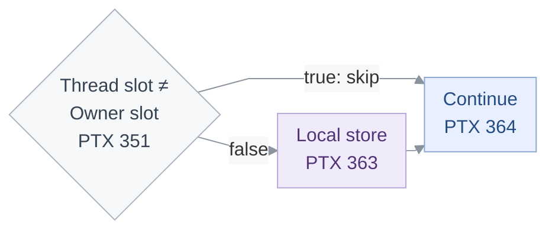
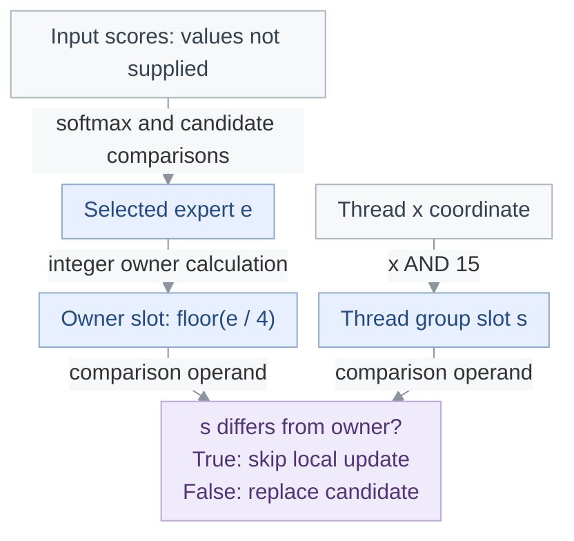

<!-- report-layout:v2 -->

<!-- verifier-result:start -->
<p align="center">MoE top-k routing: a score-dependent owner test</p>
<h1 align="center">ANALYSIS UNSUPPORTED</h1>

**Inputs:** [PTX](https://github.com/gpu-verifier/sentryward/blob/94a6b26b1990a4b9df7ded3727acc4b4cc36f23c/corpus/vllm__moe_topk_softmax__sm_100a.ptx) ([raw](https://github.com/gpu-verifier/sentryward/raw/94a6b26b1990a4b9df7ded3727acc4b4cc36f23c/corpus/vllm__moe_topk_softmax__sm_100a.ptx)) · analyzed code; [input.json](https://github.com/gpu-verifier/sentryward/blob/94a6b26b1990a4b9df7ded3727acc4b4cc36f23c/examples/vllm__moe_topk_softmax__sm_100a/input.json) · launch, arguments and assumptions.

**Result:** [output.json](https://github.com/gpu-verifier/sentryward/blob/94a6b26b1990a4b9df7ded3727acc4b4cc36f23c/examples/vllm__moe_topk_softmax__sm_100a/output.json) · saved verifier findings.

<table>
<thead><tr><th align="left">VERIFIER RESULT · Where analysis stopped</th></tr></thead>
<tbody><tr><td>

A required operation is unsupported. The saved checks identify which analyses completed.

**Synchronization:** Not run · **Memory:** Not run · **Equivalence:** Not run

**First diagnostic:** <code>control_predicate_not_static</code> · <code>ptx_execution</code> — control predicate is not statically determined · <a href="https://github.com/gpu-verifier/sentryward/blob/94a6b26b1990a4b9df7ded3727acc4b4cc36f23c/examples/vllm__moe_topk_softmax__sm_100a/output.json#L62"><code>output.json#/diagnostics/0</code></a>.

**Saved source location:** <a href="https://github.com/gpu-verifier/sentryward/blob/94a6b26b1990a4b9df7ded3727acc4b4cc36f23c/corpus/vllm__moe_topk_softmax__sm_100a.ptx#L352"><code>corpus/vllm__moe_topk_softmax__sm_100a.ptx</code> · source line <code>352</code></a>, column <code>0</code>.

**Recorded source anchors.** These lines locate the saved events. Their guards and surrounding control flow belong to the code explanation.

<p><strong>Stop location · saved source location</strong> · <a href="https://github.com/gpu-verifier/sentryward/blob/94a6b26b1990a4b9df7ded3727acc4b4cc36f23c/corpus/vllm__moe_topk_softmax__sm_100a.ptx#L352">physical PTX 352</a></p>

<pre><code>@%p68 <strong>bra</strong> $L__BB7_23;</code></pre>

<details>
<summary><strong>Saved status and diagnostic codes</strong></summary>

**Saved result:** <code>unsupported</code> · <a href="https://github.com/gpu-verifier/sentryward/blob/94a6b26b1990a4b9df7ded3727acc4b4cc36f23c/examples/vllm__moe_topk_softmax__sm_100a/output.json#L187"><code>output.json#/result</code></a>.

**Operation:** <code>kernel_verification</code>.

**Checks:** Synchronization <code>not_run</code> · Memory <code>not_run</code> · Equivalence <code>not_run</code>.

</details>

</td></tr>
<tr><td>

### Analysis scope

**Coverage:** Memory analysis complete: **no** · Search complete: <code>not saved</code> · Exhaustive search: <code>not saved</code>.

This result applies to the supplied launch, arguments and enabled assumptions.

<details>
<summary><strong>Analysis records — open the saved evidence</strong></summary>

Each record link opens its field in the original `output.json`. Model summaries are not full execution traces.

**Check the finding**

- [Diagnostic messages and details · `diagnostics`](https://github.com/gpu-verifier/sentryward/blob/94a6b26b1990a4b9df7ded3727acc4b4cc36f23c/examples/vllm__moe_topk_softmax__sm_100a/output.json#L61)
- [Individual check outcomes · `checks`](https://github.com/gpu-verifier/sentryward/blob/94a6b26b1990a4b9df7ded3727acc4b4cc36f23c/examples/vllm__moe_topk_softmax__sm_100a/output.json#L53)

**Check how the model was built**

- [PTX translation · `frontend`](https://github.com/gpu-verifier/sentryward/blob/94a6b26b1990a4b9df7ded3727acc4b4cc36f23c/examples/vllm__moe_topk_softmax__sm_100a/output.json#L116)
- [Model and source bindings · `semantic_program`](https://github.com/gpu-verifier/sentryward/blob/94a6b26b1990a4b9df7ded3727acc4b4cc36f23c/examples/vllm__moe_topk_softmax__sm_100a/output.json#L199)

**Check values separately**

- [Value-analysis status · `value_analysis`](https://github.com/gpu-verifier/sentryward/blob/94a6b26b1990a4b9df7ded3727acc4b4cc36f23c/examples/vllm__moe_topk_softmax__sm_100a/output.json#L234)
- [Numerical comparison · `equivalence`](https://github.com/gpu-verifier/sentryward/blob/94a6b26b1990a4b9df7ded3727acc4b4cc36f23c/examples/vllm__moe_topk_softmax__sm_100a/output.json#L76)

For the records explained in this report, see the [Evidence appendix](#evidence-appendix).

</details>

</td></tr></tbody>
</table>
<!-- verifier-result:end -->

<!-- code-explanation:start -->

## Code explanation

Interpretation from the PTX and saved inputs: how the reported operations fit together and what remains to check.

### 1. The branch asks whether this thread owns the selected expert

This kernel converts each row of expert scores into routing weights and expert indices. A 16-thread group holds four candidates per thread.

With `k = 2`, it selects twice. Between selections, the thread that owns the first winner replaces that entry in its private array with −10000, allowing another expert to be selected for ordinary finite inputs. **The reported branch decides whether this thread performs that update.**

The owner comes from the loaded scores. Those values are absent from the supplied files, so the launch and scalar parameters cannot determine which side of this branch is taken.

**Test:** Thread slot ≠ Owner slot.



Arrows show local control flow, not observed execution. The comparison at PTX 351 uses <code>%r3</code> and <code>%r116</code> (≠); the branch at 352 bypasses the local store at 363 when this comparison is true. Both paths rejoin at PTX 364.

<p><strong>Skip the candidate update in non-owner threads</strong> · <a href="https://github.com/gpu-verifier/sentryward/blob/94a6b26b1990a4b9df7ded3727acc4b4cc36f23c/corpus/vllm__moe_topk_softmax__sm_100a.ptx#L350-L364" title="Open the original PTX">physical PTX 350–352, 360–364</a></p>

<ul>
<li><code>%r3</code> — Thread slot within its row group</li>
<li><code>%r116</code> — Owner slot derived from the selected expert</li>
<li><code>%rd34</code> — Selected entry in this thread’s private candidate array</li>
</ul>

<pre><code><strong>sub.s32</strong> <strong>%r116</strong>, %r111, %r115;
<a href="https://docs.nvidia.com/cuda/archive/13.0.0/parallel-thread-execution/index.html#comparison-and-selection-instructions-setp">setp.ne.s32</a> <strong>%p68</strong>, <strong>%r3</strong>, <strong>%r116</strong>;
@<strong>%p68</strong> <a href="https://docs.nvidia.com/cuda/archive/13.0.0/parallel-thread-execution/index.html#control-flow-instructions-bra">bra</a> $L__BB7_23;
…
<strong>mul.wide.s32</strong> %rd33, %r126, 4;
<strong>add.s64</strong> %rd34, %rd2, %rd33;
<strong>mov.b32</strong> %r127, -971227136;
<a href="https://docs.nvidia.com/cuda/archive/13.0.0/parallel-thread-execution/index.html#data-movement-and-conversion-instructions-st"><strong>st.local.u32</strong></a> [%rd34], %r127;
$L__BB7_23:</code></pre>


<details>
<summary><strong>Derivation: row ownership and score-dependent selection</strong></summary>

#### Which scores does each thread own?

The configured block covers all eight rows: `row = 8×ctaid.x + 2×tid.y + (tid.x >> 4)` ranges from 0 to 7, so the comparison with `num_rows=8` does not exit any launched thread. The group slot is `s = tid.x & 15`; its four input indices are `64×row + 4×s + j`, for `j=0..3`. Each thread stores its candidates in a separate 16-byte local array. The butterfly exchanges use offsets 8, 4, 2 and 1 with `4127 = 0x101f`, preserving the two 16-lane halves. Their `-1` member mask still includes the full warp in the shuffle rendezvous. Slot zero writes the selected global weight, expert index and source-row reference; it is not necessarily the thread that owns the selected candidate.

<p><strong>Thread coordinates assign the row and its four-score slice</strong> · <a href="https://github.com/gpu-verifier/sentryward/blob/94a6b26b1990a4b9df7ded3727acc4b4cc36f23c/corpus/vllm__moe_topk_softmax__sm_100a.ptx#L51-L81" title="Open the original PTX">physical PTX 51–60, 71–81</a></p>

<pre><code><strong>mov.u32</strong> %r52, %ctaid.x;
<strong>shl.b32</strong> %r53, %r52, 3;
<strong>mov.u32</strong> %r54, <strong>%tid.y</strong>;
<strong>shl.b32</strong> %r55, %r54, 1;
<strong>add.s32</strong> %r56, %r53, %r55;
<strong>mov.u32</strong> %r1, <strong>%tid.x</strong>;
<strong>shr.u32</strong> %r57, %r1, 4;
<strong>add.s32</strong> %r2, %r56, %r57;
<strong>setp.ge.s32</strong> %p13, %r2, %r48;
@%p13 <strong>bra</strong> $L__BB7_40;
…
<strong>shl.b32</strong> %r58, %r2, 6;
<strong>cvt.s64.s32</strong> %rd17, %r58;
<strong>and.b32</strong> <strong>%r3</strong>, %r1, 15;
<strong>shl.b32</strong> %r59, %r1, 2;
<strong>and.b32</strong> %r60, %r59, 60;
<strong>cvt.u64.u32</strong> %rd3, %r60;
<strong>or.b64</strong> %rd18, %rd17, %rd3;
<strong>cvta.to.global.u64</strong> %rd19, %rd43;
<strong>shl.b64</strong> %rd20, %rd18, 2;
<strong>add.s64</strong> %rd21, %rd19, %rd20;
<strong>ld.global.v4.f32</strong> {%f37, %f38, %f39, %f40}, [%rd21];</code></pre>


#### Why does the selected index depend on input values?

The vector load supplies the scores. The following maximum reduction, exponential calculations and normalization produce the softmax candidates. Because `bias=null`, the bias-load path is bypassed and these candidates enter the local array unchanged. The selection loop compares four candidates locally, then exchanges candidate values and indices across the row group. For finite inputs, larger scores win and equal scores prefer the smaller expert index. The final selection carries an expert index in `%r22`; it cannot be inferred from coordinates alone. Whatever the comparison outcomes, that index is selected from the constructed range 0..63. No tensor contents or selected index are saved, so this explanation does not choose a numerical winner or assert behavior for exceptional floating-point inputs.



Arrows show source value dependencies, not a saved execution. The owner comparison is evaluated between the first and second selections; the final selection skips this update.

<p><strong>The last exchange selects the expert index carried into the owner test</strong> · <a href="https://github.com/gpu-verifier/sentryward/blob/94a6b26b1990a4b9df7ded3727acc4b4cc36f23c/corpus/vllm__moe_topk_softmax__sm_100a.ptx#L292-L307" title="Open the original PTX">physical PTX 292–307</a></p>

<pre><code><a href="https://docs.nvidia.com/cuda/archive/13.0.0/parallel-thread-execution/index.html#data-movement-and-conversion-instructions-shfl-sync"><strong>shfl.sync.bfly.b32</strong></a> %r101|%p55, %r100, 1, 4127, -1;
<strong>mov.b32</strong> %f29, %r101;
<strong>mov.b32</strong> %r102, %f28;
<a href="https://docs.nvidia.com/cuda/archive/13.0.0/parallel-thread-execution/index.html#data-movement-and-conversion-instructions-shfl-sync"><strong>shfl.sync.bfly.b32</strong></a> %r20|%p56, %r102, 1, 4127, -1;
<a href="https://docs.nvidia.com/cuda/archive/13.0.0/parallel-thread-execution/index.html#data-movement-and-conversion-instructions-shfl-sync"><strong>shfl.sync.bfly.b32</strong></a> %r21|%p57, %r19, 1, 4127, -1;
<a href="https://docs.nvidia.com/cuda/archive/13.0.0/parallel-thread-execution/index.html#comparison-and-selection-instructions-setp">setp.lt.f32</a> %p58, %f27, %f29;
<strong>mov.pred</strong> <strong>%p86</strong>, -1;
@%p58 <strong>bra</strong> $L__BB7_16;
<strong>setp.eq.f32</strong> %p59, %f27, %f29;
<strong>setp.lt.s32</strong> %p60, %r21, %r19;
<strong>and.pred</strong> <strong>%p86</strong>, %p59, %p60;
$L__BB7_16:
<strong>setp.ne.s32</strong> %p61, %r3, 0;
<strong>mov.b32</strong> %f136, %r20;
<strong>selp.f32</strong> %f30, %f136, %f28, <strong>%p86</strong>;
<a href="https://docs.nvidia.com/cuda/archive/13.0.0/parallel-thread-execution/index.html#comparison-and-selection-instructions-selp">selp.b32</a> <strong>%r22</strong>, %r21, %r19, <strong>%p86</strong>;</code></pre>


#### Why is this test reached only between the two selections?

`k=2` admits the selection loop. Its completed-selection counter starts at zero and is incremented before the owner test: after the first selection it is 1, so the `>= k` branch falls through; after the second it is 2, so that branch skips the entire owner test and replacement. The loop-back counter starts at −2 and advances through −1 to 0, giving two selection rounds. Slot-zero output writers and the other threads rejoin before this counter check. The configured null `finished` and `is_padding` pointers bypass their flag loads; they do not remove this first-round owner test. These are deductions from source and supplied configuration, not recorded execution steps.

| Selection round | Completed selections | Owner test | Next selection |
| --- | --- | --- | --- |
| First | 1 < 2 | Reached | Loop back |
| Second | 2 ≥ 2 | Skipped | Exit selection loop |

<p><strong>Loop bookkeeping after both paths rejoin</strong> · <a href="https://github.com/gpu-verifier/sentryward/blob/94a6b26b1990a4b9df7ded3727acc4b4cc36f23c/corpus/vllm__moe_topk_softmax__sm_100a.ptx#L364-L369" title="Open the original PTX">physical PTX 364–369</a></p>

<pre><code>$L__BB7_23:
<strong>add.s32</strong> %r135, %r135, 1;
<strong>setp.ne.s32</strong> <strong>%p69</strong>, %r135, 0;
<strong>add.s32</strong> %r134, %r134, %r48;
<strong>add.s32</strong> %r133, %r133, 1;
@<strong>%p69</strong> <strong>bra</strong> $L__BB7_8;</code></pre>


#### What exactly does the taken branch skip?

For selected expert `e` in 0..63, the sign-correction terms at lines 342–350 are zero. The comparison operand reduces to `floor(e/4)`, the slot whose four candidates contain that expert. Thus `%p68=true` takes the branch and skips the replacement; `%p68=false` falls through. The address arithmetic at lines 353–361 selects local element `e mod 4`, a byte offset of `4×(e mod 4)` within the 16-byte array. The stored integer bits `0xc61c4000` represent float −10000. Both paths then reach the same loop-counter increment. The store is to private candidate storage, not the global routing output, and it is not an asynchronous handoff.

<details>
<summary><strong>Sources: row ownership and score-dependent selection</strong></summary>

<blockquote>

##### Source references: Which scores does each thread own?

- <a href="https://github.com/gpu-verifier/sentryward/blob/94a6b26b1990a4b9df7ded3727acc4b4cc36f23c/examples/vllm__moe_topk_softmax__sm_100a/input.json#L10"><code>input.json#/launch/block_dim</code></a>: <code>[32,4,1]</code>
- <a href="https://github.com/gpu-verifier/sentryward/blob/94a6b26b1990a4b9df7ded3727acc4b4cc36f23c/examples/vllm__moe_topk_softmax__sm_100a/input.json#L5"><code>input.json#/launch/grid_dim</code></a>: <code>[1,1,1]</code>
- <a href="https://github.com/gpu-verifier/sentryward/blob/94a6b26b1990a4b9df7ded3727acc4b4cc36f23c/examples/vllm__moe_topk_softmax__sm_100a/input.json#L31"><code>input.json#/arguments/1/value</code></a>: <code>8</code>
- physical PTX 31,50-81: <code>__local_depot7</code>, <code>%r3</code>, <code>%rd21</code>
- physical PTX 212,240-307: <code>st.local.v4.f32</code>, <code>4127</code>
- physical PTX 304-337: <code>%p61</code>, <code>st.global.f32</code>, <code>st.global.u32</code>

##### Source references: Why does the selected index depend on input values?

- physical PTX 70-191: <code>ld.global.v4.f32</code>, <code>ex2.approx.ftz.f32</code>, <code>rcp.rn.f32</code>
- physical PTX 192-239: <code>%p28</code>, <code>%r10</code>
- physical PTX 240-307: <code>%p86</code>, <code>%r22</code>
- <a href="https://github.com/gpu-verifier/sentryward/blob/94a6b26b1990a4b9df7ded3727acc4b4cc36f23c/examples/vllm__moe_topk_softmax__sm_100a/input.json#L53"><code>input.json#/arguments/6</code></a>: <code>{&quot;parameter&quot;:10,&quot;type&quot;:&quot;pointer&quot;,&quot;value&quot;:null}</code>
- <a href="https://github.com/gpu-verifier/sentryward/blob/94a6b26b1990a4b9df7ded3727acc4b4cc36f23c/examples/vllm__moe_topk_softmax__sm_100a/input.json#L70"><code>input.json#/declarations/0</code></a>: <code>{&quot;parameter&quot;:0,&quot;type&quot;:&quot;pointer&quot;,&quot;object&quot;:&quot;input&quot;,&quot;name&quot;:&quot;input&quot;}</code>
- <a href="https://github.com/gpu-verifier/sentryward/blob/94a6b26b1990a4b9df7ded3727acc4b4cc36f23c/examples/vllm__moe_topk_softmax__sm_100a/output.json#L175"><code>output.json#/frontend/user_branch_decisions</code></a>: <code>[]</code>

##### Source references: Why is this test reached only between the two selections?

- <a href="https://github.com/gpu-verifier/sentryward/blob/94a6b26b1990a4b9df7ded3727acc4b4cc36f23c/examples/vllm__moe_topk_softmax__sm_100a/input.json#L23"><code>input.json#/arguments/0</code></a>: <code>{&quot;parameter&quot;:1,&quot;type&quot;:&quot;pointer&quot;,&quot;value&quot;:null}</code>
- <a href="https://github.com/gpu-verifier/sentryward/blob/94a6b26b1990a4b9df7ded3727acc4b4cc36f23c/examples/vllm__moe_topk_softmax__sm_100a/input.json#L36"><code>input.json#/arguments/2/value</code></a>: <code>2</code>
- <a href="https://github.com/gpu-verifier/sentryward/blob/94a6b26b1990a4b9df7ded3727acc4b4cc36f23c/examples/vllm__moe_topk_softmax__sm_100a/input.json#L63"><code>input.json#/arguments/8</code></a>: <code>{&quot;parameter&quot;:12,&quot;type&quot;:&quot;pointer&quot;,&quot;value&quot;:null}</code>
- physical PTX 61-69: <code>%p82</code>, <code>%p15</code>
- physical PTX 213-225: <code>%r136</code>, <code>%r135</code>
- physical PTX 304-341: <code>%p61</code>, <code>%p63</code>, <code>%p67</code>
- physical PTX 364-369: <code>%p69</code>

##### Source references: What exactly does the taken branch skip?

- physical PTX 342-369: <code>%r116</code>, <code>%p68</code>, <code>%rd34</code>, <code>-971227136</code>, <code>st.local.u32</code>
- physical PTX 31,50: <code>__local_depot7</code>, <code>%rd2</code>

##### Additional section references

- physical PTX 51-81: <code>%tid.x</code>, <code>%tid.y</code>, <code>ld.global.v4.f32</code>
- physical PTX 192-239: <code>st.local.v4.f32</code>, <code>%r10</code>
- physical PTX 240-307: <code>shfl.sync.bfly.b32</code>, <code>%r22</code>
- physical PTX 338-369: <code>%p68</code>, <code>st.local.u32</code>
- <a href="https://github.com/gpu-verifier/sentryward/blob/94a6b26b1990a4b9df7ded3727acc4b4cc36f23c/examples/vllm__moe_topk_softmax__sm_100a/output.json#L68"><code>output.json#/diagnostics/0/details/location/line</code></a>: <code>352</code>
- <a href="https://github.com/gpu-verifier/sentryward/blob/94a6b26b1990a4b9df7ded3727acc4b4cc36f23c/examples/vllm__moe_topk_softmax__sm_100a/input.json#L73"><code>input.json#/declarations/0/object</code></a>: <code>&quot;input&quot;</code>

</blockquote>

</details>

</details>

### 2. Next check

Check frontend support for the score-dependent owner branch. The missing value is the selected winner from the input tensor: the required-parameter list is empty and no concrete branch decision is saved.

The later prerequisite and memory-elimination diagnostics describe analyses that could not proceed. They do not identify additional kernel operations to repair, or justify forcing either side of the branch.

<details>
<summary><strong>Evidence for the next check</strong></summary>

- <a href="https://github.com/gpu-verifier/sentryward/blob/94a6b26b1990a4b9df7ded3727acc4b4cc36f23c/examples/vllm__moe_topk_softmax__sm_100a/output.json#L59"><code>output.json#/details/required_parameters</code></a>: <code>[]</code>
- <a href="https://github.com/gpu-verifier/sentryward/blob/94a6b26b1990a4b9df7ded3727acc4b4cc36f23c/examples/vllm__moe_topk_softmax__sm_100a/output.json#L175"><code>output.json#/frontend/user_branch_decisions</code></a>: <code>[]</code>
- <a href="https://github.com/gpu-verifier/sentryward/blob/94a6b26b1990a4b9df7ded3727acc4b4cc36f23c/examples/vllm__moe_topk_softmax__sm_100a/output.json#L84"><code>output.json#/equivalence/diagnostics/0/code</code></a>: <code>&quot;prerequisite_check_not_passed&quot;</code>
- <a href="https://github.com/gpu-verifier/sentryward/blob/94a6b26b1990a4b9df7ded3727acc4b4cc36f23c/examples/vllm__moe_topk_softmax__sm_100a/output.json#L242"><code>output.json#/value_analysis/diagnostics/0/code</code></a>: <code>&quot;prerequisite_check_not_passed&quot;</code>
- <a href="https://github.com/gpu-verifier/sentryward/blob/94a6b26b1990a4b9df7ded3727acc4b4cc36f23c/examples/vllm__moe_topk_softmax__sm_100a/output.json#L281"><code>output.json#/value_analysis/scalar_fold/diagnostics/0/code</code></a>: <code>&quot;memory_elimination_not_completed&quot;</code>
- physical PTX 307,342-352: <code>%r22</code>, <code>%p68</code>

</details>

<!-- code-explanation:end -->

<!-- verifier-evidence:start -->
## Evidence appendix

Use these records to check the verifier result and source explanation above. JSON pointers refer to the original saved files. Identical prerequisite copies use `same_records_as` to refer to the diagnostic evidence shown once; their original locations and content hashes remain recorded.

<details>
<summary><strong>Diagnostic records — verify the finding</strong></summary>

These are saved verifier records. Truncation flags describe missing records in the original result, not merely collapsed presentation.

#### Diagnostics

- <code>control_predicate_not_static</code>: control predicate is not statically determined

<details>
<summary><strong>Exact diagnostic records and metadata</strong></summary>

##### Flags and empty collections

These retain their original top-level keys in `output.json`.

```json
{
  "warnings": []
}
```

##### Diagnostics

<a href="https://github.com/gpu-verifier/sentryward/blob/94a6b26b1990a4b9df7ded3727acc4b4cc36f23c/examples/vllm__moe_topk_softmax__sm_100a/output.json#L61"><code>output.json#/diagnostics</code></a>

**Retained records:** 1.

```json
[
  {
    "code": "control_predicate_not_static",
    "details": {
      "location": {
        "column": 0,
        "file": "corpus/vllm__moe_topk_softmax__sm_100a.ptx",
        "line": 352
      },
      "required_parameters": []
    },
    "message": "control predicate is not statically determined",
    "stage": "ptx_execution"
  }
]
```

</details>

</details>

<details>
<summary><strong>Assumptions — what qualifies the result</strong></summary>

Enabled and triggered answer different questions: whether a rule was selected, and whether its applicability was recorded. `triggered: null` means unknown or unmeasured, not inactive.

#### Duplicate TMA stores

**Key:** <code>duplicate_tma_store_benign</code>

**Enabled:** <code>true</code> · **Triggered:** <code>null</code>

Matching same-warp duplicate TMA stores are races in the model, but are reported as warnings under the assumption that their stored values agree.

#### Representative election

**Key:** <code>representative_election</code>

**Enabled:** <code>true</code> · **Triggered:** <code>null</code>

Election selects lane zero when participating, otherwise the lowest participating lane.

#### Failed launch cancellation

**Key:** <code>clc_always_fails</code>

**Enabled:** <code>true</code> · **Triggered:** <code>null</code>

Every cluster launch cancellation request fails.

#### Representative branches

**Key:** <code>representative_branches</code>

**Enabled:** <code>false</code> · **Triggered:** <code>false</code>

Choose fallthrough for an unresolved structured if/else; unknown ordinary instruction guards execute. Terminal control uses CFG classification. Known control and explicit choices take precedence.

#### Bounded computation loops

**Key:** <code>bounded_computation_loops</code>

**Enabled:** <code>false</code> · **Triggered:** <code>false</code>

Execute a configured number of body iterations for unresolved recognized computation loops, counted separately per invocation. Polling and unclassified loops are never forced to complete.

<details>
<summary><strong>Exact assumption settings</strong></summary>

```json
{
  "assumptions": [
    {
      "enabled": true,
      "key": "duplicate_tma_store_benign",
      "label": "Duplicate TMA stores",
      "text": "Matching same-warp duplicate TMA stores are races in the model, but are reported as warnings under the assumption that their stored values agree.",
      "triggered": null
    },
    {
      "enabled": true,
      "key": "representative_election",
      "label": "Representative election",
      "text": "Election selects lane zero when participating, otherwise the lowest participating lane.",
      "triggered": null
    },
    {
      "enabled": true,
      "key": "clc_always_fails",
      "label": "Failed launch cancellation",
      "text": "Every cluster launch cancellation request fails.",
      "triggered": null
    },
    {
      "enabled": false,
      "key": "representative_branches",
      "label": "Representative branches",
      "text": "Choose fallthrough for an unresolved structured if/else; unknown ordinary instruction guards execute. Terminal control uses CFG classification. Known control and explicit choices take precedence.",
      "triggered": false
    },
    {
      "enabled": false,
      "key": "bounded_computation_loops",
      "label": "Bounded computation loops",
      "text": "Execute a configured number of body iterations for unresolved recognized computation loops, counted separately per invocation. Polling and unclassified loops are never forced to complete.",
      "triggered": false
    }
  ],
  "semantic_assumptions": {
    "bounded_computation_loops": false,
    "clc_always_fails": true,
    "duplicate_tma_store_benign": true,
    "representative_branches": false,
    "representative_election": true
  }
}
```

</details>

</details>

<details>
<summary><strong>Value analysis — independent status</strong></summary>

Memory safety and numerical equivalence are separate results.

**Value analysis:** <code>unsupported</code> · <a href="https://github.com/gpu-verifier/sentryward/blob/94a6b26b1990a4b9df7ded3727acc4b4cc36f23c/examples/vllm__moe_topk_softmax__sm_100a/output.json#L234"><code>output.json#/value_analysis</code></a>

**Checks:** Synchronization <code>not_requested</code> · Memory <code>not_requested</code> · Equivalence <code>not_requested</code>.

- **Prerequisite status:** <code>ptx_execution_unsupported</code>
- **Scope:** {&quot;operation&quot;:&quot;<code>value_analysis</code>&quot;}
- **Diagnostic:** <code>prerequisite_check_not_passed</code> · <code>pipeline</code> · <a href="https://github.com/gpu-verifier/sentryward/blob/94a6b26b1990a4b9df7ded3727acc4b4cc36f23c/examples/vllm__moe_topk_softmax__sm_100a/output.json#L241"><code>output.json#/value_analysis/diagnostics/0</code></a>

**Equivalence:** <code>unsupported</code> · <a href="https://github.com/gpu-verifier/sentryward/blob/94a6b26b1990a4b9df7ded3727acc4b4cc36f23c/examples/vllm__moe_topk_softmax__sm_100a/output.json#L76"><code>output.json#/equivalence</code></a>

**Checks:** Synchronization <code>not_requested</code> · Memory <code>not_requested</code> · Equivalence <code>not_run</code>.

- **Scope:** {&quot;operation&quot;:&quot;equivalence&quot;}
- **Diagnostic:** <code>prerequisite_check_not_passed</code> · <code>pipeline</code> · <a href="https://github.com/gpu-verifier/sentryward/blob/94a6b26b1990a4b9df7ded3727acc4b4cc36f23c/examples/vllm__moe_topk_softmax__sm_100a/output.json#L83"><code>output.json#/equivalence/diagnostics/0</code></a>

<details>
<summary><strong>Exact value-analysis fields and large-data references</strong></summary>

##### Value analysis

```json
{
  "equivalence_check": "blocked",
  "prerequisite_status": "ptx_execution_unsupported",
  "result": "unsupported",
  "checks": {
    "equivalence": "not_requested",
    "memory": "not_requested",
    "synchronization": "not_requested"
  },
  "diagnostics": [
    {
      "code": "prerequisite_check_not_passed",
      "details": {
        "prerequisite_checks": {
          "equivalence": "not_run",
          "memory": "not_run",
          "synchronization": "not_run"
        },
        "prerequisite_diagnostics": [
          {
            "code": "control_predicate_not_static",
            "details": {
              "location": {
                "column": 0,
                "file": "corpus/vllm__moe_topk_softmax__sm_100a.ptx",
                "line": 352
              },
              "required_parameters": []
            },
            "message": "control predicate is not statically determined",
            "stage": "ptx_execution"
          }
        ],
        "prerequisite_result": "unsupported",
        "prerequisite_status": "ptx_execution_unsupported"
      },
      "stage": "pipeline"
    }
  ],
  "scalar_fold": {
    "checks": {
      "equivalence": "not_requested",
      "memory": "not_requested",
      "synchronization": "not_requested"
    },
    "diagnostics": [
      {
        "code": "memory_elimination_not_completed",
        "stage": "pipeline"
      }
    ],
    "result": "unsupported",
    "scope": {
      "operation": "scalar_fold"
    }
  },
  "scope": {
    "operation": "value_analysis"
  }
}
```

##### Equivalence

```json
{
  "result": "unsupported",
  "checks": {
    "equivalence": "not_run",
    "memory": "not_requested",
    "synchronization": "not_requested"
  },
  "diagnostics": [
    {
      "code": "prerequisite_check_not_passed",
      "details": {
        "prerequisite_checks": {
          "equivalence": "not_run",
          "memory": "not_run",
          "synchronization": "not_run"
        },
        "prerequisite_diagnostics": [
          {
            "code": "control_predicate_not_static",
            "details": {
              "location": {
                "column": 0,
                "file": "corpus/vllm__moe_topk_softmax__sm_100a.ptx",
                "line": 352
              },
              "required_parameters": []
            },
            "message": "control predicate is not statically determined",
            "stage": "ptx_execution"
          }
        ],
        "prerequisite_result": "unsupported"
      },
      "stage": "pipeline"
    }
  ],
  "scope": {
    "operation": "equivalence"
  }
}
```

</details>

</details>

<details>
<summary><strong>Input configuration — reproduce this run</strong></summary>

**Launch and arguments define this run.** Tuple coordinates use `(x, y, z)`; grid and cluster dimensions count blocks, while block dimensions count threads.

| Launch quantity | Saved value |
| --- | --- |
| Grid · blocks | <code>[1,1,1]</code> |
| Block · threads | <code>[32,4,1]</code> |
| Cluster · blocks | <code>[1,1,1]</code> |
| Dynamic shared memory · bytes | <code>0</code> |

**Arguments:** 9 retained entries. Exact parameter bindings, descriptors and entry name: <a href="https://github.com/gpu-verifier/sentryward/blob/94a6b26b1990a4b9df7ded3727acc4b4cc36f23c/examples/vllm__moe_topk_softmax__sm_100a/input.json#L1"><code>input.json#</code></a>.

<details>
<summary><strong>Exact input configuration</strong></summary>

```json
{
  "schema": "spverify.kernel-input/v1",
  "entry": "_ZN4vllm3moe10topkGatingILi4ELi64ELi4ELi16ELi32EifLNS0_11ScoringFuncE0EEEvPKT5_PKbPfiPT4_PiiiibPKfdS7_",
  "launch": {
    "grid_dim": [
      1,
      1,
      1
    ],
    "block_dim": [
      32,
      4,
      1
    ],
    "cluster_dim": [
      1,
      1,
      1
    ],
    "dynamic_shared_bytes": 0
  },
  "arguments": [
    {
      "parameter": 1,
      "type": "pointer",
      "value": null
    },
    {
      "parameter": 3,
      "type": "u32",
      "value": 8
    },
    {
      "parameter": 6,
      "type": "u32",
      "value": 2
    },
    {
      "parameter": 7,
      "type": "u32",
      "value": 0
    },
    {
      "parameter": 8,
      "type": "u32",
      "value": 64
    },
    {
      "parameter": 9,
      "type": "u8",
      "value": 1
    },
    {
      "parameter": 10,
      "type": "pointer",
      "value": null
    },
    {
      "parameter": 11,
      "type": "f64",
      "value": 1.0
    },
    {
      "parameter": 12,
      "type": "pointer",
      "value": null
    }
  ],
  "declarations": [
    {
      "parameter": 0,
      "type": "pointer",
      "object": "input",
      "name": "input"
    },
    {
      "parameter": 1,
      "type": "pointer",
      "name": "finished"
    },
    {
      "parameter": 2,
      "type": "pointer",
      "object": "output",
      "name": "output"
    },
    {
      "parameter": 3,
      "type": "u32",
      "name": "num_rows"
    },
    {
      "parameter": 4,
      "type": "pointer",
      "object": "indices",
      "name": "indices"
    },
    {
      "parameter": 5,
      "type": "pointer",
      "object": "source_rows",
      "name": "source_rows"
    },
    {
      "parameter": 6,
      "type": "u32",
      "name": "k"
    },
    {
      "parameter": 7,
      "type": "u32",
      "name": "start_expert"
    },
    {
      "parameter": 8,
      "type": "u32",
      "name": "end_expert"
    },
    {
      "parameter": 9,
      "type": "u8",
      "name": "renormalize"
    },
    {
      "parameter": 10,
      "type": "pointer",
      "name": "bias"
    },
    {
      "parameter": 11,
      "type": "f64",
      "name": "routed_scaling_factor"
    },
    {
      "parameter": 12,
      "type": "pointer",
      "name": "is_padding"
    }
  ],
  "assumptions": {
    "duplicate_tma_store_benign": true,
    "representative_election": true,
    "clc_always_fails": true
  }
}
```

</details>

</details>

<details>
<summary><strong>Provenance and coverage — check the saved run</strong></summary>

Use the original-file hashes to identify the run. Coverage flags describe what this result establishes; implementation statistics remain separate below.

**Coverage:** Memory analysis complete: **no** · Search complete: <code>not saved</code> · Exhaustive search: <code>not saved</code>.


#### Original artifacts

- **Input configuration:** [input.json](https://github.com/gpu-verifier/sentryward/blob/94a6b26b1990a4b9df7ded3727acc4b4cc36f23c/examples/vllm__moe_topk_softmax__sm_100a/input.json) · <code>examples/vllm__moe_topk_softmax__sm_100a/input.json</code> · SHA-256 <code>b109e6c8a52f00d16aba3b5594d41d9a2f9bf51b6bc4ca83bcb17e6a14b6706b</code>
- **Verifier output:** [output.json](https://github.com/gpu-verifier/sentryward/blob/94a6b26b1990a4b9df7ded3727acc4b4cc36f23c/examples/vllm__moe_topk_softmax__sm_100a/output.json) · <code>examples/vllm__moe_topk_softmax__sm_100a/output.json</code> · SHA-256 <code>cde02aa5199879f1883dcba0097e118338827a33063407cdc2ab5ae3eac3c7d9</code>
- **PTX:** [vllm__moe_topk_softmax__sm_100a.ptx](https://github.com/gpu-verifier/sentryward/blob/94a6b26b1990a4b9df7ded3727acc4b4cc36f23c/corpus/vllm__moe_topk_softmax__sm_100a.ptx) · <code>corpus/vllm__moe_topk_softmax__sm_100a.ptx</code> · SHA-256 <code>3c552cf0c157cbdf00c04883dcfe636a843245d508b6c8110580b4a0e91789bf</code>

Large structures are referenced by exact JSON pointer, item count and SHA-256 of their canonical JSON (UTF-8, sorted keys, compact separators). Original-artifact hashes above are hashes of the file bytes.

<details>
<summary><strong>Exact coverage, implementation and provenance fields</strong></summary>

```json
{
  "assumption_hints": [
    {
      "key": "representative_branches",
      "label": "Representative branches",
      "message": "Supply the missing control input for exact analysis. This assumption applies only if CFG classification identifies the corresponding structured control; polling and unclassified loops remain unsupported.",
      "suggested_value": true
    },
    {
      "key": "bounded_computation_loops",
      "label": "Bounded computation loops",
      "message": "Supply the missing control input for exact analysis. This assumption applies only if CFG classification identifies the corresponding structured control; polling and unclassified loops remain unsupported.",
      "suggested_value": true
    }
  ],
  "checks": {
    "equivalence": "not_run",
    "memory": "not_run",
    "synchronization": "not_run"
  },
  "details": {
    "required_parameters": []
  },
  "frontend": {
    "frontend_assumptions": {
      "assertion_failure_forms": [
        "trap",
        "__assertfail"
      ],
      "assertion_uses": 0,
      "bounded_loop_uses": 0,
      "clc_failure": true,
      "clc_uses": 0,
      "data_branch_decisions": [],
      "election_policy": {
        "fallback": "lowest_member",
        "preferred_lane": 0,
        "strategy": "preferred_member"
      },
      "election_uses": 0,
      "fixed_election": true,
      "isolated_launch": true,
      "noalias_unbounded": false,
      "opaque_compute_regions": [],
      "pointer_contract": {
        "aliasing": "distinct_objects_noalias",
        "extent_bytes": "unbounded"
      },
      "representative_branch_uses": 0,
      "trap_only_equality_assertions_hold": true
    },
    "input_objects": [
      {
        "bytes": 8,
        "object": "input",
        "offset": 0,
        "parameter": "_ZN4vllm3moe10topkGatingILi4ELi64ELi4ELi16ELi32EifLNS0_11ScoringFuncE0EEEvPKT5_PKbPfiPT4_PiiiibPKfdS7__param_0",
        "source": "declaration"
      },
      {
        "bytes": 8,
        "object": "output",
        "offset": 0,
        "parameter": "_ZN4vllm3moe10topkGatingILi4ELi64ELi4ELi16ELi32EifLNS0_11ScoringFuncE0EEEvPKT5_PKbPfiPT4_PiiiibPKfdS7__param_2",
        "source": "declaration"
      },
      {
        "bytes": 8,
        "object": "indices",
        "offset": 0,
        "parameter": "_ZN4vllm3moe10topkGatingILi4ELi64ELi4ELi16ELi32EifLNS0_11ScoringFuncE0EEEvPKT5_PKbPfiPT4_PiiiibPKfdS7__param_4",
        "source": "declaration"
      },
      {
        "bytes": 8,
        "object": "source_rows",
        "offset": 0,
        "parameter": "_ZN4vllm3moe10topkGatingILi4ELi64ELi4ELi16ELi32EifLNS0_11ScoringFuncE0EEEvPKT5_PKbPfiPT4_PiiiibPKfdS7__param_5",
        "source": "declaration"
      }
    ],
    "required_parameters": [],
    "user_branch_decisions": []
  },
  "implementation": "cpp",
  "location": {
    "column": 0,
    "file": "corpus/vllm__moe_topk_softmax__sm_100a.ptx",
    "line": 352
  },
  "memory_analysis_complete": false,
  "peak_footprint_mib": 16.34375,
  "peak_rss_mib": 93.8984375,
  "pipeline_elapsed_seconds": 0.020495008,
  "result": "unsupported",
  "rss_limit_mib": null,
  "scope": {
    "operation": "kernel_verification"
  },
  "semantic_program": {
    "execution_cohorts": 0,
    "mapping_complete": false,
    "memory_binding_stored_rows": 0,
    "memory_binding_templates": 0,
    "memory_bindings": 0,
    "memory_linking_templates_used": false,
    "synchronization_groups": 0,
    "synchronization_groups_materialized": false,
    "synthetic_synchronization_nodes": 0,
    "thread_prefix_groups": 0
  },
  "stage": "ptx_execution",
  "template_execution": {
    "completed_ctas": 0,
    "coordinate_bindings": 0,
    "logical_thread_steps": 0,
    "path_entries": 0,
    "record_bindings": 0,
    "record_nodes": 0,
    "splits": 0,
    "template_steps": 0,
    "thread_memberships": 0,
    "value_nodes": 0
  },
  "thread_record_compression": {
    "completed_ctas": 0,
    "enabled": true,
    "estimated_pool_bytes_sum": 0,
    "intern_calls": 0,
    "logical_records": 0,
    "record_handle_bytes": 32,
    "templates": 0,
    "unique_bindings": 0
  },
  "value_ir_instance_count": 0,
  "value_ir_node_count": 0,
  "value_view_complete": false,
  "wellsync_timeout_seconds": 500.0,
  "whole_pipeline_timeout_seconds": 500.0
}
```

</details>

</details>

<!-- verifier-evidence:end -->
