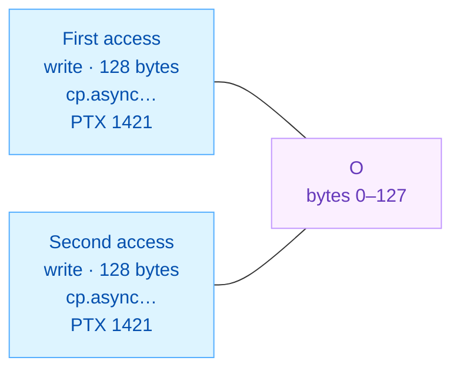

<!-- report-layout:v2 -->

<!-- verifier-result:start -->
<p align="center">flash_attention__fwd_paged_bf16_h128__sm_100a</p>
<h1 align="center">ANALYSIS UNSUPPORTED</h1>

**Inputs:** [PTX](https://github.com/gpu-verifier/sentryward/blob/94a6b26b1990a4b9df7ded3727acc4b4cc36f23c/corpus/flash_attention__fwd_paged_bf16_h128__sm_100a.ptx) · analyzed code; [input.json](https://github.com/gpu-verifier/sentryward/blob/94a6b26b1990a4b9df7ded3727acc4b4cc36f23c/examples/flash_attention__fwd_paged_bf16_h128__sm_100a/input.json) · launch, arguments and assumptions.

**Result:** [output.json](https://github.com/gpu-verifier/sentryward/blob/94a6b26b1990a4b9df7ded3727acc4b4cc36f23c/examples/flash_attention__fwd_paged_bf16_h128__sm_100a/output.json) · saved verifier findings.

<details>
<summary><strong>Analysis records — open the saved evidence</strong></summary>

Each record link opens its field in the original `output.json`. Model summaries are not full execution traces.

**Check the finding**

- [Diagnostic messages and details · `diagnostics`](https://github.com/gpu-verifier/sentryward/blob/94a6b26b1990a4b9df7ded3727acc4b4cc36f23c/examples/flash_attention__fwd_paged_bf16_h128__sm_100a/output.json#L68)
- [Individual check outcomes · `checks`](https://github.com/gpu-verifier/sentryward/blob/94a6b26b1990a4b9df7ded3727acc4b4cc36f23c/examples/flash_attention__fwd_paged_bf16_h128__sm_100a/output.json#L56)

**Check how the model was built**

- [PTX translation · `frontend`](https://github.com/gpu-verifier/sentryward/blob/94a6b26b1990a4b9df7ded3727acc4b4cc36f23c/examples/flash_attention__fwd_paged_bf16_h128__sm_100a/output.json#L282)
- [Model and source bindings · `semantic_program`](https://github.com/gpu-verifier/sentryward/blob/94a6b26b1990a4b9df7ded3727acc4b4cc36f23c/examples/flash_attention__fwd_paged_bf16_h128__sm_100a/output.json#L644)
- [Synchronization-check setup · `synchronization_input`](https://github.com/gpu-verifier/sentryward/blob/94a6b26b1990a4b9df7ded3727acc4b4cc36f23c/examples/flash_attention__fwd_paged_bf16_h128__sm_100a/output.json#L661)

**Check values separately**

- [Value-analysis status · `value_analysis`](https://github.com/gpu-verifier/sentryward/blob/94a6b26b1990a4b9df7ded3727acc4b4cc36f23c/examples/flash_attention__fwd_paged_bf16_h128__sm_100a/output.json#L689)
- [Numerical comparison · `equivalence`](https://github.com/gpu-verifier/sentryward/blob/94a6b26b1990a4b9df7ded3727acc4b4cc36f23c/examples/flash_attention__fwd_paged_bf16_h128__sm_100a/output.json#L81)

For the records explained in this report, see the [Evidence appendix](#evidence-appendix).

</details>

## 1. Verifier result

Saved findings and analysis scope, formatted directly from the verifier output.

### 1.1 Where analysis stopped

A required operation is unsupported. The saved checks identify which analyses completed.

**Saved result:** <code>unsupported</code> · <code>output.json#/result</code>.

**Checks:** Synchronization <code>passed</code> · Memory <code>passed</code> · Equivalence <code>incomplete</code>.

**Operation:** <code>kernel_verification</code>.

**First diagnostic:** <code>input_alignment_not_proven</code> · <code>equivalence_import</code> — Could not prove that the input read is element-aligned · <code>output.json#/diagnostics/0</code>.

**Recorded totals:** 0 races · 10,919,936 warnings · 0 unresolved.

**Retained warnings:** 16; samples truncated: <code>true</code>.

**Warning classification rule:** Duplicate TMA stores — Matching same-warp duplicate TMA stores are races in the model, but are reported as warnings under the assumption that their stored values agree.

Saved rule flags: enabled <code>true</code> · triggered <code>true</code>.

#### Memory warning alongside the stopped check

The memory check passed with warnings; the overall result above also includes other checks. This warning does not replace or explain the separate analysis stop.

First of 16 retained warnings, in file order. All retained warnings remain in Evidence.

**write / write overlap:** <code>128</code> bytes in <code>global</code> memory, at byte offset <code>0</code>.

Unordered same-warp TMA writes have matching copy footprints and PTX site-visit indices. Value equality is not proven; analysis continues with all accesses retained.



Lines connect the two recorded accesses to their shared byte region; they do not show execution order.


<details>
<summary><strong>Locate the accesses and check their recorded overlap</strong></summary>

| Access | Source operation | Model event / instruction | Actor ID |
| --- | --- | --- | --- |
| First access | <code>cp.async.bulk.tensor.4d.global.shared::cta.tile.bulk_group.L2::cache_hint</code><br/>PTX line <code>1421</code> | <code>646637</code> / <code>148156</code> | <code>416</code> |
| Second access | <code>cp.async.bulk.tensor.4d.global.shared::cta.tile.bulk_group.L2::cache_hint</code><br/>PTX line <code>1421</code> | <code>649448</code> / <code>148179</code> | <code>417</code> |

Actor IDs name verifier participants; this record does not itself establish CUDA thread coordinates. Event and instruction IDs identify model records, not source-line numbers.

**Recorded source anchors.** These lines locate the saved events. Their guards and surrounding control flow belong to the code explanation.

<p><strong>First access · saved source location</strong> · physical PTX 1421 · display wrapping added</p>

<pre><code><strong>cp.async.bulk.tensor.4d.global.shared::cta.tile.bulk_group.L2::cache_hint</strong>
    [%rd258, {%r583, %r582, %r2935, %r2934}], [%r56], %rd259;</code></pre>


**Saved record:** <code>output.json#/warnings/0</code>. **Overlap check:** constant byte ranges intersect. **Allocation:** <code>O</code>. **Address space:** <code>global</code>.

</details>

### 1.2 Analysis scope

**Coverage:** Memory analysis complete: yes · Search complete: yes · Exhaustive search: **no**.

**Assumption-dependent:** <code>true</code>. Triggered rules: Duplicate TMA stores, Representative election.

This result applies to the supplied launch, arguments and enabled assumptions.
<!-- verifier-result:end -->

<!-- verifier-evidence:start -->
## Evidence appendix

Use these records to check the verifier result and source explanation above. JSON pointers refer to the original saved files. Identical prerequisite copies use `same_records_as` to refer to the diagnostic evidence shown once; their original locations and content hashes remain recorded.

<details>
<summary><strong>Diagnostic records — verify the finding</strong></summary>

These are saved verifier records. Truncation flags describe missing records in the original result, not merely collapsed presentation.

#### Retained warnings

16 saved records. These are the retained sample, not necessarily all findings.

| Record | First / second event | Modes | Saved code |
| --- | --- | --- | --- |
| 0 | <code>646637</code> / <code>649448</code> | <code>write</code> / <code>write</code> | <code>duplicate-tma-store</code> |
| 1 | <code>646637</code> / <code>652259</code> | <code>write</code> / <code>write</code> | <code>duplicate-tma-store</code> |
| 2 | <code>646637</code> / <code>655070</code> | <code>write</code> / <code>write</code> | <code>duplicate-tma-store</code> |
| 3 | <code>646637</code> / <code>657881</code> | <code>write</code> / <code>write</code> | <code>duplicate-tma-store</code> |
| 4 | <code>646637</code> / <code>660692</code> | <code>write</code> / <code>write</code> | <code>duplicate-tma-store</code> |
| 5 | <code>646637</code> / <code>663503</code> | <code>write</code> / <code>write</code> | <code>duplicate-tma-store</code> |
| 6 | <code>646637</code> / <code>666314</code> | <code>write</code> / <code>write</code> | <code>duplicate-tma-store</code> |
| 7 | <code>646637</code> / <code>669125</code> | <code>write</code> / <code>write</code> | <code>duplicate-tma-store</code> |
| 8 | <code>646637</code> / <code>671936</code> | <code>write</code> / <code>write</code> | <code>duplicate-tma-store</code> |
| 9 | <code>646637</code> / <code>674747</code> | <code>write</code> / <code>write</code> | <code>duplicate-tma-store</code> |
| 10 | <code>646637</code> / <code>677558</code> | <code>write</code> / <code>write</code> | <code>duplicate-tma-store</code> |
| 11 | <code>646637</code> / <code>680369</code> | <code>write</code> / <code>write</code> | <code>duplicate-tma-store</code> |
| 12 | <code>646637</code> / <code>683180</code> | <code>write</code> / <code>write</code> | <code>duplicate-tma-store</code> |
| 13 | <code>646637</code> / <code>685991</code> | <code>write</code> / <code>write</code> | <code>duplicate-tma-store</code> |
| 14 | <code>646637</code> / <code>688802</code> | <code>write</code> / <code>write</code> | <code>duplicate-tma-store</code> |
| 15 | <code>646637</code> / <code>691613</code> | <code>write</code> / <code>write</code> | <code>duplicate-tma-store</code> |

Unordered same-warp TMA writes have matching copy footprints and PTX site-visit indices. Value equality is not proven; analysis continues with all accesses retained.

Byte regions, endpoints and exact locations: <code>output.json#/warnings</code>.

#### Diagnostics

- <code>input_alignment_not_proven</code>: Could not prove that the input read is element-aligned

<details>
<summary><strong>Exact diagnostic records and metadata</strong></summary>

##### Flags and empty collections

These retain their original top-level keys in `output.json`.

```json
{
  "races": [],
  "source_violations": [],
  "verification_limitations": []
}
```

##### Warnings

<code>output.json#/warnings</code>

**Retained records:** 16.

```json
[
  {
    "code": "duplicate-tma-store",
    "first": {
      "access_index": 0,
      "actor": 416,
      "bytes": 128,
      "effect_index": 1,
      "endpoint": {
        "address": 54245,
        "kind": "memory"
      },
      "event": 646637,
      "instruction": 148156,
      "location": {
        "column": 2,
        "file": "corpus/flash_attention__fwd_paged_bf16_h128__sm_100a.ptx",
        "line": 1421
      },
      "mode": "write"
    },
    "message": "Unordered same-warp TMA writes have matching copy footprints and PTX site-visit indices. Value equality is not proven; analysis continues with all accesses retained.",
    "overlap": "constant byte ranges intersect",
    "region": {
      "address_space": "global",
      "allocation": "O",
      "bytes": 128,
      "offset": 0
    },
    "second": {
      "access_index": 0,
      "actor": 417,
      "bytes": 128,
      "effect_index": 1,
      "endpoint": {
        "address": 54245,
        "kind": "memory"
      },
      "event": 649448,
      "instruction": 148179,
      "location": {
        "column": 2,
        "file": "corpus/flash_attention__fwd_paged_bf16_h128__sm_100a.ptx",
        "line": 1421
      },
      "mode": "write"
    }
  },
  {
    "code": "duplicate-tma-store",
    "first": {
      "access_index": 0,
      "actor": 416,
      "bytes": 128,
      "effect_index": 1,
      "endpoint": {
        "address": 54245,
        "kind": "memory"
      },
      "event": 646637,
      "instruction": 148156,
      "location": {
        "column": 2,
        "file": "corpus/flash_attention__fwd_paged_bf16_h128__sm_100a.ptx",
        "line": 1421
      },
      "mode": "write"
    },
    "message": "Unordered same-warp TMA writes have matching copy footprints and PTX site-visit indices. Value equality is not proven; analysis continues with all accesses retained.",
    "overlap": "constant byte ranges intersect",
    "region": {
      "address_space": "global",
      "allocation": "O",
      "bytes": 128,
      "offset": 0
    },
    "second": {
      "access_index": 0,
      "actor": 418,
      "bytes": 128,
      "effect_index": 1,
      "endpoint": {
        "address": 54245,
        "kind": "memory"
      },
      "event": 652259,
      "instruction": 148202,
      "location": {
        "column": 2,
        "file": "corpus/flash_attention__fwd_paged_bf16_h128__sm_100a.ptx",
        "line": 1421
      },
      "mode": "write"
    }
  },
  {
    "code": "duplicate-tma-store",
    "first": {
      "access_index": 0,
      "actor": 416,
      "bytes": 128,
      "effect_index": 1,
      "endpoint": {
        "address": 54245,
        "kind": "memory"
      },
      "event": 646637,
      "instruction": 148156,
      "location": {
        "column": 2,
        "file": "corpus/flash_attention__fwd_paged_bf16_h128__sm_100a.ptx",
        "line": 1421
      },
      "mode": "write"
    },
    "message": "Unordered same-warp TMA writes have matching copy footprints and PTX site-visit indices. Value equality is not proven; analysis continues with all accesses retained.",
    "overlap": "constant byte ranges intersect",
    "region": {
      "address_space": "global",
      "allocation": "O",
      "bytes": 128,
      "offset": 0
    },
    "second": {
      "access_index": 0,
      "actor": 419,
      "bytes": 128,
      "effect_index": 1,
      "endpoint": {
        "address": 54245,
        "kind": "memory"
      },
      "event": 655070,
      "instruction": 148225,
      "location": {
        "column": 2,
        "file": "corpus/flash_attention__fwd_paged_bf16_h128__sm_100a.ptx",
        "line": 1421
      },
      "mode": "write"
    }
  },
  {
    "code": "duplicate-tma-store",
    "first": {
      "access_index": 0,
      "actor": 416,
      "bytes": 128,
      "effect_index": 1,
      "endpoint": {
        "address": 54245,
        "kind": "memory"
      },
      "event": 646637,
      "instruction": 148156,
      "location": {
        "column": 2,
        "file": "corpus/flash_attention__fwd_paged_bf16_h128__sm_100a.ptx",
        "line": 1421
      },
      "mode": "write"
    },
    "message": "Unordered same-warp TMA writes have matching copy footprints and PTX site-visit indices. Value equality is not proven; analysis continues with all accesses retained.",
    "overlap": "constant byte ranges intersect",
    "region": {
      "address_space": "global",
      "allocation": "O",
      "bytes": 128,
      "offset": 0
    },
    "second": {
      "access_index": 0,
      "actor": 420,
      "bytes": 128,
      "effect_index": 1,
      "endpoint": {
        "address": 54245,
        "kind": "memory"
      },
      "event": 657881,
      "instruction": 148248,
      "location": {
        "column": 2,
        "file": "corpus/flash_attention__fwd_paged_bf16_h128__sm_100a.ptx",
        "line": 1421
      },
      "mode": "write"
    }
  },
  {
    "code": "duplicate-tma-store",
    "first": {
      "access_index": 0,
      "actor": 416,
      "bytes": 128,
      "effect_index": 1,
      "endpoint": {
        "address": 54245,
        "kind": "memory"
      },
      "event": 646637,
      "instruction": 148156,
      "location": {
        "column": 2,
        "file": "corpus/flash_attention__fwd_paged_bf16_h128__sm_100a.ptx",
        "line": 1421
      },
      "mode": "write"
    },
    "message": "Unordered same-warp TMA writes have matching copy footprints and PTX site-visit indices. Value equality is not proven; analysis continues with all accesses retained.",
    "overlap": "constant byte ranges intersect",
    "region": {
      "address_space": "global",
      "allocation": "O",
      "bytes": 128,
      "offset": 0
    },
    "second": {
      "access_index": 0,
      "actor": 421,
      "bytes": 128,
      "effect_index": 1,
      "endpoint": {
        "address": 54245,
        "kind": "memory"
      },
      "event": 660692,
      "instruction": 148271,
      "location": {
        "column": 2,
        "file": "corpus/flash_attention__fwd_paged_bf16_h128__sm_100a.ptx",
        "line": 1421
      },
      "mode": "write"
    }
  },
  {
    "code": "duplicate-tma-store",
    "first": {
      "access_index": 0,
      "actor": 416,
      "bytes": 128,
      "effect_index": 1,
      "endpoint": {
        "address": 54245,
        "kind": "memory"
      },
      "event": 646637,
      "instruction": 148156,
      "location": {
        "column": 2,
        "file": "corpus/flash_attention__fwd_paged_bf16_h128__sm_100a.ptx",
        "line": 1421
      },
      "mode": "write"
    },
    "message": "Unordered same-warp TMA writes have matching copy footprints and PTX site-visit indices. Value equality is not proven; analysis continues with all accesses retained.",
    "overlap": "constant byte ranges intersect",
    "region": {
      "address_space": "global",
      "allocation": "O",
      "bytes": 128,
      "offset": 0
    },
    "second": {
      "access_index": 0,
      "actor": 422,
      "bytes": 128,
      "effect_index": 1,
      "endpoint": {
        "address": 54245,
        "kind": "memory"
      },
      "event": 663503,
      "instruction": 148294,
      "location": {
        "column": 2,
        "file": "corpus/flash_attention__fwd_paged_bf16_h128__sm_100a.ptx",
        "line": 1421
      },
      "mode": "write"
    }
  },
  {
    "code": "duplicate-tma-store",
    "first": {
      "access_index": 0,
      "actor": 416,
      "bytes": 128,
      "effect_index": 1,
      "endpoint": {
        "address": 54245,
        "kind": "memory"
      },
      "event": 646637,
      "instruction": 148156,
      "location": {
        "column": 2,
        "file": "corpus/flash_attention__fwd_paged_bf16_h128__sm_100a.ptx",
        "line": 1421
      },
      "mode": "write"
    },
    "message": "Unordered same-warp TMA writes have matching copy footprints and PTX site-visit indices. Value equality is not proven; analysis continues with all accesses retained.",
    "overlap": "constant byte ranges intersect",
    "region": {
      "address_space": "global",
      "allocation": "O",
      "bytes": 128,
      "offset": 0
    },
    "second": {
      "access_index": 0,
      "actor": 423,
      "bytes": 128,
      "effect_index": 1,
      "endpoint": {
        "address": 54245,
        "kind": "memory"
      },
      "event": 666314,
      "instruction": 148317,
      "location": {
        "column": 2,
        "file": "corpus/flash_attention__fwd_paged_bf16_h128__sm_100a.ptx",
        "line": 1421
      },
      "mode": "write"
    }
  },
  {
    "code": "duplicate-tma-store",
    "first": {
      "access_index": 0,
      "actor": 416,
      "bytes": 128,
      "effect_index": 1,
      "endpoint": {
        "address": 54245,
        "kind": "memory"
      },
      "event": 646637,
      "instruction": 148156,
      "location": {
        "column": 2,
        "file": "corpus/flash_attention__fwd_paged_bf16_h128__sm_100a.ptx",
        "line": 1421
      },
      "mode": "write"
    },
    "message": "Unordered same-warp TMA writes have matching copy footprints and PTX site-visit indices. Value equality is not proven; analysis continues with all accesses retained.",
    "overlap": "constant byte ranges intersect",
    "region": {
      "address_space": "global",
      "allocation": "O",
      "bytes": 128,
      "offset": 0
    },
    "second": {
      "access_index": 0,
      "actor": 424,
      "bytes": 128,
      "effect_index": 1,
      "endpoint": {
        "address": 54245,
        "kind": "memory"
      },
      "event": 669125,
      "instruction": 148340,
      "location": {
        "column": 2,
        "file": "corpus/flash_attention__fwd_paged_bf16_h128__sm_100a.ptx",
        "line": 1421
      },
      "mode": "write"
    }
  },
  {
    "code": "duplicate-tma-store",
    "first": {
      "access_index": 0,
      "actor": 416,
      "bytes": 128,
      "effect_index": 1,
      "endpoint": {
        "address": 54245,
        "kind": "memory"
      },
      "event": 646637,
      "instruction": 148156,
      "location": {
        "column": 2,
        "file": "corpus/flash_attention__fwd_paged_bf16_h128__sm_100a.ptx",
        "line": 1421
      },
      "mode": "write"
    },
    "message": "Unordered same-warp TMA writes have matching copy footprints and PTX site-visit indices. Value equality is not proven; analysis continues with all accesses retained.",
    "overlap": "constant byte ranges intersect",
    "region": {
      "address_space": "global",
      "allocation": "O",
      "bytes": 128,
      "offset": 0
    },
    "second": {
      "access_index": 0,
      "actor": 425,
      "bytes": 128,
      "effect_index": 1,
      "endpoint": {
        "address": 54245,
        "kind": "memory"
      },
      "event": 671936,
      "instruction": 148363,
      "location": {
        "column": 2,
        "file": "corpus/flash_attention__fwd_paged_bf16_h128__sm_100a.ptx",
        "line": 1421
      },
      "mode": "write"
    }
  },
  {
    "code": "duplicate-tma-store",
    "first": {
      "access_index": 0,
      "actor": 416,
      "bytes": 128,
      "effect_index": 1,
      "endpoint": {
        "address": 54245,
        "kind": "memory"
      },
      "event": 646637,
      "instruction": 148156,
      "location": {
        "column": 2,
        "file": "corpus/flash_attention__fwd_paged_bf16_h128__sm_100a.ptx",
        "line": 1421
      },
      "mode": "write"
    },
    "message": "Unordered same-warp TMA writes have matching copy footprints and PTX site-visit indices. Value equality is not proven; analysis continues with all accesses retained.",
    "overlap": "constant byte ranges intersect",
    "region": {
      "address_space": "global",
      "allocation": "O",
      "bytes": 128,
      "offset": 0
    },
    "second": {
      "access_index": 0,
      "actor": 426,
      "bytes": 128,
      "effect_index": 1,
      "endpoint": {
        "address": 54245,
        "kind": "memory"
      },
      "event": 674747,
      "instruction": 148386,
      "location": {
        "column": 2,
        "file": "corpus/flash_attention__fwd_paged_bf16_h128__sm_100a.ptx",
        "line": 1421
      },
      "mode": "write"
    }
  },
  {
    "code": "duplicate-tma-store",
    "first": {
      "access_index": 0,
      "actor": 416,
      "bytes": 128,
      "effect_index": 1,
      "endpoint": {
        "address": 54245,
        "kind": "memory"
      },
      "event": 646637,
      "instruction": 148156,
      "location": {
        "column": 2,
        "file": "corpus/flash_attention__fwd_paged_bf16_h128__sm_100a.ptx",
        "line": 1421
      },
      "mode": "write"
    },
    "message": "Unordered same-warp TMA writes have matching copy footprints and PTX site-visit indices. Value equality is not proven; analysis continues with all accesses retained.",
    "overlap": "constant byte ranges intersect",
    "region": {
      "address_space": "global",
      "allocation": "O",
      "bytes": 128,
      "offset": 0
    },
    "second": {
      "access_index": 0,
      "actor": 427,
      "bytes": 128,
      "effect_index": 1,
      "endpoint": {
        "address": 54245,
        "kind": "memory"
      },
      "event": 677558,
      "instruction": 148409,
      "location": {
        "column": 2,
        "file": "corpus/flash_attention__fwd_paged_bf16_h128__sm_100a.ptx",
        "line": 1421
      },
      "mode": "write"
    }
  },
  {
    "code": "duplicate-tma-store",
    "first": {
      "access_index": 0,
      "actor": 416,
      "bytes": 128,
      "effect_index": 1,
      "endpoint": {
        "address": 54245,
        "kind": "memory"
      },
      "event": 646637,
      "instruction": 148156,
      "location": {
        "column": 2,
        "file": "corpus/flash_attention__fwd_paged_bf16_h128__sm_100a.ptx",
        "line": 1421
      },
      "mode": "write"
    },
    "message": "Unordered same-warp TMA writes have matching copy footprints and PTX site-visit indices. Value equality is not proven; analysis continues with all accesses retained.",
    "overlap": "constant byte ranges intersect",
    "region": {
      "address_space": "global",
      "allocation": "O",
      "bytes": 128,
      "offset": 0
    },
    "second": {
      "access_index": 0,
      "actor": 428,
      "bytes": 128,
      "effect_index": 1,
      "endpoint": {
        "address": 54245,
        "kind": "memory"
      },
      "event": 680369,
      "instruction": 148432,
      "location": {
        "column": 2,
        "file": "corpus/flash_attention__fwd_paged_bf16_h128__sm_100a.ptx",
        "line": 1421
      },
      "mode": "write"
    }
  },
  {
    "code": "duplicate-tma-store",
    "first": {
      "access_index": 0,
      "actor": 416,
      "bytes": 128,
      "effect_index": 1,
      "endpoint": {
        "address": 54245,
        "kind": "memory"
      },
      "event": 646637,
      "instruction": 148156,
      "location": {
        "column": 2,
        "file": "corpus/flash_attention__fwd_paged_bf16_h128__sm_100a.ptx",
        "line": 1421
      },
      "mode": "write"
    },
    "message": "Unordered same-warp TMA writes have matching copy footprints and PTX site-visit indices. Value equality is not proven; analysis continues with all accesses retained.",
    "overlap": "constant byte ranges intersect",
    "region": {
      "address_space": "global",
      "allocation": "O",
      "bytes": 128,
      "offset": 0
    },
    "second": {
      "access_index": 0,
      "actor": 429,
      "bytes": 128,
      "effect_index": 1,
      "endpoint": {
        "address": 54245,
        "kind": "memory"
      },
      "event": 683180,
      "instruction": 148455,
      "location": {
        "column": 2,
        "file": "corpus/flash_attention__fwd_paged_bf16_h128__sm_100a.ptx",
        "line": 1421
      },
      "mode": "write"
    }
  },
  {
    "code": "duplicate-tma-store",
    "first": {
      "access_index": 0,
      "actor": 416,
      "bytes": 128,
      "effect_index": 1,
      "endpoint": {
        "address": 54245,
        "kind": "memory"
      },
      "event": 646637,
      "instruction": 148156,
      "location": {
        "column": 2,
        "file": "corpus/flash_attention__fwd_paged_bf16_h128__sm_100a.ptx",
        "line": 1421
      },
      "mode": "write"
    },
    "message": "Unordered same-warp TMA writes have matching copy footprints and PTX site-visit indices. Value equality is not proven; analysis continues with all accesses retained.",
    "overlap": "constant byte ranges intersect",
    "region": {
      "address_space": "global",
      "allocation": "O",
      "bytes": 128,
      "offset": 0
    },
    "second": {
      "access_index": 0,
      "actor": 430,
      "bytes": 128,
      "effect_index": 1,
      "endpoint": {
        "address": 54245,
        "kind": "memory"
      },
      "event": 685991,
      "instruction": 148478,
      "location": {
        "column": 2,
        "file": "corpus/flash_attention__fwd_paged_bf16_h128__sm_100a.ptx",
        "line": 1421
      },
      "mode": "write"
    }
  },
  {
    "code": "duplicate-tma-store",
    "first": {
      "access_index": 0,
      "actor": 416,
      "bytes": 128,
      "effect_index": 1,
      "endpoint": {
        "address": 54245,
        "kind": "memory"
      },
      "event": 646637,
      "instruction": 148156,
      "location": {
        "column": 2,
        "file": "corpus/flash_attention__fwd_paged_bf16_h128__sm_100a.ptx",
        "line": 1421
      },
      "mode": "write"
    },
    "message": "Unordered same-warp TMA writes have matching copy footprints and PTX site-visit indices. Value equality is not proven; analysis continues with all accesses retained.",
    "overlap": "constant byte ranges intersect",
    "region": {
      "address_space": "global",
      "allocation": "O",
      "bytes": 128,
      "offset": 0
    },
    "second": {
      "access_index": 0,
      "actor": 431,
      "bytes": 128,
      "effect_index": 1,
      "endpoint": {
        "address": 54245,
        "kind": "memory"
      },
      "event": 688802,
      "instruction": 148501,
      "location": {
        "column": 2,
        "file": "corpus/flash_attention__fwd_paged_bf16_h128__sm_100a.ptx",
        "line": 1421
      },
      "mode": "write"
    }
  },
  {
    "code": "duplicate-tma-store",
    "first": {
      "access_index": 0,
      "actor": 416,
      "bytes": 128,
      "effect_index": 1,
      "endpoint": {
        "address": 54245,
        "kind": "memory"
      },
      "event": 646637,
      "instruction": 148156,
      "location": {
        "column": 2,
        "file": "corpus/flash_attention__fwd_paged_bf16_h128__sm_100a.ptx",
        "line": 1421
      },
      "mode": "write"
    },
    "message": "Unordered same-warp TMA writes have matching copy footprints and PTX site-visit indices. Value equality is not proven; analysis continues with all accesses retained.",
    "overlap": "constant byte ranges intersect",
    "region": {
      "address_space": "global",
      "allocation": "O",
      "bytes": 128,
      "offset": 0
    },
    "second": {
      "access_index": 0,
      "actor": 432,
      "bytes": 128,
      "effect_index": 1,
      "endpoint": {
        "address": 54245,
        "kind": "memory"
      },
      "event": 691613,
      "instruction": 148524,
      "location": {
        "column": 2,
        "file": "corpus/flash_attention__fwd_paged_bf16_h128__sm_100a.ptx",
        "line": 1421
      },
      "mode": "write"
    }
  }
]
```

##### Diagnostics

<code>output.json#/diagnostics</code>

**Retained records:** 1.

```json
[
  {
    "code": "input_alignment_not_proven",
    "details": {
      "allocation": "K",
      "element_bytes": 2,
      "offset_expression": "word[,64](add[,32,32,-1,2,4294967296,1](1,var[right:binder:3297:0=2:1=0:2=3,0,2](),atom[kernel_cutlass_kernel_flash_attncuteflash_fwd_sm100FlashAttentionForwardSm100_object_at__tensor0000o11101213_tensorptrbf16gmemalign16oi64div81i64div8i64div8_tensorptrbf16gmemalign16o1i64d_0_param_1+0](),var[right:shared-binder:2:2,0,15](),idiv[,4294967296](word#141,),word[,32](word#141,),),)",
      "remainder_expression": "imod[,2](add[,1,1](atom[kernel_cutlass_kernel_flash_attncuteflash_fwd_sm100FlashAttentionForwardSm100_object_at__tensor0000o11101213_tensorptrbf16gmemalign16oi64div81i64div8i64div8_tensorptrbf16gmemalign16o1i64d_0_param_1+0](),word[,32](word#141,),),)"
    },
    "message": "Could not prove that the input read is element-aligned",
    "stage": "equivalence_import"
  }
]
```

</details>

</details>

<details>
<summary><strong>Assumptions — what qualifies the result</strong></summary>

Enabled and triggered answer different questions: whether a rule was selected, and whether its applicability was recorded. `triggered: null` means unknown or unmeasured, not inactive.

#### Duplicate TMA stores

**Key:** <code>duplicate_tma_store_benign</code>

**Enabled:** <code>true</code> · **Triggered:** <code>true</code>

Matching same-warp duplicate TMA stores are races in the model, but are reported as warnings under the assumption that their stored values agree.

#### Representative election

**Key:** <code>representative_election</code>

**Enabled:** <code>true</code> · **Triggered:** <code>true</code>

Election selects lane zero when participating, otherwise the lowest participating lane.

#### Failed launch cancellation

**Key:** <code>clc_always_fails</code>

**Enabled:** <code>true</code> · **Triggered:** <code>false</code>

Every cluster launch cancellation request fails.

#### Representative branches

**Key:** <code>representative_branches</code>

**Enabled:** <code>false</code> · **Triggered:** <code>false</code>

Choose fallthrough for an unresolved structured if/else; unknown ordinary instruction guards execute. Terminal control uses CFG classification. Known control and explicit choices take precedence.

#### Bounded computation loops

**Key:** <code>bounded_computation_loops</code>

**Enabled:** <code>false</code> · **Triggered:** <code>false</code>

Execute a configured number of body iterations for unresolved recognized computation loops, counted separately per invocation. Polling and unclassified loops are never forced to complete.

<details>
<summary><strong>Exact assumption settings</strong></summary>

```json
{
  "assumptions": [
    {
      "category": "analysis assumption",
      "enabled": true,
      "key": "duplicate_tma_store_benign",
      "label": "Duplicate TMA stores",
      "text": "Matching same-warp duplicate TMA stores are races in the model, but are reported as warnings under the assumption that their stored values agree.",
      "triggered": true
    },
    {
      "category": "analysis assumption",
      "enabled": true,
      "key": "representative_election",
      "label": "Representative election",
      "text": "Election selects lane zero when participating, otherwise the lowest participating lane.",
      "triggered": true
    },
    {
      "category": "analysis assumption",
      "enabled": true,
      "key": "clc_always_fails",
      "label": "Failed launch cancellation",
      "text": "Every cluster launch cancellation request fails.",
      "triggered": false
    },
    {
      "category": "analysis assumption",
      "enabled": false,
      "key": "representative_branches",
      "label": "Representative branches",
      "text": "Choose fallthrough for an unresolved structured if/else; unknown ordinary instruction guards execute. Terminal control uses CFG classification. Known control and explicit choices take precedence.",
      "triggered": false
    },
    {
      "category": "analysis assumption",
      "enabled": false,
      "key": "bounded_computation_loops",
      "label": "Bounded computation loops",
      "text": "Execute a configured number of body iterations for unresolved recognized computation loops, counted separately per invocation. Polling and unclassified loops are never forced to complete.",
      "triggered": false
    }
  ],
  "semantic_assumptions": {
    "bounded_computation_loops": false,
    "clc_always_fails": true,
    "duplicate_tma_store_benign": true,
    "representative_branches": false,
    "representative_election": true
  },
  "frontend_assumptions": {
    "assertion_failure_forms": [
      "trap",
      "__assertfail"
    ],
    "assertion_uses": 0,
    "bounded_loop_uses": 0,
    "clc_failure": true,
    "clc_uses": 0,
    "data_branch_decisions": [],
    "election_policy": {
      "fallback": "lowest_member",
      "preferred_lane": 0,
      "strategy": "preferred_member"
    },
    "election_uses": 19456,
    "fixed_election": true,
    "isolated_launch": true,
    "noalias_unbounded": false,
    "opaque_compute_regions": [],
    "pointer_contract": {
      "aliasing": "distinct_objects_noalias",
      "extent_bytes": "unbounded"
    },
    "representative_branch_uses": 0,
    "trap_only_equality_assertions_hold": true
  },
  "assumption_reporting": "triggered=null means applicability was not measured or analysis was not reached",
  "assumption_dependent": true
}
```

</details>

</details>

<details>
<summary><strong>Value analysis — independent status</strong></summary>

Memory safety and numerical equivalence are separate results.

**Value analysis:** <code>verified</code> · <code>output.json#/value_analysis</code>

**Checks:** Synchronization <code>not_requested</code> · Memory <code>not_requested</code> · Equivalence <code>not_requested</code>.

- **Scope:** {&quot;operation&quot;:&quot;<code>value_analysis</code>&quot;}

**Equivalence:** <code>unsupported</code> · <code>output.json#/equivalence</code>

**Checks:** Synchronization <code>not_requested</code> · Memory <code>not_requested</code> · Equivalence <code>incomplete</code>.

- **Numerical result:** unsupported
- **Scope:** {&quot;kind&quot;:&quot;<code>mapped_expression_equivalence</code>&quot;,&quot;operation&quot;:&quot;equivalence&quot;}
- **Semantics:** <code>ideal_real</code> numerical contract; exact word/index import; conditional on reported native premises, fixed input values and any <code>input_contract</code>
- **Equivalence contract:** <code>same_domain_and_equal_values</code>; total definedness reported separately
- **Prerequisites:** caller must combine numerical proof with synchronization, memory and scope results
- **Diagnostic:** <code>input_alignment_not_proven</code> · <code>equivalence_import</code> — Could not prove that the input read is element-aligned · <code>output.json#/equivalence/diagnostics/0</code>
- **Definedness:** <code>not_proven</code>

**Verification result:** <code>race_free</code> · <code>output.json#/verification_result</code>

<details>
<summary><strong>Exact value-analysis fields and large-data references</strong></summary>

##### Value analysis

```json
{
  "duplicate_write_value_checks": 682496,
  "equivalence_check": "translation_or_supported_fragment_blocked",
  "initial_memory_regions": 22020,
  "initial_read_families": 22144,
  "output_region_families": 0,
  "output_regions": 22016,
  "processed_memory_actions": 4212240,
  "processed_memory_families": 0,
  "read_substitutions": 916944,
  "result": "verified",
  "shared_read_families": 22128,
  "shared_read_instances": 686944,
  "stored_read_substitutions": 230000,
  "checks": {
    "equivalence": "not_requested",
    "memory": "not_requested",
    "synchronization": "not_requested"
  },
  "diagnostics": [],
  "memory_action_storage": {
    "logical_actions": 4212240,
    "stored_runs": 3058896
  },
  "passes": [
    {
      "name": "packing",
      "rewritten_instances": 919040,
      "rewritten_nodes": 24064,
      "semantics": "exact_fixed_width"
    },
    {
      "abstraction": "matched approximation and clamp replaced by ideal Exp2",
      "name": "software_exp2",
      "rewritten_instances": 131072,
      "rewritten_nodes": 4096,
      "semantics": "ideal_exp2"
    },
    {
      "converted_instances": 8904464,
      "name": "type_edges",
      "removed_nodes": 222416
    },
    {
      "name": "memory_elimination"
    },
    {
      "elements": 0,
      "identities": 135648,
      "layouts": 22544,
      "mapping_blocks": 80400,
      "name": "view_normalization",
      "original_pieces": 2375680,
      "reused_initial_reads": 22144,
      "reused_views": 128,
      "segmented": 512,
      "slices": 49152,
      "stored_mapping_blocks": 80272,
      "typed_output_pieces": 0,
      "typed_output_regions": 0
    }
  ],
  "scalar_fold": {
    "checks": {
      "equivalence": "not_requested",
      "memory": "not_requested",
      "synchronization": "not_requested"
    },
    "construction_collections": 2,
    "diagnostics": [],
    "output_count": 262144,
    "output_families_merged": 0,
    "output_family_count": 64,
    "output_root_count": 64,
    "peak_construction_nodes": 1021385,
    "result": "verified",
    "scope": {
      "operation": "scalar_fold"
    },
    "shared_view_projection_hits": 248464,
    "source_outputs": 22016,
    "spatial_families_projected": 16,
    "spatial_outputs_projected": 262144,
    "spatial_template_operations": 0,
    "statistics": {
      "constants": 234,
      "edges": 245888,
      "folds": 24512,
      "indices": 7,
      "initial_cells": 15012,
      "logical_iterations": 243616,
      "logical_iterations_overflow": false,
      "max_fold_nesting": 4,
      "nodes": 130429,
      "nodes_before_final_collection": 1021385,
      "nodes_reclaimed": 1042181,
      "operations": 90662,
      "parameters": 2,
      "range_descriptions": 24512,
      "storage_nodes": 130429,
      "unique_fold_bodies": 24512
    }
  },
  "scope": {
    "operation": "value_analysis"
  },
  "serialization": {
    "action_patterns": 3058896,
    "binding_patterns": 2376336,
    "domain_refinements": 10027648,
    "elapsed_seconds": 48.141093466,
    "event_families": 1543216,
    "expanded_event_records": 0,
    "largest_batch_members": 128,
    "logical_actions": 4212240,
    "logical_events": 36655840,
    "peak_rss_mib_at_completion": 9687.04296875,
    "reachability_queries": 0,
    "relations": 9414560,
    "rss_mib_at_completion": 5983.81640625,
    "scheduled_batches": 1543216,
    "singleton_batches": 762448,
    "value_families": 677824
  }
}
```

##### Equivalence

```json
{
  "access_validity": "no_unresolved_symbolic_byte_reads",
  "arena_nodes": 217,
  "blocked_stage": "right_import_s",
  "comparison_elapsed_seconds": 0.600563407,
  "context_policy": "explicit native caller premises; no implied provenance certification",
  "elapsed_s": 0.063607779,
  "engine": "reference_guided_cpp",
  "equivalence_contract": "same_domain_and_equal_values; total definedness reported separately",
  "equivalent_families": 0,
  "finished_families": 0,
  "legacy_scalar_fallback": false,
  "native_context": null,
  "normalized_reachable_nodes": 0,
  "numerical_result": "unsupported",
  "pattern_nodes": 2,
  "peak_rss_kib": 10507512,
  "peak_rss_scope": "process_lifetime_not_comparison_delta",
  "piece_nodes": 0,
  "prerequisites": "caller must combine numerical proof with synchronization, memory and scope results",
  "reference_term_patterns": 0,
  "result": "unsupported",
  "scalar_engine": "mandatory_exponential_polynomial",
  "semantics": "ideal_real numerical contract; exact word/index import; conditional on reported native premises, fixed input values and any input_contract",
  "total_output_families": 64,
  "transport": "in_memory_cpp_objects",
  "checks": {
    "equivalence": "incomplete",
    "memory": "not_requested",
    "synchronization": "not_requested"
  },
  "context_declaration": {
    "assumptions": [
      {
        "input": "page_table",
        "interpretation": "s32",
        "interval": {
          "lower": "0",
          "lower_inclusive": true,
          "upper": "3",
          "upper_inclusive": true
        },
        "kind": "input_elements",
        "reason": "User-authorized current four-physical-page scenario, confirmed 2026-10-09."
      }
    ],
    "fixed_inputs": [],
    "inputs": [],
    "predicate_nodes": []
  },
  "counters": {
    "add_term_visits": 389,
    "affine_state_banks": 1,
    "coordinate_digit_node_visits": 5,
    "exact_word_reconstruction": 1,
    "finite_bilinear_banks": 1,
    "finite_state_reuse_banks": 1,
    "fp_idiom_power_constructions": 0,
    "fp_idiom_rm_producers": 0,
    "ideal_additive_compiler_exp_sequences": 0,
    "ideal_compiler_exp_sequences": 0,
    "ideal_compiler_log2_polynomials": 0,
    "ideal_compiler_lse_sequences": 0,
    "ideal_single_constant_exp_sequences": 0,
    "imported_context_nodes": 341,
    "importer_scope_banks": 2,
    "importer_scope_binder_hits": 7,
    "importer_scope_binders_created": 4,
    "importer_scope_leaf_lookups": 11,
    "importer_scope_nested_body_fallbacks": 22,
    "input_index_radix_quotients": 30,
    "intern_requests": 1277,
    "known_bits_cache_hits": 1,
    "known_bits_edges": 4,
    "known_bits_nodes": 5,
    "packed_radix_probes": 30,
    "packed_radix_rewrites": 30,
    "select_max_probe_ancestor_nodes": 0,
    "select_max_probe_temporary_nodes": 0,
    "symbolic_byte_reads_without_extent_proof": 0
  },
  "definedness": {
    "partial_equivalence_families": 0,
    "proved_families": 0,
    "status": "not_proven"
  },
  "diagnostics": {
    "same_records_as": "output.json#/diagnostics",
    "stored_at": "output.json#/equivalence/diagnostics",
    "size": "1 items",
    "canonical_json_bytes": 862,
    "canonical_json_sha256": "0cf9ec5aba16a782bd820b78d0e5a87cc3ef249ac7deb9a10948fd404a874aaa"
  },
  "ep_profile": {
    "body_instantiation_s": 0.0,
    "body_scalar_s": 0.0,
    "candidate_discovery_and_bookkeeping_s": 0.0,
    "cross_product_s": 0.0,
    "enabled": false,
    "equal_s": 0.0,
    "fraction": {
      "computations": 0,
      "previously_completed": 0,
      "repeated_across_queries": 0,
      "requests": 0,
      "shared_hits": 0,
      "unique_query_nodes": 0
    },
    "fraction_witness_s": 0.0,
    "match_total_s": 0.0,
    "normal": {
      "computations": 0,
      "previously_completed": 0,
      "repeated_across_queries": 0,
      "requests": 0,
      "shared_hits": 0,
      "unique_query_nodes": 0
    },
    "ordinary_polynomial_s": 0.0,
    "polynomial": {
      "computations": 0,
      "previously_completed": 0,
      "repeated_across_queries": 0,
      "requests": 0,
      "shared_hits": 0,
      "unique_query_nodes": 0
    },
    "query_count": 0,
    "reset_s": 0.0,
    "reuse_cache": false,
    "shared_evictions": 0
  },
  "equivalence_context": {
    "applied_predicates": 0,
    "element_assumptions": 1,
    "fixed_input_elements": 0,
    "scoped_predicates": 0
  },
  "idealizations_applied": [],
  "input_contract": [
    {
      "element_type": "s32",
      "max_inclusive": 3,
      "min_inclusive": 0,
      "object": "page_table",
      "region": "whole_object",
      "source": "User-authorized current four-physical-page scenario, confirmed 2026-10-09."
    }
  ],
  "input_contract_applied_reads": [
    {
      "element_type": "s32",
      "object": "page_table",
      "side": "left"
    },
    {
      "element_type": "s32",
      "object": "page_table",
      "side": "right"
    }
  ],
  "mapping_input_memory_constraints": {},
  "raw_nodes": [
    204,
    130429
  ],
  "rows": [
    {
      "family": 0,
      "left_import_s": 0.0011855839999999965
    }
  ],
  "scope": {
    "kind": "mapped_expression_equivalence",
    "operation": "equivalence"
  },
  "stages_s": {
    "affine_state_pattern_s": 0.0,
    "exponential_polynomial_s": 0.0,
    "left_import_s": 0.0011855839999999965,
    "left_normalize_s": 0.0,
    "parametric_state_s": 0.0,
    "piece_union_record_s": 0.0,
    "piece_union_reuse_s": 0.0,
    "piece_union_seal_s": 0.0,
    "proof_reuse_s": 0.0,
    "right_import_s": 0.0,
    "right_normalize_s": 0.0,
    "state_pattern_s": 0.0
  },
  "timings": {
    "load_and_scope_analysis": 0.036511796
  },
  "unmatched_reasons": {}
}
```

</details>

</details>

<details>
<summary><strong>Input configuration — reproduce this run</strong></summary>

**Launch and arguments define this run.** Tuple coordinates use `(x, y, z)`; grid and cluster dimensions count blocks, while block dimensions count threads.

| Launch quantity | Saved value |
| --- | --- |
| Grid · blocks | <code>[16,1,1]</code> |
| Block · threads | <code>[512,1,1]</code> |
| Cluster · blocks | <code>[1,1,1]</code> |
| Dynamic shared memory · bytes | <code>232448</code> |

**Arguments:** 35 retained entries. Exact parameter bindings, descriptors and entry name: <code>input.json#</code>.

<details>
<summary><strong>Exact input configuration</strong></summary>

```json
{
  "schema": "spverify.kernel-input/v1",
  "entry": "kernel_cutlass_kernel_flash_attncuteflash_fwd_sm100FlashAttentionForwardSm100_object_at__tensor0000o11101213_tensorptrbf16gmemalign16oi64div81i64div8i64div8_tensorptrbf16gmemalign16o1i64d_0",
  "launch": {
    "grid_dim": [
      16,
      1,
      1
    ],
    "block_dim": [
      512,
      1,
      1
    ],
    "cluster_dim": [
      1,
      1,
      1
    ],
    "dynamic_shared_bytes": 232448
  },
  "arguments": [
    {
      "field": "shape.0.0",
      "value": 128
    },
    {
      "field": "shape.0.1",
      "value": 128
    },
    {
      "field": "shape.0.2",
      "value": 8
    },
    {
      "field": "shape.0.3",
      "value": 2
    },
    {
      "field": "shape.3.0",
      "value": 128
    },
    {
      "field": "shape.3.1",
      "value": 128
    },
    {
      "field": "shape.3.2",
      "value": 8
    },
    {
      "field": "shape.3.3",
      "value": 2
    },
    {
      "field": "shape.1.0",
      "value": 128
    },
    {
      "field": "shape.1.1",
      "value": 128
    },
    {
      "field": "shape.1.2",
      "value": 8
    },
    {
      "field": "shape.1.3",
      "value": 4
    },
    {
      "field": "stride.1.0",
      "value": 1024
    },
    {
      "field": "stride.1.1",
      "value": 128
    },
    {
      "field": "stride.1.2",
      "value": 131072
    },
    {
      "field": "shape.2.0",
      "value": 128
    },
    {
      "field": "shape.2.1",
      "value": 128
    },
    {
      "field": "shape.2.2",
      "value": 8
    },
    {
      "field": "shape.2.3",
      "value": 4
    },
    {
      "field": "stride.2.0",
      "value": 1024
    },
    {
      "field": "stride.2.1",
      "value": 128
    },
    {
      "field": "stride.2.2",
      "value": 131072
    },
    {
      "field": "page_table.batch",
      "value": 2
    },
    {
      "field": "page_table.max_pages",
      "value": 2
    },
    {
      "field": "page_table.batch_stride",
      "value": 2
    },
    {
      "field": "scale_log2",
      "value": 0.12751743082459868
    },
    {
      "field": "scheduler.total_tiles",
      "value": 16
    },
    {
      "field": "div.10.divisor",
      "value": 1
    },
    {
      "field": "div.10.multiplier",
      "value": 0
    },
    {
      "field": "div.10.shift1",
      "value": 0
    },
    {
      "field": "div.10.shift2",
      "value": 0
    },
    {
      "field": "div.11.divisor",
      "value": 8
    },
    {
      "field": "div.11.multiplier",
      "value": 0
    },
    {
      "field": "div.11.shift1",
      "value": 0
    },
    {
      "field": "div.11.shift2",
      "value": 3
    }
  ],
  "declarations": [
    {
      "name": "shape.0.0",
      "parameter": 0,
      "offset": 0,
      "type": "s32"
    },
    {
      "name": "shape.0.1",
      "parameter": 0,
      "offset": 4,
      "type": "s32"
    },
    {
      "name": "shape.0.2",
      "parameter": 0,
      "offset": 8,
      "type": "s32"
    },
    {
      "name": "shape.0.3",
      "parameter": 0,
      "offset": 12,
      "type": "s32"
    },
    {
      "name": "shape.3.0",
      "parameter": 3,
      "offset": 0,
      "type": "s32"
    },
    {
      "name": "shape.3.1",
      "parameter": 3,
      "offset": 4,
      "type": "s32"
    },
    {
      "name": "shape.3.2",
      "parameter": 3,
      "offset": 8,
      "type": "s32"
    },
    {
      "name": "shape.3.3",
      "parameter": 3,
      "offset": 12,
      "type": "s32"
    },
    {
      "name": "shape.1.0",
      "parameter": 1,
      "offset": 8,
      "type": "s32"
    },
    {
      "name": "shape.1.1",
      "parameter": 1,
      "offset": 12,
      "type": "s32"
    },
    {
      "name": "shape.1.2",
      "parameter": 1,
      "offset": 16,
      "type": "s32"
    },
    {
      "name": "shape.1.3",
      "parameter": 1,
      "offset": 20,
      "type": "s32"
    },
    {
      "name": "stride.1.0",
      "parameter": 1,
      "offset": 24,
      "type": "s64"
    },
    {
      "name": "stride.1.1",
      "parameter": 1,
      "offset": 32,
      "type": "s64"
    },
    {
      "name": "stride.1.2",
      "parameter": 1,
      "offset": 40,
      "type": "s64"
    },
    {
      "name": "shape.2.0",
      "parameter": 2,
      "offset": 8,
      "type": "s32"
    },
    {
      "name": "shape.2.1",
      "parameter": 2,
      "offset": 12,
      "type": "s32"
    },
    {
      "name": "shape.2.2",
      "parameter": 2,
      "offset": 16,
      "type": "s32"
    },
    {
      "name": "shape.2.3",
      "parameter": 2,
      "offset": 20,
      "type": "s32"
    },
    {
      "name": "stride.2.0",
      "parameter": 2,
      "offset": 24,
      "type": "s64"
    },
    {
      "name": "stride.2.1",
      "parameter": 2,
      "offset": 32,
      "type": "s64"
    },
    {
      "name": "stride.2.2",
      "parameter": 2,
      "offset": 40,
      "type": "s64"
    },
    {
      "name": "page_table.batch",
      "parameter": 4,
      "offset": 8,
      "type": "s32"
    },
    {
      "name": "page_table.max_pages",
      "parameter": 4,
      "offset": 12,
      "type": "s32"
    },
    {
      "name": "page_table.batch_stride",
      "parameter": 4,
      "offset": 16,
      "type": "s64"
    },
    {
      "name": "scale_log2",
      "parameter": 7,
      "offset": 0,
      "type": "f32"
    },
    {
      "name": "scheduler.total_tiles",
      "parameter": 12,
      "offset": 0,
      "type": "u32"
    },
    {
      "name": "div.10.divisor",
      "parameter": 10,
      "offset": 0,
      "type": "u32"
    },
    {
      "name": "div.10.multiplier",
      "parameter": 10,
      "offset": 4,
      "type": "u32"
    },
    {
      "name": "div.10.shift1",
      "parameter": 10,
      "offset": 8,
      "type": "u8"
    },
    {
      "name": "div.10.shift2",
      "parameter": 10,
      "offset": 9,
      "type": "u8"
    },
    {
      "name": "div.11.divisor",
      "parameter": 11,
      "offset": 0,
      "type": "u32"
    },
    {
      "name": "div.11.multiplier",
      "parameter": 11,
      "offset": 4,
      "type": "u32"
    },
    {
      "name": "div.11.shift1",
      "parameter": 11,
      "offset": 8,
      "type": "u8"
    },
    {
      "name": "div.11.shift2",
      "parameter": 11,
      "offset": 9,
      "type": "u8"
    },
    {
      "parameter": 5,
      "type": "tensor_map"
    },
    {
      "parameter": 6,
      "type": "tensor_map"
    },
    {
      "parameter": 1,
      "offset": 0,
      "type": "pointer",
      "object": "K"
    },
    {
      "parameter": 2,
      "offset": 0,
      "type": "pointer",
      "object": "V"
    },
    {
      "parameter": 4,
      "offset": 0,
      "type": "pointer",
      "object": "page_table"
    }
  ],
  "tma_descriptors": [
    {
      "parameter": 5,
      "offset": 0,
      "object": "Q",
      "element_type": "bf16",
      "global_shape": [
        128,
        128,
        8,
        2
      ],
      "coordinate_strides_bytes": [
        2,
        2048,
        256,
        262144
      ],
      "box_shape": [
        64,
        128,
        1,
        1
      ],
      "element_strides": [
        1,
        1,
        1,
        1
      ],
      "swizzle": "128B",
      "interleave": "none",
      "oob_fill": "zero"
    },
    {
      "parameter": 6,
      "offset": 0,
      "object": "O",
      "element_type": "bf16",
      "global_shape": [
        128,
        128,
        8,
        2
      ],
      "coordinate_strides_bytes": [
        2,
        2048,
        256,
        262144
      ],
      "box_shape": [
        64,
        128,
        1,
        1
      ],
      "element_strides": [
        1,
        1,
        1,
        1
      ],
      "swizzle": "128B",
      "interleave": "none",
      "oob_fill": "zero"
    }
  ],
  "assumptions": {
    "duplicate_tma_store_benign": true,
    "representative_election": true,
    "clc_always_fails": true
  },
  "branch_decisions": [
    {
      "line": 4134,
      "taken": false,
      "note": "Always execute softmax correction; do not jump over the TMEM rescale update. User-enabled pattern-based scenario; analysis is conditional on this branch choice. Revisit when dynamic branch analysis is supported."
    }
  ]
}
```

</details>

</details>

<details>
<summary><strong>Provenance and coverage — check the saved run</strong></summary>

Use the original-file hashes to identify the run. Coverage flags describe what this result establishes; implementation statistics remain separate below.

**Coverage:** Memory analysis complete: yes · Search complete: yes · Exhaustive search: **no**.

**Assumption-dependent:** <code>true</code>. Triggered rules: Duplicate TMA stores, Representative election.


#### Original artifacts

- **Input configuration:** [input.json](https://github.com/gpu-verifier/sentryward/blob/94a6b26b1990a4b9df7ded3727acc4b4cc36f23c/examples/flash_attention__fwd_paged_bf16_h128__sm_100a/input.json) · <code>examples/flash_attention__fwd_paged_bf16_h128__sm_100a/input.json</code> · SHA-256 <code>0650d90e2c21021fc215cb90f8c42575339a06894432c355c07015ab429cbebd</code>
- **Verifier output:** [output.json](https://github.com/gpu-verifier/sentryward/blob/94a6b26b1990a4b9df7ded3727acc4b4cc36f23c/examples/flash_attention__fwd_paged_bf16_h128__sm_100a/output.json) · <code>examples/flash_attention__fwd_paged_bf16_h128__sm_100a/output.json</code> · SHA-256 <code>fcc872bbe071de7db24c21bfa46367bd086366dcd9ea6aa9a01205f9ee04f421</code>
- **PTX:** [flash_attention__fwd_paged_bf16_h128__sm_100a.ptx](https://github.com/gpu-verifier/sentryward/blob/94a6b26b1990a4b9df7ded3727acc4b4cc36f23c/corpus/flash_attention__fwd_paged_bf16_h128__sm_100a.ptx) · <code>corpus/flash_attention__fwd_paged_bf16_h128__sm_100a.ptx</code> · SHA-256 <code>5bcfe2860337f1968460845223cd589db7a3ded9f96e28fd947378b15c0e542a</code>

Large structures are referenced by exact JSON pointer, item count and SHA-256 of their canonical JSON (UTF-8, sorted keys, compact separators). Original-artifact hashes above are hashes of the file bytes.

<details>
<summary><strong>Exact coverage, implementation and provenance fields</strong></summary>

```json
{
  "address_model": {
    "address_invariants": [],
    "kind": "symbolic",
    "layers": [
      0,
      2
    ],
    "solver": "z3",
    "solver_timeout_ms": 100
  },
  "checks": {
    "equivalence": "incomplete",
    "memory": "passed",
    "synchronization": "passed"
  },
  "counts": {
    "edges": 29914336,
    "events": 11842672,
    "instructions": 2401968,
    "memory_accesses": 7061648,
    "threads": 8192
  },
  "frontend": {
    "address_value_bridge": {
      "diagnostics": [],
      "first_unavailable_reason": "",
      "queries": 131072,
      "resolved": 131072,
      "source": "value_lowering",
      "unavailable": 0,
      "value_view_complete": true
    },
    "branch_scope_capture": {
      "reason": "branch scope unavailable: unsupported_operation: No exact per-thread value model for compute operation 'vote'",
      "status": "unavailable"
    },
    "cluster_completion_joins": 0,
    "cta_count": 16,
    "dependency_compression": {
      "bulk_read_wait": {
        "consumers": 512,
        "emitted_references": 1024,
        "original_references": 1024,
        "prefix_effects": 0
      },
      "cp_async_mbarrier": {
        "consumers": 8192,
        "emitted_references": 145408,
        "original_references": 327680,
        "prefix_effects": 8192
      },
      "tcgen_commit": {
        "consumers": 128,
        "emitted_references": 752,
        "original_references": 2688,
        "prefix_effects": 128
      },
      "tcgen_store_wait": {
        "consumers": 10240,
        "emitted_references": 32768,
        "original_references": 61440,
        "prefix_effects": 0
      }
    },
    "diagnostic_sample_count": 0,
    "discharged_codes": [
      "mma_memory_effect_refinement",
      "tcgen_pipeline_effect_refinement",
      "tcgen_commit_notification_order_refinement"
    ],
    "executed_records": 7940192,
    "frontend_assumptions": {
      "assertion_failure_forms": [
        "trap",
        "__assertfail"
      ],
      "assertion_uses": 0,
      "bounded_loop_uses": 0,
      "clc_failure": true,
      "clc_uses": 0,
      "data_branch_decisions": [],
      "election_policy": {
        "fallback": "lowest_member",
        "preferred_lane": 0,
        "strategy": "preferred_member"
      },
      "election_uses": 19456,
      "fixed_election": true,
      "isolated_launch": true,
      "noalias_unbounded": false,
      "opaque_compute_regions": [],
      "pointer_contract": {
        "aliasing": "distinct_objects_noalias",
        "extent_bytes": "unbounded"
      },
      "representative_branch_uses": 0,
      "trap_only_equality_assertions_hold": true
    },
    "implementation": "cpp",
    "input_objects": [
      {
        "bytes": 8,
        "object": "K",
        "offset": 0,
        "parameter": "kernel_cutlass_kernel_flash_attncuteflash_fwd_sm100FlashAttentionForwardSm100_object_at__tensor0000o11101213_tensorptrbf16gmemalign16oi64div81i64div8i64div8_tensorptrbf16gmemalign16o1i64d_0_param_1",
        "source": "declaration"
      },
      {
        "bytes": 8,
        "object": "V",
        "offset": 0,
        "parameter": "kernel_cutlass_kernel_flash_attncuteflash_fwd_sm100FlashAttentionForwardSm100_object_at__tensor0000o11101213_tensorptrbf16gmemalign16oi64div81i64div8i64div8_tensorptrbf16gmemalign16o1i64d_0_param_2",
        "source": "declaration"
      },
      {
        "bytes": 8,
        "object": "page_table",
        "offset": 0,
        "parameter": "kernel_cutlass_kernel_flash_attncuteflash_fwd_sm100FlashAttentionForwardSm100_object_at__tensor0000o11101213_tensorptrbf16gmemalign16oi64div81i64div8i64div8_tensorptrbf16gmemalign16o1i64d_0_param_4",
        "source": "declaration"
      }
    ],
    "lowered_instruction_count": 2401968,
    "mma_refinement": {
      "blocked": [],
      "discharged": 512
    },
    "reached_opcodes": {
      "add.f32": 4096,
      "add.rm.f32x2": 32768,
      "add.rn.f32x2": 260096,
      "add.s16": 14336,
      "add.s32": 347136,
      "add.s64": 88064,
      "add.u32": 7168,
      "and.b16": 2048,
      "and.b32": 320512,
      "and.b64": 2048,
      "and.pred": 6656,
      "bar.arrive": 10240,
      "bar.sync": 19456,
      "bar.warp.sync": 4096,
      "bra": 135136,
      "bra.uni": 3072,
      "cp.async.bulk.commit_group": 512,
      "cp.async.bulk.tensor.4d.global.shared::cta.tile.bulk_group.L2::cache_hint": 1024,
      "cp.async.bulk.tensor.4d.shared::cta.global.tile.mbarrier::complete_tx::bytes.L2::cache_hint": 32,
      "cp.async.bulk.wait_group.read": 512,
      "cp.async.cg.shared.global": 131072,
      "cp.async.commit_group": 8192,
      "cp.async.mbarrier.arrive.noinc.shared.b64": 8192,
      "cvt.rn.bf16x2.f32": 393216,
      "cvt.s64.s32": 12288,
      "cvt.u32.u16": 14336,
      "cvt.u32.u64": 4096,
      "cvt.u64.u32": 8192,
      "cvta.param.u64": 1568,
      "div.u32": 2048,
      "elect.sync": 19456,
      "ex2.approx.ftz.f32": 460800,
      "fence.mbarrier_init.release.cluster": 8192,
      "fence.proxy.async.shared::cta": 2048,
      "fma.rn.f32x2": 360448,
      "ld.global.s32": 4096,
      "ld.param.b32": 44032,
      "ld.param.b64": 90112,
      "ld.param.v2.b32": 8192,
      "ld.param.v2.b8": 16384,
      "ld.shared.b32": 4608,
      "mad.lo.s32": 16384,
      "mad.lo.s64": 8192,
      "max.f32": 335872,
      "max.s32": 10240,
      "max.u16": 2048,
      "mbarrier.arrive.expect_tx.shared.b64": 32,
      "mbarrier.arrive.shared.b64": 19072,
      "mbarrier.init.shared.b64": 352,
      "mbarrier.try_wait.parity.shared.b64": 41984,
      "mbarrier.try_wait.parity.shared::cta.b64": 1024,
      "mov.b16": 2048,
      "mov.b32": 301472,
      "mov.b64": 2249248,
      "mov.u32": 64512,
      "mul.f32": 8192,
      "mul.hi.u32": 10240,
      "mul.lo.s32": 22528,
      "mul.lo.s64": 20480,
      "mul.rn.f32x2": 262144,
      "mul.wide.s32": 4096,
      "mul.wide.u32": 6144,
      "neg.s32": 2048,
      "not.pred": 17408,
      "or.b32": 49664,
      "prefetch.tensormap": 1024,
      "rcp.approx.ftz.f32": 2048,
      "ret": 8192,
      "selp.b16": 4096,
      "selp.b32": 90624,
      "selp.f32": 274432,
      "setmaxnreg.dec.sync.aligned.u32": 6144,
      "setmaxnreg.inc.sync.aligned.u32": 2048,
      "setp.eq.b32": 288768,
      "setp.ge.f32": 2048,
      "setp.ge.s32": 11264,
      "setp.gt.s32": 57856,
      "setp.lt.f32": 2048,
      "setp.lt.s32": 19968,
      "setp.lt.u32": 12288,
      "setp.ne.b16": 2048,
      "setp.ne.b32": 135168,
      "setp.ne.b64": 2048,
      "setp.ne.f32": 2048,
      "setp.neu.f32": 4096,
      "shfl.sync.idx.b32": 160768,
      "shl.b32": 141824,
      "shl.b64": 20480,
      "shr.s32": 15360,
      "shr.u32": 64512,
      "st.shared.b32": 4096,
      "st.shared.v4.b32": 32768,
      "sub.f32": 6144,
      "sub.rn.f32x2": 65536,
      "sub.s32": 47104,
      "sub.s64": 2048,
      "tcgen05.alloc.cta_group::1.sync.aligned.shared::cta.b32": 512,
      "tcgen05.commit.cta_group::1.mbarrier::arrive::one.shared::cluster.b64": 128,
      "tcgen05.dealloc.cta_group::1.sync.aligned.b32": 512,
      "tcgen05.ld.sync.aligned.32x32b.x16.b32": 32768,
      "tcgen05.ld.sync.aligned.32x32b.x32.b32": 16384,
      "tcgen05.mma.cta_group::1.kind::f16": 512,
      "tcgen05.relinquish_alloc_permit.cta_group::1.sync.aligned": 512,
      "tcgen05.st.sync.aligned.32x32b.x16.b32": 32768,
      "tcgen05.wait::st.sync.aligned": 10240,
      "vote.sync.ballot.b32": 2048,
      "xor.b32": 38912
    },
    "shared_constant_propagation": {
      "read_from_dependencies": 0,
      "representation": "sparse_known_bytes",
      "validation": "pending_backend"
    },
    "source_binding_storage": {
      "binding_templates": 304,
      "generated_address_rows": 0,
      "generated_body_rows": 0,
      "generated_memory_instances": 0,
      "logical_instructions": 2401968,
      "stored_bindings": 90720
    },
    "source_edge_storage": {
      "binding_templates": 13216,
      "logical_edges": 2393776,
      "stored_bindings": 13216
    },
    "tcgen_history_refinement": {
      "blocked": [],
      "notifications": 128,
      "operations": 512
    },
    "thread_count": 8192,
    "unsupported_occurrence_counts": {},
    "user_branch_decisions": [
      {
        "line": 4134,
        "note": "Always execute softmax correction; do not jump over the TMEM rescale update. User-enabled pattern-based scenario; analysis is conditional on this branch choice. Revisit when dynamic branch analysis is supported.",
        "taken": false
      }
    ]
  },
  "hb_queries": {
    "memory": {
      "algorithm": "not-built",
      "batches": 0,
      "cache_hits": 0,
      "dfs_queries": 0,
      "edge_visits": 0,
      "filtered_queries": 0,
      "queries": 0,
      "shared_peak_index_bytes": 0
    },
    "required_orders": {
      "algorithm": "member-relations",
      "batches": 623,
      "edge_visits": 28778252,
      "member_enumerations": 0,
      "request_construction": {
        "concrete_pair_materializations": 0,
        "endpoint_reads": 1313792,
        "family_requests": 83200,
        "logical_orders": 2719744,
        "owner_bindings": 2265600,
        "stored_orders": 84992
      }
    }
  },
  "implementation": "cpp",
  "memory_analysis": {
    "address_candidates": 51149840,
    "address_model": {
      "cache_hits": 0,
      "ground_disjoint": 0,
      "ground_overlap": 0,
      "layer0_disjoint": 0,
      "refined_pairs": 0,
      "solver_queries": 0,
      "solver_sat": 0,
      "solver_unknown": 0,
      "solver_unsat": 0
    },
    "candidate_generation_fallback": false,
    "exhaustive": false,
    "family_analysis": {
      "access_families": 730864,
      "affine_member_rows": 121600,
      "candidate_relations": 36394496,
      "hb_frontier_pieces": 4639326,
      "hb_member_enumerations": 0,
      "logical_accesses": 7061648
    },
    "hb_algorithm": "member-relations",
    "hb_batches": 3862,
    "hb_cache_hits": 0,
    "hb_dfs_queries": 0,
    "hb_edge_visits": 109451232,
    "hb_filtered_queries": 0,
    "hb_peak_index_bytes": 0,
    "hb_queries": 51149840,
    "hb_query_seconds": 16.678971932,
    "overlap_queries": 682496,
    "strategy": "conflict-family",
    "unordered_candidates_examined": 682496
  },
  "memory_analysis_complete": true,
  "mma_operand_ordering": {},
  "mode": "verify",
  "peak_footprint_mib": 10262.24609375,
  "peak_rss_mib": 10262.24609375,
  "pipeline_elapsed_seconds": 283.151018678,
  "race_count": 0,
  "race_samples_truncated": false,
  "required_order_domains": 84992,
  "required_orders": 2719744,
  "result": "unsupported",
  "rss_limit_mib": null,
  "schema": "spverify.native-result/v1",
  "scope": {
    "operation": "kernel_verification"
  },
  "search_complete": true,
  "semantic_program": {
    "binding_diagnostic_count": 0,
    "binding_diagnostics": [],
    "execution_cohorts": 400,
    "mapping_complete": true,
    "memory_binding_stored_rows": 2376336,
    "memory_binding_templates": 110481,
    "memory_bindings": 4212240,
    "memory_linking_templates_used": true,
    "synchronization_groups": 45440,
    "synchronization_groups_materialized": true,
    "synthetic_synchronization_nodes": 2576,
    "thread_prefix_groups": 949504,
    "value_diagnostic_count": 0,
    "value_diagnostics": []
  },
  "synchronization_input": {
    "compute_access_binding": "after_happens_before",
    "kind": "ordering_endpoints",
    "memory_address_payloads": false
  },
  "template_execution": {
    "completed_ctas": 16,
    "coordinate_bindings": 0,
    "logical_thread_steps": 8022656,
    "path_entries": 224128,
    "record_bindings": 271520,
    "record_nodes": 177472,
    "splits": 208,
    "template_steps": 179872,
    "thread_memberships": 8192,
    "value_nodes": 171205
  },
  "thread_record_compression": {
    "completed_ctas": 16,
    "enabled": true,
    "estimated_pool_bytes_sum": 0,
    "intern_calls": 0,
    "logical_records": 7940192,
    "record_handle_bytes": 32,
    "templates": 0,
    "unique_bindings": 0
  },
  "unresolved_count": 0,
  "value_ir_instance_count": 15056370,
  "value_ir_node_count": 502738,
  "value_view_complete": true,
  "verification_elapsed_seconds": 137.024780766,
  "warning_count": 10919936,
  "warning_samples_truncated": true,
  "wellsync_timeout_seconds": 500.0,
  "whole_pipeline_timeout_seconds": 498.501
}
```

</details>

</details>

<!-- verifier-evidence:end -->
