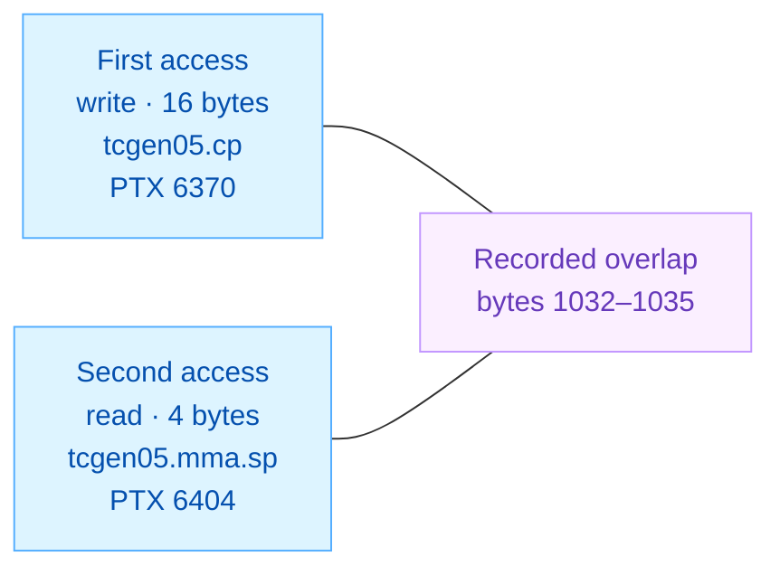
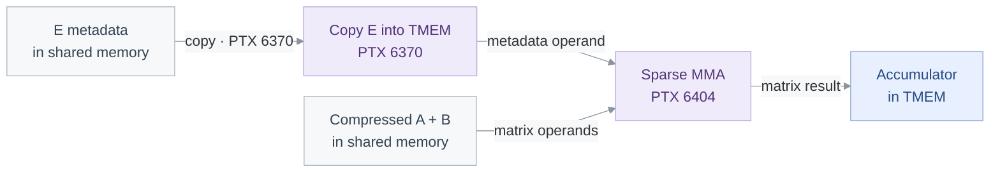
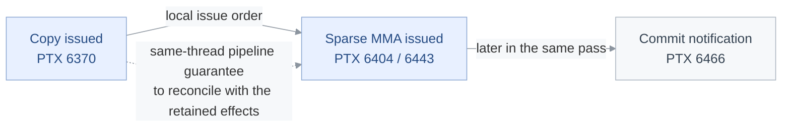

<!-- report-layout:v2 -->

<!-- verifier-result:start -->
<p align="center">Sparse GEMM · metadata copy and MMA</p>
<h1 align="center">RACE CANDIDATE</h1>

**Inputs:** [PTX](https://github.com/gpu-verifier/sentryward/blob/94a6b26b1990a4b9df7ded3727acc4b4cc36f23c/corpus/cutlass__sparse-gemm-f16__sm_100a.ptx) ([raw](https://github.com/gpu-verifier/sentryward/raw/94a6b26b1990a4b9df7ded3727acc4b4cc36f23c/corpus/cutlass__sparse-gemm-f16__sm_100a.ptx)) · analyzed code; [input.json](https://github.com/gpu-verifier/sentryward/blob/94a6b26b1990a4b9df7ded3727acc4b4cc36f23c/examples/cutlass__sparse-gemm-f16__sm_100a/input.json) · launch, arguments and assumptions.

**Result:** [output.json](https://github.com/gpu-verifier/sentryward/blob/94a6b26b1990a4b9df7ded3727acc4b4cc36f23c/examples/cutlass__sparse-gemm-f16__sm_100a/output.json) · saved verifier findings.

<table>
<thead><tr><th align="left">VERIFIER RESULT · Potentially conflicting accesses</th></tr></thead>
<tbody><tr><td>

The verifier retained potentially conflicting memory accesses.

**Synchronization:** Passed · **Memory:** Failed · **Equivalence:** Not run

The synchronization check passed; the separate memory check still found a conflict. Passing one check does not clear the other.

**Recorded totals:** 1 races · 0 warnings · 0 unresolved.

The pair below is a race candidate to inspect, not an observed GPU failure.

**write / read overlap:** <code>4</code> bytes in <code>tensor</code> memory, at byte offset <code>1032</code>.



Lines connect the two recorded accesses to their shared byte region; they do not show execution order.


<details>
<summary><strong>Locate the accesses and check their recorded overlap</strong></summary>

| Access | Source operation | Model event / instruction | Actor ID |
| --- | --- | --- | --- |
| First access | <code>tcgen05.cp.cta_group::1.128x128b</code><br/>PTX line <code>6370</code> | <code>266</code> / <code>103</code> | <code>0</code> |
| Second access | <code>tcgen05.mma.sp.cta_group::1.kind::</code><br/><code>f16</code><br/>PTX line <code>6404</code> | <code>1919</code> / <code>128</code> | <code>0</code> |

Actor IDs name verifier participants; this record does not itself establish CUDA thread coordinates. Event and instruction IDs identify model records, not source-line numbers.

**Recorded source anchors.** These lines locate the saved events. Their guards and surrounding control flow belong to the code explanation.

<p><strong>First access · saved source location</strong> · <a href="https://github.com/gpu-verifier/sentryward/blob/94a6b26b1990a4b9df7ded3727acc4b4cc36f23c/corpus/cutlass__sparse-gemm-f16__sm_100a.ptx#L6370">physical PTX 6370</a></p>

<pre><code><strong>tcgen05.cp.cta_group::1.128x128b</strong> [%r925], %rd59;</code></pre>


<p><strong>Second access · saved source location</strong> · <a href="https://github.com/gpu-verifier/sentryward/blob/94a6b26b1990a4b9df7ded3727acc4b4cc36f23c/corpus/cutlass__sparse-gemm-f16__sm_100a.ptx#L6404">physical PTX 6404</a> · display wrapping added</p>

<pre><code><strong>tcgen05.mma.sp.cta_group::1.kind::f16</strong> [%r943], %rd60, %rd61, [%r937],
    %r935, {%r936, %r936, %r936, %r936}, p;</code></pre>


**Saved record:** <a href="https://github.com/gpu-verifier/sentryward/blob/94a6b26b1990a4b9df7ded3727acc4b4cc36f23c/examples/cutlass__sparse-gemm-f16__sm_100a/output.json#L409"><code>output.json#/races/0</code></a>. **Overlap check:** constant byte ranges intersect. **Allocation:** <code>cta:(0, 0, 0):tensor:physical.tmem.cta.0</code>. **Address space:** <code>tensor</code>.

</details>

<details>
<summary><strong>Saved status and diagnostic codes</strong></summary>

**Saved result:** <code>potential_race</code> · <a href="https://github.com/gpu-verifier/sentryward/blob/94a6b26b1990a4b9df7ded3727acc4b4cc36f23c/examples/cutlass__sparse-gemm-f16__sm_100a/output.json#L457"><code>output.json#/result</code></a>.

**Operation:** <code>kernel_verification</code>.

**First diagnostic:** <code>conflicting_accesses_unordered</code> · <code>memory_check</code> — Conflicting accesses have no proven required ordering · <a href="https://github.com/gpu-verifier/sentryward/blob/94a6b26b1990a4b9df7ded3727acc4b4cc36f23c/examples/cutlass__sparse-gemm-f16__sm_100a/output.json#L69"><code>output.json#/diagnostics/0</code></a>.

**Checks:** Synchronization <code>passed</code> · Memory <code>failed</code> · Equivalence <code>not_run</code>.

</details>

</td></tr>
<tr><td>

### Analysis scope

**Coverage:** Memory analysis complete: yes · Search complete: **no** · Exhaustive search: **no**.

The memory analysis returned a result, but its search is not complete. This finding is available to inspect; the flags do not establish that all possible conflicts were examined.

**Assumption-dependent:** <code>true</code>. Triggered rules: Representative election, Failed launch cancellation.

This result applies to the supplied launch, arguments and enabled assumptions.

<details>
<summary><strong>Analysis records — open the saved evidence</strong></summary>

Each record link opens its field in the original `output.json`. Model summaries are not full execution traces.

**Check the finding**

- [Diagnostic messages and details · `diagnostics`](https://github.com/gpu-verifier/sentryward/blob/94a6b26b1990a4b9df7ded3727acc4b4cc36f23c/examples/cutlass__sparse-gemm-f16__sm_100a/output.json#L68)
- [Individual check outcomes · `checks`](https://github.com/gpu-verifier/sentryward/blob/94a6b26b1990a4b9df7ded3727acc4b4cc36f23c/examples/cutlass__sparse-gemm-f16__sm_100a/output.json#L56)

**Check how the model was built**

- [PTX translation · `frontend`](https://github.com/gpu-verifier/sentryward/blob/94a6b26b1990a4b9df7ded3727acc4b4cc36f23c/examples/cutlass__sparse-gemm-f16__sm_100a/output.json#L115)
- [Model and source bindings · `semantic_program`](https://github.com/gpu-verifier/sentryward/blob/94a6b26b1990a4b9df7ded3727acc4b4cc36f23c/examples/cutlass__sparse-gemm-f16__sm_100a/output.json#L471)
- [Synchronization-check setup · `synchronization_input`](https://github.com/gpu-verifier/sentryward/blob/94a6b26b1990a4b9df7ded3727acc4b4cc36f23c/examples/cutlass__sparse-gemm-f16__sm_100a/output.json#L746)

**Check values separately**

- [Value-analysis status · `value_analysis`](https://github.com/gpu-verifier/sentryward/blob/94a6b26b1990a4b9df7ded3727acc4b4cc36f23c/examples/cutlass__sparse-gemm-f16__sm_100a/output.json#L774)
- [Numerical comparison · `equivalence`](https://github.com/gpu-verifier/sentryward/blob/94a6b26b1990a4b9df7ded3727acc4b4cc36f23c/examples/cutlass__sparse-gemm-f16__sm_100a/output.json#L79)

For the records explained in this report, see the [Evidence appendix](#evidence-appendix).

</details>

</td></tr></tbody>
</table>
<!-- verifier-result:end -->

<!-- code-explanation:start -->

## Code explanation

Interpretation from the PTX and saved inputs: how the reported operations fit together and what remains to check.

### 1. The two reported instructions share the metadata path

This kernel multiplies compressed **A** by **B**. Sparse metadata **E** identifies which A positions are present. The reported copy moves shared-memory data into TMEM; the reported sparse MMA has a TMEM metadata operand. The diagram follows that metadata path.

The saved candidate is a **16-byte write and a 4-byte read that overlap by 4 bytes**. Both records name the same actor. The read is linked to the MMA instruction, but its exact operand is not identified in the saved record. The source-level metadata path and the recorded read effect still need to be matched.



Arrows show source-level data roles. The two highlighted operations match the saved source locations; this diagram does not assign the saved read effect to an operand or assert completion order.

<p><strong>The reported TMEM copy and sparse MMA</strong> · <a href="https://github.com/gpu-verifier/sentryward/blob/94a6b26b1990a4b9df7ded3727acc4b4cc36f23c/corpus/cutlass__sparse-gemm-f16__sm_100a.ptx#L6370-L6404" title="Open the original PTX">physical PTX 6370, 6403–6404</a> · display wrapping added</p>

<ul>
<li><code>%rd59</code> — Shared-memory copy descriptor for E</li>
<li><code>%r925</code> — TMEM destination for the metadata copy</li>
<li><code>%r937</code> — TMEM metadata address supplied to the MMA</li>
<li><code>%r943</code> — TMEM accumulator destination</li>
<li><code>p</code> — Whether the MMA reads the previous accumulator</li>
</ul>

<pre><code><a href="https://docs.nvidia.com/cuda/archive/13.2.0/parallel-thread-execution/index.html#tcgen05-instructions-tcgen05-cp"><strong>tcgen05.cp.cta_group::1.128x128b</strong></a> <strong>[%r925]</strong>, %rd59;
…
<strong>setp.ne.b32</strong> p, %r1008, 0;
<a href="https://docs.nvidia.com/cuda/archive/13.2.0/parallel-thread-execution/index.html#tcgen05-mma-instructions"><strong>tcgen05.mma.sp.cta_group::1.kind::f16</strong></a> [%r943], %rd60, %rd61, <strong>[%r937]</strong>,
    %r935, {%r936, %r936, %r936, %r936}, p;</code></pre>


<details>
<summary><strong>Derivation: metadata path and overlap bytes</strong></summary>

#### Which part of the PTX file is this explanation about?

The selected sparse-GEMM kernel occupies physical PTX 4882–7362. Earlier device-function definitions are outside this local explanation. The saved input entry matches this kernel; the two reported source sites lie in its warp-zero compute path.

#### How does E reach the copy source?

The supplied tensor-map descriptor at parameter offset 384 names E.metadata. Warp 2 selects this descriptor and loads metadata into the shared-memory region beginning at +206848, with pipeline-slot and cluster-rank offsets. Warp 0 constructs its <a href="https://docs.nvidia.com/cuda/archive/13.2.0/parallel-thread-execution/index.html#tcgen05-instructions-tcgen05-cp"><code>tcgen05.cp</code></a> source descriptor from the same shared-memory region. The A and B descriptors instead use the regions +34816 and +92160. These distinct bases explain why the copy feeds sparse metadata rather than either matrix operand.

#### Where does that metadata enter the MMA?

The allocation handle is loaded from shared +304. The copy destination is that TMEM handle +256. The sparse MMA syntax gives its fourth operand, [<code>%r937</code>], the metadata role; its first operand, [<code>%r943</code>], is the accumulator. The source derives the metadata operand from the copy destination and the current pass selector. The [PTX 9.2 sparse-MMA definition](https://docs.nvidia.com/cuda/archive/13.2.0/parallel-thread-execution/index.html#tcgen05-mma-instructions-mma-sp) establishes these operand meanings.

#### What do the 16 bytes and 4 bytes describe?

They are individual retained memory effects, not the complete copy or MMA footprint. The saved overlap is allocation-relative bytes 1032–1035 in CTA (0,0,0) TMEM. The output supplies effect identities and source lines, but no effect-to-operand mapping or per-event loop index. Consequently the report does not infer the MMA pass from the byte offset, nor convert the TMEM address operands into byte intervals.

<details>
<summary><strong>Sources: metadata path and overlap bytes</strong></summary>

<blockquote>

##### Source references: Which part of the PTX file is this explanation about?

- <a href="https://github.com/gpu-verifier/sentryward/blob/94a6b26b1990a4b9df7ded3727acc4b4cc36f23c/examples/cutlass__sparse-gemm-f16__sm_100a/input.json#L3"><code>input.json#/entry</code></a>: <code>&quot;_ZN7cutlass13device_kernelI89cutlass3x_sm100_sptensorop_spgemm_f16_f16_f32_void_f16_128x128x64_4x4x1_0_tnt_align16_1smEEvNT_6ParamsE&quot;</code>
- physical PTX 4882-4888,6173-6175,6370,6404,7362: <code>.entry</code>, <code>setp.ne.b32</code>, <a href="https://docs.nvidia.com/cuda/archive/13.2.0/parallel-thread-execution/index.html#tcgen05-instructions-tcgen05-cp"><code>tcgen05.cp</code></a>, <a href="https://docs.nvidia.com/cuda/archive/13.2.0/parallel-thread-execution/index.html#tcgen05-mma-instructions"><code>tcgen05.mma.sp</code></a>

##### Source references: How does E reach the copy source?

- <a href="https://github.com/gpu-verifier/sentryward/blob/94a6b26b1990a4b9df7ded3727acc4b4cc36f23c/examples/cutlass__sparse-gemm-f16__sm_100a/input.json#L278"><code>input.json#/tma_descriptors/1/offset</code></a>: <code>384</code>
- <a href="https://github.com/gpu-verifier/sentryward/blob/94a6b26b1990a4b9df7ded3727acc4b4cc36f23c/examples/cutlass__sparse-gemm-f16__sm_100a/input.json#L279"><code>input.json#/tma_descriptors/1/object</code></a>: <code>&quot;E.metadata&quot;</code>
- physical PTX 4895-4897,5519-5528,5535-5538,5684-5708,6190-6207,6365-6368: <code>%tid.x</code>, <code>384</code>, <code>206848</code>, <code>34816</code>, <code>92160</code>, <code>%rd59</code>

##### Source references: Where does that metadata enter the MMA?

- physical PTX 9,6188-6189,6266-6267,6373-6374,6394-6404: <code>.version 9.2</code>, <code>add.s32</code>, <code>%r925</code>, <code>%r937</code>, <code>%r943</code>, <a href="https://docs.nvidia.com/cuda/archive/13.2.0/parallel-thread-execution/index.html#tcgen05-mma-instructions"><code>tcgen05.mma.sp</code></a>

##### Source references: What do the 16 bytes and 4 bytes describe?

- <a href="https://github.com/gpu-verifier/sentryward/blob/94a6b26b1990a4b9df7ded3727acc4b4cc36f23c/examples/cutlass__sparse-gemm-f16__sm_100a/output.json#L433"><code>output.json#/races/0/region/offset</code></a>: <code>1032</code>
- <a href="https://github.com/gpu-verifier/sentryward/blob/94a6b26b1990a4b9df7ded3727acc4b4cc36f23c/examples/cutlass__sparse-gemm-f16__sm_100a/output.json#L432"><code>output.json#/races/0/region/bytes</code></a>: <code>4</code>
- <a href="https://github.com/gpu-verifier/sentryward/blob/94a6b26b1990a4b9df7ded3727acc4b4cc36f23c/examples/cutlass__sparse-gemm-f16__sm_100a/output.json#L431"><code>output.json#/races/0/region/allocation</code></a>: <code>&quot;cta:(0, 0, 0):tensor:physical.tmem.cta.0&quot;</code>
- <a href="https://github.com/gpu-verifier/sentryward/blob/94a6b26b1990a4b9df7ded3727acc4b4cc36f23c/examples/cutlass__sparse-gemm-f16__sm_100a/output.json#L414"><code>output.json#/races/0/first/effect_index</code></a>: <code>1</code>
- <a href="https://github.com/gpu-verifier/sentryward/blob/94a6b26b1990a4b9df7ded3727acc4b4cc36f23c/examples/cutlass__sparse-gemm-f16__sm_100a/output.json#L439"><code>output.json#/races/0/second/effect_index</code></a>: <code>226</code>

##### Additional section references

- <a href="https://github.com/gpu-verifier/sentryward/blob/94a6b26b1990a4b9df7ded3727acc4b4cc36f23c/examples/cutlass__sparse-gemm-f16__sm_100a/input.json#L250"><code>input.json#/tma_descriptors/0/object</code></a>: <code>&quot;A.compressed&quot;</code>
- <a href="https://github.com/gpu-verifier/sentryward/blob/94a6b26b1990a4b9df7ded3727acc4b4cc36f23c/examples/cutlass__sparse-gemm-f16__sm_100a/input.json#L312"><code>input.json#/tma_descriptors/2/object</code></a>: <code>&quot;B&quot;</code>
- physical PTX 5525-5528,5670-5673,5679-5681,5701-5708: <code>384</code>, <code>34816</code>, <code>92160</code>, <code>206848</code>, <a href="https://docs.nvidia.com/cuda/archive/13.2.0/parallel-thread-execution/index.html#data-movement-and-conversion-instructions-cp-async-bulk-tensor"><code>cp.async.bulk.tensor.4d</code></a>
- physical PTX 6188-6207,6365-6404: <code>%r925</code>, <code>%rd59</code>, <code>%r937</code>, <a href="https://docs.nvidia.com/cuda/archive/13.2.0/parallel-thread-execution/index.html#tcgen05-instructions-tcgen05-cp"><code>tcgen05.cp</code></a>, <a href="https://docs.nvidia.com/cuda/archive/13.2.0/parallel-thread-execution/index.html#tcgen05-mma-instructions"><code>tcgen05.mma.sp</code></a>
- <a href="https://github.com/gpu-verifier/sentryward/blob/94a6b26b1990a4b9df7ded3727acc4b4cc36f23c/examples/cutlass__sparse-gemm-f16__sm_100a/output.json#L413"><code>output.json#/races/0/first/bytes</code></a>: <code>16</code>
- <a href="https://github.com/gpu-verifier/sentryward/blob/94a6b26b1990a4b9df7ded3727acc4b4cc36f23c/examples/cutlass__sparse-gemm-f16__sm_100a/output.json#L438"><code>output.json#/races/0/second/bytes</code></a>: <code>4</code>
- <a href="https://github.com/gpu-verifier/sentryward/blob/94a6b26b1990a4b9df7ded3727acc4b4cc36f23c/examples/cutlass__sparse-gemm-f16__sm_100a/output.json#L412"><code>output.json#/races/0/first/actor</code></a>: <code>0</code>
- <a href="https://github.com/gpu-verifier/sentryward/blob/94a6b26b1990a4b9df7ded3727acc4b4cc36f23c/examples/cutlass__sparse-gemm-f16__sm_100a/output.json#L437"><code>output.json#/races/0/second/actor</code></a>: <code>0</code>

</blockquote>

</details>

</details>

### 2. One metadata copy serves two compute passes

For the supplied `K = 128`, the compute loop takes **two passes**, each with two sparse MMAs. The first pass copies the metadata into TMEM; the second reuses it.

Within warp 0, separate elections choose the copy and MMA issuers. The saved representative-election rule selects lane 0 when it participates. The table follows source control flow; the saved read record does not identify its pass.

| Compute pass | Metadata copy · PTX 6370 | MMA pair · PTX 6404 / 6443 |
| --- | --- | --- |
| First | Issued once by the elected lane | Initialize the accumulator, then accumulate |
| Second | Skipped; reuse the metadata | Both accumulate; metadata selector advances |

<p><strong>The alternating pass guard controls the metadata copy</strong> · <a href="https://github.com/gpu-verifier/sentryward/blob/94a6b26b1990a4b9df7ded3727acc4b4cc36f23c/corpus/cutlass__sparse-gemm-f16__sm_100a.ptx#L6346-L6370" title="Open the original PTX">physical PTX 6346–6349, 6363–6370</a></p>

<ul>
<li><code>%r1005</code> — Pass counter: 1 on the first pass, 2 on the second</li>
<li><code>%r923</code> — Election result: 1 only for the chosen copy issuer</li>
</ul>

<pre><code><strong>and.b32</strong> %r921, %r1005, 1;
<strong>setp.ne.b32</strong> %p132, %r921, 0;
<strong>not.pred</strong> %p133, %p132;
<strong>@%p133</strong> <strong>bra</strong> $L__BB1_81;
…
<strong>setp.eq.b32</strong> %p134, %r923, 0;
<strong>@%p134</strong> <strong>bra</strong> $L__BB1_81;
<strong>shl.b32</strong> %r926, %r1009, 7;
<strong>add.s32</strong> %r927, %r926, %r45;
<strong>mov.b64</strong> {_, %r928}, %rd4;
<strong>mov.b64</strong> %rd59, {%r927, %r928};
// begin inline asm
<a href="https://docs.nvidia.com/cuda/archive/13.2.0/parallel-thread-execution/index.html#tcgen05-instructions-tcgen05-cp"><strong>tcgen05.cp.cta_group::1.128x128b</strong></a> [%r925], %rd59;</code></pre>


<details>
<summary><strong>Derivation: compute passes and elected issuers</strong></summary>

#### Why exactly two compute passes?

The K parameter is loaded at offset 12. For `K=128`, the code at PTX 5359–5363 computes `(128+63)>>6 = 2`. The loop counter starts at -max(2,1), increments once per pass, and exits at zero: -2 → -1 → 0. The `K<1` bypass is false. The outer loop repeats only if launch cancellation succeeds; the saved <code>clc_always_fails</code> assumption makes that condition false in this modeled run.

#### How do the copy and MMA choices change?

The copy counter starts at 1 and is tested for an odd low bit, so only the first pass enters its election. The metadata selector starts at 0 and toggles to 1, changing the first MMA metadata-address expression from (<code>copy_base</code> + 0) & ~1 to (<code>copy_base</code> + 2) & ~1. A second MMA at PTX 6443 uses the adjacent selector. The first MMA enable-input-d predicate starts false and becomes true after the first pass; the second MMA always enables accumulation. These are source-derived operand choices, not byte-range reconstruction.

#### Which threads reach these elections?

The warp index comes from `tid.x >> 5`. Warp 0 takes the branch at PTX 5524, then the branch at PTX 5972, and falls through the warp-zero guard at PTX 6175. The compute-pass tests and preceding waits are warp-uniform here. At each full-mask `elect.sync`, the saved representative-election policy selects lane 0; the elected-only branch rejoins before the next election. The source and policy therefore support the same issuing lane for the shown copy/MMA path. This is separate from interpreting the numeric actor ID as a thread coordinate.

<details>
<summary><strong>Sources: compute passes and elected issuers</strong></summary>

<blockquote>

##### Source references: Why exactly two compute passes?

- <a href="https://github.com/gpu-verifier/sentryward/blob/94a6b26b1990a4b9df7ded3727acc4b4cc36f23c/examples/cutlass__sparse-gemm-f16__sm_100a/input.json#L37"><code>input.json#/arguments/3/value</code></a>: <code>128</code>
- <a href="https://github.com/gpu-verifier/sentryward/blob/94a6b26b1990a4b9df7ded3727acc4b4cc36f23c/examples/cutlass__sparse-gemm-f16__sm_100a/input.json#L134"><code>input.json#/declarations/3/offset</code></a>: <code>12</code>
- physical PTX 4894,5359-5363,6208,6214,6244-6248,6283,6299-6305,6470-6477,6500-6509: <code>%r1</code>, <code>%r7</code>, <code>%r1004</code>, <code>%r894</code>, <code>%p141</code>
- <a href="https://github.com/gpu-verifier/sentryward/blob/94a6b26b1990a4b9df7ded3727acc4b4cc36f23c/examples/cutlass__sparse-gemm-f16__sm_100a/output.json#L33"><code>output.json#/assumptions/2/enabled</code></a>: <code>true</code>
- <a href="https://github.com/gpu-verifier/sentryward/blob/94a6b26b1990a4b9df7ded3727acc4b4cc36f23c/examples/cutlass__sparse-gemm-f16__sm_100a/output.json#L36"><code>output.json#/assumptions/2/text</code></a>: <code>&quot;Every cluster launch cancellation request fails.&quot;</code>

##### Source references: How do the copy and MMA choices change?

- physical PTX 6300-6304,6346-6349,6373-6374,6394-6404,6426-6443,6470-6475: <code>%r1006</code>, <code>%r1005</code>, <code>%r1008</code>, <code>%r937</code>, <code>%r947</code>, <code>%r945</code>

##### Source references: Which threads reach these elections?

- physical PTX 4895-4897,5519-5524,5969-5972,6174-6175,6306-6349,6350-6408: <code>%tid.x</code>, <code>%r4</code>, <code>%p55</code>, <code>%p87</code>, <code>%p97</code>, <code>elect.sync</code>, <code>-1</code>
- <a href="https://github.com/gpu-verifier/sentryward/blob/94a6b26b1990a4b9df7ded3727acc4b4cc36f23c/examples/cutlass__sparse-gemm-f16__sm_100a/output.json#L319"><code>output.json#/frontend_assumptions/election_policy</code></a>: <code>{&quot;fallback&quot;:&quot;lowest_member&quot;,&quot;preferred_lane&quot;:0,&quot;strategy&quot;:&quot;preferred_member&quot;}</code>
- <a href="https://github.com/gpu-verifier/sentryward/blob/94a6b26b1990a4b9df7ded3727acc4b4cc36f23c/examples/cutlass__sparse-gemm-f16__sm_100a/output.json#L412"><code>output.json#/races/0/first/actor</code></a>: <code>0</code>
- <a href="https://github.com/gpu-verifier/sentryward/blob/94a6b26b1990a4b9df7ded3727acc4b4cc36f23c/examples/cutlass__sparse-gemm-f16__sm_100a/output.json#L437"><code>output.json#/races/0/second/actor</code></a>: <code>0</code>

##### Additional section references

- physical PTX 4894-4897,5359-5363,5519-5524,5969-5972,6174-6175: <code>%tid.x</code>, <code>%r7</code>, <code>%r4</code>
- physical PTX 6208,6214,6299-6305,6346-6364,6386-6393,6418-6425,6470-6477: <code>%r1005</code>, <code>%r1004</code>, <code>%r1006</code>, <code>elect.sync</code>, <code>%p138</code>
- physical PTX 6373-6374,6394,6403-6404,6426-6443: <code>%r937</code>, <code>%r947</code>, <a href="https://docs.nvidia.com/cuda/archive/13.2.0/parallel-thread-execution/index.html#tcgen05-mma-instructions"><code>tcgen05.mma.sp</code></a>
- <a href="https://github.com/gpu-verifier/sentryward/blob/94a6b26b1990a4b9df7ded3727acc4b4cc36f23c/examples/cutlass__sparse-gemm-f16__sm_100a/output.json#L25"><code>output.json#/assumptions/1/enabled</code></a>: <code>true</code>
- <a href="https://github.com/gpu-verifier/sentryward/blob/94a6b26b1990a4b9df7ded3727acc4b4cc36f23c/examples/cutlass__sparse-gemm-f16__sm_100a/output.json#L321"><code>output.json#/frontend_assumptions/election_policy/preferred_lane</code></a>: <code>0</code>

</blockquote>

</details>

</details>

### 3. The same-thread pipeline has an ordering guarantee

PTX 9.2 gives `tcgen05.cp → tcgen05.mma` a [pipelined ordering guarantee](https://docs.nvidia.com/cuda/archive/13.2.0/parallel-thread-execution/index.html#tcgen05-memory-consistency-model-pipelined-instructions) with the same `cta_group`. Its [same-thread pattern](https://docs.nvidia.com/cuda/archive/13.2.0/parallel-thread-execution/index.html#tcgen05-memory-consistency-model-canonical-sync-patterns-pipelined-same-thread) needs no extra ordering instruction. The inspected path uses `cta_group::1` and, under the saved election policy, the same issuing lane.

**The unresolved issue is how the saved read maps to this path and how the model represents that ordering.** A missing explicit wait is therefore not an established cause. The saved `potential_race` result remains unchanged.



Solid arrows show the inspected local issue sequence. The dotted edge names the applicable ISA ordering rule to check against the saved effects; it is not a recorded execution trace. Commit follows the MMAs and is not itself a blocking wait.

<details>
<summary><strong>Derivation: pipeline ordering and the saved read</strong></summary>

#### Which ordering is supplied by the instruction pipeline?

The official PTX 9.2 rule lists <a href="https://docs.nvidia.com/cuda/archive/13.2.0/parallel-thread-execution/index.html#tcgen05-instructions-tcgen05-cp"><code>tcgen05.cp.cta_group</code></a>::N → <a href="https://docs.nvidia.com/cuda/archive/13.2.0/parallel-thread-execution/index.html#tcgen05-mma-instructions"><code>tcgen05.mma.cta_group</code></a>::N for the same N. The same-thread canonical pattern supplies ordering without an explicit wait. Both reported sites use N=1, and the source elections under the recorded policy establish a common issuing lane on this path. That is stronger evidence than merely observing that one instruction appears earlier in the file.

#### What does the later commit do?

After the two sparse MMAs, the elected lane issues a commit to the current input-stage notification barrier at base +56. This tracks prior tcgen05 operations; issuing it is not a blocking wait. The local copy-to-MMA relation must be evaluated using the pipeline guarantee, independently of this later notification.

<p><strong>The commit follows the two sparse MMAs</strong> · <a href="https://github.com/gpu-verifier/sentryward/blob/94a6b26b1990a4b9df7ded3727acc4b4cc36f23c/corpus/cutlass__sparse-gemm-f16__sm_100a.ptx#L6404-L6467" title="Open the original PTX">physical PTX 6404, 6443, 6463–6467</a> · display wrapping added</p>

<ul>
<li><code>%r954</code> — Notification barrier: current input-stage barrier +56</li>
</ul>

<pre><code><a href="https://docs.nvidia.com/cuda/archive/13.2.0/parallel-thread-execution/index.html#tcgen05-mma-instructions"><strong>tcgen05.mma.sp.cta_group::1.kind::f16</strong></a> [%r943], %rd60, %rd61, [%r937],
    %r935, {%r936, %r936, %r936, %r936}, p;
…
<a href="https://docs.nvidia.com/cuda/archive/13.2.0/parallel-thread-execution/index.html#tcgen05-mma-instructions"><strong>tcgen05.mma.sp.cta_group::1.kind::f16</strong></a> [%r943], %rd62, %rd63, [%r947],
    %r944, {%r946, %r946, %r946, %r946}, p;
…
<strong>add.s32</strong> %r954, %r913, 56;
// begin inline asm
{
<a href="https://docs.nvidia.com/cuda/archive/13.2.0/parallel-thread-execution/index.html#tcgen-async-sync-operations-commit"><strong>tcgen05.commit.cta_group::1.mbarrier::arrive::one.shared::cluster.multicast::cluster.b64</strong></a>
    [%r954], %rs1;
}</code></pre>


#### What is unresolved in the saved result?

The write is event 266 / instruction 103 / effect 1; the read is event 1919 / instruction 128 / effect 226. Both name actor 0, and the source locations are exact. The saved report does not include an effect-to-MMA-operand mapping, per-event pass index or an explanation of why this pair lacks order. In particular, event numbers are identifiers, not timestamps. The result alone cannot settle whether the retained effects expose a model representation problem or another unrecorded cause.

<details>
<summary><strong>Sources: pipeline ordering and the saved read</strong></summary>

<blockquote>

##### Source references: Which ordering is supplied by the instruction pipeline?

- physical PTX 9,6350-6408: <code>.version 9.2</code>, <code>elect.sync</code>, <a href="https://docs.nvidia.com/cuda/archive/13.2.0/parallel-thread-execution/index.html#tcgen05-instructions-tcgen05-cp"><code>tcgen05.cp.cta_group::1</code></a>, <a href="https://docs.nvidia.com/cuda/archive/13.2.0/parallel-thread-execution/index.html#tcgen05-mma-instructions"><code>tcgen05.mma.sp.cta_group::1</code></a>
- <a href="https://github.com/gpu-verifier/sentryward/blob/94a6b26b1990a4b9df7ded3727acc4b4cc36f23c/examples/cutlass__sparse-gemm-f16__sm_100a/output.json#L321"><code>output.json#/frontend_assumptions/election_policy/preferred_lane</code></a>: <code>0</code>

##### Source references: What does the later commit do?

- physical PTX 6308-6311,6404,6443,6447-6466: <code>%r913</code>, <code>elect.sync</code>, <a href="https://docs.nvidia.com/cuda/archive/13.2.0/parallel-thread-execution/index.html#tcgen05-mma-instructions"><code>tcgen05.mma.sp</code></a>, <a href="https://docs.nvidia.com/cuda/archive/13.2.0/parallel-thread-execution/index.html#tcgen-async-sync-operations-commit"><code>tcgen05.commit</code></a>, <code>56</code>

##### Source references: What is unresolved in the saved result?

- <a href="https://github.com/gpu-verifier/sentryward/blob/94a6b26b1990a4b9df7ded3727acc4b4cc36f23c/examples/cutlass__sparse-gemm-f16__sm_100a/output.json#L419"><code>output.json#/races/0/first/event</code></a>: <code>266</code>
- <a href="https://github.com/gpu-verifier/sentryward/blob/94a6b26b1990a4b9df7ded3727acc4b4cc36f23c/examples/cutlass__sparse-gemm-f16__sm_100a/output.json#L420"><code>output.json#/races/0/first/instruction</code></a>: <code>103</code>
- <a href="https://github.com/gpu-verifier/sentryward/blob/94a6b26b1990a4b9df7ded3727acc4b4cc36f23c/examples/cutlass__sparse-gemm-f16__sm_100a/output.json#L414"><code>output.json#/races/0/first/effect_index</code></a>: <code>1</code>
- <a href="https://github.com/gpu-verifier/sentryward/blob/94a6b26b1990a4b9df7ded3727acc4b4cc36f23c/examples/cutlass__sparse-gemm-f16__sm_100a/output.json#L444"><code>output.json#/races/0/second/event</code></a>: <code>1919</code>
- <a href="https://github.com/gpu-verifier/sentryward/blob/94a6b26b1990a4b9df7ded3727acc4b4cc36f23c/examples/cutlass__sparse-gemm-f16__sm_100a/output.json#L445"><code>output.json#/races/0/second/instruction</code></a>: <code>128</code>
- <a href="https://github.com/gpu-verifier/sentryward/blob/94a6b26b1990a4b9df7ded3727acc4b4cc36f23c/examples/cutlass__sparse-gemm-f16__sm_100a/output.json#L439"><code>output.json#/races/0/second/effect_index</code></a>: <code>226</code>
- <a href="https://github.com/gpu-verifier/sentryward/blob/94a6b26b1990a4b9df7ded3727acc4b4cc36f23c/examples/cutlass__sparse-gemm-f16__sm_100a/output.json#L70"><code>output.json#/diagnostics/0/code</code></a>: <code>&quot;conflicting_accesses_unordered&quot;</code>

##### Additional section references

- physical PTX 9,6370,6404,6443,6466: <code>.version 9.2</code>, <a href="https://docs.nvidia.com/cuda/archive/13.2.0/parallel-thread-execution/index.html#tcgen05-instructions-tcgen05-cp"><code>tcgen05.cp.cta_group::1</code></a>, <a href="https://docs.nvidia.com/cuda/archive/13.2.0/parallel-thread-execution/index.html#tcgen05-mma-instructions"><code>tcgen05.mma.sp.cta_group::1</code></a>, <a href="https://docs.nvidia.com/cuda/archive/13.2.0/parallel-thread-execution/index.html#tcgen-async-sync-operations-commit"><code>tcgen05.commit.cta_group::1</code></a>
- <a href="https://github.com/gpu-verifier/sentryward/blob/94a6b26b1990a4b9df7ded3727acc4b4cc36f23c/examples/cutlass__sparse-gemm-f16__sm_100a/output.json#L412"><code>output.json#/races/0/first/actor</code></a>: <code>0</code>
- <a href="https://github.com/gpu-verifier/sentryward/blob/94a6b26b1990a4b9df7ded3727acc4b4cc36f23c/examples/cutlass__sparse-gemm-f16__sm_100a/output.json#L437"><code>output.json#/races/0/second/actor</code></a>: <code>0</code>
- <a href="https://github.com/gpu-verifier/sentryward/blob/94a6b26b1990a4b9df7ded3727acc4b4cc36f23c/examples/cutlass__sparse-gemm-f16__sm_100a/output.json#L457"><code>output.json#/result</code></a>: <code>&quot;potential_race&quot;</code>

</blockquote>

</details>

</details>

### 4. Next check

Trace retained read effect 226 to its MMA operand and pass, then check the model edge from copy event 266 to that read under the PTX 9.2 pipeline rule. The source already establishes the local metadata path, repeated passes and common elected issuer; adding a wait is not yet a justified fix.

<details>
<summary><strong>Evidence for the next check</strong></summary>

- <a href="https://github.com/gpu-verifier/sentryward/blob/94a6b26b1990a4b9df7ded3727acc4b4cc36f23c/examples/cutlass__sparse-gemm-f16__sm_100a/output.json#L439"><code>output.json#/races/0/second/effect_index</code></a>: <code>226</code>
- <a href="https://github.com/gpu-verifier/sentryward/blob/94a6b26b1990a4b9df7ded3727acc4b4cc36f23c/examples/cutlass__sparse-gemm-f16__sm_100a/output.json#L419"><code>output.json#/races/0/first/event</code></a>: <code>266</code>
- physical PTX 6370,6404: <a href="https://docs.nvidia.com/cuda/archive/13.2.0/parallel-thread-execution/index.html#tcgen05-instructions-tcgen05-cp"><code>tcgen05.cp</code></a>, <a href="https://docs.nvidia.com/cuda/archive/13.2.0/parallel-thread-execution/index.html#tcgen05-mma-instructions"><code>tcgen05.mma.sp</code></a>
- <a href="https://github.com/gpu-verifier/sentryward/blob/94a6b26b1990a4b9df7ded3727acc4b4cc36f23c/examples/cutlass__sparse-gemm-f16__sm_100a/output.json#L457"><code>output.json#/result</code></a>: <code>&quot;potential_race&quot;</code>

</details>

<!-- code-explanation:end -->

<!-- verifier-evidence:start -->
## Evidence appendix

Use these records to check the verifier result and source explanation above. JSON pointers refer to the original saved files. Identical prerequisite copies use `same_records_as` to refer to the diagnostic evidence shown once; their original locations and content hashes remain recorded.

<details>
<summary><strong>Diagnostic records — verify the finding</strong></summary>

These are saved verifier records. Truncation flags describe missing records in the original result, not merely collapsed presentation.

#### Retained races

1 saved records. These are the retained sample, not necessarily all findings.

| Record | First / second event | Modes | Saved code |
| --- | --- | --- | --- |
| 0 | <code>266</code> / <code>1919</code> | <code>write</code> / <code>read</code> | <code>not saved</code> |


Byte regions, endpoints and exact locations: <a href="https://github.com/gpu-verifier/sentryward/blob/94a6b26b1990a4b9df7ded3727acc4b4cc36f23c/examples/cutlass__sparse-gemm-f16__sm_100a/output.json#L408"><code>output.json#/races</code></a>.

#### Diagnostics

- <code>conflicting_accesses_unordered</code>: Conflicting accesses have no proven required ordering

<details>
<summary><strong>Exact diagnostic records and metadata</strong></summary>

##### Flags and empty collections

These retain their original top-level keys in `output.json`.

```json
{
  "warnings": [],
  "source_violations": [],
  "verification_limitations": []
}
```

##### Races

<a href="https://github.com/gpu-verifier/sentryward/blob/94a6b26b1990a4b9df7ded3727acc4b4cc36f23c/examples/cutlass__sparse-gemm-f16__sm_100a/output.json#L408"><code>output.json#/races</code></a>

**Retained records:** 1.

```json
[
  {
    "first": {
      "access_index": 0,
      "actor": 0,
      "bytes": 16,
      "effect_index": 1,
      "endpoint": {
        "address": 3,
        "kind": "memory"
      },
      "event": 266,
      "instruction": 103,
      "location": {
        "column": 2,
        "file": "corpus/cutlass__sparse-gemm-f16__sm_100a.ptx",
        "line": 6370
      },
      "mode": "write"
    },
    "overlap": "constant byte ranges intersect",
    "region": {
      "address_space": "tensor",
      "allocation": "cta:(0, 0, 0):tensor:physical.tmem.cta.0",
      "bytes": 4,
      "offset": 1032
    },
    "second": {
      "access_index": 0,
      "actor": 0,
      "bytes": 4,
      "effect_index": 226,
      "endpoint": {
        "address": 1190,
        "kind": "memory"
      },
      "event": 1919,
      "instruction": 128,
      "location": {
        "column": 2,
        "file": "corpus/cutlass__sparse-gemm-f16__sm_100a.ptx",
        "line": 6404
      },
      "mode": "read"
    }
  }
]
```

##### Diagnostics

<a href="https://github.com/gpu-verifier/sentryward/blob/94a6b26b1990a4b9df7ded3727acc4b4cc36f23c/examples/cutlass__sparse-gemm-f16__sm_100a/output.json#L68"><code>output.json#/diagnostics</code></a>

**Retained records:** 1.

```json
[
  {
    "code": "conflicting_accesses_unordered",
    "details": {
      "count": 1,
      "witnesses_path": "races"
    },
    "message": "Conflicting accesses have no proven required ordering",
    "stage": "memory_check"
  }
]
```

</details>

</details>

<details>
<summary><strong>Assumptions — what qualifies the result</strong></summary>

Enabled and triggered answer different questions: whether a rule was selected, and whether its applicability was recorded. `triggered: null` means unknown or unmeasured, not inactive.

#### Duplicate TMA stores

**Key:** <code>duplicate_tma_store_benign</code>

**Enabled:** <code>true</code> · **Triggered:** <code>false</code>

Matching same-warp duplicate TMA stores are races in the model, but are reported as warnings under the assumption that their stored values agree.

#### Representative election

**Key:** <code>representative_election</code>

**Enabled:** <code>true</code> · **Triggered:** <code>true</code>

Election selects lane zero when participating, otherwise the lowest participating lane.

#### Failed launch cancellation

**Key:** <code>clc_always_fails</code>

**Enabled:** <code>true</code> · **Triggered:** <code>true</code>

Every cluster launch cancellation request fails.

#### Representative branches

**Key:** <code>representative_branches</code>

**Enabled:** <code>false</code> · **Triggered:** <code>false</code>

Choose fallthrough for an unresolved structured if/else; unknown ordinary instruction guards execute. Terminal control uses CFG classification. Known control and explicit choices take precedence.

#### Bounded computation loops

**Key:** <code>bounded_computation_loops</code>

**Enabled:** <code>false</code> · **Triggered:** <code>false</code>

Execute a configured number of body iterations for unresolved recognized computation loops, counted separately per invocation. Polling and unclassified loops are never forced to complete.

<details>
<summary><strong>Exact assumption settings</strong></summary>

```json
{
  "assumptions": [
    {
      "category": "analysis assumption",
      "enabled": true,
      "key": "duplicate_tma_store_benign",
      "label": "Duplicate TMA stores",
      "text": "Matching same-warp duplicate TMA stores are races in the model, but are reported as warnings under the assumption that their stored values agree.",
      "triggered": false
    },
    {
      "category": "analysis assumption",
      "enabled": true,
      "key": "representative_election",
      "label": "Representative election",
      "text": "Election selects lane zero when participating, otherwise the lowest participating lane.",
      "triggered": true
    },
    {
      "category": "analysis assumption",
      "enabled": true,
      "key": "clc_always_fails",
      "label": "Failed launch cancellation",
      "text": "Every cluster launch cancellation request fails.",
      "triggered": true
    },
    {
      "category": "analysis assumption",
      "enabled": false,
      "key": "representative_branches",
      "label": "Representative branches",
      "text": "Choose fallthrough for an unresolved structured if/else; unknown ordinary instruction guards execute. Terminal control uses CFG classification. Known control and explicit choices take precedence.",
      "triggered": false
    },
    {
      "category": "analysis assumption",
      "enabled": false,
      "key": "bounded_computation_loops",
      "label": "Bounded computation loops",
      "text": "Execute a configured number of body iterations for unresolved recognized computation loops, counted separately per invocation. Polling and unclassified loops are never forced to complete.",
      "triggered": false
    }
  ],
  "semantic_assumptions": {
    "bounded_computation_loops": false,
    "clc_always_fails": true,
    "duplicate_tma_store_benign": true,
    "representative_branches": false,
    "representative_election": true
  },
  "frontend_assumptions": {
    "assertion_failure_forms": [
      "trap",
      "__assertfail"
    ],
    "assertion_uses": 6144,
    "bounded_loop_uses": 0,
    "clc_failure": true,
    "clc_uses": 3105,
    "data_branch_decisions": [],
    "election_policy": {
      "fallback": "lowest_member",
      "preferred_lane": 0,
      "strategy": "preferred_member"
    },
    "election_uses": 21024,
    "fixed_election": true,
    "isolated_launch": true,
    "noalias_unbounded": false,
    "opaque_compute_regions": [],
    "pointer_contract": {
      "aliasing": "distinct_objects_noalias",
      "extent_bytes": "unbounded"
    },
    "representative_branch_uses": 0,
    "trap_only_equality_assertions_hold": true
  },
  "assumption_reporting": "triggered=null means applicability was not measured or analysis was not reached",
  "assumption_dependent": true
}
```

</details>

</details>

<details>
<summary><strong>Value analysis — independent status</strong></summary>

Memory safety and numerical equivalence are separate results.

**Value analysis:** <code>unsupported</code> · <a href="https://github.com/gpu-verifier/sentryward/blob/94a6b26b1990a4b9df7ded3727acc4b4cc36f23c/examples/cutlass__sparse-gemm-f16__sm_100a/output.json#L774"><code>output.json#/value_analysis</code></a>

**Checks:** Synchronization <code>not_requested</code> · Memory <code>not_requested</code> · Equivalence <code>not_requested</code>.

- **Prerequisite status:** <code>potential_race</code>
- **Scope:** {&quot;operation&quot;:&quot;<code>value_analysis</code>&quot;}
- **Diagnostic:** <code>prerequisite_check_not_passed</code> · <code>pipeline</code> · <a href="https://github.com/gpu-verifier/sentryward/blob/94a6b26b1990a4b9df7ded3727acc4b4cc36f23c/examples/cutlass__sparse-gemm-f16__sm_100a/output.json#L781"><code>output.json#/value_analysis/diagnostics/0</code></a>

**Equivalence:** <code>unsupported</code> · <a href="https://github.com/gpu-verifier/sentryward/blob/94a6b26b1990a4b9df7ded3727acc4b4cc36f23c/examples/cutlass__sparse-gemm-f16__sm_100a/output.json#L79"><code>output.json#/equivalence</code></a>

**Checks:** Synchronization <code>not_requested</code> · Memory <code>not_requested</code> · Equivalence <code>not_run</code>.

- **Scope:** {&quot;operation&quot;:&quot;equivalence&quot;}
- **Diagnostic:** <code>prerequisite_check_not_passed</code> · <code>pipeline</code> · <a href="https://github.com/gpu-verifier/sentryward/blob/94a6b26b1990a4b9df7ded3727acc4b4cc36f23c/examples/cutlass__sparse-gemm-f16__sm_100a/output.json#L86"><code>output.json#/equivalence/diagnostics/0</code></a>

<details>
<summary><strong>Exact value-analysis fields and large-data references</strong></summary>

##### Value analysis

```json
{
  "equivalence_check": "blocked",
  "prerequisite_status": "potential_race",
  "result": "unsupported",
  "checks": {
    "equivalence": "not_requested",
    "memory": "not_requested",
    "synchronization": "not_requested"
  },
  "diagnostics": [
    {
      "code": "prerequisite_check_not_passed",
      "details": {
        "prerequisite_checks": {
          "equivalence": "not_run",
          "memory": "failed",
          "synchronization": "passed"
        },
        "prerequisite_diagnostics": [
          {
            "code": "conflicting_accesses_unordered",
            "details": {
              "count": 1,
              "witnesses_path": "races"
            },
            "message": "Conflicting accesses have no proven required ordering",
            "stage": "memory_check"
          }
        ],
        "prerequisite_result": "potential_race",
        "prerequisite_status": "potential_race"
      },
      "stage": "pipeline"
    }
  ],
  "scalar_fold": {
    "checks": {
      "equivalence": "not_requested",
      "memory": "not_requested",
      "synchronization": "not_requested"
    },
    "diagnostics": [
      {
        "code": "memory_elimination_not_completed",
        "stage": "pipeline"
      }
    ],
    "result": "unsupported",
    "scope": {
      "operation": "scalar_fold"
    }
  },
  "scope": {
    "operation": "value_analysis"
  }
}
```

##### Equivalence

```json
{
  "result": "unsupported",
  "checks": {
    "equivalence": "not_run",
    "memory": "not_requested",
    "synchronization": "not_requested"
  },
  "diagnostics": [
    {
      "code": "prerequisite_check_not_passed",
      "details": {
        "prerequisite_checks": {
          "equivalence": "not_run",
          "memory": "failed",
          "synchronization": "passed"
        },
        "prerequisite_diagnostics": [
          {
            "code": "conflicting_accesses_unordered",
            "details": {
              "count": 1,
              "witnesses_path": "races"
            },
            "message": "Conflicting accesses have no proven required ordering",
            "stage": "memory_check"
          }
        ],
        "prerequisite_result": "potential_race"
      },
      "stage": "pipeline"
    }
  ],
  "scope": {
    "operation": "equivalence"
  }
}
```

</details>

</details>

<details>
<summary><strong>Input configuration — reproduce this run</strong></summary>

**Launch and arguments define this run.** Tuple coordinates use `(x, y, z)`; grid and cluster dimensions count blocks, while block dimensions count threads.

| Launch quantity | Saved value |
| --- | --- |
| Grid · blocks | <code>[4,4,1]</code> |
| Block · threads | <code>[256,1,1]</code> |
| Cluster · blocks | <code>[4,4,1]</code> |
| Dynamic shared memory · bytes | <code>232448</code> |

**Arguments:** 22 retained entries. Exact parameter bindings, descriptors and entry name: <a href="https://github.com/gpu-verifier/sentryward/blob/94a6b26b1990a4b9df7ded3727acc4b4cc36f23c/examples/cutlass__sparse-gemm-f16__sm_100a/input.json#L1"><code>input.json#</code></a>.

<details>
<summary><strong>Exact input configuration</strong></summary>

```json
{
  "schema": "spverify.kernel-input/v1",
  "entry": "_ZN7cutlass13device_kernelI89cutlass3x_sm100_sptensorop_spgemm_f16_f16_f32_void_f16_128x128x64_4x4x1_0_tnt_align16_1smEEvNT_6ParamsE",
  "launch": {
    "grid_dim": [
      4,
      4,
      1
    ],
    "block_dim": [
      256,
      1,
      1
    ],
    "cluster_dim": [
      4,
      4,
      1
    ],
    "dynamic_shared_bytes": 232448
  },
  "arguments": [
    {
      "field": "mode",
      "value": 0
    },
    {
      "field": "shape.M",
      "value": 512
    },
    {
      "field": "shape.N",
      "value": 512
    },
    {
      "field": "shape.K",
      "value": 128
    },
    {
      "field": "shape.L",
      "value": 1
    },
    {
      "field": "alpha",
      "value": 1.0
    },
    {
      "field": "alpha.pointer",
      "value": null
    },
    {
      "field": "alpha.stride",
      "value": 0
    },
    {
      "field": "scheduler.problem_tiles_m",
      "value": 1
    },
    {
      "field": "scheduler.problem_tiles_n",
      "value": 1
    },
    {
      "field": "scheduler.problem_tiles_l",
      "value": 1
    },
    {
      "field": "scheduler.cluster_m.divisor",
      "value": 4
    },
    {
      "field": "scheduler.cluster_m.multiplier",
      "value": 2147483648
    },
    {
      "field": "scheduler.cluster_m.shift_right",
      "value": 1
    },
    {
      "field": "scheduler.cluster_n.divisor",
      "value": 4
    },
    {
      "field": "scheduler.cluster_n.multiplier",
      "value": 2147483648
    },
    {
      "field": "scheduler.cluster_n.shift_right",
      "value": 1
    },
    {
      "field": "scheduler.swizzle.divisor",
      "value": 0
    },
    {
      "field": "scheduler.swizzle.multiplier",
      "value": 0
    },
    {
      "field": "scheduler.swizzle.shift_right",
      "value": 0
    },
    {
      "field": "scheduler.raster_order",
      "value": 1
    },
    {
      "field": "scheduler.log_swizzle_size",
      "value": 0
    }
  ],
  "declarations": [
    {
      "name": "mode",
      "parameter": 0,
      "offset": 0,
      "type": "s32"
    },
    {
      "name": "shape.M",
      "parameter": 0,
      "offset": 4,
      "type": "s32"
    },
    {
      "name": "shape.N",
      "parameter": 0,
      "offset": 8,
      "type": "s32"
    },
    {
      "name": "shape.K",
      "parameter": 0,
      "offset": 12,
      "type": "s32"
    },
    {
      "name": "shape.L",
      "parameter": 0,
      "offset": 16,
      "type": "s32"
    },
    {
      "name": "alpha",
      "parameter": 0,
      "offset": 1824,
      "type": "f32"
    },
    {
      "name": "alpha.pointer",
      "parameter": 0,
      "offset": 1832,
      "type": "pointer"
    },
    {
      "name": "alpha.stride",
      "parameter": 0,
      "offset": 1840,
      "type": "s64"
    },
    {
      "name": "scheduler.problem_tiles_m",
      "parameter": 0,
      "offset": 2432,
      "type": "u32"
    },
    {
      "name": "scheduler.problem_tiles_n",
      "parameter": 0,
      "offset": 2436,
      "type": "u32"
    },
    {
      "name": "scheduler.problem_tiles_l",
      "parameter": 0,
      "offset": 2440,
      "type": "u32"
    },
    {
      "name": "scheduler.cluster_m.divisor",
      "parameter": 0,
      "offset": 2444,
      "type": "s32"
    },
    {
      "name": "scheduler.cluster_m.multiplier",
      "parameter": 0,
      "offset": 2448,
      "type": "u32"
    },
    {
      "name": "scheduler.cluster_m.shift_right",
      "parameter": 0,
      "offset": 2452,
      "type": "u32"
    },
    {
      "name": "scheduler.cluster_n.divisor",
      "parameter": 0,
      "offset": 2456,
      "type": "s32"
    },
    {
      "name": "scheduler.cluster_n.multiplier",
      "parameter": 0,
      "offset": 2460,
      "type": "u32"
    },
    {
      "name": "scheduler.cluster_n.shift_right",
      "parameter": 0,
      "offset": 2464,
      "type": "u32"
    },
    {
      "name": "scheduler.swizzle.divisor",
      "parameter": 0,
      "offset": 2468,
      "type": "s32"
    },
    {
      "name": "scheduler.swizzle.multiplier",
      "parameter": 0,
      "offset": 2472,
      "type": "u32"
    },
    {
      "name": "scheduler.swizzle.shift_right",
      "parameter": 0,
      "offset": 2476,
      "type": "u32"
    },
    {
      "name": "scheduler.raster_order",
      "parameter": 0,
      "offset": 2480,
      "type": "s32"
    },
    {
      "name": "scheduler.log_swizzle_size",
      "parameter": 0,
      "offset": 2484,
      "type": "s32"
    }
  ],
  "tma_descriptors": [
    {
      "parameter": 0,
      "offset": 128,
      "object": "A.compressed",
      "element_type": "f16",
      "global_shape": [
        64,
        512,
        1
      ],
      "coordinate_strides_bytes": [
        2,
        128,
        65536
      ],
      "box_shape": [
        32,
        32,
        1
      ],
      "element_strides": [
        1,
        1,
        1
      ],
      "swizzle": "64B",
      "interleave": "none",
      "oob_fill": "zero"
    },
    {
      "parameter": 0,
      "offset": 384,
      "object": "E.metadata",
      "element_type": "u64",
      "global_shape": [
        256,
        4,
        1,
        1
      ],
      "coordinate_strides_bytes": [
        8,
        2048,
        8192,
        8192
      ],
      "box_shape": [
        64,
        1,
        1,
        1
      ],
      "element_strides": [
        1,
        1,
        1,
        1
      ],
      "swizzle": "none",
      "interleave": "none",
      "oob_fill": "zero"
    },
    {
      "parameter": 0,
      "offset": 640,
      "object": "B",
      "element_type": "f16",
      "global_shape": [
        128,
        512,
        1
      ],
      "coordinate_strides_bytes": [
        2,
        256,
        131072
      ],
      "box_shape": [
        64,
        32,
        1
      ],
      "element_strides": [
        1,
        1,
        1
      ],
      "swizzle": "128B",
      "interleave": "none",
      "oob_fill": "zero"
    },
    {
      "parameter": 0,
      "offset": 2176,
      "object": "D",
      "element_type": "f16",
      "global_shape": [
        512,
        512,
        1
      ],
      "coordinate_strides_bytes": [
        2,
        1024,
        524288
      ],
      "box_shape": [
        64,
        128,
        1
      ],
      "element_strides": [
        1,
        1,
        1
      ],
      "swizzle": "128B",
      "interleave": "none",
      "oob_fill": "zero"
    }
  ],
  "assumptions": {
    "duplicate_tma_store_benign": true,
    "representative_election": true,
    "clc_always_fails": true
  }
}
```

</details>

</details>

<details>
<summary><strong>Provenance and coverage — check the saved run</strong></summary>

Use the original-file hashes to identify the run. Coverage flags describe what this result establishes; implementation statistics remain separate below.

**Coverage:** Memory analysis complete: yes · Search complete: **no** · Exhaustive search: **no**.

The memory analysis returned a result, but its search is not complete. This finding is available to inspect; the flags do not establish that all possible conflicts were examined.

**Assumption-dependent:** <code>true</code>. Triggered rules: Representative election, Failed launch cancellation.


#### Original artifacts

- **Input configuration:** [input.json](https://github.com/gpu-verifier/sentryward/blob/94a6b26b1990a4b9df7ded3727acc4b4cc36f23c/examples/cutlass__sparse-gemm-f16__sm_100a/input.json) · <code>examples/cutlass__sparse-gemm-f16__sm_100a/input.json</code> · SHA-256 <code>3a94a65d691421da954c4a2ee8339b33a3cdb5d37e0d3314f5c34faa77e09761</code>
- **Verifier output:** [output.json](https://github.com/gpu-verifier/sentryward/blob/94a6b26b1990a4b9df7ded3727acc4b4cc36f23c/examples/cutlass__sparse-gemm-f16__sm_100a/output.json) · <code>examples/cutlass__sparse-gemm-f16__sm_100a/output.json</code> · SHA-256 <code>1d0ca3eea0e4ab6e7d3440c8cdbbf44079e3feec29c45ce8aed2641fa23efd48</code>
- **PTX:** [cutlass__sparse-gemm-f16__sm_100a.ptx](https://github.com/gpu-verifier/sentryward/blob/94a6b26b1990a4b9df7ded3727acc4b4cc36f23c/corpus/cutlass__sparse-gemm-f16__sm_100a.ptx) · <code>corpus/cutlass__sparse-gemm-f16__sm_100a.ptx</code> · SHA-256 <code>b5592d2cb79ed86da596f242664dd68636b16a36fa263a14c45e13ae76615b5d</code>

Large structures are referenced by exact JSON pointer, item count and SHA-256 of their canonical JSON (UTF-8, sorted keys, compact separators). Original-artifact hashes above are hashes of the file bytes.

<details>
<summary><strong>Exact coverage, implementation and provenance fields</strong></summary>

```json
{
  "address_model": {
    "address_invariants": [],
    "kind": "symbolic",
    "layers": [
      0,
      2
    ],
    "solver": "z3",
    "solver_timeout_ms": 100
  },
  "checks": {
    "equivalence": "not_run",
    "memory": "failed",
    "synchronization": "passed"
  },
  "counts": {
    "edges": 9901336,
    "events": 3921112,
    "instructions": 675730,
    "memory_accesses": 2621360,
    "threads": 4096
  },
  "frontend": {
    "address_value_bridge": {
      "diagnostics": [],
      "first_unavailable_reason": "",
      "queries": 0,
      "resolved": 0,
      "source": "value_lowering",
      "unavailable": 0,
      "value_view_complete": true
    },
    "cluster_completion_joins": 1,
    "cta_count": 16,
    "dependency_compression": {
      "bulk_read_wait": {
        "consumers": 1024,
        "emitted_references": 512,
        "original_references": 512,
        "prefix_effects": 0
      },
      "tcgen_commit": {
        "consumers": 48,
        "emitted_references": 352,
        "original_references": 976,
        "prefix_effects": 48
      },
      "tcgen_load_wait": {
        "consumers": 2048,
        "emitted_references": 4096,
        "original_references": 4096,
        "prefix_effects": 0
      }
    },
    "diagnostic_sample_count": 0,
    "discharged_codes": [
      "tcgen_cp_memory_effect_refinement",
      "mma_memory_effect_refinement",
      "tcgen_pipeline_effect_refinement",
      "tcgen_commit_notification_order_refinement"
    ],
    "executed_records": 1506163,
    "frontend_assumptions": {
      "assertion_failure_forms": [
        "trap",
        "__assertfail"
      ],
      "assertion_uses": 6144,
      "bounded_loop_uses": 0,
      "clc_failure": true,
      "clc_uses": 3105,
      "data_branch_decisions": [],
      "election_policy": {
        "fallback": "lowest_member",
        "preferred_lane": 0,
        "strategy": "preferred_member"
      },
      "election_uses": 21024,
      "fixed_election": true,
      "isolated_launch": true,
      "noalias_unbounded": false,
      "opaque_compute_regions": [],
      "pointer_contract": {
        "aliasing": "distinct_objects_noalias",
        "extent_bytes": "unbounded"
      },
      "representative_branch_uses": 0,
      "trap_only_equality_assertions_hold": true
    },
    "implementation": "cpp",
    "input_objects": [],
    "lowered_instruction_count": 675730,
    "mma_refinement": {
      "blocked": [],
      "discharged": 64
    },
    "reached_opcodes": {
      "add.s32": 104402,
      "add.s64": 3664,
      "and.b16": 1568,
      "and.b32": 37952,
      "and.pred": 512,
      "bar.arrive": 512,
      "bar.sync": 10240,
      "bar.warp.sync": 1024,
      "barrier.cluster.arrive.relaxed.aligned": 4096,
      "barrier.cluster.wait.aligned": 4096,
      "bra": 80975,
      "bra.uni": 1056,
      "clusterlaunchcontrol.query_cancel.is_canceled.pred.b128": 3104,
      "clusterlaunchcontrol.try_cancel.async.shared::cta.mbarrier::complete_tx::bytes.multicast::cluster::all.b128": 1,
      "cp.async.bulk.commit_group": 1024,
      "cp.async.bulk.tensor.3d.global.shared::cta.bulk_group": 1024,
      "cp.async.bulk.tensor.3d.shared::cluster.global.mbarrier::complete_tx::bytes.multicast::cluster.L2::cache_hint": 64,
      "cp.async.bulk.tensor.4d.shared::cluster.global.mbarrier::complete_tx::bytes.multicast::cluster.L2::cache_hint": 16,
      "cp.async.bulk.wait_group.read": 1024,
      "cvt.rn.f16x2.f32": 131072,
      "cvt.u16.u32": 1568,
      "cvt.u32.u64": 2048,
      "cvt.u64.u32": 1536,
      "cvta.param.u64": 2592,
      "cvta.to.shared.u64": 2048,
      "elect.sync": 21024,
      "fence.mbarrier_init.release.cluster": 24576,
      "fence.proxy.async.shared::cta": 7200,
      "ld.param.b32": 29696,
      "ld.param.b64": 8192,
      "ld.param.v4.b32": 6656,
      "ld.shared.b128": 3104,
      "ld.shared.b32": 2560,
      "mad.lo.s32": 13312,
      "mapa.shared::cluster.u32": 5200,
      "max.s32": 1024,
      "mbarrier.arrive.expect_tx.shared::cluster.b64": 16,
      "mbarrier.arrive.expect_tx.shared::cta.b64": 32,
      "mbarrier.arrive.shared::cluster.b64": 5184,
      "mbarrier.arrive.shared::cta.b64": 32,
      "mbarrier.init.shared::cta.b64": 512,
      "mbarrier.test_wait.parity.shared::cta.b64": 64,
      "mbarrier.try_wait.parity.shared::cta.b64": 17088,
      "mov.b16": 9248,
      "mov.b32": 137360,
      "mov.b64": 8016,
      "mov.s32": 21681,
      "mov.u32": 50176,
      "mul.f32": 262144,
      "mul.hi.u32": 13312,
      "neg.s32": 512,
      "not.pred": 1536,
      "or.b16": 8224,
      "or.b32": 4688,
      "or.b64": 1536,
      "or.pred": 15872,
      "prefetch.tensormap": 80,
      "ret": 4096,
      "selp.b16": 15872,
      "selp.b32": 48064,
      "selp.u32": 3104,
      "setp.eq.b16": 32,
      "setp.eq.b32": 62176,
      "setp.eq.b64": 6144,
      "setp.eq.u32": 96,
      "setp.lt.s32": 11232,
      "setp.lt.u32": 32,
      "setp.ne.b16": 1024,
      "setp.ne.b32": 81504,
      "setp.ne.b64": 4096,
      "shfl.sync.idx.b32": 36864,
      "shl.b16": 4608,
      "shl.b32": 44384,
      "shr.s32": 8192,
      "shr.u32": 27136,
      "st.shared.v4.b32": 32768,
      "sub.s32": 13312,
      "tcgen05.alloc.cta_group::1.sync.aligned.shared::cta.b32": 512,
      "tcgen05.commit.cta_group::1.mbarrier::arrive::one.shared::cluster.b64": 16,
      "tcgen05.commit.cta_group::1.mbarrier::arrive::one.shared::cluster.multicast::cluster.b64": 32,
      "tcgen05.cp.cta_group::1.128x128b": 16,
      "tcgen05.dealloc.cta_group::1.sync.aligned.b32": 512,
      "tcgen05.ld.sync.aligned.32x32b.x64.b32": 4096,
      "tcgen05.mma.sp.cta_group::1.kind::f16": 64,
      "tcgen05.relinquish_alloc_permit.cta_group::1.sync.aligned": 512,
      "tcgen05.wait::ld.sync.aligned": 2048,
      "xor.b32": 16544
    },
    "shared_constant_propagation": {
      "read_from_dependencies": 0,
      "representation": "sparse_known_bytes",
      "validation": "pending_backend"
    },
    "source_binding_storage": {
      "binding_templates": 273,
      "generated_address_rows": 0,
      "generated_body_rows": 0,
      "generated_memory_instances": 0,
      "logical_instructions": 675730,
      "stored_bindings": 60505
    },
    "source_edge_storage": {
      "binding_templates": 4385,
      "logical_edges": 671634,
      "stored_bindings": 4386
    },
    "tcgen_copy_refinement": {
      "blocked": [],
      "discharged": 16
    },
    "tcgen_history_refinement": {
      "blocked": [],
      "notifications": 48,
      "operations": 80
    },
    "thread_count": 4096,
    "unsupported_occurrence_counts": {},
    "user_branch_decisions": []
  },
  "hb_queries": {
    "memory": {
      "algorithm": "not-built",
      "batches": 0,
      "cache_hits": 0,
      "dfs_queries": 0,
      "edge_visits": 0,
      "filtered_queries": 0,
      "queries": 0,
      "shared_peak_index_bytes": 0
    },
    "required_orders": {
      "algorithm": "member-relations",
      "batches": 6,
      "edge_visits": 374164,
      "member_enumerations": 0,
      "request_construction": {
        "concrete_pair_materializations": 0,
        "endpoint_reads": 17168,
        "family_requests": 1056,
        "logical_orders": 139776,
        "owner_bindings": 8736,
        "stored_orders": 4368
      }
    }
  },
  "implementation": "cpp",
  "memory_analysis": {
    "address_candidates": 369,
    "address_model": {
      "cache_hits": 0,
      "ground_disjoint": 0,
      "ground_overlap": 0,
      "layer0_disjoint": 0,
      "refined_pairs": 0,
      "solver_queries": 0,
      "solver_sat": 0,
      "solver_unknown": 0,
      "solver_unsat": 0
    },
    "candidate_generation_fallback": false,
    "exhaustive": false,
    "family_analysis": {
      "access_families": 380943,
      "affine_member_rows": 0,
      "candidate_relations": 219,
      "hb_frontier_pieces": 0,
      "hb_member_enumerations": 0,
      "logical_accesses": 2621360
    },
    "first_race_seconds": 0.517102702,
    "hb_algorithm": "member-relations",
    "hb_batches": 1,
    "hb_cache_hits": 0,
    "hb_dfs_queries": 0,
    "hb_edge_visits": 49,
    "hb_filtered_queries": 0,
    "hb_peak_index_bytes": 0,
    "hb_queries": 369,
    "hb_query_seconds": 0.002465008,
    "overlap_queries": 1,
    "strategy": "conflict-family",
    "unordered_candidates_examined": 1
  },
  "memory_analysis_complete": true,
  "mma_operand_ordering": {},
  "mode": "verify",
  "peak_footprint_mib": 2348.546875,
  "peak_rss_mib": 2348.546875,
  "pipeline_elapsed_seconds": 27.229989333,
  "race_count": 1,
  "race_samples_truncated": false,
  "required_order_domains": 4368,
  "required_orders": 139776,
  "result": "potential_race",
  "rss_limit_mib": null,
  "schema": "spverify.native-result/v1",
  "scope": {
    "operation": "kernel_verification"
  },
  "search_complete": false,
  "semantic_program": {
    "binding_diagnostic_count": 64,
    "binding_diagnostics": [
      {
        "code": "unsupported_mma_value_mapping",
        "message": "MMA value needs a fixed shape and a native matrix address"
      },
      {
        "code": "unsupported_mma_value_mapping",
        "message": "MMA value needs a fixed shape and a native matrix address"
      },
      {
        "code": "unsupported_mma_value_mapping",
        "message": "MMA value needs a fixed shape and a native matrix address"
      },
      {
        "code": "unsupported_mma_value_mapping",
        "message": "MMA value needs a fixed shape and a native matrix address"
      },
      {
        "code": "unsupported_mma_value_mapping",
        "message": "MMA value needs a fixed shape and a native matrix address"
      },
      {
        "code": "unsupported_mma_value_mapping",
        "message": "MMA value needs a fixed shape and a native matrix address"
      },
      {
        "code": "unsupported_mma_value_mapping",
        "message": "MMA value needs a fixed shape and a native matrix address"
      },
      {
        "code": "unsupported_mma_value_mapping",
        "message": "MMA value needs a fixed shape and a native matrix address"
      },
      {
        "code": "unsupported_mma_value_mapping",
        "message": "MMA value needs a fixed shape and a native matrix address"
      },
      {
        "code": "unsupported_mma_value_mapping",
        "message": "MMA value needs a fixed shape and a native matrix address"
      },
      {
        "code": "unsupported_mma_value_mapping",
        "message": "MMA value needs a fixed shape and a native matrix address"
      },
      {
        "code": "unsupported_mma_value_mapping",
        "message": "MMA value needs a fixed shape and a native matrix address"
      },
      {
        "code": "unsupported_mma_value_mapping",
        "message": "MMA value needs a fixed shape and a native matrix address"
      },
      {
        "code": "unsupported_mma_value_mapping",
        "message": "MMA value needs a fixed shape and a native matrix address"
      },
      {
        "code": "unsupported_mma_value_mapping",
        "message": "MMA value needs a fixed shape and a native matrix address"
      },
      {
        "code": "unsupported_mma_value_mapping",
        "message": "MMA value needs a fixed shape and a native matrix address"
      },
      {
        "code": "unsupported_mma_value_mapping",
        "message": "MMA value needs a fixed shape and a native matrix address"
      },
      {
        "code": "unsupported_mma_value_mapping",
        "message": "MMA value needs a fixed shape and a native matrix address"
      },
      {
        "code": "unsupported_mma_value_mapping",
        "message": "MMA value needs a fixed shape and a native matrix address"
      },
      {
        "code": "unsupported_mma_value_mapping",
        "message": "MMA value needs a fixed shape and a native matrix address"
      },
      {
        "code": "unsupported_mma_value_mapping",
        "message": "MMA value needs a fixed shape and a native matrix address"
      },
      {
        "code": "unsupported_mma_value_mapping",
        "message": "MMA value needs a fixed shape and a native matrix address"
      },
      {
        "code": "unsupported_mma_value_mapping",
        "message": "MMA value needs a fixed shape and a native matrix address"
      },
      {
        "code": "unsupported_mma_value_mapping",
        "message": "MMA value needs a fixed shape and a native matrix address"
      },
      {
        "code": "unsupported_mma_value_mapping",
        "message": "MMA value needs a fixed shape and a native matrix address"
      },
      {
        "code": "unsupported_mma_value_mapping",
        "message": "MMA value needs a fixed shape and a native matrix address"
      },
      {
        "code": "unsupported_mma_value_mapping",
        "message": "MMA value needs a fixed shape and a native matrix address"
      },
      {
        "code": "unsupported_mma_value_mapping",
        "message": "MMA value needs a fixed shape and a native matrix address"
      },
      {
        "code": "unsupported_mma_value_mapping",
        "message": "MMA value needs a fixed shape and a native matrix address"
      },
      {
        "code": "unsupported_mma_value_mapping",
        "message": "MMA value needs a fixed shape and a native matrix address"
      },
      {
        "code": "unsupported_mma_value_mapping",
        "message": "MMA value needs a fixed shape and a native matrix address"
      },
      {
        "code": "unsupported_mma_value_mapping",
        "message": "MMA value needs a fixed shape and a native matrix address"
      },
      {
        "code": "unsupported_mma_value_mapping",
        "message": "MMA value needs a fixed shape and a native matrix address"
      },
      {
        "code": "unsupported_mma_value_mapping",
        "message": "MMA value needs a fixed shape and a native matrix address"
      },
      {
        "code": "unsupported_mma_value_mapping",
        "message": "MMA value needs a fixed shape and a native matrix address"
      },
      {
        "code": "unsupported_mma_value_mapping",
        "message": "MMA value needs a fixed shape and a native matrix address"
      },
      {
        "code": "unsupported_mma_value_mapping",
        "message": "MMA value needs a fixed shape and a native matrix address"
      },
      {
        "code": "unsupported_mma_value_mapping",
        "message": "MMA value needs a fixed shape and a native matrix address"
      },
      {
        "code": "unsupported_mma_value_mapping",
        "message": "MMA value needs a fixed shape and a native matrix address"
      },
      {
        "code": "unsupported_mma_value_mapping",
        "message": "MMA value needs a fixed shape and a native matrix address"
      },
      {
        "code": "unsupported_mma_value_mapping",
        "message": "MMA value needs a fixed shape and a native matrix address"
      },
      {
        "code": "unsupported_mma_value_mapping",
        "message": "MMA value needs a fixed shape and a native matrix address"
      },
      {
        "code": "unsupported_mma_value_mapping",
        "message": "MMA value needs a fixed shape and a native matrix address"
      },
      {
        "code": "unsupported_mma_value_mapping",
        "message": "MMA value needs a fixed shape and a native matrix address"
      },
      {
        "code": "unsupported_mma_value_mapping",
        "message": "MMA value needs a fixed shape and a native matrix address"
      },
      {
        "code": "unsupported_mma_value_mapping",
        "message": "MMA value needs a fixed shape and a native matrix address"
      },
      {
        "code": "unsupported_mma_value_mapping",
        "message": "MMA value needs a fixed shape and a native matrix address"
      },
      {
        "code": "unsupported_mma_value_mapping",
        "message": "MMA value needs a fixed shape and a native matrix address"
      },
      {
        "code": "unsupported_mma_value_mapping",
        "message": "MMA value needs a fixed shape and a native matrix address"
      },
      {
        "code": "unsupported_mma_value_mapping",
        "message": "MMA value needs a fixed shape and a native matrix address"
      },
      {
        "code": "unsupported_mma_value_mapping",
        "message": "MMA value needs a fixed shape and a native matrix address"
      },
      {
        "code": "unsupported_mma_value_mapping",
        "message": "MMA value needs a fixed shape and a native matrix address"
      },
      {
        "code": "unsupported_mma_value_mapping",
        "message": "MMA value needs a fixed shape and a native matrix address"
      },
      {
        "code": "unsupported_mma_value_mapping",
        "message": "MMA value needs a fixed shape and a native matrix address"
      },
      {
        "code": "unsupported_mma_value_mapping",
        "message": "MMA value needs a fixed shape and a native matrix address"
      },
      {
        "code": "unsupported_mma_value_mapping",
        "message": "MMA value needs a fixed shape and a native matrix address"
      },
      {
        "code": "unsupported_mma_value_mapping",
        "message": "MMA value needs a fixed shape and a native matrix address"
      },
      {
        "code": "unsupported_mma_value_mapping",
        "message": "MMA value needs a fixed shape and a native matrix address"
      },
      {
        "code": "unsupported_mma_value_mapping",
        "message": "MMA value needs a fixed shape and a native matrix address"
      },
      {
        "code": "unsupported_mma_value_mapping",
        "message": "MMA value needs a fixed shape and a native matrix address"
      },
      {
        "code": "unsupported_mma_value_mapping",
        "message": "MMA value needs a fixed shape and a native matrix address"
      },
      {
        "code": "unsupported_mma_value_mapping",
        "message": "MMA value needs a fixed shape and a native matrix address"
      },
      {
        "code": "unsupported_mma_value_mapping",
        "message": "MMA value needs a fixed shape and a native matrix address"
      },
      {
        "code": "unsupported_mma_value_mapping",
        "message": "MMA value needs a fixed shape and a native matrix address"
      }
    ],
    "execution_cohorts": 434,
    "mapping_complete": false,
    "memory_binding_stored_rows": 527443,
    "memory_binding_templates": 44419,
    "memory_bindings": 1853712,
    "memory_linking_templates_used": true,
    "synchronization_groups": 27102,
    "synchronization_groups_materialized": true,
    "synthetic_synchronization_nodes": 145,
    "thread_prefix_groups": 521481,
    "value_diagnostic_count": 0,
    "value_diagnostics": []
  },
  "stage": "memory_check",
  "synchronization_input": {
    "compute_access_binding": "after_happens_before",
    "kind": "ordering_endpoints",
    "memory_address_payloads": false
  },
  "template_execution": {
    "completed_ctas": 16,
    "coordinate_bindings": 0,
    "logical_thread_steps": 1559859,
    "path_entries": 82173,
    "record_bindings": 71196,
    "record_nodes": 71635,
    "splits": 209,
    "template_steps": 73730,
    "thread_memberships": 4096,
    "value_nodes": 17480
  },
  "thread_record_compression": {
    "completed_ctas": 16,
    "enabled": true,
    "estimated_pool_bytes_sum": 0,
    "intern_calls": 0,
    "logical_records": 1506163,
    "record_handle_bytes": 32,
    "templates": 0,
    "unique_bindings": 0
  },
  "unresolved_count": 0,
  "value_ir_instance_count": 6439160,
  "value_ir_node_count": 439083,
  "value_view_complete": true,
  "warning_count": 0,
  "warning_samples_truncated": false,
  "wellsync_timeout_seconds": 500.0,
  "whole_pipeline_timeout_seconds": 500.0
}
```

</details>

</details>

<!-- verifier-evidence:end -->
