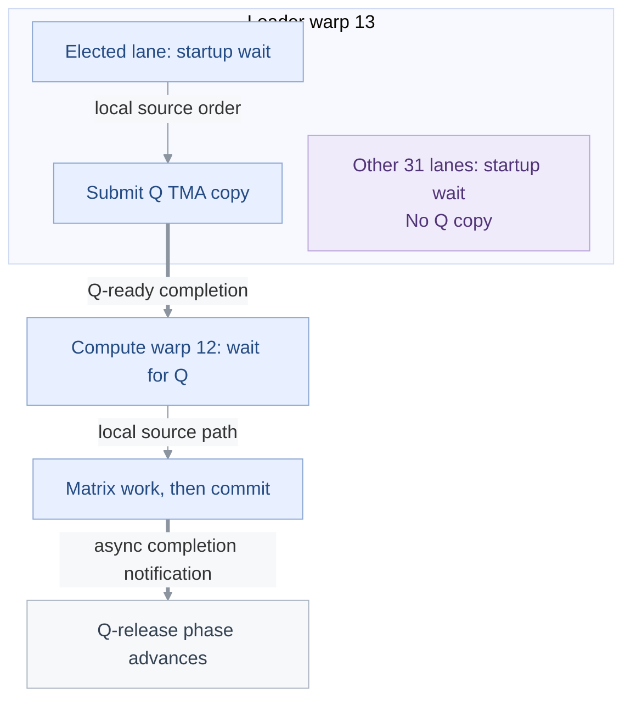

<!-- report-layout:v2 -->

<!-- verifier-result:start -->
<p align="center">FMHA: Q-input barrier handoff</p>
<h1 align="center">SYNCHRONIZATION CANDIDATE</h1>

**Inputs:** [PTX](https://github.com/gpu-verifier/sentryward/blob/94a6b26b1990a4b9df7ded3727acc4b4cc36f23c/corpus/cutlass77_blackwell_fmha_fp16.compute_100a.ptx) ([raw](https://github.com/gpu-verifier/sentryward/raw/94a6b26b1990a4b9df7ded3727acc4b4cc36f23c/corpus/cutlass77_blackwell_fmha_fp16.compute_100a.ptx)) · analyzed code; [input.json](https://github.com/gpu-verifier/sentryward/blob/94a6b26b1990a4b9df7ded3727acc4b4cc36f23c/examples/cutlass77_blackwell_fmha_fp16.compute_100a/input.json) · launch, arguments and assumptions.

**Result:** [output.json](https://github.com/gpu-verifier/sentryward/blob/94a6b26b1990a4b9df7ded3727acc4b4cc36f23c/examples/cutlass77_blackwell_fmha_fp16.compute_100a/output.json) · saved verifier findings.

<table>
<thead><tr><th align="left">VERIFIER RESULT · Synchronization requirement</th></tr></thead>
<tbody><tr><td>

A synchronization check rejected the candidate model execution.

**Synchronization:** Failed · **Memory:** Not run · **Equivalence:** Not run

This finding concerns **barrier reuse**. The model could not establish that the wait is issued before at least one completion effect of the next barrier phase. The failed requirement is shown below.

**Checked phase:** barrier 1 · generation 0.


The dashed arrow names the failed requirement: issue before at least one listed phase effect. It does not show an observed order.

**Model replay — not an observed GPU trace:** 32 event IDs retained from an executed prefix of 1,318,836. First unexecuted event: <code>1290360</code>.

**Replay gap: 1,318,804 events not listed**; do not join the retained prefix directly to the stop point.

**Other truncated sequences:** candidate order, replayed candidate order.

<details>
<summary><strong>Locate the wait, phase effect and replay stop</strong></summary>

**Saved check:** requirement details · <a href="https://github.com/gpu-verifier/sentryward/blob/94a6b26b1990a4b9df7ded3727acc4b4cc36f23c/examples/cutlass77_blackwell_fmha_fp16.compute_100a/output.json#L593"><code>output.json#/rejection</code></a>.

The listed required events are next-phase completion effects, not predecessors that the wait must follow.

| Role | Source operation | Model event / instruction |
| --- | --- | --- |
| Wait issue | <code>mbarrier.try_wait.parity.shared::</code><br/><code>cta.b64</code><br/>PTX line <code>314797</code> | <code>1290359</code> / <code>330050</code> |
| Phase effect | <code>tcgen05.commit.cta_group::1.</code><br/><code>mbarrier::arrive::one.shared::</code><br/><code>cluster.b64</code><br/>PTX line <code>310187</code> | <code>1239648</code> / <code>316627</code> |
| First unexecuted | <code>mbarrier.try_wait.parity.shared::</code><br/><code>cta.b64</code><br/>PTX line <code>314797</code> | <code>1290360</code> / <code>330050</code> |

Event and instruction IDs are model identifiers; only the separately saved source location identifies a file and line.

**Recorded source anchors.** These lines locate the saved events. Their guards and surrounding control flow belong to the code explanation.

<p><strong>Wait issue event 1290359 · saved source location</strong> · <a href="https://github.com/gpu-verifier/sentryward/blob/94a6b26b1990a4b9df7ded3727acc4b4cc36f23c/corpus/cutlass77_blackwell_fmha_fp16.compute_100a.ptx#L314797">physical PTX 314797</a></p>

<pre><code><strong>mbarrier.try_wait.parity.shared::cta.b64</strong> P1, [%r235], %r236, %r237;</code></pre>


<p><strong>Phase effect event 1239648 · saved source location</strong> · <a href="https://github.com/gpu-verifier/sentryward/blob/94a6b26b1990a4b9df7ded3727acc4b4cc36f23c/corpus/cutlass77_blackwell_fmha_fp16.compute_100a.ptx#L310187">physical PTX 310187</a> · display wrapping added</p>

<pre><code><strong>tcgen05.commit.cta_group::1.mbarrier::arrive::one.shared::cluster.b64</strong>
    [%r2047];</code></pre>


The saved witness does not map its events to CUDA participant columns. Exact retained sequences, candidate order and source mappings: Evidence appendix → Diagnostic records.

</details>

<details>
<summary><strong>Saved status and diagnostic codes</strong></summary>

**Saved result:** <code>not_wellsynced</code> · <a href="https://github.com/gpu-verifier/sentryward/blob/94a6b26b1990a4b9df7ded3727acc4b4cc36f23c/examples/cutlass77_blackwell_fmha_fp16.compute_100a/output.json#L612"><code>output.json#/result</code></a>.

**Operation:** <code>kernel_verification</code>.

**First diagnostic:** <code>issue_not_ordered_before_next_phase</code> · <code>synchronization_check</code> · <a href="https://github.com/gpu-verifier/sentryward/blob/94a6b26b1990a4b9df7ded3727acc4b4cc36f23c/examples/cutlass77_blackwell_fmha_fp16.compute_100a/output.json#L203"><code>output.json#/diagnostics/0</code></a>.

**Checks:** Synchronization <code>failed</code> · Memory <code>not_run</code> · Equivalence <code>not_run</code>.

</details>

</td></tr>
<tr><td>

### Analysis scope

**Coverage:** Memory analysis complete: **no** · Search complete: <code>not saved</code> · Exhaustive search: <code>not saved</code>.

**Assumption-dependent:** <code>true</code>. Triggered rules: Representative election.

This result applies to the supplied launch, arguments and enabled assumptions.

<details>
<summary><strong>Analysis records — open the saved evidence</strong></summary>

Each record link opens its field in the original `output.json`. Model summaries are not full execution traces.

**Check the finding**

- [Diagnostic messages and details · `diagnostics`](https://github.com/gpu-verifier/sentryward/blob/94a6b26b1990a4b9df7ded3727acc4b4cc36f23c/examples/cutlass77_blackwell_fmha_fp16.compute_100a/output.json#L202)
- [Individual check outcomes · `checks`](https://github.com/gpu-verifier/sentryward/blob/94a6b26b1990a4b9df7ded3727acc4b4cc36f23c/examples/cutlass77_blackwell_fmha_fp16.compute_100a/output.json#L56)
- [Rejected synchronization requirement · `rejection`](https://github.com/gpu-verifier/sentryward/blob/94a6b26b1990a4b9df7ded3727acc4b4cc36f23c/examples/cutlass77_blackwell_fmha_fp16.compute_100a/output.json#L593)
- [Saved model replay · `counterexample`](https://github.com/gpu-verifier/sentryward/blob/94a6b26b1990a4b9df7ded3727acc4b4cc36f23c/examples/cutlass77_blackwell_fmha_fp16.compute_100a/output.json#L61)
- [Event-to-source mappings · `source_events`](https://github.com/gpu-verifier/sentryward/blob/94a6b26b1990a4b9df7ded3727acc4b4cc36f23c/examples/cutlass77_blackwell_fmha_fp16.compute_100a/output.json#L653)

**Check how the model was built**

- [PTX translation · `frontend`](https://github.com/gpu-verifier/sentryward/blob/94a6b26b1990a4b9df7ded3727acc4b4cc36f23c/examples/cutlass77_blackwell_fmha_fp16.compute_100a/output.json#L269)
- [Model and source bindings · `semantic_program`](https://github.com/gpu-verifier/sentryward/blob/94a6b26b1990a4b9df7ded3727acc4b4cc36f23c/examples/cutlass77_blackwell_fmha_fp16.compute_100a/output.json#L625)
- [Synchronization-check setup · `synchronization_input`](https://github.com/gpu-verifier/sentryward/blob/94a6b26b1990a4b9df7ded3727acc4b4cc36f23c/examples/cutlass77_blackwell_fmha_fp16.compute_100a/output.json#L972)

**Check values separately**

- [Value-analysis status · `value_analysis`](https://github.com/gpu-verifier/sentryward/blob/94a6b26b1990a4b9df7ded3727acc4b4cc36f23c/examples/cutlass77_blackwell_fmha_fp16.compute_100a/output.json#L1001)
- [Numerical comparison · `equivalence`](https://github.com/gpu-verifier/sentryward/blob/94a6b26b1990a4b9df7ded3727acc4b4cc36f23c/examples/cutlass77_blackwell_fmha_fp16.compute_100a/output.json#L223)

For the records explained in this report, see the [Evidence appendix](#evidence-appendix).

</details>

</td></tr></tbody>
</table>
<!-- verifier-result:end -->

<!-- code-explanation:start -->

## Code explanation

Interpretation from the PTX and saved inputs: how the reported operations fit together and what remains to check.

### 1. The reported wait guards the first Q copy

This forward-attention kernel stages `Q`, `K` and `V` in shared memory, uses TMEM for matrix accumulators, and writes `O` to global memory.

The finding is in the **Q-input handoff**: a loader waits before its first 16 KiB Q copy, and a compute warp later notifies the same barrier. First distinguish the [**Barrier roles**](#user-content-code-section-1), then follow the [**Copy issuer**](#user-content-code-section-2) across the handoff. The source protocol must finally be compared with the particular wait event retained by the model.

<details>
<summary><strong>Derivation: warp roles and configured workload</strong></summary>

#### Where the input and output paths meet the computation

The supplied descriptor offsets identify `Q` at parameter +128, `K` at +384, `V` at +640 and `O` at +1024. Their TMA sites are PTX 314822, 314859, 314934 and 315459 respectively. The first `Q` tile is 64 × 128 f16 elements: 64 × 128 × 2 = 16,384 bytes. The matrix path builds shared-memory descriptors from the `Q` base and `K` base +32,768 before <a href="https://docs.nvidia.com/cuda/archive/13.2.0/parallel-thread-execution/index.html#tcgen05-mma-instructions"><code>tcgen05.mma</code></a> writes TMEM. This account follows that input handoff; it does not reconstruct the numerical attention calculation.

#### Which warps execute the two sides

The entry computes the warp number as `tid.x >> 5`. Dispatch assigns warp 12 to role 3 and warp 13 to role 4; roles 0–2 take other compute/epilogue paths. Role 3 falls through PTX 308434–308439 to the matrix path. Role 4 branches through 310577–310578 to the loader at 314757. With 512 threads, these are threads 384–415 and 416–447. All 32 loader lanes reach the startup wait; the copy below it is elected-lane-only.

#### The supplied configuration admits both paths

Both paths load parameter offsets 0 and 4 as 256 and 256. The only CTA has `ctaid.x = 0`, so its tile origin is `0 << 8 = 0 < 256`, and the second extent is nonzero. Neither work guard exits before the handoff. The matrix path computes `(256 + 127) >> 7 = 2`; its remaining-work loop executes one body before reaching the `Q`-release commit. The loader’s bootstrap order is first `Q` tile, first `K` tile, second `Q` tile, then first `V` tile; the remaining `K`/`V` loop follows. That later loop does not revisit the startup wait at PTX 314797.

#### Keep the configured analysis boundary

The input fixes ten softmax-correction branch decisions and enables representative election. The saved frontend also records an unresolved compute diamond at PTX 313193 and incomplete value semantics. These conditions remain part of the result; the source explanation below establishes the local handoff, not full numerical correctness.

<details>
<summary><strong>Sources: warp roles and configured workload</strong></summary>

<blockquote>

##### Source references: Where the input and output paths meet the computation

- <a href="https://github.com/gpu-verifier/sentryward/blob/94a6b26b1990a4b9df7ded3727acc4b4cc36f23c/examples/cutlass77_blackwell_fmha_fp16.compute_100a/input.json#L111"><code>input.json#/tma_descriptors</code></a>: <code>list, 4 entries; see original artifact</code>
- physical PTX 314813-314822,314849-314859,314924-314934,315452-315459: <code>128</code>, <code>384</code>, <code>640</code>, <code>1024</code>
- physical PTX 308460-308473,308524-308530: <code>32768</code>, <a href="https://docs.nvidia.com/cuda/archive/13.2.0/parallel-thread-execution/index.html#tcgen05-mma-instructions"><code>tcgen05.mma</code></a>

##### Source references: Which warps execute the two sides

- <a href="https://github.com/gpu-verifier/sentryward/blob/94a6b26b1990a4b9df7ded3727acc4b4cc36f23c/examples/cutlass77_blackwell_fmha_fp16.compute_100a/input.json#L6"><code>input.json#/launch/block_dim</code></a>: <code>[512,1,1]</code>
- physical PTX 307806-307865: <code>%tid.x</code>, <code>%r2, 12</code>, <code>%r2, 13</code>, <code>%r2157, 4</code>
- physical PTX 308434-308449,310576-310580,314757-314800: <code>%p46</code>, <code>%p47</code>, <a href="https://docs.nvidia.com/cuda/archive/13.2.0/parallel-thread-execution/index.html#parallel-synchronization-and-communication-instructions-mbarrier-test-wait-try-wait"><code>mbarrier.try_wait</code></a>
- physical PTX 314813-314822: <code>@%p57</code>, <a href="https://docs.nvidia.com/cuda/archive/13.2.0/parallel-thread-execution/index.html#data-movement-and-conversion-instructions-cp-async-bulk-tensor"><code>cp.async.bulk.tensor</code></a>

##### Source references: The supplied configuration admits both paths

- <a href="https://github.com/gpu-verifier/sentryward/blob/94a6b26b1990a4b9df7ded3727acc4b4cc36f23c/examples/cutlass77_blackwell_fmha_fp16.compute_100a/input.json#L11"><code>input.json#/launch/grid_dim</code></a>: <code>[1,1,1]</code>
- <a href="https://github.com/gpu-verifier/sentryward/blob/94a6b26b1990a4b9df7ded3727acc4b4cc36f23c/examples/cutlass77_blackwell_fmha_fp16.compute_100a/input.json#L23"><code>input.json#/arguments/0</code></a>: <code>{&quot;parameter&quot;:0,&quot;offset&quot;:0,&quot;type&quot;:&quot;s32&quot;,&quot;value&quot;:256}</code>
- <a href="https://github.com/gpu-verifier/sentryward/blob/94a6b26b1990a4b9df7ded3727acc4b4cc36f23c/examples/cutlass77_blackwell_fmha_fp16.compute_100a/input.json#L29"><code>input.json#/arguments/1</code></a>: <code>{&quot;parameter&quot;:0,&quot;offset&quot;:4,&quot;type&quot;:&quot;s32&quot;,&quot;value&quot;:256}</code>
- physical PTX 308444-308459,314762-314770: <code>shl.b32</code>
- physical PTX 309150-309170,310156-310187: <code>%r2302</code>, <code>@%p183</code>, <a href="https://docs.nvidia.com/cuda/archive/13.2.0/parallel-thread-execution/index.html#tcgen-async-sync-operations-commit"><code>tcgen05.commit</code></a>
- physical PTX 314813-314934,314936-314955,315315-315407: <code>%r2318</code>, <code>@%p85</code>

##### Source references: Keep the configured analysis boundary

- <a href="https://github.com/gpu-verifier/sentryward/blob/94a6b26b1990a4b9df7ded3727acc4b4cc36f23c/examples/cutlass77_blackwell_fmha_fp16.compute_100a/input.json#L258"><code>input.json#/branch_decisions</code></a>: <code>list, 10 entries; see original artifact</code>
- <a href="https://github.com/gpu-verifier/sentryward/blob/94a6b26b1990a4b9df7ded3727acc4b4cc36f23c/examples/cutlass77_blackwell_fmha_fp16.compute_100a/input.json#L255"><code>input.json#/assumptions/representative_election</code></a>: <code>true</code>
- <a href="https://github.com/gpu-verifier/sentryward/blob/94a6b26b1990a4b9df7ded3727acc4b4cc36f23c/examples/cutlass77_blackwell_fmha_fp16.compute_100a/output.json#L271"><code>output.json#/frontend/address_value_bridge/diagnostics</code></a>: <code>list, 1 entries; see original artifact</code>
- <a href="https://github.com/gpu-verifier/sentryward/blob/94a6b26b1990a4b9df7ded3727acc4b4cc36f23c/examples/cutlass77_blackwell_fmha_fp16.compute_100a/output.json#L634"><code>output.json#/semantic_program/mapping_complete</code></a>: <code>false</code>
- <a href="https://github.com/gpu-verifier/sentryward/blob/94a6b26b1990a4b9df7ded3727acc4b4cc36f23c/examples/cutlass77_blackwell_fmha_fp16.compute_100a/output.json#L56"><code>output.json#/checks</code></a>: <code>{&quot;equivalence&quot;:&quot;not_run&quot;,&quot;memory&quot;:&quot;not_run&quot;,&quot;synchronization&quot;:&quot;failed&quot;}</code>

##### Additional section references

- <a href="https://github.com/gpu-verifier/sentryward/blob/94a6b26b1990a4b9df7ded3727acc4b4cc36f23c/examples/cutlass77_blackwell_fmha_fp16.compute_100a/input.json#L3"><code>input.json#/entry</code></a>: <code>str, 547 entries; see original artifact</code>
- <a href="https://github.com/gpu-verifier/sentryward/blob/94a6b26b1990a4b9df7ded3727acc4b4cc36f23c/examples/cutlass77_blackwell_fmha_fp16.compute_100a/input.json#L4"><code>input.json#/launch</code></a>: <code>{&quot;dynamic_shared_bytes&quot;:232448,&quot;block_dim&quot;:[512,1,1],&quot;grid_dim&quot;:[1,1,1],&quot;cluster_dim&quot;:[1,1,1]}</code>
- physical PTX 314813-314822,314849-314859,314924-314934: <a href="https://docs.nvidia.com/cuda/archive/13.2.0/parallel-thread-execution/index.html#data-movement-and-conversion-instructions-cp-async-bulk-tensor"><code>cp.async.bulk.tensor</code></a>
- physical PTX 308524-308530,315452-315459: <a href="https://docs.nvidia.com/cuda/archive/13.2.0/parallel-thread-execution/index.html#tcgen05-mma-instructions"><code>tcgen05.mma</code></a>, <a href="https://docs.nvidia.com/cuda/archive/13.2.0/parallel-thread-execution/index.html#data-movement-and-conversion-instructions-cp-async-bulk-tensor"><code>cp.async.bulk.tensor.5d.global</code></a>
- physical PTX 314789-314800,310182-310187: <code>81936</code>

</blockquote>

</details>

</details>

<a id="code-section-1" name="user-content-code-section-1"></a>

### 2. Barrier roles: Q-ready publishes data; Q-release permits reuse

**Q-ready** tells the compute warp that the input copy has finished. **Q-release** receives the compute warp’s later completion notification so that the loader can reuse the Q buffer.

The rejected wait is on Q-release. Initialization starts that barrier at phase `0`; the startup wait tests parity `1`, so it can succeed immediately.

| Protocol point | Q-ready · shared +81920 | Q-release · shared +81936 |
| --- | --- | --- |
| After initialization | Phase 0 · one arrival expected | Phase 0 · one arrival expected |
| Loader’s first Q copy | Expect 16 KiB; TMA completes the bytes | Startup wait uses parity `1` |
| Compute consumes Q | Wait uses parity `0` | Later <a href="https://docs.nvidia.com/cuda/archive/13.2.0/parallel-thread-execution/index.html#tcgen-async-sync-operations-commit"><code>tcgen05.commit</code></a> notifies completion |

<p><strong>Startup gate: test Q-release with opposite parity</strong> · <a href="https://github.com/gpu-verifier/sentryward/blob/94a6b26b1990a4b9df7ded3727acc4b4cc36f23c/corpus/cutlass77_blackwell_fmha_fp16.compute_100a.ptx#L314789-L314801" title="Open the original PTX">physical PTX 314789–314801</a></p>

<ul>
<li><code>%r235</code> — Q-release barrier address</li>
<li><code>%r236</code> — Literal parity 1</li>
</ul>

<pre><code><strong>mov.b32</strong> %r241, _ZN7cutlass4smemE;
<strong>add.s32</strong> %r235, %r241, <strong>81936</strong>;
<strong>mov.b32</strong> <strong>%r236</strong>, 1;
<strong>mov.b32</strong> %r237, 10000000;

{
.reg .pred P1;
LAB_WAIT:
<a href="https://docs.nvidia.com/cuda/archive/13.2.0/parallel-thread-execution/index.html#parallel-synchronization-and-communication-instructions-mbarrier-test-wait-try-wait"><strong>mbarrier.try_wait.parity.shared::cta.b64</strong></a> P1, [%r235], <strong>%r236</strong>, %r237;
<strong>@P1</strong> <strong>bra</strong> DONE;
<strong>bra</strong> LAB_WAIT;
DONE:
}</code></pre>


**Implication.** The first successful Q-release test permits the initial copy into a fresh buffer; it does not mean matrix work has already finished. The [**Copy issuer**](#user-content-code-section-2) is the next distinction: all loader lanes wait, but only one submits the copy.

<details>
<summary><strong>Derivation: barrier initialization and startup phase</strong></summary>

#### Both barrier addresses are initialized before role dispatch

One elected lane of warp 0 initializes both barriers with arrival count 1. The barrier-initialization fence and CTA-wide `bar.sync 0` precede the split into loader and compute paths. PTX initializes an mbarrier at phase 0. The loader’s literal parity 1 therefore allows the first copy to start before any matrix-completion arrival; calling this wait “wait for the current computation” would reverse its startup purpose.

<p><strong>One arrival expected for Q-ready and Q-release</strong> · <a href="https://github.com/gpu-verifier/sentryward/blob/94a6b26b1990a4b9df7ded3727acc4b4cc36f23c/corpus/cutlass77_blackwell_fmha_fp16.compute_100a.ptx#L307945-L307957" title="Open the original PTX">physical PTX 307945–307957</a></p>

<pre><code><strong>mov.b32</strong> %r97, _ZN7cutlass4smemE;
<strong>add.s32</strong> %r93, %r97, <strong>81920</strong>;
<strong>mov.b32</strong> <strong>%r92</strong>, 1;

{
<a href="https://docs.nvidia.com/cuda/archive/13.2.0/parallel-thread-execution/index.html#parallel-synchronization-and-communication-instructions-mbarrier-init"><strong>mbarrier.init.shared::cta.b64</strong></a> [%r93], <strong>%r92</strong>;
}

<strong>add.s32</strong> %r94, %r97, <strong>81936</strong>;

{
<a href="https://docs.nvidia.com/cuda/archive/13.2.0/parallel-thread-execution/index.html#parallel-synchronization-and-communication-instructions-mbarrier-init"><strong>mbarrier.init.shared::cta.b64</strong></a> [%r94], <strong>%r92</strong>;
}</code></pre>


#### The checked completion belongs to the release barrier

The saved rejection names model barrier 1, generation 0. Its source mappings tie the wait to PTX 314797 and the required completion effect to 310187. The latter is a <a href="https://docs.nvidia.com/cuda/archive/13.2.0/parallel-thread-execution/index.html#tcgen-async-sync-operations-commit"><code>tcgen05.commit</code></a> with address shared +81936. It arranges a completion arrival after preceding asynchronous matrix operations; issuing the commit is not that completion itself. Q-ready uses shared +81920 instead, so its TMA completion must not be confused with this later release notification.

<p><strong>Notify Q-release when prior matrix operations complete</strong> · <a href="https://github.com/gpu-verifier/sentryward/blob/94a6b26b1990a4b9df7ded3727acc4b4cc36f23c/corpus/cutlass77_blackwell_fmha_fp16.compute_100a.ptx#L310182-L310187" title="Open the original PTX">physical PTX 310182–310187</a> · display wrapping added</p>

<ul>
<li><code>%r2047</code> — The same Q-release address</li>
</ul>

<pre><code><strong>setp.eq.b32</strong> %p184, %r2045, 0;
@%p184 <strong>bra</strong> $L__BB37_152;
<strong>mov.b32</strong> %r2048, _ZN7cutlass4smemE;
<strong>add.s32</strong> %r2047, %r2048, <strong>81936</strong>;

<a href="https://docs.nvidia.com/cuda/archive/13.2.0/parallel-thread-execution/index.html#tcgen-async-sync-operations-commit"><strong>tcgen05.commit.cta_group::1.mbarrier::arrive::one.shared::cluster.b64</strong></a>
    [%r2047];</code></pre>


#### Why startup order matters

A parity bit repeats across barrier phases. The checker therefore needs the startup wait issue to precede a completion effect that advances this barrier out of its initial phase. The failed requirement is that direction: wait issue before the listed completion effect. It does not say that the completion happened first, and it does not establish a hardware race.

<details>
<summary><strong>Sources: barrier initialization and startup phase</strong></summary>

<blockquote>

##### Source references: Both barrier addresses are initialized before role dispatch

- physical PTX 307927-307956,307971-307975,308367-308373: <code>%r88, 0</code>, <code>elect.sync</code>, <a href="https://docs.nvidia.com/cuda/archive/13.2.0/parallel-thread-execution/index.html#parallel-synchronization-and-communication-instructions-mbarrier-init"><code>mbarrier.init</code></a>, <code>fence.mbarrier_init</code>, <code>bar.sync</code>

##### Source references: The checked completion belongs to the release barrier

- <a href="https://github.com/gpu-verifier/sentryward/blob/94a6b26b1990a4b9df7ded3727acc4b4cc36f23c/examples/cutlass77_blackwell_fmha_fp16.compute_100a/output.json#L597"><code>output.json#/rejection/phase</code></a>: <code>{&quot;barrier&quot;:1,&quot;generation&quot;:0}</code>
- <a href="https://github.com/gpu-verifier/sentryward/blob/94a6b26b1990a4b9df7ded3727acc4b4cc36f23c/examples/cutlass77_blackwell_fmha_fp16.compute_100a/output.json#L878"><code>output.json#/source_events/32</code></a>: <code>{&quot;column&quot;:1,&quot;event&quot;:1239648,&quot;file&quot;:&quot;corpus/cutlass77_blackwell_fmha_fp16.compute_100a.ptx&quot;,&quot;instruction&quot;:316627,&quot;line&quot;:310187}</code>
- <a href="https://github.com/gpu-verifier/sentryward/blob/94a6b26b1990a4b9df7ded3727acc4b4cc36f23c/examples/cutlass77_blackwell_fmha_fp16.compute_100a/output.json#L885"><code>output.json#/source_events/33</code></a>: <code>{&quot;column&quot;:1,&quot;event&quot;:1290359,&quot;file&quot;:&quot;corpus/cutlass77_blackwell_fmha_fp16.compute_100a.ptx&quot;,&quot;instruction&quot;:330050,&quot;line&quot;:314797}</code>
- physical PTX 310182-310187,314789-314822: <code>81936</code>, <code>81920</code>, <a href="https://docs.nvidia.com/cuda/archive/13.2.0/parallel-thread-execution/index.html#tcgen-async-sync-operations-commit"><code>tcgen05.commit</code></a>

##### Source references: Why startup order matters

- <a href="https://github.com/gpu-verifier/sentryward/blob/94a6b26b1990a4b9df7ded3727acc4b4cc36f23c/examples/cutlass77_blackwell_fmha_fp16.compute_100a/output.json#L593"><code>output.json#/rejection</code></a>: <code>dict, 5 entries; see original artifact</code>
- physical PTX 314791-314800,310182-310187: <code>%r236, 1</code>, <a href="https://docs.nvidia.com/cuda/archive/13.2.0/parallel-thread-execution/index.html#parallel-synchronization-and-communication-instructions-mbarrier-test-wait-try-wait"><code>mbarrier.try_wait</code></a>, <a href="https://docs.nvidia.com/cuda/archive/13.2.0/parallel-thread-execution/index.html#tcgen-async-sync-operations-commit"><code>tcgen05.commit</code></a>

##### Additional section references

- physical PTX 307943-307956,308373: <a href="https://docs.nvidia.com/cuda/archive/13.2.0/parallel-thread-execution/index.html#parallel-synchronization-and-communication-instructions-mbarrier-init"><code>mbarrier.init</code></a>, <code>%r92, 1</code>, <code>bar.sync</code>
- physical PTX 314789-314822: <code>81936</code>, <code>%r236, 1</code>, <code>81920</code>, <code>16384</code>
- physical PTX 308474-308485,310182-310187: <code>%r1581, 0</code>, <a href="https://docs.nvidia.com/cuda/archive/13.2.0/parallel-thread-execution/index.html#tcgen-async-sync-operations-commit"><code>tcgen05.commit</code></a>

</blockquote>

</details>

</details>

<a id="code-section-2" name="user-content-code-section-2"></a>

### 3. Copy issuer: one elected lane connects the loader to compute

All 32 loader lanes execute the startup wait; only the elected lane submits the Q copy. For that lane, source order leads from wait to copy, copy completion enables the compute warp’s Q-ready wait, and the compute path later sends its Q-release notification.

The other loader lanes do not submit that copy. The source path therefore does not supply the same ordering chain for every loader lane.



Single arrows show source order within the indicated participant; double arrows show the named PTX completion handoff. No ordering edge from the other loader lanes to the elected lane’s copy is assumed. This is a source-protocol view, not a replay or an observed GPU schedule.

<p><strong>Only the elected loader lane submits the Q copy</strong> · <a href="https://github.com/gpu-verifier/sentryward/blob/94a6b26b1990a4b9df7ded3727acc4b4cc36f23c/corpus/cutlass77_blackwell_fmha_fp16.compute_100a.ptx#L314813-L314824" title="Open the original PTX">physical PTX 314813–314824</a> · display wrapping added</p>

<ul>
<li><code>%rd22</code> — Q tensor-map descriptor</li>
<li><code>%r245</code> — Shared Q tile destination</li>
<li><code>%r246</code> — Q-ready barrier</li>
</ul>

<pre><code><strong>setp.eq.b32</strong> %p57, %r233, 0;
<strong>@%p57</strong> <strong>bra</strong> $L__BB37_241;
<strong>cvta.param.u64</strong> %rd24, %rd1;
<strong>add.s64</strong> %rd22, %rd24, <strong>128</strong>;
<strong>mov.b32</strong> %r245, _ZN7cutlass4smemE;
<strong>add.s32</strong> %r246, %r245, 81920;
<strong>mov.b32</strong> %r247, 0;
<strong>mov.b64</strong> %rd23, 1152921504606846976;

<a href="https://docs.nvidia.com/cuda/archive/13.2.0/parallel-thread-execution/index.html#data-movement-and-conversion-instructions-cp-async-bulk-tensor"><strong>cp.async.bulk.tensor.5d.shared::cluster.global.mbarrier::complete_tx::bytes.L2::cache_hint</strong></a>
    [%r245], [%rd22, {%r247, %r248, %r271, %r56, %r54}], [%r246], %rd23;

$L__BB37_241:</code></pre>


**Implication.** The failed model event is bound to the wait’s source site, but not to a particular lane or the intervening ordering edges. That missing binding determines whether this source chain explains that event. The saved rejection stands; the source diagram alone cannot resolve it or justify adding a wait.

<details>
<summary><strong>Derivation: copy completion and loader lanes</strong></summary>

#### The wait includes every loader lane; submission is elected

The election at PTX 314783 sets `%r233 = 1` only in its elected lane. The wait at 314797 has no lane-selection branch. After it succeeds, `%r233 == 0` branches over the copy at 314822. A separate entry election controls the single `arrive.expect_tx` at 314809 through `%p1`; under the supplied representative-election rule both elections choose the preferred lane 0. The all-lane wait is therefore distinct from the single-lane copy and arrival. There is no later explicit `bar.warp.sync` between this wait and the copy; that observation alone does not prove the model is missing an edge.

#### Q-ready carries copy completion into the matrix path

The loader expects 16,384 bytes on shared +81920 and supplies that same address to <a href="https://docs.nvidia.com/cuda/archive/13.2.0/parallel-thread-execution/index.html#data-movement-and-conversion-instructions-cp-async-bulk-tensor"><code>cp.async.bulk.tensor</code></a>. The compute warp waits on shared +81920 with parity 0 before its first <a href="https://docs.nvidia.com/cuda/archive/13.2.0/parallel-thread-execution/index.html#tcgen05-mma-instructions"><code>tcgen05.mma</code></a>. This is the input-ready handoff that connects the elected loader lane to matrix work. The compute warp also waits for K and other pipeline stages; Q-ready alone is not a claim that all later matrix work is immediately executable.

<p><strong>Compute waits for the first Q-ready phase</strong> · <a href="https://github.com/gpu-verifier/sentryward/blob/94a6b26b1990a4b9df7ded3727acc4b4cc36f23c/corpus/cutlass77_blackwell_fmha_fp16.compute_100a.ptx#L308474-L308485" title="Open the original PTX">physical PTX 308474–308485</a></p>

<pre><code><strong>add.s32</strong> %r1576, %r1584, <strong>81920</strong>;
<strong>mov.b32</strong> <strong>%r1581</strong>, 0;
<strong>mov.b32</strong> %r1577, 10000000;

{
.reg .pred P1;
LAB_WAIT:
<a href="https://docs.nvidia.com/cuda/archive/13.2.0/parallel-thread-execution/index.html#parallel-synchronization-and-communication-instructions-mbarrier-test-wait-try-wait"><strong>mbarrier.try_wait.parity.shared::cta.b64</strong></a> P1, [%r1576], <strong>%r1581</strong>, %r1577;
<strong>@P1</strong> <strong>bra</strong> DONE;
<strong>bra</strong> LAB_WAIT;
DONE:
}</code></pre>


#### The release notification follows the configured matrix path

Warp 12 elects one lane at each matrix-issue and commit site. With the supplied extent 256, the loop counter starts at 2; after one remaining-work body, the `> 2` back-edge is false and control reaches the release commit. That site notifies shared +81936; the following commit uses shared +81944 for the second Q tile. These are distinct release barriers, not two arrivals required to finish the first barrier’s phase.

#### The retained replay cannot supply the missing lane-by-lane history

The 32 retained executed-prefix IDs all map to the entry shuffle at PTX 307808. Neither endpoint of the failed requirement appears in that retained prefix. `source_events` separately maps the later wait and commit effect to PTX, but provides no CUDA thread field. The first unexecuted event maps to the same wait site as the failed issue. Thus the saved result locates the stop and the rejected relation; reconstructing a participant timeline around that stop requires the omitted event bindings and ordering edges, not invented steps between the sample and the stop.

<details>
<summary><strong>Sources: copy completion and loader lanes</strong></summary>

<blockquote>

##### Source references: The wait includes every loader lane; submission is elected

- physical PTX 307870-307912,314776-314822: <code>%r233</code>, <code>%p1</code>, <code>elect.sync</code>, <code>@%p57</code>
- <a href="https://github.com/gpu-verifier/sentryward/blob/94a6b26b1990a4b9df7ded3727acc4b4cc36f23c/examples/cutlass77_blackwell_fmha_fp16.compute_100a/input.json#L255"><code>input.json#/assumptions/representative_election</code></a>: <code>true</code>
- <a href="https://github.com/gpu-verifier/sentryward/blob/94a6b26b1990a4b9df7ded3727acc4b4cc36f23c/examples/cutlass77_blackwell_fmha_fp16.compute_100a/output.json#L345"><code>output.json#/frontend/frontend_assumptions/election_policy</code></a>: <code>{&quot;fallback&quot;:&quot;lowest_member&quot;,&quot;preferred_lane&quot;:0,&quot;strategy&quot;:&quot;preferred_member&quot;}</code>

##### Source references: Q-ready carries copy completion into the matrix path

- physical PTX 314803-314822,308474-308530: <code>81920</code>, <code>16384</code>, <code>%r1581, 0</code>, <a href="https://docs.nvidia.com/cuda/archive/13.2.0/parallel-thread-execution/index.html#tcgen05-mma-instructions"><code>tcgen05.mma</code></a>

##### Source references: The release notification follows the configured matrix path

- <a href="https://github.com/gpu-verifier/sentryward/blob/94a6b26b1990a4b9df7ded3727acc4b4cc36f23c/examples/cutlass77_blackwell_fmha_fp16.compute_100a/input.json#L29"><code>input.json#/arguments/1</code></a>: <code>{&quot;parameter&quot;:0,&quot;offset&quot;:4,&quot;type&quot;:&quot;s32&quot;,&quot;value&quot;:256}</code>
- physical PTX 308444-308459,309150-309170,310156-310208: <code>%r2302</code>, <code>%p183</code>, <code>81936</code>, <code>81944</code>, <code>elect.sync</code>

##### Source references: The retained replay cannot supply the missing lane-by-lane history

- <a href="https://github.com/gpu-verifier/sentryward/blob/94a6b26b1990a4b9df7ded3727acc4b4cc36f23c/examples/cutlass77_blackwell_fmha_fp16.compute_100a/output.json#L101"><code>output.json#/counterexample/executed_prefix</code></a>: <code>dict, 3 entries; see original artifact</code>
- <a href="https://github.com/gpu-verifier/sentryward/blob/94a6b26b1990a4b9df7ded3727acc4b4cc36f23c/examples/cutlass77_blackwell_fmha_fp16.compute_100a/output.json#L139"><code>output.json#/counterexample/first_unexecuted</code></a>: <code>1290360</code>
- <a href="https://github.com/gpu-verifier/sentryward/blob/94a6b26b1990a4b9df7ded3727acc4b4cc36f23c/examples/cutlass77_blackwell_fmha_fp16.compute_100a/output.json#L653"><code>output.json#/source_events</code></a>: <code>list, 45 entries; see original artifact</code>
- <a href="https://github.com/gpu-verifier/sentryward/blob/94a6b26b1990a4b9df7ded3727acc4b4cc36f23c/examples/cutlass77_blackwell_fmha_fp16.compute_100a/output.json#L878"><code>output.json#/source_events/32</code></a>: <code>{&quot;column&quot;:1,&quot;event&quot;:1239648,&quot;file&quot;:&quot;corpus/cutlass77_blackwell_fmha_fp16.compute_100a.ptx&quot;,&quot;instruction&quot;:316627,&quot;line&quot;:310187}</code>
- <a href="https://github.com/gpu-verifier/sentryward/blob/94a6b26b1990a4b9df7ded3727acc4b4cc36f23c/examples/cutlass77_blackwell_fmha_fp16.compute_100a/output.json#L885"><code>output.json#/source_events/33</code></a>: <code>{&quot;column&quot;:1,&quot;event&quot;:1290359,&quot;file&quot;:&quot;corpus/cutlass77_blackwell_fmha_fp16.compute_100a.ptx&quot;,&quot;instruction&quot;:330050,&quot;line&quot;:314797}</code>
- <a href="https://github.com/gpu-verifier/sentryward/blob/94a6b26b1990a4b9df7ded3727acc4b4cc36f23c/examples/cutlass77_blackwell_fmha_fp16.compute_100a/output.json#L892"><code>output.json#/source_events/34</code></a>: <code>{&quot;column&quot;:1,&quot;event&quot;:1290360,&quot;file&quot;:&quot;corpus/cutlass77_blackwell_fmha_fp16.compute_100a.ptx&quot;,&quot;instruction&quot;:330050,&quot;line&quot;:314797}</code>

##### Additional section references

- physical PTX 314776-314822: <code>elect.sync</code>, <code>@%p57</code>, <a href="https://docs.nvidia.com/cuda/archive/13.2.0/parallel-thread-execution/index.html#data-movement-and-conversion-instructions-cp-async-bulk-tensor"><code>cp.async.bulk.tensor</code></a>
- physical PTX 307870-307912: <code>elect.sync</code>, <code>%p1</code>
- physical PTX 308474-308530,310182-310187: <a href="https://docs.nvidia.com/cuda/archive/13.2.0/parallel-thread-execution/index.html#parallel-synchronization-and-communication-instructions-mbarrier-test-wait-try-wait"><code>mbarrier.try_wait</code></a>, <a href="https://docs.nvidia.com/cuda/archive/13.2.0/parallel-thread-execution/index.html#tcgen05-mma-instructions"><code>tcgen05.mma</code></a>, <a href="https://docs.nvidia.com/cuda/archive/13.2.0/parallel-thread-execution/index.html#tcgen-async-sync-operations-commit"><code>tcgen05.commit</code></a>
- <a href="https://github.com/gpu-verifier/sentryward/blob/94a6b26b1990a4b9df7ded3727acc4b4cc36f23c/examples/cutlass77_blackwell_fmha_fp16.compute_100a/output.json#L593"><code>output.json#/rejection</code></a>: <code>dict, 5 entries; see original artifact</code>

</blockquote>

</details>

</details>

### 4. Next check

Identify the loader lane bound to wait event `1290359`, then inspect its ordering edges to the Q-copy issuer, Q-ready completion and release effect `1239648`.

The saved output gives the endpoint locations and edge counts, but omits those bindings and edges. They are needed to distinguish a missing model dependency from a source synchronization problem.

<details>
<summary><strong>Evidence for the next check</strong></summary>

- <a href="https://github.com/gpu-verifier/sentryward/blob/94a6b26b1990a4b9df7ded3727acc4b4cc36f23c/examples/cutlass77_blackwell_fmha_fp16.compute_100a/output.json#L593"><code>output.json#/rejection</code></a>: <code>dict, 5 entries; see original artifact</code>
- <a href="https://github.com/gpu-verifier/sentryward/blob/94a6b26b1990a4b9df7ded3727acc4b4cc36f23c/examples/cutlass77_blackwell_fmha_fp16.compute_100a/output.json#L878"><code>output.json#/source_events/32</code></a>: <code>{&quot;column&quot;:1,&quot;event&quot;:1239648,&quot;file&quot;:&quot;corpus/cutlass77_blackwell_fmha_fp16.compute_100a.ptx&quot;,&quot;instruction&quot;:316627,&quot;line&quot;:310187}</code>
- <a href="https://github.com/gpu-verifier/sentryward/blob/94a6b26b1990a4b9df7ded3727acc4b4cc36f23c/examples/cutlass77_blackwell_fmha_fp16.compute_100a/output.json#L885"><code>output.json#/source_events/33</code></a>: <code>{&quot;column&quot;:1,&quot;event&quot;:1290359,&quot;file&quot;:&quot;corpus/cutlass77_blackwell_fmha_fp16.compute_100a.ptx&quot;,&quot;instruction&quot;:330050,&quot;line&quot;:314797}</code>
- <a href="https://github.com/gpu-verifier/sentryward/blob/94a6b26b1990a4b9df7ded3727acc4b4cc36f23c/examples/cutlass77_blackwell_fmha_fp16.compute_100a/output.json#L197"><code>output.json#/counts/edges</code></a>: <code>2981284</code>
- <a href="https://github.com/gpu-verifier/sentryward/blob/94a6b26b1990a4b9df7ded3727acc4b4cc36f23c/examples/cutlass77_blackwell_fmha_fp16.compute_100a/output.json#L625"><code>output.json#/semantic_program</code></a>: <code>dict, 14 entries; see original artifact</code>
- physical PTX 314776-314822,308474-308485,310182-310187: <code>elect.sync</code>, <a href="https://docs.nvidia.com/cuda/archive/13.2.0/parallel-thread-execution/index.html#parallel-synchronization-and-communication-instructions-mbarrier-test-wait-try-wait"><code>mbarrier.try_wait</code></a>, <a href="https://docs.nvidia.com/cuda/archive/13.2.0/parallel-thread-execution/index.html#tcgen-async-sync-operations-commit"><code>tcgen05.commit</code></a>

</details>

<!-- code-explanation:end -->

<!-- verifier-evidence:start -->
## Evidence appendix

Use these records to check the verifier result and source explanation above. JSON pointers refer to the original saved files. Identical prerequisite copies use `same_records_as` to refer to the diagnostic evidence shown once; their original locations and content hashes remain recorded.

<details>
<summary><strong>Diagnostic records — verify the finding</strong></summary>

These are saved verifier records. Truncation flags describe missing records in the original result, not merely collapsed presentation.

#### Rejected check

Wait check failed: <code>issue_not_ordered_before_next_phase</code>.

**Issue event:** <code>1290359</code> · **Barrier phase:** <code>{&quot;barrier&quot;:1,&quot;generation&quot;:0}</code> · <a href="https://github.com/gpu-verifier/sentryward/blob/94a6b26b1990a4b9df7ded3727acc4b4cc36f23c/examples/cutlass77_blackwell_fmha_fp16.compute_100a/output.json#L593"><code>output.json#/rejection</code></a>

#### Model replay coverage

Each row describes one saved sequence. Truncation means events are missing from the original result; the sequences cannot be joined into an uninterrupted timeline.

| Sequence | Retained / total events | Truncated |
| --- | --- | --- |
| <code>candidate_order</code> | 32 / <code>1318900</code> | <code>true</code> |
| <code>executed_prefix</code> | 32 / <code>1318836</code> | <code>true</code> |
| <code>replayed_candidate_order</code> | 32 / <code>1318491</code> | <code>true</code> |
| <code>unexecuted_candidate</code> | 11 / <code>11</code> | <code>false</code> |

**Replay stop:** first unexecuted event <code>1290360</code>. Exact arrays and flags: <a href="https://github.com/gpu-verifier/sentryward/blob/94a6b26b1990a4b9df7ded3727acc4b4cc36f23c/examples/cutlass77_blackwell_fmha_fp16.compute_100a/output.json#L61"><code>output.json#/counterexample</code></a>.

#### Event-to-source lookup

Event IDs below are lookup sets, **not execution order**. Each file is named once.

- **File 1:** <code>corpus/cutlass77_blackwell_fmha_fp16.compute_100a.ptx</code>

| File · source line / column | Event IDs | Instruction IDs |
| --- | --- | --- |
| 1 · <code>307808</code> / <code>1</code> | <code>0–6</code>, <code>3675–3681</code>, <code>7322–7328</code>, <code>10969–10975</code>, <code>14616–14619</code> | <code>0–2</code>, <code>1001–1003</code>, <code>1974–1976</code>, <code>2947–2949</code>, <code>3920</code> |
| 1 · <code>310187</code> / <code>1</code> | <code>1239648</code> | <code>316627</code> |
| 1 · <code>314797</code> / <code>1</code> | <code>1290359–1290360</code> | <code>330050</code> |
| 1 · <code>314833</code> / <code>1</code> | <code>1290361–1290362</code> | <code>330051</code> |
| 1 · <code>314870</code> / <code>1</code> | <code>1290363–1290364</code> | <code>330052</code> |
| 1 · <code>314908</code> / <code>1</code> | <code>1290365–1290366</code> | <code>330053</code> |
| 1 · <code>315329</code> / <code>1</code> | <code>1290367–1290368</code> | <code>330054</code> |
| 1 · <code>315371</code> / <code>1</code> | <code>1290369–1290370</code> | <code>330055</code> |

Exact per-event associations: <a href="https://github.com/gpu-verifier/sentryward/blob/94a6b26b1990a4b9df7ded3727acc4b4cc36f23c/examples/cutlass77_blackwell_fmha_fp16.compute_100a/output.json#L653"><code>output.json#/source_events</code></a>.

#### Diagnostics

- <code>issue_not_ordered_before_next_phase</code>: Wait check failed: <code>issue_not_ordered_before_next_phase</code>.

<details>
<summary><strong>Exact diagnostic records and metadata</strong></summary>

##### Flags and empty collections

These retain their original top-level keys in `output.json`.

```json
{
  "rejection_kind": "wait_condition",
  "witness_event_lists_truncated": true,
  "witness_event_list_limit": 32,
  "source_event_scope": "reported_witness_events",
  "unmapped_witness_events": [],
  "synthetic_events": [],
  "warnings": [],
  "source_violations": [],
  "verification_limitations": []
}
```

##### Rejection

<a href="https://github.com/gpu-verifier/sentryward/blob/94a6b26b1990a4b9df7ded3727acc4b4cc36f23c/examples/cutlass77_blackwell_fmha_fp16.compute_100a/output.json#L593"><code>output.json#/rejection</code></a>

```json
{
  "code": "issue_not_ordered_before_next_phase",
  "issue": 1290359,
  "message": "Wait check failed: issue_not_ordered_before_next_phase.",
  "phase": {
    "barrier": 1,
    "generation": 0
  },
  "required_events": {
    "events": [
      1239648
    ],
    "total": 1,
    "truncated": false
  }
}
```

##### Counterexample

<a href="https://github.com/gpu-verifier/sentryward/blob/94a6b26b1990a4b9df7ded3727acc4b4cc36f23c/examples/cutlass77_blackwell_fmha_fp16.compute_100a/output.json#L61"><code>output.json#/counterexample</code></a>

```json
{
  "candidate_order": {
    "events": [
      0,
      3,
      1,
      2,
      4,
      5,
      6,
      3675,
      3678,
      3676,
      3677,
      3679,
      3680,
      3681,
      7322,
      7325,
      7323,
      7324,
      7326,
      7327,
      7328,
      10969,
      10972,
      10970,
      10971,
      10973,
      10974,
      10975,
      14616,
      14619,
      14617,
      14618
    ],
    "total": 1318900,
    "truncated": true
  },
  "candidate_order_preserved": true,
  "executed_prefix": {
    "events": [
      0,
      3,
      1,
      2,
      4,
      5,
      6,
      3675,
      3678,
      3676,
      3677,
      3679,
      3680,
      3681,
      7322,
      7325,
      7323,
      7324,
      7326,
      7327,
      7328,
      10969,
      10972,
      10970,
      10971,
      10973,
      10974,
      10975,
      14616,
      14619,
      14617,
      14618
    ],
    "total": 1318836,
    "truncated": true
  },
  "first_unexecuted": 1290360,
  "replayed_candidate_order": {
    "events": [
      0,
      3,
      1,
      2,
      4,
      5,
      6,
      3675,
      3678,
      3676,
      3677,
      3679,
      3680,
      3681,
      7322,
      7325,
      7323,
      7324,
      7326,
      7327,
      7328,
      10969,
      10972,
      10970,
      10971,
      10973,
      10974,
      10975,
      14616,
      14619,
      14617,
      14618
    ],
    "total": 1318491,
    "truncated": true
  },
  "unexecuted_candidate": {
    "events": [
      1290360,
      1290361,
      1290362,
      1290363,
      1290364,
      1290365,
      1290366,
      1290367,
      1290368,
      1290369,
      1290370
    ],
    "total": 11,
    "truncated": false
  }
}
```

##### Source events

<a href="https://github.com/gpu-verifier/sentryward/blob/94a6b26b1990a4b9df7ded3727acc4b4cc36f23c/examples/cutlass77_blackwell_fmha_fp16.compute_100a/output.json#L653"><code>output.json#/source_events</code></a>

**Retained records:** 45.

```json
[
  {
    "column": 1,
    "event": 0,
    "file": "corpus/cutlass77_blackwell_fmha_fp16.compute_100a.ptx",
    "instruction": 0,
    "line": 307808
  },
  {
    "column": 1,
    "event": 1,
    "file": "corpus/cutlass77_blackwell_fmha_fp16.compute_100a.ptx",
    "instruction": 0,
    "line": 307808
  },
  {
    "column": 1,
    "event": 2,
    "file": "corpus/cutlass77_blackwell_fmha_fp16.compute_100a.ptx",
    "instruction": 0,
    "line": 307808
  },
  {
    "column": 1,
    "event": 3,
    "file": "corpus/cutlass77_blackwell_fmha_fp16.compute_100a.ptx",
    "instruction": 0,
    "line": 307808
  },
  {
    "column": 1,
    "event": 4,
    "file": "corpus/cutlass77_blackwell_fmha_fp16.compute_100a.ptx",
    "instruction": 1,
    "line": 307808
  },
  {
    "column": 1,
    "event": 5,
    "file": "corpus/cutlass77_blackwell_fmha_fp16.compute_100a.ptx",
    "instruction": 1,
    "line": 307808
  },
  {
    "column": 1,
    "event": 6,
    "file": "corpus/cutlass77_blackwell_fmha_fp16.compute_100a.ptx",
    "instruction": 2,
    "line": 307808
  },
  {
    "column": 1,
    "event": 3675,
    "file": "corpus/cutlass77_blackwell_fmha_fp16.compute_100a.ptx",
    "instruction": 1001,
    "line": 307808
  },
  {
    "column": 1,
    "event": 3676,
    "file": "corpus/cutlass77_blackwell_fmha_fp16.compute_100a.ptx",
    "instruction": 1001,
    "line": 307808
  },
  {
    "column": 1,
    "event": 3677,
    "file": "corpus/cutlass77_blackwell_fmha_fp16.compute_100a.ptx",
    "instruction": 1001,
    "line": 307808
  },
  {
    "column": 1,
    "event": 3678,
    "file": "corpus/cutlass77_blackwell_fmha_fp16.compute_100a.ptx",
    "instruction": 1001,
    "line": 307808
  },
  {
    "column": 1,
    "event": 3679,
    "file": "corpus/cutlass77_blackwell_fmha_fp16.compute_100a.ptx",
    "instruction": 1002,
    "line": 307808
  },
  {
    "column": 1,
    "event": 3680,
    "file": "corpus/cutlass77_blackwell_fmha_fp16.compute_100a.ptx",
    "instruction": 1002,
    "line": 307808
  },
  {
    "column": 1,
    "event": 3681,
    "file": "corpus/cutlass77_blackwell_fmha_fp16.compute_100a.ptx",
    "instruction": 1003,
    "line": 307808
  },
  {
    "column": 1,
    "event": 7322,
    "file": "corpus/cutlass77_blackwell_fmha_fp16.compute_100a.ptx",
    "instruction": 1974,
    "line": 307808
  },
  {
    "column": 1,
    "event": 7323,
    "file": "corpus/cutlass77_blackwell_fmha_fp16.compute_100a.ptx",
    "instruction": 1974,
    "line": 307808
  },
  {
    "column": 1,
    "event": 7324,
    "file": "corpus/cutlass77_blackwell_fmha_fp16.compute_100a.ptx",
    "instruction": 1974,
    "line": 307808
  },
  {
    "column": 1,
    "event": 7325,
    "file": "corpus/cutlass77_blackwell_fmha_fp16.compute_100a.ptx",
    "instruction": 1974,
    "line": 307808
  },
  {
    "column": 1,
    "event": 7326,
    "file": "corpus/cutlass77_blackwell_fmha_fp16.compute_100a.ptx",
    "instruction": 1975,
    "line": 307808
  },
  {
    "column": 1,
    "event": 7327,
    "file": "corpus/cutlass77_blackwell_fmha_fp16.compute_100a.ptx",
    "instruction": 1975,
    "line": 307808
  },
  {
    "column": 1,
    "event": 7328,
    "file": "corpus/cutlass77_blackwell_fmha_fp16.compute_100a.ptx",
    "instruction": 1976,
    "line": 307808
  },
  {
    "column": 1,
    "event": 10969,
    "file": "corpus/cutlass77_blackwell_fmha_fp16.compute_100a.ptx",
    "instruction": 2947,
    "line": 307808
  },
  {
    "column": 1,
    "event": 10970,
    "file": "corpus/cutlass77_blackwell_fmha_fp16.compute_100a.ptx",
    "instruction": 2947,
    "line": 307808
  },
  {
    "column": 1,
    "event": 10971,
    "file": "corpus/cutlass77_blackwell_fmha_fp16.compute_100a.ptx",
    "instruction": 2947,
    "line": 307808
  },
  {
    "column": 1,
    "event": 10972,
    "file": "corpus/cutlass77_blackwell_fmha_fp16.compute_100a.ptx",
    "instruction": 2947,
    "line": 307808
  },
  {
    "column": 1,
    "event": 10973,
    "file": "corpus/cutlass77_blackwell_fmha_fp16.compute_100a.ptx",
    "instruction": 2948,
    "line": 307808
  },
  {
    "column": 1,
    "event": 10974,
    "file": "corpus/cutlass77_blackwell_fmha_fp16.compute_100a.ptx",
    "instruction": 2948,
    "line": 307808
  },
  {
    "column": 1,
    "event": 10975,
    "file": "corpus/cutlass77_blackwell_fmha_fp16.compute_100a.ptx",
    "instruction": 2949,
    "line": 307808
  },
  {
    "column": 1,
    "event": 14616,
    "file": "corpus/cutlass77_blackwell_fmha_fp16.compute_100a.ptx",
    "instruction": 3920,
    "line": 307808
  },
  {
    "column": 1,
    "event": 14617,
    "file": "corpus/cutlass77_blackwell_fmha_fp16.compute_100a.ptx",
    "instruction": 3920,
    "line": 307808
  },
  {
    "column": 1,
    "event": 14618,
    "file": "corpus/cutlass77_blackwell_fmha_fp16.compute_100a.ptx",
    "instruction": 3920,
    "line": 307808
  },
  {
    "column": 1,
    "event": 14619,
    "file": "corpus/cutlass77_blackwell_fmha_fp16.compute_100a.ptx",
    "instruction": 3920,
    "line": 307808
  },
  {
    "column": 1,
    "event": 1239648,
    "file": "corpus/cutlass77_blackwell_fmha_fp16.compute_100a.ptx",
    "instruction": 316627,
    "line": 310187
  },
  {
    "column": 1,
    "event": 1290359,
    "file": "corpus/cutlass77_blackwell_fmha_fp16.compute_100a.ptx",
    "instruction": 330050,
    "line": 314797
  },
  {
    "column": 1,
    "event": 1290360,
    "file": "corpus/cutlass77_blackwell_fmha_fp16.compute_100a.ptx",
    "instruction": 330050,
    "line": 314797
  },
  {
    "column": 1,
    "event": 1290361,
    "file": "corpus/cutlass77_blackwell_fmha_fp16.compute_100a.ptx",
    "instruction": 330051,
    "line": 314833
  },
  {
    "column": 1,
    "event": 1290362,
    "file": "corpus/cutlass77_blackwell_fmha_fp16.compute_100a.ptx",
    "instruction": 330051,
    "line": 314833
  },
  {
    "column": 1,
    "event": 1290363,
    "file": "corpus/cutlass77_blackwell_fmha_fp16.compute_100a.ptx",
    "instruction": 330052,
    "line": 314870
  },
  {
    "column": 1,
    "event": 1290364,
    "file": "corpus/cutlass77_blackwell_fmha_fp16.compute_100a.ptx",
    "instruction": 330052,
    "line": 314870
  },
  {
    "column": 1,
    "event": 1290365,
    "file": "corpus/cutlass77_blackwell_fmha_fp16.compute_100a.ptx",
    "instruction": 330053,
    "line": 314908
  },
  {
    "column": 1,
    "event": 1290366,
    "file": "corpus/cutlass77_blackwell_fmha_fp16.compute_100a.ptx",
    "instruction": 330053,
    "line": 314908
  },
  {
    "column": 1,
    "event": 1290367,
    "file": "corpus/cutlass77_blackwell_fmha_fp16.compute_100a.ptx",
    "instruction": 330054,
    "line": 315329
  },
  {
    "column": 1,
    "event": 1290368,
    "file": "corpus/cutlass77_blackwell_fmha_fp16.compute_100a.ptx",
    "instruction": 330054,
    "line": 315329
  },
  {
    "column": 1,
    "event": 1290369,
    "file": "corpus/cutlass77_blackwell_fmha_fp16.compute_100a.ptx",
    "instruction": 330055,
    "line": 315371
  },
  {
    "column": 1,
    "event": 1290370,
    "file": "corpus/cutlass77_blackwell_fmha_fp16.compute_100a.ptx",
    "instruction": 330055,
    "line": 315371
  }
]
```

##### Diagnostics

<a href="https://github.com/gpu-verifier/sentryward/blob/94a6b26b1990a4b9df7ded3727acc4b4cc36f23c/examples/cutlass77_blackwell_fmha_fp16.compute_100a/output.json#L202"><code>output.json#/diagnostics</code></a>

**Retained records:** 1.

```json
[
  {
    "code": "issue_not_ordered_before_next_phase",
    "details": {
      "issue": 1290359,
      "phase": {
        "barrier": 1,
        "generation": 0
      },
      "required_events": {
        "events": [
          1239648
        ],
        "total": 1,
        "truncated": false
      }
    },
    "message": "Wait check failed: issue_not_ordered_before_next_phase.",
    "stage": "synchronization_check"
  }
]
```

</details>

</details>

<details>
<summary><strong>Assumptions — what qualifies the result</strong></summary>

Enabled and triggered answer different questions: whether a rule was selected, and whether its applicability was recorded. `triggered: null` means unknown or unmeasured, not inactive.

#### Duplicate TMA stores

**Key:** <code>duplicate_tma_store_benign</code>

**Enabled:** <code>true</code> · **Triggered:** <code>null</code>

Matching same-warp duplicate TMA stores are races in the model, but are reported as warnings under the assumption that their stored values agree.

#### Representative election

**Key:** <code>representative_election</code>

**Enabled:** <code>true</code> · **Triggered:** <code>true</code>

Election selects lane zero when participating, otherwise the lowest participating lane.

#### Failed launch cancellation

**Key:** <code>clc_always_fails</code>

**Enabled:** <code>true</code> · **Triggered:** <code>false</code>

Every cluster launch cancellation request fails.

#### Representative branches

**Key:** <code>representative_branches</code>

**Enabled:** <code>false</code> · **Triggered:** <code>false</code>

Choose fallthrough for an unresolved structured if/else; unknown ordinary instruction guards execute. Terminal control uses CFG classification. Known control and explicit choices take precedence.

#### Bounded computation loops

**Key:** <code>bounded_computation_loops</code>

**Enabled:** <code>false</code> · **Triggered:** <code>false</code>

Execute a configured number of body iterations for unresolved recognized computation loops, counted separately per invocation. Polling and unclassified loops are never forced to complete.

<details>
<summary><strong>Exact assumption settings</strong></summary>

```json
{
  "assumptions": [
    {
      "category": "analysis assumption",
      "enabled": true,
      "key": "duplicate_tma_store_benign",
      "label": "Duplicate TMA stores",
      "text": "Matching same-warp duplicate TMA stores are races in the model, but are reported as warnings under the assumption that their stored values agree.",
      "triggered": null
    },
    {
      "category": "analysis assumption",
      "enabled": true,
      "key": "representative_election",
      "label": "Representative election",
      "text": "Election selects lane zero when participating, otherwise the lowest participating lane.",
      "triggered": true
    },
    {
      "category": "analysis assumption",
      "enabled": true,
      "key": "clc_always_fails",
      "label": "Failed launch cancellation",
      "text": "Every cluster launch cancellation request fails.",
      "triggered": false
    },
    {
      "category": "analysis assumption",
      "enabled": false,
      "key": "representative_branches",
      "label": "Representative branches",
      "text": "Choose fallthrough for an unresolved structured if/else; unknown ordinary instruction guards execute. Terminal control uses CFG classification. Known control and explicit choices take precedence.",
      "triggered": false
    },
    {
      "category": "analysis assumption",
      "enabled": false,
      "key": "bounded_computation_loops",
      "label": "Bounded computation loops",
      "text": "Execute a configured number of body iterations for unresolved recognized computation loops, counted separately per invocation. Polling and unclassified loops are never forced to complete.",
      "triggered": false
    }
  ],
  "semantic_assumptions": {
    "bounded_computation_loops": false,
    "clc_always_fails": true,
    "duplicate_tma_store_benign": true,
    "representative_branches": false,
    "representative_election": true
  },
  "frontend_assumptions": {
    "assertion_failure_forms": [
      "trap",
      "__assertfail"
    ],
    "assertion_uses": 0,
    "bounded_loop_uses": 0,
    "clc_failure": true,
    "clc_uses": 0,
    "data_branch_decisions": [],
    "election_policy": {
      "fallback": "lowest_member",
      "preferred_lane": 0,
      "strategy": "preferred_member"
    },
    "election_uses": 3936,
    "fixed_election": true,
    "isolated_launch": true,
    "noalias_unbounded": false,
    "opaque_compute_regions": [],
    "pointer_contract": {
      "aliasing": "distinct_objects_noalias",
      "extent_bytes": "unbounded"
    },
    "representative_branch_uses": 0,
    "trap_only_equality_assertions_hold": true
  },
  "assumption_reporting": "triggered=null means applicability was not measured or analysis was not reached",
  "assumption_dependent": true
}
```

</details>

</details>

<details>
<summary><strong>Value analysis — independent status</strong></summary>

Memory safety and numerical equivalence are separate results.

**Value analysis:** <code>unsupported</code> · <a href="https://github.com/gpu-verifier/sentryward/blob/94a6b26b1990a4b9df7ded3727acc4b4cc36f23c/examples/cutlass77_blackwell_fmha_fp16.compute_100a/output.json#L1001"><code>output.json#/value_analysis</code></a>

**Checks:** Synchronization <code>not_requested</code> · Memory <code>not_requested</code> · Equivalence <code>not_requested</code>.

- **Prerequisite status:** <code>not_wellsynced</code>
- **Scope:** {&quot;operation&quot;:&quot;<code>value_analysis</code>&quot;}
- **Diagnostic:** <code>prerequisite_check_not_passed</code> · <code>pipeline</code> · <a href="https://github.com/gpu-verifier/sentryward/blob/94a6b26b1990a4b9df7ded3727acc4b4cc36f23c/examples/cutlass77_blackwell_fmha_fp16.compute_100a/output.json#L1008"><code>output.json#/value_analysis/diagnostics/0</code></a>

**Equivalence:** <code>unsupported</code> · <a href="https://github.com/gpu-verifier/sentryward/blob/94a6b26b1990a4b9df7ded3727acc4b4cc36f23c/examples/cutlass77_blackwell_fmha_fp16.compute_100a/output.json#L223"><code>output.json#/equivalence</code></a>

**Checks:** Synchronization <code>not_requested</code> · Memory <code>not_requested</code> · Equivalence <code>not_run</code>.

- **Scope:** {&quot;operation&quot;:&quot;equivalence&quot;}
- **Diagnostic:** <code>prerequisite_check_not_passed</code> · <code>pipeline</code> · <a href="https://github.com/gpu-verifier/sentryward/blob/94a6b26b1990a4b9df7ded3727acc4b4cc36f23c/examples/cutlass77_blackwell_fmha_fp16.compute_100a/output.json#L230"><code>output.json#/equivalence/diagnostics/0</code></a>

<details>
<summary><strong>Exact value-analysis fields and large-data references</strong></summary>

##### Value analysis

```json
{
  "equivalence_check": "blocked",
  "prerequisite_status": "not_wellsynced",
  "result": "unsupported",
  "checks": {
    "equivalence": "not_requested",
    "memory": "not_requested",
    "synchronization": "not_requested"
  },
  "diagnostics": [
    {
      "code": "prerequisite_check_not_passed",
      "details": {
        "prerequisite_checks": {
          "equivalence": "not_run",
          "memory": "not_run",
          "synchronization": "failed"
        },
        "prerequisite_diagnostics": {
          "same_records_as": "output.json#/diagnostics",
          "stored_at": "output.json#/value_analysis/diagnostics/0/details/prerequisite_diagnostics",
          "size": "1 items",
          "canonical_json_bytes": 280,
          "canonical_json_sha256": "eb524abf84f8d8d0b466b7239b728e39df9e34502bb81925d41dc2f18ebe000d"
        },
        "prerequisite_result": "not_wellsynced",
        "prerequisite_status": "not_wellsynced"
      },
      "stage": "pipeline"
    }
  ],
  "scalar_fold": {
    "checks": {
      "equivalence": "not_requested",
      "memory": "not_requested",
      "synchronization": "not_requested"
    },
    "diagnostics": [
      {
        "code": "memory_elimination_not_completed",
        "stage": "pipeline"
      }
    ],
    "result": "unsupported",
    "scope": {
      "operation": "scalar_fold"
    }
  },
  "scope": {
    "operation": "value_analysis"
  }
}
```

##### Equivalence

```json
{
  "result": "unsupported",
  "checks": {
    "equivalence": "not_run",
    "memory": "not_requested",
    "synchronization": "not_requested"
  },
  "diagnostics": [
    {
      "code": "prerequisite_check_not_passed",
      "details": {
        "prerequisite_checks": {
          "equivalence": "not_run",
          "memory": "not_run",
          "synchronization": "failed"
        },
        "prerequisite_diagnostics": {
          "same_records_as": "output.json#/diagnostics",
          "stored_at": "output.json#/equivalence/diagnostics/0/details/prerequisite_diagnostics",
          "size": "1 items",
          "canonical_json_bytes": 280,
          "canonical_json_sha256": "eb524abf84f8d8d0b466b7239b728e39df9e34502bb81925d41dc2f18ebe000d"
        },
        "prerequisite_result": "not_wellsynced"
      },
      "stage": "pipeline"
    }
  ],
  "scope": {
    "operation": "equivalence"
  }
}
```

</details>

</details>

<details>
<summary><strong>Input configuration — reproduce this run</strong></summary>

**Launch and arguments define this run.** Tuple coordinates use `(x, y, z)`; grid and cluster dimensions count blocks, while block dimensions count threads.

| Launch quantity | Saved value |
| --- | --- |
| Grid · blocks | <code>[1,1,1]</code> |
| Block · threads | <code>[512,1,1]</code> |
| Cluster · blocks | <code>[1,1,1]</code> |
| Dynamic shared memory · bytes | <code>232448</code> |

**Arguments:** 9 retained entries. Exact parameter bindings, descriptors and entry name: <a href="https://github.com/gpu-verifier/sentryward/blob/94a6b26b1990a4b9df7ded3727acc4b4cc36f23c/examples/cutlass77_blackwell_fmha_fp16.compute_100a/input.json#L1"><code>input.json#</code></a>.

<details>
<summary><strong>Exact input configuration</strong></summary>

```json
{
  "schema": "spverify.kernel-input/v1",
  "entry": "_ZN7cutlass13device_kernelINS_4fmha6kernel36Sm100FmhaFwdKernelTmaWarpspecializedIN4cute5tupleIJiiiNS5_IJNS5_IJiiEEEiEEEEEENS1_10collective38Sm100FmhaFwdMainloopTmaWarpspecializedINS_6half_tEffNS5_IJNS4_1CILi256EEENSC_ILi128EEENSC_ILi64EEEEEENS5_IJiNSC_ILi1EEES7_EEENS5_IJiSH_NS5_IJNS5_IJNSC_ILi0EEEiEEEiEEEEEESM_NS9_6NoMaskENS5_IJNSC_ILi2EEESH_SH_EEENSC_ILb0EEEEENS9_38Sm100FmhaFwdEpilogueTmaWarpspecializedISB_fNS5_IJSE_SF_SE_EEESI_NS5_IJSH_S7_EEESQ_EENS2_23IndividualTileSchedulerENS2_41Sm100FmhaCtxKernelWarpspecializedScheduleEEEEEvNT_6ParamsE",
  "launch": {
    "dynamic_shared_bytes": 232448,
    "block_dim": [
      512,
      1,
      1
    ],
    "grid_dim": [
      1,
      1,
      1
    ],
    "cluster_dim": [
      1,
      1,
      1
    ]
  },
  "arguments": [
    {
      "parameter": 0,
      "offset": 0,
      "type": "s32",
      "value": 256
    },
    {
      "parameter": 0,
      "offset": 4,
      "type": "s32",
      "value": 256
    },
    {
      "parameter": 0,
      "offset": 8,
      "type": "s32",
      "value": 64
    },
    {
      "parameter": 0,
      "offset": 12,
      "type": "s32",
      "value": 1
    },
    {
      "parameter": 0,
      "offset": 16,
      "type": "s32",
      "value": 1
    },
    {
      "parameter": 0,
      "offset": 20,
      "type": "s32",
      "value": 1
    },
    {
      "parameter": 0,
      "offset": 1288,
      "type": "s32",
      "value": 256
    },
    {
      "parameter": 0,
      "offset": 1292,
      "type": "s32",
      "value": 256
    },
    {
      "parameter": 0,
      "offset": 1296,
      "type": "s32",
      "value": 256
    }
  ],
  "declarations": [
    {
      "parameter": 0,
      "offset": 128,
      "type": "tensor_map",
      "object": "tma.q"
    },
    {
      "parameter": 0,
      "offset": 384,
      "type": "tensor_map",
      "object": "tma.k"
    },
    {
      "parameter": 0,
      "offset": 640,
      "type": "tensor_map",
      "object": "tma.v"
    },
    {
      "parameter": 0,
      "offset": 1024,
      "type": "tensor_map",
      "object": "tma.o"
    },
    {
      "parameter": 0,
      "offset": 1280,
      "type": "pointer",
      "space": "global",
      "object": "softmax_lse"
    }
  ],
  "tma_descriptors": [
    {
      "parameter": 0,
      "offset": 128,
      "object": "q",
      "element_type": "f16",
      "global_shape": [
        64,
        256,
        1,
        1,
        1
      ],
      "coordinate_strides_bytes": [
        2,
        128,
        128,
        128,
        32768
      ],
      "box_shape": [
        64,
        128,
        1,
        1,
        1
      ],
      "element_strides": [
        1,
        1,
        1,
        1,
        1
      ],
      "interleave": "none",
      "swizzle": "128B",
      "oob_fill": "zero"
    },
    {
      "parameter": 0,
      "offset": 384,
      "object": "k",
      "element_type": "f16",
      "global_shape": [
        64,
        256,
        1,
        1
      ],
      "coordinate_strides_bytes": [
        2,
        128,
        128,
        32768
      ],
      "box_shape": [
        64,
        128,
        1,
        1
      ],
      "element_strides": [
        1,
        1,
        1,
        1
      ],
      "interleave": "none",
      "swizzle": "128B",
      "oob_fill": "zero"
    },
    {
      "parameter": 0,
      "offset": 640,
      "object": "v",
      "element_type": "f16",
      "global_shape": [
        64,
        256,
        1,
        1
      ],
      "coordinate_strides_bytes": [
        2,
        128,
        128,
        32768
      ],
      "box_shape": [
        64,
        128,
        1,
        1
      ],
      "element_strides": [
        1,
        1,
        1,
        1
      ],
      "interleave": "none",
      "swizzle": "128B",
      "oob_fill": "zero"
    },
    {
      "parameter": 0,
      "offset": 1024,
      "object": "o",
      "element_type": "f16",
      "global_shape": [
        64,
        256,
        1,
        1,
        1
      ],
      "coordinate_strides_bytes": [
        2,
        128,
        128,
        128,
        32768
      ],
      "box_shape": [
        64,
        128,
        1,
        1,
        1
      ],
      "element_strides": [
        1,
        1,
        1,
        1,
        1
      ],
      "interleave": "none",
      "swizzle": "128B",
      "oob_fill": "zero"
    }
  ],
  "assumptions": {
    "duplicate_tma_store_benign": true,
    "representative_election": true,
    "clc_always_fails": true
  },
  "branch_decisions": [
    {
      "line": 313216,
      "taken": false,
      "note": "Always execute softmax correction; do not jump over the TMEM rescale update. User-enabled pattern-based scenario; analysis is conditional on this branch choice. Revisit when dynamic branch analysis is supported."
    },
    {
      "line": 313227,
      "taken": false,
      "note": "Always execute the per-lane correction multiplication; do not jump over the rescale update. User-enabled pattern-based scenario; analysis is conditional on this branch choice. Revisit when dynamic branch analysis is supported."
    },
    {
      "line": 313286,
      "taken": false,
      "note": "Always execute the per-lane correction multiplication; do not jump over the rescale update. User-enabled pattern-based scenario; analysis is conditional on this branch choice. Revisit when dynamic branch analysis is supported."
    },
    {
      "line": 313345,
      "taken": false,
      "note": "Always execute the per-lane correction multiplication; do not jump over the rescale update. User-enabled pattern-based scenario; analysis is conditional on this branch choice. Revisit when dynamic branch analysis is supported."
    },
    {
      "line": 313400,
      "taken": false,
      "note": "Always execute the per-lane correction multiplication; do not jump over the rescale update. User-enabled pattern-based scenario; analysis is conditional on this branch choice. Revisit when dynamic branch analysis is supported."
    },
    {
      "line": 313519,
      "taken": false,
      "note": "Always execute softmax correction; do not jump over the TMEM rescale update. User-enabled pattern-based scenario; analysis is conditional on this branch choice. Revisit when dynamic branch analysis is supported."
    },
    {
      "line": 313530,
      "taken": false,
      "note": "Always execute the per-lane correction multiplication; do not jump over the rescale update. User-enabled pattern-based scenario; analysis is conditional on this branch choice. Revisit when dynamic branch analysis is supported."
    },
    {
      "line": 313589,
      "taken": false,
      "note": "Always execute the per-lane correction multiplication; do not jump over the rescale update. User-enabled pattern-based scenario; analysis is conditional on this branch choice. Revisit when dynamic branch analysis is supported."
    },
    {
      "line": 313648,
      "taken": false,
      "note": "Always execute the per-lane correction multiplication; do not jump over the rescale update. User-enabled pattern-based scenario; analysis is conditional on this branch choice. Revisit when dynamic branch analysis is supported."
    },
    {
      "line": 313703,
      "taken": false,
      "note": "Always execute the per-lane correction multiplication; do not jump over the rescale update. User-enabled pattern-based scenario; analysis is conditional on this branch choice. Revisit when dynamic branch analysis is supported."
    }
  ]
}
```

</details>

</details>

<details>
<summary><strong>Provenance and coverage — check the saved run</strong></summary>

Use the original-file hashes to identify the run. Coverage flags describe what this result establishes; implementation statistics remain separate below.

**Coverage:** Memory analysis complete: **no** · Search complete: <code>not saved</code> · Exhaustive search: <code>not saved</code>.

**Assumption-dependent:** <code>true</code>. Triggered rules: Representative election.


#### Original artifacts

- **Input configuration:** [input.json](https://github.com/gpu-verifier/sentryward/blob/94a6b26b1990a4b9df7ded3727acc4b4cc36f23c/examples/cutlass77_blackwell_fmha_fp16.compute_100a/input.json) · <code>examples/cutlass77_blackwell_fmha_fp16.compute_100a/input.json</code> · SHA-256 <code>1f0595b78f7237a5dd8e3446aaaecd2fec5dc8ca0b898ff0e021ab6c562f0646</code>
- **Verifier output:** [output.json](https://github.com/gpu-verifier/sentryward/blob/94a6b26b1990a4b9df7ded3727acc4b4cc36f23c/examples/cutlass77_blackwell_fmha_fp16.compute_100a/output.json) · <code>examples/cutlass77_blackwell_fmha_fp16.compute_100a/output.json</code> · SHA-256 <code>11725de9e0a2a53ec6571e6b4c7cd264b7d49c8909e322f84e382a254d847df1</code>
- **PTX:** [cutlass77_blackwell_fmha_fp16.compute_100a.ptx](https://github.com/gpu-verifier/sentryward/blob/94a6b26b1990a4b9df7ded3727acc4b4cc36f23c/corpus/cutlass77_blackwell_fmha_fp16.compute_100a.ptx) · <code>corpus/cutlass77_blackwell_fmha_fp16.compute_100a.ptx</code> · SHA-256 <code>0a33644edd13e4ab2bc599e8a79a0acb2634b6caf224742df8a3a55730197404</code>

Large structures are referenced by exact JSON pointer, item count and SHA-256 of their canonical JSON (UTF-8, sorted keys, compact separators). Original-artifact hashes above are hashes of the file bytes.

<details>
<summary><strong>Exact coverage, implementation and provenance fields</strong></summary>

```json
{
  "address_model": {
    "address_invariants": [],
    "kind": "symbolic",
    "layers": [
      0,
      2
    ],
    "solver": "z3",
    "solver_timeout_ms": 100
  },
  "checks": {
    "equivalence": "not_run",
    "memory": "not_run",
    "synchronization": "failed"
  },
  "counts": {
    "edges": 2981284,
    "events": 1318847,
    "instructions": 339091,
    "threads": 512
  },
  "frontend": {
    "address_value_bridge": {
      "diagnostics": [
        {
          "code": "opaque_compute_diamond",
          "details": {
            "cta": 0,
            "instruction": "@%p89 bra $L__BB37_206;",
            "instruction_index": 3060,
            "location": {
              "file": "corpus/cutlass77_blackwell_fmha_fp16.compute_100a.ptx",
              "line": 313193
            },
            "occurrence": 0,
            "thread": 257
          },
          "message": "Execution skipped an unresolved compute diamond; its values and any private-memory reads are not exported",
          "stage": "value_lowering"
        }
      ],
      "first_unavailable_reason": "",
      "queries": 0,
      "resolved": 0,
      "source": "value_lowering",
      "unavailable": 0,
      "value_view_complete": false
    },
    "branch_scope_capture": {
      "reason": "branch scope requires complete original emission",
      "status": "unavailable"
    },
    "cluster_completion_joins": 0,
    "cta_count": 1,
    "dependency_compression": {
      "bulk_read_wait": {
        "consumers": 64,
        "emitted_references": 2,
        "original_references": 3,
        "prefix_effects": 0
      },
      "tcgen_commit": {
        "consumers": 16,
        "emitted_references": 79,
        "original_references": 488,
        "prefix_effects": 16
      },
      "tcgen_load_wait": {
        "consumers": 256,
        "emitted_references": 2560,
        "original_references": 4480,
        "prefix_effects": 0
      },
      "tcgen_store_wait": {
        "consumers": 768,
        "emitted_references": 2560,
        "original_references": 3840,
        "prefix_effects": 0
      }
    },
    "diagnostic_sample_count": 0,
    "discharged_codes": [
      "mma_memory_effect_refinement",
      "tcgen_pipeline_effect_refinement",
      "tcgen_commit_notification_order_refinement"
    ],
    "executed_records": 568524,
    "frontend_assumptions": {
      "assertion_failure_forms": [
        "trap",
        "__assertfail"
      ],
      "assertion_uses": 0,
      "bounded_loop_uses": 0,
      "clc_failure": true,
      "clc_uses": 0,
      "data_branch_decisions": [],
      "election_policy": {
        "fallback": "lowest_member",
        "preferred_lane": 0,
        "strategy": "preferred_member"
      },
      "election_uses": 3936,
      "fixed_election": true,
      "isolated_launch": true,
      "noalias_unbounded": false,
      "opaque_compute_regions": [],
      "pointer_contract": {
        "aliasing": "distinct_objects_noalias",
        "extent_bytes": "unbounded"
      },
      "representative_branch_uses": 0,
      "trap_only_equality_assertions_hold": true
    },
    "implementation": "cpp",
    "input_objects": [
      {
        "bytes": 8,
        "object": "softmax_lse",
        "offset": 1280,
        "parameter": "_ZN7cutlass13device_kernelINS_4fmha6kernel36Sm100FmhaFwdKernelTmaWarpspecializedIN4cute5tupleIJiiiNS5_IJNS5_IJiiEEEiEEEEEENS1_10collective38Sm100FmhaFwdMainloopTmaWarpspecializedINS_6half_tEffNS5_IJNS4_1CILi256EEENSC_ILi128EEENSC_ILi64EEEEEENS5_IJiNSC_ILi1EEES7_EEENS5_IJiSH_NS5_IJNS5_IJNSC_ILi0EEEiEEEiEEEEEESM_NS9_6NoMaskENS5_IJNSC_ILi2EEESH_SH_EEENSC_ILb0EEEEENS9_38Sm100FmhaFwdEpilogueTmaWarpspecializedISB_fNS5_IJSE_SF_SE_EEESI_NS5_IJSH_S7_EEESQ_EENS2_23IndividualTileSchedulerENS2_41Sm100FmhaCtxKernelWarpspecializedScheduleEEEEEvNT_6ParamsE_param_0",
        "source": "declaration"
      }
    ],
    "lowered_instruction_count": 339091,
    "mma_refinement": {
      "blocked": [],
      "discharged": 48
    },
    "reached_opcodes": {
      "add.f32x2": 34304,
      "add.ftz.f32": 512,
      "add.s32": 18470,
      "add.s64": 2378,
      "and.b32": 1120,
      "and.b64": 2048,
      "bar.sync": 512,
      "bar.warp.sync": 32,
      "bra": 11815,
      "bra.uni": 769,
      "cp.async.bulk.commit_group": 64,
      "cp.async.bulk.tensor.4d.shared::cluster.global.mbarrier::complete_tx::bytes.L2::cache_hint": 4,
      "cp.async.bulk.tensor.5d.global.shared::cta.bulk_group": 2,
      "cp.async.bulk.tensor.5d.shared::cluster.global.mbarrier::complete_tx::bytes.L2::cache_hint": 2,
      "cp.async.bulk.wait_group.read": 64,
      "cvt.rn.f16x2.f32": 40960,
      "cvt.u64.u32": 192,
      "cvta.local.u64": 512,
      "cvta.param.u64": 40,
      "cvta.shared.u64": 128,
      "cvta.to.global.u64": 128,
      "div.approx.ftz.f32": 256,
      "div.u32": 320,
      "elect.sync": 3936,
      "ex2.approx.ftz.f32": 65536,
      "fence.mbarrier_init.release.cluster": 4608,
      "fence.proxy.async.shared::cta": 256,
      "fma.rn.f32x2": 32768,
      "fma.rn.ftz.f32": 256,
      "ld.param.b32": 1376,
      "ld.param.b64": 416,
      "ld.param.v2.b32": 160,
      "ld.param.v4.b32": 128,
      "ld.shared.b32": 32,
      "lg2.approx.ftz.f32": 256,
      "mad.lo.s32": 768,
      "mapa.shared::cluster.u32": 2112,
      "max.ftz.f32": 67072,
      "mbarrier.arrive.expect_tx.shared::cta.b64": 6,
      "mbarrier.arrive.shared::cluster.b64": 2112,
      "mbarrier.arrive.shared::cta.b64": 1536,
      "mbarrier.init.shared::cta.b64": 28,
      "mbarrier.try_wait.parity.shared::cta.b64": 4608,
      "min.s32": 32,
      "mov.b32": 24625,
      "mov.b64": 137117,
      "mov.pred": 4608,
      "mov.s32": 4059,
      "mov.u32": 12128,
      "mul.f32x2": 16384,
      "mul.ftz.f32": 1280,
      "mul.lo.s32": 320,
      "mul.wide.u16": 256,
      "mul.wide.u32": 384,
      "neg.ftz.f32": 512,
      "neg.s32": 32,
      "not.pred": 1792,
      "or.b32": 2304,
      "or.b64": 96,
      "or.pred": 1824,
      "prefetch.tensormap": 4,
      "ret": 512,
      "selp.b16": 256,
      "selp.b32": 9280,
      "selp.f32": 512,
      "setmaxnreg.dec.sync.aligned.u32": 256,
      "setmaxnreg.inc.sync.aligned.u32": 256,
      "setp.eq.b32": 6080,
      "setp.eq.b64": 256,
      "setp.eq.ftz.f32": 2304,
      "setp.ge.s32": 256,
      "setp.ge.u32": 448,
      "setp.gt.s32": 544,
      "setp.gt.u32": 640,
      "setp.lt.s32": 448,
      "setp.lt.u32": 480,
      "setp.ne.b32": 5648,
      "setp.neu.ftz.f32": 256,
      "shfl.sync.idx.b32": 7168,
      "shl.b32": 1893,
      "shr.s32": 1152,
      "shr.u32": 1536,
      "shr.u64": 2048,
      "st.global.b32": 256,
      "st.v4.b32": 2048,
      "sub.s32": 352,
      "tcgen05.alloc.cta_group::1.sync.aligned.shared::cta.b32": 32,
      "tcgen05.commit.cta_group::1.mbarrier::arrive::one.shared::cluster.b64": 16,
      "tcgen05.dealloc.cta_group::1.sync.aligned.b32": 32,
      "tcgen05.ld.sync.aligned.32x32b.x16.b32": 2048,
      "tcgen05.ld.sync.aligned.32x32b.x2.b32": 512,
      "tcgen05.ld.sync.aligned.32x32b.x32.b32": 2048,
      "tcgen05.mma.cta_group::1.kind::f16": 48,
      "tcgen05.st.sync.aligned.32x32b.x16.b32": 1024,
      "tcgen05.st.sync.aligned.32x32b.x2.b32": 768,
      "tcgen05.st.sync.aligned.32x32b.x32.b32": 1024,
      "tcgen05.wait::ld.sync.aligned": 256,
      "tcgen05.wait::st.sync.aligned": 768,
      "vote.sync.any.pred": 256,
      "xor.b32": 2400,
      "xor.b64": 2048
    },
    "shared_constant_propagation": {
      "read_from_dependencies": 0,
      "representation": "sparse_known_bytes",
      "validation": "pending_backend"
    },
    "source_binding_storage": {
      "binding_templates": 33,
      "generated_address_rows": 0,
      "generated_body_rows": 0,
      "generated_memory_instances": 0,
      "logical_instructions": 339091,
      "stored_bindings": 21526
    },
    "source_edge_storage": {
      "binding_templates": 946,
      "logical_edges": 338579,
      "stored_bindings": 946
    },
    "tcgen_history_refinement": {
      "blocked": [],
      "notifications": 16,
      "operations": 48
    },
    "thread_count": 512,
    "unsupported_occurrence_counts": {},
    "user_branch_decisions": [
      {
        "line": 313216,
        "note": "Always execute softmax correction; do not jump over the TMEM rescale update. User-enabled pattern-based scenario; analysis is conditional on this branch choice. Revisit when dynamic branch analysis is supported.",
        "taken": false
      },
      {
        "line": 313227,
        "note": "Always execute the per-lane correction multiplication; do not jump over the rescale update. User-enabled pattern-based scenario; analysis is conditional on this branch choice. Revisit when dynamic branch analysis is supported.",
        "taken": false
      },
      {
        "line": 313286,
        "note": "Always execute the per-lane correction multiplication; do not jump over the rescale update. User-enabled pattern-based scenario; analysis is conditional on this branch choice. Revisit when dynamic branch analysis is supported.",
        "taken": false
      },
      {
        "line": 313345,
        "note": "Always execute the per-lane correction multiplication; do not jump over the rescale update. User-enabled pattern-based scenario; analysis is conditional on this branch choice. Revisit when dynamic branch analysis is supported.",
        "taken": false
      },
      {
        "line": 313400,
        "note": "Always execute the per-lane correction multiplication; do not jump over the rescale update. User-enabled pattern-based scenario; analysis is conditional on this branch choice. Revisit when dynamic branch analysis is supported.",
        "taken": false
      },
      {
        "line": 313519,
        "note": "Always execute softmax correction; do not jump over the TMEM rescale update. User-enabled pattern-based scenario; analysis is conditional on this branch choice. Revisit when dynamic branch analysis is supported.",
        "taken": false
      },
      {
        "line": 313530,
        "note": "Always execute the per-lane correction multiplication; do not jump over the rescale update. User-enabled pattern-based scenario; analysis is conditional on this branch choice. Revisit when dynamic branch analysis is supported.",
        "taken": false
      },
      {
        "line": 313589,
        "note": "Always execute the per-lane correction multiplication; do not jump over the rescale update. User-enabled pattern-based scenario; analysis is conditional on this branch choice. Revisit when dynamic branch analysis is supported.",
        "taken": false
      },
      {
        "line": 313648,
        "note": "Always execute the per-lane correction multiplication; do not jump over the rescale update. User-enabled pattern-based scenario; analysis is conditional on this branch choice. Revisit when dynamic branch analysis is supported.",
        "taken": false
      },
      {
        "line": 313703,
        "note": "Always execute the per-lane correction multiplication; do not jump over the rescale update. User-enabled pattern-based scenario; analysis is conditional on this branch choice. Revisit when dynamic branch analysis is supported.",
        "taken": false
      }
    ]
  },
  "implementation": "cpp",
  "memory_analysis_complete": false,
  "mma_operand_ordering": {},
  "mode": "verify",
  "peak_footprint_mib": 885.3125,
  "peak_rss_mib": 885.68359375,
  "pipeline_elapsed_seconds": 7.435162335,
  "provenance_events_total": 1318900,
  "required_order_domains": 7706,
  "required_orders": 246592,
  "result": "not_wellsynced",
  "rss_limit_mib": null,
  "schema": "spverify.native-result/v1",
  "scope": {
    "operation": "kernel_verification"
  },
  "semantic_program": {
    "binding_diagnostic_count": 1,
    "binding_diagnostics": [
      {
        "code": "incomplete_value_semantics",
        "message": "opaque_compute_diamond: Execution skipped an unresolved compute diamond; its values and any private-memory reads are not exported"
      }
    ],
    "execution_cohorts": 31,
    "mapping_complete": false,
    "memory_binding_stored_rows": 0,
    "memory_binding_templates": 0,
    "memory_bindings": 0,
    "memory_linking_templates_used": false,
    "synchronization_groups": 8230,
    "synchronization_groups_materialized": true,
    "synthetic_synchronization_nodes": 233,
    "thread_prefix_groups": 7193,
    "value_diagnostic_count": 1,
    "value_diagnostics": [
      {
        "code": "opaque_compute_diamond",
        "line": 313193,
        "message": "Execution skipped an unresolved compute diamond; its values and any private-memory reads are not exported"
      }
    ]
  },
  "stage": "synchronization_check",
  "synchronization_input": {
    "compute_access_binding": "after_happens_before",
    "kind": "ordering_endpoints",
    "memory_address_payloads": false
  },
  "template_execution": {
    "completed_ctas": 1,
    "coordinate_bindings": 0,
    "logical_thread_steps": 576522,
    "path_entries": 14702,
    "record_bindings": 25009,
    "record_nodes": 14272,
    "splits": 15,
    "template_steps": 14556,
    "thread_memberships": 512,
    "value_nodes": 13317
  },
  "thread_record_compression": {
    "completed_ctas": 1,
    "enabled": true,
    "estimated_pool_bytes_sum": 0,
    "intern_calls": 0,
    "logical_records": 568524,
    "record_handle_bytes": 32,
    "templates": 0,
    "unique_bindings": 0
  },
  "value_ir_instance_count": 70590,
  "value_ir_node_count": 4678,
  "value_view_complete": false,
  "wellsync_timeout_seconds": 500.0,
  "whole_pipeline_timeout_seconds": 500.0
}
```

</details>

</details>

<!-- verifier-evidence:end -->
