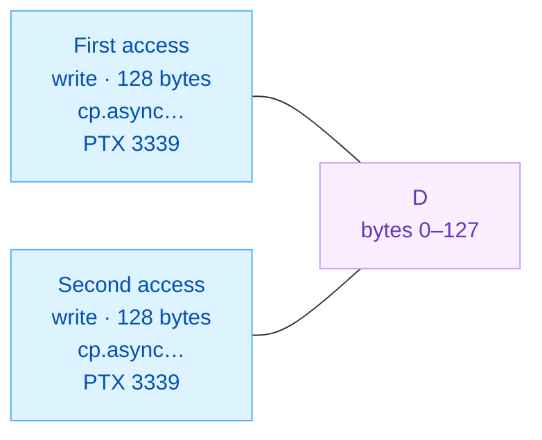
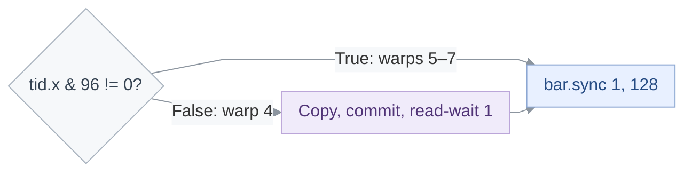

<!-- report-layout:v2 -->

<!-- verifier-result:start -->
<p align="center">Duplicate TMA output copies</p>
<h1 align="center">VERIFIED<br/>341,248 WARNINGS</h1>

**Inputs:** [PTX](https://github.com/gpu-verifier/sentryward/blob/94a6b26b1990a4b9df7ded3727acc4b4cc36f23c/corpus/cutlass__dense-gemm-f16-tma-1sm__sm_100a.ptx) ([raw](https://github.com/gpu-verifier/sentryward/raw/94a6b26b1990a4b9df7ded3727acc4b4cc36f23c/corpus/cutlass__dense-gemm-f16-tma-1sm__sm_100a.ptx)) · analyzed code; [input.json](https://github.com/gpu-verifier/sentryward/blob/94a6b26b1990a4b9df7ded3727acc4b4cc36f23c/examples/cutlass__dense-gemm-f16-tma-1sm__sm_100a/input.json) · launch, arguments and assumptions.

**Result:** [output.json](https://github.com/gpu-verifier/sentryward/blob/94a6b26b1990a4b9df7ded3727acc4b4cc36f23c/examples/cutlass__dense-gemm-f16-tma-1sm__sm_100a/output.json) · saved verifier findings.

<table>
<thead><tr><th align="left">VERIFIER RESULT · Warning to inspect</th></tr></thead>
<tbody><tr><td>

The verifier reports verification complete for the saved scope and checks below.

**Synchronization:** Passed · **Memory:** Passed · **Equivalence:** Passed

**Recorded totals:** 0 races · 341,248 warnings · 0 unresolved.

**Retained warnings:** 16; samples truncated: <code>true</code>.

**Warning classification rule:** Duplicate TMA stores — Matching same-warp duplicate TMA stores are races in the model, but are reported as warnings under the assumption that their stored values agree.

Saved rule flags: enabled <code>true</code> · triggered <code>true</code>.

**Why inspect this warning?** The saved classification is a warning, not a race. It remains relevant to interpreting the no-race result.

Showing the first of 16 retained warnings; this is file order, not a severity ranking. All retained records are in the [Evidence appendix](#evidence-appendix).

**write / write overlap:** <code>128</code> bytes in <code>global</code> memory, at byte offset <code>0</code>.

Unordered same-warp TMA writes have matching copy footprints and PTX site-visit indices. Value equality is not proven; analysis continues with all accesses retained.



Lines connect the two recorded accesses to their shared byte region; they do not show execution order.


<details>
<summary><strong>Locate the accesses and check their recorded overlap</strong></summary>

| Access | Source operation | Model event / instruction | Actor ID |
| --- | --- | --- | --- |
| First access | <code>cp.async.bulk.tensor.3d.global.</code><br/><code>shared::cta.bulk_group</code><br/>PTX line <code>3339</code> | <code>107459</code> / <code>13149</code> | <code>128</code> |
| Second access | <code>cp.async.bulk.tensor.3d.global.</code><br/><code>shared::cta.bulk_group</code><br/>PTX line <code>3339</code> | <code>109510</code> / <code>13327</code> | <code>129</code> |

Actor IDs name verifier participants; this record does not itself establish CUDA thread coordinates. Event and instruction IDs identify model records, not source-line numbers.

**Recorded source anchors.** These lines locate the saved events. Their guards and surrounding control flow belong to the code explanation.

<p><strong>First access · saved source location</strong> · <a href="https://github.com/gpu-verifier/sentryward/blob/94a6b26b1990a4b9df7ded3727acc4b4cc36f23c/corpus/cutlass__dense-gemm-f16-tma-1sm__sm_100a.ptx#L3339">physical PTX 3339</a> · display wrapping added</p>

<pre><code><strong>cp.async.bulk.tensor.3d.global.shared::cta.bulk_group</strong> [%rd139, {%r878,
    %r719, %r16}], [%r718];</code></pre>


**Saved record:** <a href="https://github.com/gpu-verifier/sentryward/blob/94a6b26b1990a4b9df7ded3727acc4b4cc36f23c/examples/cutlass__dense-gemm-f16-tma-1sm__sm_100a/output.json#L25681"><code>output.json#/warnings/0</code></a>. **Overlap check:** constant byte ranges intersect. **Allocation:** <code>D</code>. **Address space:** <code>global</code>.

</details>

<details>
<summary><strong>Saved status and diagnostic codes</strong></summary>

**Saved result:** <code>verified</code> · <a href="https://github.com/gpu-verifier/sentryward/blob/94a6b26b1990a4b9df7ded3727acc4b4cc36f23c/examples/cutlass__dense-gemm-f16-tma-1sm__sm_100a/output.json#L25488"><code>output.json#/result</code></a>.

**Operation:** <code>kernel_verification</code>.

**Checks:** Synchronization <code>passed</code> · Memory <code>passed</code> · Equivalence <code>passed</code>.

</details>

</td></tr>
<tr><td>

### Analysis scope

**Coverage:** Memory analysis complete: yes · Search complete: yes · Exhaustive search: **no**.

**Assumption-dependent:** <code>true</code>. Triggered rules: Duplicate TMA stores, Representative election, Failed launch cancellation.

This result applies to the supplied launch, arguments and enabled assumptions.

<details>
<summary><strong>Analysis records — open the saved evidence</strong></summary>

Each record link opens its field in the original `output.json`. Model summaries are not full execution traces.

**Check the finding**

- [Diagnostic messages and details · `diagnostics`](https://github.com/gpu-verifier/sentryward/blob/94a6b26b1990a4b9df7ded3727acc4b4cc36f23c/examples/cutlass__dense-gemm-f16-tma-1sm__sm_100a/output.json#L68)
- [Individual check outcomes · `checks`](https://github.com/gpu-verifier/sentryward/blob/94a6b26b1990a4b9df7ded3727acc4b4cc36f23c/examples/cutlass__dense-gemm-f16-tma-1sm__sm_100a/output.json#L56)

**Check how the model was built**

- [PTX translation · `frontend`](https://github.com/gpu-verifier/sentryward/blob/94a6b26b1990a4b9df7ded3727acc4b4cc36f23c/examples/cutlass__dense-gemm-f16-tma-1sm__sm_100a/output.json#L25192)
- [Model and source bindings · `semantic_program`](https://github.com/gpu-verifier/sentryward/blob/94a6b26b1990a4b9df7ded3727acc4b4cc36f23c/examples/cutlass__dense-gemm-f16-tma-1sm__sm_100a/output.json#L25502)
- [Synchronization-check setup · `synchronization_input`](https://github.com/gpu-verifier/sentryward/blob/94a6b26b1990a4b9df7ded3727acc4b4cc36f23c/examples/cutlass__dense-gemm-f16-tma-1sm__sm_100a/output.json#L25519)

**Check values separately**

- [Value-analysis status · `value_analysis`](https://github.com/gpu-verifier/sentryward/blob/94a6b26b1990a4b9df7ded3727acc4b4cc36f23c/examples/cutlass__dense-gemm-f16-tma-1sm__sm_100a/output.json#L25547)
- [Numerical comparison · `equivalence`](https://github.com/gpu-verifier/sentryward/blob/94a6b26b1990a4b9df7ded3727acc4b4cc36f23c/examples/cutlass__dense-gemm-f16-tma-1sm__sm_100a/output.json#L69)

For the records explained in this report, see the [Evidence appendix](#evidence-appendix).

</details>

</td></tr></tbody>
</table>
<!-- verifier-result:end -->

<!-- code-explanation:start -->

## Code explanation

Interpretation from the PTX and saved inputs: how the reported operations fit together and what remains to check.

### 1. The warning is in the shared-to-global output handoff

This f16 GEMM uses matrix-multiply instructions to build an accumulator in tensor memory (TMEM). Its output stage reads that accumulator, applies the epilogue scalars, stages f16 values in shared memory, and copies them to global output `D`.

For the supplied `alpha = 1` and `beta = 0`, the input-`C` load path is skipped. The affected TMA instruction copies the first 4 KiB strip of `D`; the question is which threads issue that copy, not which thread computed each element.

<details>
<summary><strong>Derivation: output stage and supplied scalars</strong></summary>

#### Why this is a nonempty multiplication

The `shape.K` declaration supplies the load at PTX 71. With `K = 128`, the calculation at 1994–1998 gives `(128 + 63) >> 6 = 2`; the `K < 1` branches at 2064 and 2094 are not taken. The K-loop counter starts at −2 and increments to zero. The first MMA uses `%r1173 = 0`, so it starts the accumulator without its old contents; subsequent unrolled MMAs use a literal 1, and 2297 changes `%r1173` to 1 for the next K iteration. This identifies an actual multiply/accumulate path rather than inferring computation from matrix-shaped descriptors.

#### Why the input-C contribution is bypassed

The zero beta stride at parameter offset 1296 lets the initial scalar load proceed, and the null beta pointer at 1288 selects the by-value zero at 1280. Alpha follows the analogous null-pointer path to the by-value one at 1312. At the output loop, `%p161` and `%p163` test the strides, so both reload blocks are skipped and those initial scalar values stay live. The beta-zero comparisons then give `%p242 = false`, `%p171 = true`, and `%p243 = true`; the branches at 3120 and 3164 bypass the C wait/load corridor. Later C-load corridors are likewise bypassed at 3387, 3571 and 3763. The first epilogue arithmetic multiplies TMEM values by alpha and adds beta times initially zero C registers before `stmatrix` stages the result.

<details>
<summary><strong>Sources: output stage and supplied scalars</strong></summary>

<blockquote>

##### Source references: Why this is a nonempty multiplication

- <a href="https://github.com/gpu-verifier/sentryward/blob/94a6b26b1990a4b9df7ded3727acc4b4cc36f23c/examples/cutlass__dense-gemm-f16-tma-1sm__sm_100a/input.json#L35"><code>input.json#/arguments/3</code></a>: <code>{&quot;field&quot;:&quot;shape.K&quot;,&quot;value&quot;:128}</code>
- <a href="https://github.com/gpu-verifier/sentryward/blob/94a6b26b1990a4b9df7ded3727acc4b4cc36f23c/examples/cutlass__dense-gemm-f16-tma-1sm__sm_100a/input.json#L151"><code>input.json#/declarations/3</code></a>: <code>{&quot;name&quot;:&quot;shape.K&quot;,&quot;parameter&quot;:0,&quot;offset&quot;:12,&quot;type&quot;:&quot;s32&quot;}</code>
- physical PTX 71,1994-2007,2009,2063-2064,2078-2097,2162-2168,2194-2201,2227-2234,2260-2267,2294-2299: <code>%r1173</code>

##### Source references: Why the input-C contribution is bypassed

- physical PTX 114-139: <code>%rd4</code>, <code>%rs1</code>, <code>%rs3</code>
- physical PTX 3021-3057: <code>%p161</code>, <code>%p163</code>, <code>%p166</code>
- physical PTX 3086-3120,3164-3199: <code>%p171</code>, <code>%p243</code>
- <a href="https://github.com/gpu-verifier/sentryward/blob/94a6b26b1990a4b9df7ded3727acc4b4cc36f23c/examples/cutlass__dense-gemm-f16-tma-1sm__sm_100a/input.json#L43"><code>input.json#/arguments/5</code></a>: <code>{&quot;field&quot;:&quot;beta&quot;,&quot;value&quot;:0.0}</code>
- <a href="https://github.com/gpu-verifier/sentryward/blob/94a6b26b1990a4b9df7ded3727acc4b4cc36f23c/examples/cutlass__dense-gemm-f16-tma-1sm__sm_100a/input.json#L47"><code>input.json#/arguments/6</code></a>: <code>{&quot;field&quot;:&quot;beta.pointer&quot;,&quot;value&quot;:null}</code>
- <a href="https://github.com/gpu-verifier/sentryward/blob/94a6b26b1990a4b9df7ded3727acc4b4cc36f23c/examples/cutlass__dense-gemm-f16-tma-1sm__sm_100a/input.json#L51"><code>input.json#/arguments/7</code></a>: <code>{&quot;field&quot;:&quot;beta.stride&quot;,&quot;value&quot;:0}</code>
- <a href="https://github.com/gpu-verifier/sentryward/blob/94a6b26b1990a4b9df7ded3727acc4b4cc36f23c/examples/cutlass__dense-gemm-f16-tma-1sm__sm_100a/input.json#L55"><code>input.json#/arguments/8</code></a>: <code>{&quot;field&quot;:&quot;alpha&quot;,&quot;value&quot;:1.0}</code>
- <a href="https://github.com/gpu-verifier/sentryward/blob/94a6b26b1990a4b9df7ded3727acc4b4cc36f23c/examples/cutlass__dense-gemm-f16-tma-1sm__sm_100a/input.json#L59"><code>input.json#/arguments/9</code></a>: <code>{&quot;field&quot;:&quot;alpha.pointer&quot;,&quot;value&quot;:null}</code>
- <a href="https://github.com/gpu-verifier/sentryward/blob/94a6b26b1990a4b9df7ded3727acc4b4cc36f23c/examples/cutlass__dense-gemm-f16-tma-1sm__sm_100a/input.json#L63"><code>input.json#/arguments/10</code></a>: <code>{&quot;field&quot;:&quot;alpha.stride&quot;,&quot;value&quot;:0}</code>
- physical PTX 3155-3164,3240-3317,3387,3571,3763: <code>%r1204</code>, <code>%p171</code>

##### Additional section references

- physical PTX 1973-1998,2094-2097,2162-2168,2294-2299: <a href="https://docs.nvidia.com/cuda/archive/13.2.0/parallel-thread-execution/index.html#tcgen05-mma-instructions"><code>tcgen05.mma</code></a>, <code>%r1173</code>
- physical PTX 3240-3254,3281-3288,3315-3339: <a href="https://docs.nvidia.com/cuda/archive/13.2.0/parallel-thread-execution/index.html#tcgen05-instructions-tcgen05-ld"><code>tcgen05.ld</code></a>, <code>stmatrix</code>, <a href="https://docs.nvidia.com/cuda/archive/13.2.0/parallel-thread-execution/index.html#data-movement-and-conversion-instructions-cp-async-bulk-tensor"><code>cp.async.bulk.tensor</code></a>
- <a href="https://github.com/gpu-verifier/sentryward/blob/94a6b26b1990a4b9df7ded3727acc4b4cc36f23c/examples/cutlass__dense-gemm-f16-tma-1sm__sm_100a/input.json#L442"><code>input.json#/tma_descriptors/5</code></a>: <code>dict, 11 entries; see original artifact</code>

</blockquote>

</details>

</details>

<a id="code-section-1" name="user-content-code-section-1"></a>

### 2. The copy selector admits a whole warp

Within the first output-copy block, the selector admits all 32 lanes of warp 4, threads 128–159, while warps 5–7 skip the copy and rejoin the next barrier. Each admitted lane uses the same `D` descriptor, coordinates `(0, 0, 0)`, and shared source at base + 1024.

Thus the source contains peer copies of one output strip, rather than disjoint per-lane output addresses. The view below is derived from PTX; the saved actor IDs are not explicitly mapped to CUDA thread coordinates in the supplied records, so it does not identify the retained pair.

**Possible interleaving.** Steps run downward; they are not a measured GPU clock or a hardware trace.

| Step | Warp 4, lane 0 (thread 128) | Warp 4, lane 1 (thread 129) |
| --- | --- | --- |
| 1 | Issue the first shared → D copy with coordinates (0, 0, 0). | — |
| 2 | — | Issue the same copy from the same shared source. |
| 3 | Commit its bulk group; execute read-wait 1; reach the next 128-thread barrier. | — |
| 4 | — | Commit its bulk group; execute read-wait 1; reach the same barrier. |

<p><strong>The same copy, commit and read-wait corridor applies to both illustrated lanes</strong> · <a href="https://github.com/gpu-verifier/sentryward/blob/94a6b26b1990a4b9df7ded3727acc4b4cc36f23c/corpus/cutlass__dense-gemm-f16-tma-1sm__sm_100a.ptx#L3242-L3351" title="Open the original PTX">physical PTX 3242, 3330–3351</a> · display wrapping added</p>

<ul>
<li><code>%p176</code> — True for output warps 5–7, which skip the copy corridor</li>
<li><code>%rd139</code> — D tensor-map address</li>
<li><code>%r718</code> — Shared source, base + 1024</li>
<li><code>%r878</code> — First descriptor-axis coordinate</li>
<li><code>%r719</code> — Second descriptor-axis coordinate</li>
</ul>

<pre><code><strong>setp.ne.b32</strong> <strong>%p176</strong>, %r83, 0;
…
<strong>mov.b32</strong> %r712, 1;
<strong>mov.b32</strong> %r713, 128;
// begin inline asm
<strong>bar.sync</strong> %r712, %r713;
// end inline asm
@<strong>%p176</strong> <strong>bra</strong> $L__BB0_225;
<strong>mov.b32</strong> %r720, _ZN7cutlass4smemE;
<strong>add.s32</strong> %r718, %r720, 1024;
// begin inline asm
<a href="https://docs.nvidia.com/cuda/archive/13.2.0/parallel-thread-execution/index.html#data-movement-and-conversion-instructions-cp-async-bulk-tensor"><strong>cp.async.bulk.tensor.3d.global.shared::cta.bulk_group</strong></a> [%rd139, {%r878,
    %r719, %r16}], [%r718];
// end inline asm
// begin inline asm
<a href="https://docs.nvidia.com/cuda/archive/13.2.0/parallel-thread-execution/index.html#data-movement-and-conversion-instructions-cp-async-bulk-commit-group"><strong>cp.async.bulk.commit_group</strong></a>;
// end inline asm
// begin inline asm
<a href="https://docs.nvidia.com/cuda/archive/13.2.0/parallel-thread-execution/index.html#data-movement-and-conversion-instructions-cp-async-bulk-wait-group"><strong>cp.async.bulk.wait_group.read</strong></a> <strong>1</strong>;
// end inline asm
$L__BB0_225:
<strong>mov.b32</strong> %r721, 1;
<strong>mov.b32</strong> %r722, 128;
// begin inline asm
<strong>bar.sync</strong> %r721, %r722;</code></pre>


- **Participants:** These are two of the 32 lanes admitted by the same warp-level selector. The other 126 output threads also participate in the surrounding counted barriers; they are omitted from the two-column view. Rows that expand the same warp instruction do not imply a measured lane issue order.
- **Branches:** This starts after the first output preparation barrier, for threads reaching that block after setup, assertions and accumulator availability. Both selected threads have `(tid.x & 96) = 0`, so `%p176` is false. No elected-lane predicate appears on this copy corridor.
- **Iterations:** The example uses the first strip of the initial tile. The initial CTA coordinates are zero, the configured swizzle branch is bypassed, and the raster transform preserves zero. Later scheduler coordinates do not replace the current tile coordinates until 3979–3985.
- **Completion:** Both copy issues precede their respective commit and read-wait. No completion order between the two asynchronous writes is asserted. Read-wait 1 may leave the newest group outstanding; the following `bar.sync` rendezvous does not select one writer or impose an order between peer copy completions.

<details>
<summary><strong>Sources for this interleaving</strong></summary>

- physical PTX 72-74: <code>%tid.x</code>, <code>%r4</code>
- physical PTX 1191-1192,1766-1769,1971-1972,2412-2415,2825-2837: <code>%p148</code>, <code>%r83</code>
- <a href="https://github.com/gpu-verifier/sentryward/blob/94a6b26b1990a4b9df7ded3727acc4b4cc36f23c/examples/cutlass__dense-gemm-f16-tma-1sm__sm_100a/input.json#L10"><code>input.json#/launch/block_dim</code></a>: <code>[256,1,1]</code>
- physical PTX 3242,3330-3351: <code>%p176</code>, <a href="https://docs.nvidia.com/cuda/archive/13.2.0/parallel-thread-execution/index.html#data-movement-and-conversion-instructions-cp-async-bulk-tensor"><code>cp.async.bulk.tensor.3d.global.shared::cta.bulk_group</code></a>, <a href="https://docs.nvidia.com/cuda/archive/13.2.0/parallel-thread-execution/index.html#data-movement-and-conversion-instructions-cp-async-bulk-wait-group"><code>cp.async.bulk.wait_group.read 1</code></a>, <code>bar.sync</code>
- physical PTX 3200-3244: <code>%p175</code>, <code>%p176</code>
- physical PTX 1099-1105,1161-1179: <code>%ctaid.x</code>, <code>%r29</code>
- physical PTX 2856-2857,2985-2986,3336-3339: <code>1664</code>, <code>1024</code>
- <a href="https://github.com/gpu-verifier/sentryward/blob/94a6b26b1990a4b9df7ded3727acc4b4cc36f23c/examples/cutlass__dense-gemm-f16-tma-1sm__sm_100a/input.json#L5"><code>input.json#/launch/grid_dim</code></a>: <code>[1,1,1]</code>
- <a href="https://github.com/gpu-verifier/sentryward/blob/94a6b26b1990a4b9df7ded3727acc4b4cc36f23c/examples/cutlass__dense-gemm-f16-tma-1sm__sm_100a/input.json#L111"><code>input.json#/arguments/22</code></a>: <code>{&quot;field&quot;:&quot;scheduler.swizzle.divisor&quot;,&quot;value&quot;:0}</code>
- <a href="https://github.com/gpu-verifier/sentryward/blob/94a6b26b1990a4b9df7ded3727acc4b4cc36f23c/examples/cutlass__dense-gemm-f16-tma-1sm__sm_100a/input.json#L123"><code>input.json#/arguments/25</code></a>: <code>{&quot;field&quot;:&quot;scheduler.raster_order&quot;,&quot;value&quot;:1}</code>
- <a href="https://github.com/gpu-verifier/sentryward/blob/94a6b26b1990a4b9df7ded3727acc4b4cc36f23c/examples/cutlass__dense-gemm-f16-tma-1sm__sm_100a/input.json#L442"><code>input.json#/tma_descriptors/5</code></a>: <code>dict, 11 entries; see original artifact</code>
- physical PTX 3979-3985: <code>%r30</code>, <code>%r31</code>, <code>%r16</code>

</details>

<details>
<summary><strong>Derivation: issuing warp and shared copy operands</strong></summary>

#### How the thread selector reaches the output block

PTX 72 reads `%tid.x`; shifting by five gives the warp index, and the shuffle broadcasts that index within each warp. Warps 4–7 take the branches that skip the warp-2, warp-1, warp-0 and warp-3 work bodies at 1192, 1769, 1972 and 2415. They then fall through the `warp < 4` exit test at 2827. The later mask is decimal 96 = 0x60, the two low warp-index bits of `tid.x`; it is zero for warp 4 and nonzero for warps 5–7. It contains no lane bits. This establishes the local role for threads reaching the output body, rather than identifying roles by nearby code placement.



Arrows show local branch and rejoin paths at PTX 3335–3351; they do not establish asynchronous completion or cross-thread order.

#### Why the copy operands are identical

The tensor-map address is parameter base + 1664, matching the supplied `D` descriptor. The source base is the shared symbol + 1024, with no lane-dependent addition. The coordinate tuple is `(tile_x << 6, tile_y << 7, tile_z)`. A one-CTA grid starts at `(0,0,0)`; swizzle divisor zero takes the branch at 1105, and raster order one with unit cluster divisors leaves those coordinates zero. The descriptor has a 64 × 32 × 1 f16 box, so one copy reads `64 × 32 × 1 × 2 = 4096` bytes. Its first two coordinate strides are 2 and 128 bytes. This is the complete copy box; the retained 128-byte overlap is a modeled region within it, not the total transfer size.

#### What the surrounding barrier coordinates

The output roles comprise four warps, or 128 threads. They stage register values with `stmatrix`, execute the async-proxy fence, and rendezvous at named barrier 1 with count 128 before the copy. The non-copying warps branch directly to the second barrier-1 rendezvous; the copying warp reaches it after its own bulk-group wait. Each rendezvous therefore coordinates the output threads, but neither is an election and neither serializes the peer TMA writes. A fence concerns visibility across proxies; it is not a wait for these later copies to finish.

<p><strong>Shared staging is visible before the output threads rendezvous</strong> · <a href="https://github.com/gpu-verifier/sentryward/blob/94a6b26b1990a4b9df7ded3727acc4b4cc36f23c/corpus/cutlass__dense-gemm-f16-tma-1sm__sm_100a.ptx#L3315-L3333" title="Open the original PTX">physical PTX 3315–3333</a> · display wrapping added</p>

<pre><code><strong>add.s32</strong> %r702, %r101, 1024;
// begin inline asm
<strong>stmatrix.sync.aligned.x4.trans.m8n8.shared.b16</strong> [%r702], {%r703, %r704,
    %r705, %r706};

// end inline asm
<strong>add.s32</strong> %r707, %r101, 3072;
// begin inline asm
<strong>stmatrix.sync.aligned.x4.trans.m8n8.shared.b16</strong> [%r707], {%r708, %r709,
    %r710, %r711};

// end inline asm
// begin inline asm
{
<strong>fence.proxy.async.shared::cta</strong>;
}
// end inline asm
<strong>mov.b32</strong> %r712, 1;
<strong>mov.b32</strong> %r713, 128;
// begin inline asm
<strong>bar.sync</strong> %r712, %r713;</code></pre>


<details>
<summary><strong>Sources: issuing warp and shared copy operands</strong></summary>

<blockquote>

##### Source references: How the thread selector reaches the output block

- physical PTX 72-74: <code>%tid.x</code>, <code>%r4</code>
- physical PTX 1191-1192,1766-1769,1971-1972,2412-2415,2825-2837: <code>%p148</code>, <code>%r83</code>
- <a href="https://github.com/gpu-verifier/sentryward/blob/94a6b26b1990a4b9df7ded3727acc4b4cc36f23c/examples/cutlass__dense-gemm-f16-tma-1sm__sm_100a/input.json#L10"><code>input.json#/launch/block_dim</code></a>: <code>[256,1,1]</code>
- physical PTX 3242,3335: <code>%p176</code>

##### Source references: Why the copy operands are identical

- physical PTX 1099-1105,1161-1179: <code>%ctaid.x</code>, <code>%r29</code>
- physical PTX 2856-2857,2985-2986,3336-3339: <code>1664</code>, <code>1024</code>
- <a href="https://github.com/gpu-verifier/sentryward/blob/94a6b26b1990a4b9df7ded3727acc4b4cc36f23c/examples/cutlass__dense-gemm-f16-tma-1sm__sm_100a/input.json#L5"><code>input.json#/launch/grid_dim</code></a>: <code>[1,1,1]</code>
- <a href="https://github.com/gpu-verifier/sentryward/blob/94a6b26b1990a4b9df7ded3727acc4b4cc36f23c/examples/cutlass__dense-gemm-f16-tma-1sm__sm_100a/input.json#L111"><code>input.json#/arguments/22</code></a>: <code>{&quot;field&quot;:&quot;scheduler.swizzle.divisor&quot;,&quot;value&quot;:0}</code>
- <a href="https://github.com/gpu-verifier/sentryward/blob/94a6b26b1990a4b9df7ded3727acc4b4cc36f23c/examples/cutlass__dense-gemm-f16-tma-1sm__sm_100a/input.json#L123"><code>input.json#/arguments/25</code></a>: <code>{&quot;field&quot;:&quot;scheduler.raster_order&quot;,&quot;value&quot;:1}</code>
- <a href="https://github.com/gpu-verifier/sentryward/blob/94a6b26b1990a4b9df7ded3727acc4b4cc36f23c/examples/cutlass__dense-gemm-f16-tma-1sm__sm_100a/input.json#L442"><code>input.json#/tma_descriptors/5</code></a>: <code>dict, 11 entries; see original artifact</code>
- <a href="https://github.com/gpu-verifier/sentryward/blob/94a6b26b1990a4b9df7ded3727acc4b4cc36f23c/examples/cutlass__dense-gemm-f16-tma-1sm__sm_100a/output.json#L25703"><code>output.json#/warnings/0/region</code></a>: <code>{&quot;address_space&quot;:&quot;global&quot;,&quot;allocation&quot;:&quot;D&quot;,&quot;bytes&quot;:128,&quot;offset&quot;:0}</code>

##### Source references: What the surrounding barrier coordinates

- physical PTX 72-74: <code>%tid.x</code>, <code>%r4</code>
- physical PTX 1191-1192,1766-1769,1971-1972,2412-2415,2825-2837: <code>%p148</code>, <code>%r83</code>
- <a href="https://github.com/gpu-verifier/sentryward/blob/94a6b26b1990a4b9df7ded3727acc4b4cc36f23c/examples/cutlass__dense-gemm-f16-tma-1sm__sm_100a/input.json#L10"><code>input.json#/launch/block_dim</code></a>: <code>[256,1,1]</code>
- physical PTX 3315-3351: <code>stmatrix</code>, <code>fence.proxy.async.shared::cta</code>, <code>bar.sync</code>

##### Additional section references

- physical PTX 3242,3330-3351: <code>%p176</code>, <a href="https://docs.nvidia.com/cuda/archive/13.2.0/parallel-thread-execution/index.html#data-movement-and-conversion-instructions-cp-async-bulk-tensor"><code>cp.async.bulk.tensor.3d.global.shared::cta.bulk_group</code></a>, <a href="https://docs.nvidia.com/cuda/archive/13.2.0/parallel-thread-execution/index.html#data-movement-and-conversion-instructions-cp-async-bulk-wait-group"><code>cp.async.bulk.wait_group.read 1</code></a>, <code>bar.sync</code>
- <a href="https://github.com/gpu-verifier/sentryward/blob/94a6b26b1990a4b9df7ded3727acc4b4cc36f23c/examples/cutlass__dense-gemm-f16-tma-1sm__sm_100a/output.json#L25680"><code>output.json#/warnings</code></a>: <code>list, 16 entries; see original artifact</code>
- <a href="https://github.com/gpu-verifier/sentryward/blob/94a6b26b1990a4b9df7ded3727acc4b4cc36f23c/examples/cutlass__dense-gemm-f16-tma-1sm__sm_100a/output.json#L25502"><code>output.json#/semantic_program</code></a>: <code>dict, 14 entries; see original artifact</code>

</blockquote>

</details>

</details>

<a id="code-section-2" name="user-content-code-section-2"></a>

### 3. The copy waits do not serialize peer writers

Each output strip has a per-issuer <a href="https://docs.nvidia.com/cuda/archive/13.2.0/parallel-thread-execution/index.html#data-movement-and-conversion-instructions-cp-async-bulk-wait-group"><code>cp.async.bulk.wait_group.read 1</code></a> after its copy group is committed. This waits for source reads of older groups and permits the newest group to remain pending; it is not a mutual-exclusion mechanism for the destination.

The configured `beta = 0` exit skips the final `read 0` drain, and failed cluster cancellation prevents a second output-loop iteration. Those conditions explain the actual lifetime of this tile’s staging buffers; they do not turn the duplicate-write warning into evidence of a missing wait.

| Output strip | Shared source offset | Second descriptor coordinate | Copy / commit / read-wait |
| --- | --- | --- | --- |
| First | 1024 | 0 | 3339 / 3342 / 3345 |
| Second | 5120 | 32 | 3541 / 3544 / 3547 |
| Third | 9216 | 64 | 3733 / 3736 / 3739 |
| Fourth | 13312 | 96 | 3937 / 3940 / 3946 |

<p><strong>The final drain is conditional: beta-zero takes the branch to return</strong> · <a href="https://github.com/gpu-verifier/sentryward/blob/94a6b26b1990a4b9df7ded3727acc4b4cc36f23c/corpus/cutlass__dense-gemm-f16-tma-1sm__sm_100a.ptx#L3996-L4033" title="Open the original PTX">physical PTX 3996–4000, 4015–4019, 4032–4033</a></p>

<pre><code><strong>setp.eq.f16</strong> __$temp3, %rs1, %rs56;
<strong>selp.u16</strong> %rs55, 1, 0, __$temp3;}
// end inline asm
<strong>setp.ne.b16</strong> <strong>%p1</strong>, %rs55, 0;
<strong>bra.uni</strong> $L__BB0_276;
…
$L__BB0_276:
@<strong>%p1</strong> <strong>bra</strong> $L__BB0_278;
$L__BB0_277:
// begin inline asm
<a href="https://docs.nvidia.com/cuda/archive/13.2.0/parallel-thread-execution/index.html#data-movement-and-conversion-instructions-cp-async-bulk-wait-group"><strong>cp.async.bulk.wait_group.read</strong></a> <strong>0</strong>;
…
$L__BB0_278:
<strong>ret</strong>;</code></pre>


<details>
<summary><strong>Derivation: copy passes and the final drain</strong></summary>

#### All four copy predicates select the same warp

The first three selectors `%p176`, `%p182`, and `%p186` all compare the unchanged `%r83` with zero. The fourth copy selector `%p190` and its separate wait selector `%p191` perform the same comparison, with no intervening assignment to `%r83`. Thus the last wait has a different predicate name but the same participating warp. Every pass rejoins a 128-thread barrier. The shared source offsets differ by 4096 bytes, exactly one descriptor box, so later strips of this tile do not overwrite the first strip’s staging range. The second descriptor coordinate advances by 32; the first and third stay zero. These are descriptor-axis positions, not assumed logical row/column names.

| Pass | Before / after barrier-1 rendezvous | Copy selector / wait selector |
| --- | --- | --- |
| First | 3333 / 3351 | <code>%p176</code> / <code>%p176</code> |
| Second | 3534 / 3553 | <code>%p182</code> / <code>%p182</code> |
| Third | 3726 / 3745 | <code>%p186</code> / <code>%p186</code> |
| Fourth | 3930 / 3952 | <code>%p190</code> / <code>%p191</code> |

#### Why the final read-zero wait is skipped here

Live values: beta is still the initial by-value zero because the zero stride bypassed its reload. `%p165` is true and therefore `%p6 = %p165 OR %p1` is true; `%p166 = NOT %p6` is false. Loop exit: the configured failed-cancellation assumption makes the query result `%r595 = 0`, so `%p196` is false and 3986 does not loop. Incoming drain paths: 3987 cannot jump directly to the drain because `%p166` is false. The zero beta stride also makes `%p197` false at 3988, so execution falls through the live beta-zero comparison at 3996. It sets `%p1 = true`; 4000 jumps to the test at 4016, which takes the return path and bypasses 4019. The alternative stride-nonzero path at 4001–4014 is not taken. This is static reduction of the supplied conditions, not a recorded GPU trace.

#### Source-read completion is different from destination-write order

The `.read` qualifier concerns completion of reads from the shared source for the calling thread’s bulk groups. Waiting for zero groups, when reached, drains that source-read obligation; waiting for one may leave the latest group pending. Neither statement establishes a total order between writes issued by different lanes. The saved warning specifically describes unordered writes with matching footprints and PTX site visits. Its classification rule does not assert equal values. The separately saved numerical analysis and value checks must retain their own scope; they do not change the meaning of the warning message.

<details>
<summary><strong>Sources: copy passes and the final drain</strong></summary>

<blockquote>

##### Source references: All four copy predicates select the same warp

- physical PTX 2837,3242,3330-3351,3445,3531-3553,3639,3723-3745,3829,3927-3952: <code>%r83</code>, <a href="https://docs.nvidia.com/cuda/archive/13.2.0/parallel-thread-execution/index.html#data-movement-and-conversion-instructions-cp-async-bulk-wait-group"><code>cp.async.bulk.wait_group.read 1</code></a>
- <a href="https://github.com/gpu-verifier/sentryward/blob/94a6b26b1990a4b9df7ded3727acc4b4cc36f23c/examples/cutlass__dense-gemm-f16-tma-1sm__sm_100a/input.json#L442"><code>input.json#/tma_descriptors/5</code></a>: <code>dict, 11 entries; see original artifact</code>

##### Source references: Why the final read-zero wait is skipped here

- physical PTX 2888-2891,3973-4019: <code>%r595</code>, <code>%p196</code>, <code>%p166</code>, <code>%p197</code>, <code>%p1</code>, <a href="https://docs.nvidia.com/cuda/archive/13.2.0/parallel-thread-execution/index.html#data-movement-and-conversion-instructions-cp-async-bulk-wait-group"><code>cp.async.bulk.wait_group.read 0</code></a>
- physical PTX 114-139: <code>%rd4</code>, <code>%rs1</code>, <code>%rs3</code>
- physical PTX 3021-3057: <code>%p161</code>, <code>%p163</code>, <code>%p166</code>
- physical PTX 3086-3120,3164-3199: <code>%p171</code>, <code>%p243</code>
- <a href="https://github.com/gpu-verifier/sentryward/blob/94a6b26b1990a4b9df7ded3727acc4b4cc36f23c/examples/cutlass__dense-gemm-f16-tma-1sm__sm_100a/input.json#L43"><code>input.json#/arguments/5</code></a>: <code>{&quot;field&quot;:&quot;beta&quot;,&quot;value&quot;:0.0}</code>
- <a href="https://github.com/gpu-verifier/sentryward/blob/94a6b26b1990a4b9df7ded3727acc4b4cc36f23c/examples/cutlass__dense-gemm-f16-tma-1sm__sm_100a/input.json#L47"><code>input.json#/arguments/6</code></a>: <code>{&quot;field&quot;:&quot;beta.pointer&quot;,&quot;value&quot;:null}</code>
- <a href="https://github.com/gpu-verifier/sentryward/blob/94a6b26b1990a4b9df7ded3727acc4b4cc36f23c/examples/cutlass__dense-gemm-f16-tma-1sm__sm_100a/input.json#L51"><code>input.json#/arguments/7</code></a>: <code>{&quot;field&quot;:&quot;beta.stride&quot;,&quot;value&quot;:0}</code>
- <a href="https://github.com/gpu-verifier/sentryward/blob/94a6b26b1990a4b9df7ded3727acc4b4cc36f23c/examples/cutlass__dense-gemm-f16-tma-1sm__sm_100a/input.json#L55"><code>input.json#/arguments/8</code></a>: <code>{&quot;field&quot;:&quot;alpha&quot;,&quot;value&quot;:1.0}</code>
- <a href="https://github.com/gpu-verifier/sentryward/blob/94a6b26b1990a4b9df7ded3727acc4b4cc36f23c/examples/cutlass__dense-gemm-f16-tma-1sm__sm_100a/input.json#L59"><code>input.json#/arguments/9</code></a>: <code>{&quot;field&quot;:&quot;alpha.pointer&quot;,&quot;value&quot;:null}</code>
- <a href="https://github.com/gpu-verifier/sentryward/blob/94a6b26b1990a4b9df7ded3727acc4b4cc36f23c/examples/cutlass__dense-gemm-f16-tma-1sm__sm_100a/input.json#L63"><code>input.json#/arguments/10</code></a>: <code>{&quot;field&quot;:&quot;alpha.stride&quot;,&quot;value&quot;:0}</code>
- <a href="https://github.com/gpu-verifier/sentryward/blob/94a6b26b1990a4b9df7ded3727acc4b4cc36f23c/examples/cutlass__dense-gemm-f16-tma-1sm__sm_100a/input.json#L475"><code>input.json#/assumptions/clc_always_fails</code></a>: <code>true</code>

##### Source references: Source-read completion is different from destination-write order

- physical PTX 3339-3351,4019: <a href="https://docs.nvidia.com/cuda/archive/13.2.0/parallel-thread-execution/index.html#data-movement-and-conversion-instructions-cp-async-bulk-wait-group"><code>cp.async.bulk.wait_group.read</code></a>
- <a href="https://github.com/gpu-verifier/sentryward/blob/94a6b26b1990a4b9df7ded3727acc4b4cc36f23c/examples/cutlass__dense-gemm-f16-tma-1sm__sm_100a/output.json#L25681"><code>output.json#/warnings/0</code></a>: <code>dict, 6 entries; see original artifact</code>
- <a href="https://github.com/gpu-verifier/sentryward/blob/94a6b26b1990a4b9df7ded3727acc4b4cc36f23c/examples/cutlass__dense-gemm-f16-tma-1sm__sm_100a/output.json#L15"><code>output.json#/assumptions/0</code></a>: <code>dict, 6 entries; see original artifact</code>
- <a href="https://github.com/gpu-verifier/sentryward/blob/94a6b26b1990a4b9df7ded3727acc4b4cc36f23c/examples/cutlass__dense-gemm-f16-tma-1sm__sm_100a/output.json#L25166"><code>output.json#/equivalence/scope</code></a>: <code>{&quot;kind&quot;:&quot;mapped_expression_equivalence&quot;,&quot;operation&quot;:&quot;equivalence&quot;}</code>
- <a href="https://github.com/gpu-verifier/sentryward/blob/94a6b26b1990a4b9df7ded3727acc4b4cc36f23c/examples/cutlass__dense-gemm-f16-tma-1sm__sm_100a/output.json#L25554"><code>output.json#/value_analysis/duplicate_write_value_checks</code></a>: <code>21328</code>

##### Additional section references

- physical PTX 3339-3351,3536-3553,3728-3745,3932-3952: <a href="https://docs.nvidia.com/cuda/archive/13.2.0/parallel-thread-execution/index.html#data-movement-and-conversion-instructions-cp-async-bulk-wait-group"><code>cp.async.bulk.wait_group.read 1</code></a>

</blockquote>

</details>

</details>

### 4. Next check

Before relying on the duplicate-store exception, check the ISA or implementation contract for multiple same-warp TMA stores to the same destination, and associate the saved duplicate-write value checks with the relevant write pairs. The source establishes identical copy operands and the surrounding waits; the unresolved issue is whether those facts justify the benign classification for the intended execution model. Adding a wait is not a conclusion supported by this warning alone.

<details>
<summary><strong>Evidence for the next check</strong></summary>

- <a href="https://github.com/gpu-verifier/sentryward/blob/94a6b26b1990a4b9df7ded3727acc4b4cc36f23c/examples/cutlass__dense-gemm-f16-tma-1sm__sm_100a/output.json#L15"><code>output.json#/assumptions/0</code></a>: <code>dict, 6 entries; see original artifact</code>
- <a href="https://github.com/gpu-verifier/sentryward/blob/94a6b26b1990a4b9df7ded3727acc4b4cc36f23c/examples/cutlass__dense-gemm-f16-tma-1sm__sm_100a/output.json#L25681"><code>output.json#/warnings/0</code></a>: <code>dict, 6 entries; see original artifact</code>
- <a href="https://github.com/gpu-verifier/sentryward/blob/94a6b26b1990a4b9df7ded3727acc4b4cc36f23c/examples/cutlass__dense-gemm-f16-tma-1sm__sm_100a/output.json#L25554"><code>output.json#/value_analysis/duplicate_write_value_checks</code></a>: <code>21328</code>
- physical PTX 3242,3330-3351: <code>%p176</code>, <a href="https://docs.nvidia.com/cuda/archive/13.2.0/parallel-thread-execution/index.html#data-movement-and-conversion-instructions-cp-async-bulk-tensor"><code>cp.async.bulk.tensor.3d.global.shared::cta.bulk_group</code></a>, <a href="https://docs.nvidia.com/cuda/archive/13.2.0/parallel-thread-execution/index.html#data-movement-and-conversion-instructions-cp-async-bulk-wait-group"><code>cp.async.bulk.wait_group.read 1</code></a>, <code>bar.sync</code>

</details>

<!-- code-explanation:end -->

<!-- verifier-evidence:start -->
## Evidence appendix

Use these records to check the verifier result and source explanation above. JSON pointers refer to the original saved files. Identical prerequisite copies use `same_records_as` to refer to the diagnostic evidence shown once; their original locations and content hashes remain recorded.

<details>
<summary><strong>Diagnostic records — verify the finding</strong></summary>

These are saved verifier records. Truncation flags describe missing records in the original result, not merely collapsed presentation.

#### Retained warnings

16 saved records. These are the retained sample, not necessarily all findings.

| Record | First / second event | Modes | Saved code |
| --- | --- | --- | --- |
| 0 | <code>107459</code> / <code>109510</code> | <code>write</code> / <code>write</code> | <code>duplicate-tma-store</code> |
| 1 | <code>107459</code> / <code>111561</code> | <code>write</code> / <code>write</code> | <code>duplicate-tma-store</code> |
| 2 | <code>107459</code> / <code>113612</code> | <code>write</code> / <code>write</code> | <code>duplicate-tma-store</code> |
| 3 | <code>107459</code> / <code>115663</code> | <code>write</code> / <code>write</code> | <code>duplicate-tma-store</code> |
| 4 | <code>107459</code> / <code>117714</code> | <code>write</code> / <code>write</code> | <code>duplicate-tma-store</code> |
| 5 | <code>107459</code> / <code>119765</code> | <code>write</code> / <code>write</code> | <code>duplicate-tma-store</code> |
| 6 | <code>107459</code> / <code>121816</code> | <code>write</code> / <code>write</code> | <code>duplicate-tma-store</code> |
| 7 | <code>107459</code> / <code>123867</code> | <code>write</code> / <code>write</code> | <code>duplicate-tma-store</code> |
| 8 | <code>107459</code> / <code>125918</code> | <code>write</code> / <code>write</code> | <code>duplicate-tma-store</code> |
| 9 | <code>107459</code> / <code>127969</code> | <code>write</code> / <code>write</code> | <code>duplicate-tma-store</code> |
| 10 | <code>107459</code> / <code>130020</code> | <code>write</code> / <code>write</code> | <code>duplicate-tma-store</code> |
| 11 | <code>107459</code> / <code>132071</code> | <code>write</code> / <code>write</code> | <code>duplicate-tma-store</code> |
| 12 | <code>107459</code> / <code>134122</code> | <code>write</code> / <code>write</code> | <code>duplicate-tma-store</code> |
| 13 | <code>107459</code> / <code>136173</code> | <code>write</code> / <code>write</code> | <code>duplicate-tma-store</code> |
| 14 | <code>107459</code> / <code>138224</code> | <code>write</code> / <code>write</code> | <code>duplicate-tma-store</code> |
| 15 | <code>107459</code> / <code>140275</code> | <code>write</code> / <code>write</code> | <code>duplicate-tma-store</code> |

Unordered same-warp TMA writes have matching copy footprints and PTX site-visit indices. Value equality is not proven; analysis continues with all accesses retained.

Byte regions, endpoints and exact locations: <a href="https://github.com/gpu-verifier/sentryward/blob/94a6b26b1990a4b9df7ded3727acc4b4cc36f23c/examples/cutlass__dense-gemm-f16-tma-1sm__sm_100a/output.json#L25680"><code>output.json#/warnings</code></a>.

<details>
<summary><strong>Exact diagnostic records and metadata</strong></summary>

##### Flags and empty collections

These retain their original top-level keys in `output.json`.

```json
{
  "races": [],
  "diagnostics": [],
  "source_violations": [],
  "verification_limitations": []
}
```

##### Warnings

<a href="https://github.com/gpu-verifier/sentryward/blob/94a6b26b1990a4b9df7ded3727acc4b4cc36f23c/examples/cutlass__dense-gemm-f16-tma-1sm__sm_100a/output.json#L25680"><code>output.json#/warnings</code></a>

**Retained records:** 16.

```json
[
  {
    "code": "duplicate-tma-store",
    "first": {
      "access_index": 0,
      "actor": 128,
      "bytes": 128,
      "effect_index": 1,
      "endpoint": {
        "address": 12498,
        "kind": "memory"
      },
      "event": 107459,
      "instruction": 13149,
      "location": {
        "column": 2,
        "file": "corpus/cutlass__dense-gemm-f16-tma-1sm__sm_100a.ptx",
        "line": 3339
      },
      "mode": "write"
    },
    "message": "Unordered same-warp TMA writes have matching copy footprints and PTX site-visit indices. Value equality is not proven; analysis continues with all accesses retained.",
    "overlap": "constant byte ranges intersect",
    "region": {
      "address_space": "global",
      "allocation": "D",
      "bytes": 128,
      "offset": 0
    },
    "second": {
      "access_index": 0,
      "actor": 129,
      "bytes": 128,
      "effect_index": 1,
      "endpoint": {
        "address": 12498,
        "kind": "memory"
      },
      "event": 109510,
      "instruction": 13327,
      "location": {
        "column": 2,
        "file": "corpus/cutlass__dense-gemm-f16-tma-1sm__sm_100a.ptx",
        "line": 3339
      },
      "mode": "write"
    }
  },
  {
    "code": "duplicate-tma-store",
    "first": {
      "access_index": 0,
      "actor": 128,
      "bytes": 128,
      "effect_index": 1,
      "endpoint": {
        "address": 12498,
        "kind": "memory"
      },
      "event": 107459,
      "instruction": 13149,
      "location": {
        "column": 2,
        "file": "corpus/cutlass__dense-gemm-f16-tma-1sm__sm_100a.ptx",
        "line": 3339
      },
      "mode": "write"
    },
    "message": "Unordered same-warp TMA writes have matching copy footprints and PTX site-visit indices. Value equality is not proven; analysis continues with all accesses retained.",
    "overlap": "constant byte ranges intersect",
    "region": {
      "address_space": "global",
      "allocation": "D",
      "bytes": 128,
      "offset": 0
    },
    "second": {
      "access_index": 0,
      "actor": 130,
      "bytes": 128,
      "effect_index": 1,
      "endpoint": {
        "address": 12498,
        "kind": "memory"
      },
      "event": 111561,
      "instruction": 13505,
      "location": {
        "column": 2,
        "file": "corpus/cutlass__dense-gemm-f16-tma-1sm__sm_100a.ptx",
        "line": 3339
      },
      "mode": "write"
    }
  },
  {
    "code": "duplicate-tma-store",
    "first": {
      "access_index": 0,
      "actor": 128,
      "bytes": 128,
      "effect_index": 1,
      "endpoint": {
        "address": 12498,
        "kind": "memory"
      },
      "event": 107459,
      "instruction": 13149,
      "location": {
        "column": 2,
        "file": "corpus/cutlass__dense-gemm-f16-tma-1sm__sm_100a.ptx",
        "line": 3339
      },
      "mode": "write"
    },
    "message": "Unordered same-warp TMA writes have matching copy footprints and PTX site-visit indices. Value equality is not proven; analysis continues with all accesses retained.",
    "overlap": "constant byte ranges intersect",
    "region": {
      "address_space": "global",
      "allocation": "D",
      "bytes": 128,
      "offset": 0
    },
    "second": {
      "access_index": 0,
      "actor": 131,
      "bytes": 128,
      "effect_index": 1,
      "endpoint": {
        "address": 12498,
        "kind": "memory"
      },
      "event": 113612,
      "instruction": 13683,
      "location": {
        "column": 2,
        "file": "corpus/cutlass__dense-gemm-f16-tma-1sm__sm_100a.ptx",
        "line": 3339
      },
      "mode": "write"
    }
  },
  {
    "code": "duplicate-tma-store",
    "first": {
      "access_index": 0,
      "actor": 128,
      "bytes": 128,
      "effect_index": 1,
      "endpoint": {
        "address": 12498,
        "kind": "memory"
      },
      "event": 107459,
      "instruction": 13149,
      "location": {
        "column": 2,
        "file": "corpus/cutlass__dense-gemm-f16-tma-1sm__sm_100a.ptx",
        "line": 3339
      },
      "mode": "write"
    },
    "message": "Unordered same-warp TMA writes have matching copy footprints and PTX site-visit indices. Value equality is not proven; analysis continues with all accesses retained.",
    "overlap": "constant byte ranges intersect",
    "region": {
      "address_space": "global",
      "allocation": "D",
      "bytes": 128,
      "offset": 0
    },
    "second": {
      "access_index": 0,
      "actor": 132,
      "bytes": 128,
      "effect_index": 1,
      "endpoint": {
        "address": 12498,
        "kind": "memory"
      },
      "event": 115663,
      "instruction": 13861,
      "location": {
        "column": 2,
        "file": "corpus/cutlass__dense-gemm-f16-tma-1sm__sm_100a.ptx",
        "line": 3339
      },
      "mode": "write"
    }
  },
  {
    "code": "duplicate-tma-store",
    "first": {
      "access_index": 0,
      "actor": 128,
      "bytes": 128,
      "effect_index": 1,
      "endpoint": {
        "address": 12498,
        "kind": "memory"
      },
      "event": 107459,
      "instruction": 13149,
      "location": {
        "column": 2,
        "file": "corpus/cutlass__dense-gemm-f16-tma-1sm__sm_100a.ptx",
        "line": 3339
      },
      "mode": "write"
    },
    "message": "Unordered same-warp TMA writes have matching copy footprints and PTX site-visit indices. Value equality is not proven; analysis continues with all accesses retained.",
    "overlap": "constant byte ranges intersect",
    "region": {
      "address_space": "global",
      "allocation": "D",
      "bytes": 128,
      "offset": 0
    },
    "second": {
      "access_index": 0,
      "actor": 133,
      "bytes": 128,
      "effect_index": 1,
      "endpoint": {
        "address": 12498,
        "kind": "memory"
      },
      "event": 117714,
      "instruction": 14039,
      "location": {
        "column": 2,
        "file": "corpus/cutlass__dense-gemm-f16-tma-1sm__sm_100a.ptx",
        "line": 3339
      },
      "mode": "write"
    }
  },
  {
    "code": "duplicate-tma-store",
    "first": {
      "access_index": 0,
      "actor": 128,
      "bytes": 128,
      "effect_index": 1,
      "endpoint": {
        "address": 12498,
        "kind": "memory"
      },
      "event": 107459,
      "instruction": 13149,
      "location": {
        "column": 2,
        "file": "corpus/cutlass__dense-gemm-f16-tma-1sm__sm_100a.ptx",
        "line": 3339
      },
      "mode": "write"
    },
    "message": "Unordered same-warp TMA writes have matching copy footprints and PTX site-visit indices. Value equality is not proven; analysis continues with all accesses retained.",
    "overlap": "constant byte ranges intersect",
    "region": {
      "address_space": "global",
      "allocation": "D",
      "bytes": 128,
      "offset": 0
    },
    "second": {
      "access_index": 0,
      "actor": 134,
      "bytes": 128,
      "effect_index": 1,
      "endpoint": {
        "address": 12498,
        "kind": "memory"
      },
      "event": 119765,
      "instruction": 14217,
      "location": {
        "column": 2,
        "file": "corpus/cutlass__dense-gemm-f16-tma-1sm__sm_100a.ptx",
        "line": 3339
      },
      "mode": "write"
    }
  },
  {
    "code": "duplicate-tma-store",
    "first": {
      "access_index": 0,
      "actor": 128,
      "bytes": 128,
      "effect_index": 1,
      "endpoint": {
        "address": 12498,
        "kind": "memory"
      },
      "event": 107459,
      "instruction": 13149,
      "location": {
        "column": 2,
        "file": "corpus/cutlass__dense-gemm-f16-tma-1sm__sm_100a.ptx",
        "line": 3339
      },
      "mode": "write"
    },
    "message": "Unordered same-warp TMA writes have matching copy footprints and PTX site-visit indices. Value equality is not proven; analysis continues with all accesses retained.",
    "overlap": "constant byte ranges intersect",
    "region": {
      "address_space": "global",
      "allocation": "D",
      "bytes": 128,
      "offset": 0
    },
    "second": {
      "access_index": 0,
      "actor": 135,
      "bytes": 128,
      "effect_index": 1,
      "endpoint": {
        "address": 12498,
        "kind": "memory"
      },
      "event": 121816,
      "instruction": 14395,
      "location": {
        "column": 2,
        "file": "corpus/cutlass__dense-gemm-f16-tma-1sm__sm_100a.ptx",
        "line": 3339
      },
      "mode": "write"
    }
  },
  {
    "code": "duplicate-tma-store",
    "first": {
      "access_index": 0,
      "actor": 128,
      "bytes": 128,
      "effect_index": 1,
      "endpoint": {
        "address": 12498,
        "kind": "memory"
      },
      "event": 107459,
      "instruction": 13149,
      "location": {
        "column": 2,
        "file": "corpus/cutlass__dense-gemm-f16-tma-1sm__sm_100a.ptx",
        "line": 3339
      },
      "mode": "write"
    },
    "message": "Unordered same-warp TMA writes have matching copy footprints and PTX site-visit indices. Value equality is not proven; analysis continues with all accesses retained.",
    "overlap": "constant byte ranges intersect",
    "region": {
      "address_space": "global",
      "allocation": "D",
      "bytes": 128,
      "offset": 0
    },
    "second": {
      "access_index": 0,
      "actor": 136,
      "bytes": 128,
      "effect_index": 1,
      "endpoint": {
        "address": 12498,
        "kind": "memory"
      },
      "event": 123867,
      "instruction": 14573,
      "location": {
        "column": 2,
        "file": "corpus/cutlass__dense-gemm-f16-tma-1sm__sm_100a.ptx",
        "line": 3339
      },
      "mode": "write"
    }
  },
  {
    "code": "duplicate-tma-store",
    "first": {
      "access_index": 0,
      "actor": 128,
      "bytes": 128,
      "effect_index": 1,
      "endpoint": {
        "address": 12498,
        "kind": "memory"
      },
      "event": 107459,
      "instruction": 13149,
      "location": {
        "column": 2,
        "file": "corpus/cutlass__dense-gemm-f16-tma-1sm__sm_100a.ptx",
        "line": 3339
      },
      "mode": "write"
    },
    "message": "Unordered same-warp TMA writes have matching copy footprints and PTX site-visit indices. Value equality is not proven; analysis continues with all accesses retained.",
    "overlap": "constant byte ranges intersect",
    "region": {
      "address_space": "global",
      "allocation": "D",
      "bytes": 128,
      "offset": 0
    },
    "second": {
      "access_index": 0,
      "actor": 137,
      "bytes": 128,
      "effect_index": 1,
      "endpoint": {
        "address": 12498,
        "kind": "memory"
      },
      "event": 125918,
      "instruction": 14751,
      "location": {
        "column": 2,
        "file": "corpus/cutlass__dense-gemm-f16-tma-1sm__sm_100a.ptx",
        "line": 3339
      },
      "mode": "write"
    }
  },
  {
    "code": "duplicate-tma-store",
    "first": {
      "access_index": 0,
      "actor": 128,
      "bytes": 128,
      "effect_index": 1,
      "endpoint": {
        "address": 12498,
        "kind": "memory"
      },
      "event": 107459,
      "instruction": 13149,
      "location": {
        "column": 2,
        "file": "corpus/cutlass__dense-gemm-f16-tma-1sm__sm_100a.ptx",
        "line": 3339
      },
      "mode": "write"
    },
    "message": "Unordered same-warp TMA writes have matching copy footprints and PTX site-visit indices. Value equality is not proven; analysis continues with all accesses retained.",
    "overlap": "constant byte ranges intersect",
    "region": {
      "address_space": "global",
      "allocation": "D",
      "bytes": 128,
      "offset": 0
    },
    "second": {
      "access_index": 0,
      "actor": 138,
      "bytes": 128,
      "effect_index": 1,
      "endpoint": {
        "address": 12498,
        "kind": "memory"
      },
      "event": 127969,
      "instruction": 14929,
      "location": {
        "column": 2,
        "file": "corpus/cutlass__dense-gemm-f16-tma-1sm__sm_100a.ptx",
        "line": 3339
      },
      "mode": "write"
    }
  },
  {
    "code": "duplicate-tma-store",
    "first": {
      "access_index": 0,
      "actor": 128,
      "bytes": 128,
      "effect_index": 1,
      "endpoint": {
        "address": 12498,
        "kind": "memory"
      },
      "event": 107459,
      "instruction": 13149,
      "location": {
        "column": 2,
        "file": "corpus/cutlass__dense-gemm-f16-tma-1sm__sm_100a.ptx",
        "line": 3339
      },
      "mode": "write"
    },
    "message": "Unordered same-warp TMA writes have matching copy footprints and PTX site-visit indices. Value equality is not proven; analysis continues with all accesses retained.",
    "overlap": "constant byte ranges intersect",
    "region": {
      "address_space": "global",
      "allocation": "D",
      "bytes": 128,
      "offset": 0
    },
    "second": {
      "access_index": 0,
      "actor": 139,
      "bytes": 128,
      "effect_index": 1,
      "endpoint": {
        "address": 12498,
        "kind": "memory"
      },
      "event": 130020,
      "instruction": 15107,
      "location": {
        "column": 2,
        "file": "corpus/cutlass__dense-gemm-f16-tma-1sm__sm_100a.ptx",
        "line": 3339
      },
      "mode": "write"
    }
  },
  {
    "code": "duplicate-tma-store",
    "first": {
      "access_index": 0,
      "actor": 128,
      "bytes": 128,
      "effect_index": 1,
      "endpoint": {
        "address": 12498,
        "kind": "memory"
      },
      "event": 107459,
      "instruction": 13149,
      "location": {
        "column": 2,
        "file": "corpus/cutlass__dense-gemm-f16-tma-1sm__sm_100a.ptx",
        "line": 3339
      },
      "mode": "write"
    },
    "message": "Unordered same-warp TMA writes have matching copy footprints and PTX site-visit indices. Value equality is not proven; analysis continues with all accesses retained.",
    "overlap": "constant byte ranges intersect",
    "region": {
      "address_space": "global",
      "allocation": "D",
      "bytes": 128,
      "offset": 0
    },
    "second": {
      "access_index": 0,
      "actor": 140,
      "bytes": 128,
      "effect_index": 1,
      "endpoint": {
        "address": 12498,
        "kind": "memory"
      },
      "event": 132071,
      "instruction": 15285,
      "location": {
        "column": 2,
        "file": "corpus/cutlass__dense-gemm-f16-tma-1sm__sm_100a.ptx",
        "line": 3339
      },
      "mode": "write"
    }
  },
  {
    "code": "duplicate-tma-store",
    "first": {
      "access_index": 0,
      "actor": 128,
      "bytes": 128,
      "effect_index": 1,
      "endpoint": {
        "address": 12498,
        "kind": "memory"
      },
      "event": 107459,
      "instruction": 13149,
      "location": {
        "column": 2,
        "file": "corpus/cutlass__dense-gemm-f16-tma-1sm__sm_100a.ptx",
        "line": 3339
      },
      "mode": "write"
    },
    "message": "Unordered same-warp TMA writes have matching copy footprints and PTX site-visit indices. Value equality is not proven; analysis continues with all accesses retained.",
    "overlap": "constant byte ranges intersect",
    "region": {
      "address_space": "global",
      "allocation": "D",
      "bytes": 128,
      "offset": 0
    },
    "second": {
      "access_index": 0,
      "actor": 141,
      "bytes": 128,
      "effect_index": 1,
      "endpoint": {
        "address": 12498,
        "kind": "memory"
      },
      "event": 134122,
      "instruction": 15463,
      "location": {
        "column": 2,
        "file": "corpus/cutlass__dense-gemm-f16-tma-1sm__sm_100a.ptx",
        "line": 3339
      },
      "mode": "write"
    }
  },
  {
    "code": "duplicate-tma-store",
    "first": {
      "access_index": 0,
      "actor": 128,
      "bytes": 128,
      "effect_index": 1,
      "endpoint": {
        "address": 12498,
        "kind": "memory"
      },
      "event": 107459,
      "instruction": 13149,
      "location": {
        "column": 2,
        "file": "corpus/cutlass__dense-gemm-f16-tma-1sm__sm_100a.ptx",
        "line": 3339
      },
      "mode": "write"
    },
    "message": "Unordered same-warp TMA writes have matching copy footprints and PTX site-visit indices. Value equality is not proven; analysis continues with all accesses retained.",
    "overlap": "constant byte ranges intersect",
    "region": {
      "address_space": "global",
      "allocation": "D",
      "bytes": 128,
      "offset": 0
    },
    "second": {
      "access_index": 0,
      "actor": 142,
      "bytes": 128,
      "effect_index": 1,
      "endpoint": {
        "address": 12498,
        "kind": "memory"
      },
      "event": 136173,
      "instruction": 15641,
      "location": {
        "column": 2,
        "file": "corpus/cutlass__dense-gemm-f16-tma-1sm__sm_100a.ptx",
        "line": 3339
      },
      "mode": "write"
    }
  },
  {
    "code": "duplicate-tma-store",
    "first": {
      "access_index": 0,
      "actor": 128,
      "bytes": 128,
      "effect_index": 1,
      "endpoint": {
        "address": 12498,
        "kind": "memory"
      },
      "event": 107459,
      "instruction": 13149,
      "location": {
        "column": 2,
        "file": "corpus/cutlass__dense-gemm-f16-tma-1sm__sm_100a.ptx",
        "line": 3339
      },
      "mode": "write"
    },
    "message": "Unordered same-warp TMA writes have matching copy footprints and PTX site-visit indices. Value equality is not proven; analysis continues with all accesses retained.",
    "overlap": "constant byte ranges intersect",
    "region": {
      "address_space": "global",
      "allocation": "D",
      "bytes": 128,
      "offset": 0
    },
    "second": {
      "access_index": 0,
      "actor": 143,
      "bytes": 128,
      "effect_index": 1,
      "endpoint": {
        "address": 12498,
        "kind": "memory"
      },
      "event": 138224,
      "instruction": 15819,
      "location": {
        "column": 2,
        "file": "corpus/cutlass__dense-gemm-f16-tma-1sm__sm_100a.ptx",
        "line": 3339
      },
      "mode": "write"
    }
  },
  {
    "code": "duplicate-tma-store",
    "first": {
      "access_index": 0,
      "actor": 128,
      "bytes": 128,
      "effect_index": 1,
      "endpoint": {
        "address": 12498,
        "kind": "memory"
      },
      "event": 107459,
      "instruction": 13149,
      "location": {
        "column": 2,
        "file": "corpus/cutlass__dense-gemm-f16-tma-1sm__sm_100a.ptx",
        "line": 3339
      },
      "mode": "write"
    },
    "message": "Unordered same-warp TMA writes have matching copy footprints and PTX site-visit indices. Value equality is not proven; analysis continues with all accesses retained.",
    "overlap": "constant byte ranges intersect",
    "region": {
      "address_space": "global",
      "allocation": "D",
      "bytes": 128,
      "offset": 0
    },
    "second": {
      "access_index": 0,
      "actor": 144,
      "bytes": 128,
      "effect_index": 1,
      "endpoint": {
        "address": 12498,
        "kind": "memory"
      },
      "event": 140275,
      "instruction": 15997,
      "location": {
        "column": 2,
        "file": "corpus/cutlass__dense-gemm-f16-tma-1sm__sm_100a.ptx",
        "line": 3339
      },
      "mode": "write"
    }
  }
]
```

</details>

</details>

<details>
<summary><strong>Assumptions — what qualifies the result</strong></summary>

Enabled and triggered answer different questions: whether a rule was selected, and whether its applicability was recorded. `triggered: null` means unknown or unmeasured, not inactive.

#### Duplicate TMA stores

**Key:** <code>duplicate_tma_store_benign</code>

**Enabled:** <code>true</code> · **Triggered:** <code>true</code>

Matching same-warp duplicate TMA stores are races in the model, but are reported as warnings under the assumption that their stored values agree.

#### Representative election

**Key:** <code>representative_election</code>

**Enabled:** <code>true</code> · **Triggered:** <code>true</code>

Election selects lane zero when participating, otherwise the lowest participating lane.

#### Failed launch cancellation

**Key:** <code>clc_always_fails</code>

**Enabled:** <code>true</code> · **Triggered:** <code>true</code>

Every cluster launch cancellation request fails.

#### Representative branches

**Key:** <code>representative_branches</code>

**Enabled:** <code>false</code> · **Triggered:** <code>false</code>

Choose fallthrough for an unresolved structured if/else; unknown ordinary instruction guards execute. Terminal control uses CFG classification. Known control and explicit choices take precedence.

#### Bounded computation loops

**Key:** <code>bounded_computation_loops</code>

**Enabled:** <code>false</code> · **Triggered:** <code>false</code>

Execute a configured number of body iterations for unresolved recognized computation loops, counted separately per invocation. Polling and unclassified loops are never forced to complete.

<details>
<summary><strong>Exact assumption settings</strong></summary>

```json
{
  "assumptions": [
    {
      "category": "analysis assumption",
      "enabled": true,
      "key": "duplicate_tma_store_benign",
      "label": "Duplicate TMA stores",
      "text": "Matching same-warp duplicate TMA stores are races in the model, but are reported as warnings under the assumption that their stored values agree.",
      "triggered": true
    },
    {
      "category": "analysis assumption",
      "enabled": true,
      "key": "representative_election",
      "label": "Representative election",
      "text": "Election selects lane zero when participating, otherwise the lowest participating lane.",
      "triggered": true
    },
    {
      "category": "analysis assumption",
      "enabled": true,
      "key": "clc_always_fails",
      "label": "Failed launch cancellation",
      "text": "Every cluster launch cancellation request fails.",
      "triggered": true
    },
    {
      "category": "analysis assumption",
      "enabled": false,
      "key": "representative_branches",
      "label": "Representative branches",
      "text": "Choose fallthrough for an unresolved structured if/else; unknown ordinary instruction guards execute. Terminal control uses CFG classification. Known control and explicit choices take precedence.",
      "triggered": false
    },
    {
      "category": "analysis assumption",
      "enabled": false,
      "key": "bounded_computation_loops",
      "label": "Bounded computation loops",
      "text": "Execute a configured number of body iterations for unresolved recognized computation loops, counted separately per invocation. Polling and unclassified loops are never forced to complete.",
      "triggered": false
    }
  ],
  "semantic_assumptions": {
    "bounded_computation_loops": false,
    "clc_always_fails": true,
    "duplicate_tma_store_benign": true,
    "representative_branches": false,
    "representative_election": true
  },
  "frontend_assumptions": {
    "assertion_failure_forms": [
      "trap",
      "__assertfail"
    ],
    "assertion_uses": 512,
    "bounded_loop_uses": 0,
    "clc_failure": true,
    "clc_uses": 225,
    "data_branch_decisions": [],
    "election_policy": {
      "fallback": "lowest_member",
      "preferred_lane": 0,
      "strategy": "preferred_member"
    },
    "election_uses": 1408,
    "fixed_election": true,
    "isolated_launch": true,
    "noalias_unbounded": false,
    "opaque_compute_regions": [],
    "pointer_contract": {
      "aliasing": "distinct_objects_noalias",
      "extent_bytes": "unbounded"
    },
    "representative_branch_uses": 0,
    "trap_only_equality_assertions_hold": true
  },
  "assumption_reporting": "triggered=null means applicability was not measured or analysis was not reached",
  "assumption_dependent": true
}
```

</details>

</details>

<details>
<summary><strong>Value analysis — independent status</strong></summary>

Memory safety and numerical equivalence are separate results.

**Value analysis:** <code>verified</code> · <a href="https://github.com/gpu-verifier/sentryward/blob/94a6b26b1990a4b9df7ded3727acc4b4cc36f23c/examples/cutlass__dense-gemm-f16-tma-1sm__sm_100a/output.json#L25547"><code>output.json#/value_analysis</code></a>

**Checks:** Synchronization <code>not_requested</code> · Memory <code>not_requested</code> · Equivalence <code>not_requested</code>.

- **Scope:** {&quot;operation&quot;:&quot;<code>value_analysis</code>&quot;}

**Equivalence:** <code>verified</code> · <a href="https://github.com/gpu-verifier/sentryward/blob/94a6b26b1990a4b9df7ded3727acc4b4cc36f23c/examples/cutlass__dense-gemm-f16-tma-1sm__sm_100a/output.json#L69"><code>output.json#/equivalence</code></a>

**Checks:** Synchronization <code>not_requested</code> · Memory <code>not_requested</code> · Equivalence <code>passed</code>.

- **Numerical result:** verified
- **Scope:** {&quot;kind&quot;:&quot;<code>mapped_expression_equivalence</code>&quot;,&quot;operation&quot;:&quot;equivalence&quot;}
- **Semantics:** <code>ideal_real</code> numerical contract; exact word/index import; conditional on reported native premises, fixed input values and any <code>input_contract</code>
- **Equivalence contract:** <code>same_domain_and_equal_values</code>; total definedness reported separately
- **Prerequisites:** caller must combine numerical proof with synchronization, memory and scope results
- **Definedness:** <code>proved</code>

**Verification result:** <code>race_free</code> · <a href="https://github.com/gpu-verifier/sentryward/blob/94a6b26b1990a4b9df7ded3727acc4b4cc36f23c/examples/cutlass__dense-gemm-f16-tma-1sm__sm_100a/output.json#L25677"><code>output.json#/verification_result</code></a>

<details>
<summary><strong>Exact value-analysis fields and large-data references</strong></summary>

##### Value analysis

```json
{
  "duplicate_write_value_checks": 21328,
  "equivalence_check": "equivalent",
  "initial_memory_regions": 2064,
  "initial_read_families": 2064,
  "output_region_families": 0,
  "output_regions": 688,
  "processed_memory_actions": 197538,
  "processed_memory_families": 0,
  "read_substitutions": 24999,
  "result": "verified",
  "shared_read_families": 2076,
  "shared_read_instances": 19628,
  "stored_read_substitutions": 5371,
  "checks": {
    "equivalence": "not_requested",
    "memory": "not_requested",
    "synchronization": "not_requested"
  },
  "diagnostics": [],
  "memory_action_storage": {
    "logical_actions": 197538,
    "stored_runs": 167210
  },
  "passes": [
    {
      "name": "packing",
      "rewritten_instances": 8224,
      "rewritten_nodes": 896,
      "semantics": "exact_fixed_width"
    },
    {
      "abstraction": "matched approximation and clamp replaced by ideal Exp2",
      "name": "software_exp2",
      "rewritten_instances": 0,
      "rewritten_nodes": 0,
      "semantics": "ideal_exp2"
    },
    {
      "converted_instances": 138185,
      "name": "type_edges",
      "removed_nodes": 14371
    },
    {
      "name": "memory_elimination"
    },
    {
      "elements": 0,
      "identities": 27,
      "layouts": 1856,
      "mapping_blocks": 6592,
      "name": "view_normalization",
      "original_pieces": 91648,
      "reused_initial_reads": 2064,
      "reused_views": 2064,
      "segmented": 1424,
      "slices": 0,
      "stored_mapping_blocks": 3196,
      "typed_output_pieces": 0,
      "typed_output_regions": 0
    }
  ],
  "scalar_fold": {
    "checks": {
      "equivalence": "not_requested",
      "memory": "not_requested",
      "synchronization": "not_requested"
    },
    "construction_collections": 0,
    "diagnostics": [],
    "output_count": 8192,
    "output_families_merged": 2016,
    "output_family_count": 608,
    "output_root_count": 608,
    "peak_construction_nodes": 85269,
    "result": "verified",
    "scope": {
      "operation": "scalar_fold"
    },
    "shared_view_projection_hits": 40320,
    "source_outputs": 688,
    "spatial_families_projected": 1280,
    "spatial_outputs_projected": 8192,
    "spatial_template_operations": 0,
    "statistics": {
      "constants": 151,
      "edges": 8502,
      "folds": 1216,
      "indices": 3,
      "initial_cells": 146,
      "logical_iterations": 14592,
      "logical_iterations_overflow": false,
      "max_fold_nesting": 2,
      "nodes": 4174,
      "nodes_before_final_collection": 85269,
      "nodes_reclaimed": 81095,
      "operations": 2658,
      "parameters": 0,
      "range_descriptions": 1216,
      "storage_nodes": 4174,
      "unique_fold_bodies": 1216
    }
  },
  "scope": {
    "operation": "value_analysis"
  },
  "serialization": {
    "action_patterns": 167210,
    "binding_patterns": 151386,
    "domain_refinements": 128058,
    "elapsed_seconds": 1.337223462,
    "event_families": 207160,
    "expanded_event_records": 0,
    "largest_batch_members": 62,
    "logical_actions": 197538,
    "logical_events": 750852,
    "peak_rss_mib_at_completion": 868.1328125,
    "reachability_queries": 0,
    "relations": 672037,
    "rss_mib_at_completion": 646.58984375,
    "scheduled_batches": 207160,
    "singleton_batches": 167125,
    "value_families": 51582
  }
}
```

##### Equivalence

```json
{
  "access_validity": "no_unresolved_symbolic_byte_reads",
  "arena_nodes": 21324,
  "comparison_elapsed_seconds": 0.173160078,
  "context_policy": "explicit native caller premises; no implied provenance certification",
  "elapsed_s": 0.147927625,
  "engine": "reference_guided_cpp",
  "equivalence_contract": "same_domain_and_equal_values; total definedness reported separately",
  "equivalent_families": 608,
  "finished_families": 608,
  "legacy_scalar_fallback": false,
  "native_context": null,
  "normalized_reachable_nodes": 746,
  "numerical_result": "verified",
  "pattern_nodes": 900,
  "peak_rss_kib": 888968,
  "peak_rss_scope": "process_lifetime_not_comparison_delta",
  "piece_nodes": 1920,
  "prerequisites": "caller must combine numerical proof with synchronization, memory and scope results",
  "reference_term_patterns": 3,
  "result": "verified",
  "scalar_engine": "mandatory_exponential_polynomial",
  "semantics": "ideal_real numerical contract; exact word/index import; conditional on reported native premises, fixed input values and any input_contract",
  "total_output_families": 608,
  "transport": "in_memory_cpp_objects",
  "checks": {
    "equivalence": "passed",
    "memory": "not_requested",
    "synchronization": "not_requested"
  },
  "context_declaration": {
    "assumptions": [],
    "fixed_inputs": [],
    "inputs": [],
    "predicate_nodes": []
  },
  "counters": {
    "add_term_visits": 42944,
    "affine_output_decline_singleton_projection_ambiguous": 608,
    "affine_state_banks": 1,
    "call_definition_node_visits": 5464,
    "canonical_factor_visits": 4864,
    "canonical_node_visits": 8042,
    "certified_state_pattern_cache_hits": 606,
    "certified_state_pattern_decline_no_certified_state": 2,
    "certified_state_pattern_work": 23,
    "coefficient_normalizations": 1,
    "completed_reductions": 608,
    "coordinate_digit_node_visits": 1465,
    "coverage_polynomial_peak": 4,
    "coverage_polynomial_visits": 3648,
    "coverage_stored_piece_visits": 608,
    "ep_body_anchor_edges": 1428,
    "ep_body_anchor_nodes": 2143,
    "ep_body_call_rebuilds": 96,
    "ep_body_deferred_call_anchors": 192,
    "ep_body_deferred_unmatched_anchors": 192,
    "ep_body_instance_cache_entries": 608,
    "ep_body_obligations": 704,
    "ep_body_pattern_anchor_cache_hits": 805,
    "ep_body_proofs": 704,
    "ep_body_read_anchor_rejections": 616,
    "ep_body_target_anchor_cache_hits": 96,
    "ep_identity_proofs": 1312,
    "ep_scalar_attempts": 1312,
    "ep_scalar_proofs": 1312,
    "finite_bilinear_banks": 1,
    "finite_bilinear_fusions": 0,
    "finite_bilinear_masks": 0,
    "finite_bilinear_singleton_sums": 0,
    "finite_bilinear_swaps": 0,
    "finite_bilinear_work": 34656,
    "finite_state_reuse_banks": 1,
    "fp_idiom_power_constructions": 0,
    "fp_idiom_rm_producers": 0,
    "ideal_additive_compiler_exp_sequences": 0,
    "ideal_compiler_exp_sequences": 0,
    "ideal_compiler_log2_polynomials": 0,
    "ideal_compiler_lse_sequences": 0,
    "ideal_single_constant_exp_sequences": 0,
    "imported_context_nodes": 16965,
    "importer_scope_banks": 2,
    "importer_scope_binder_hits": 1216,
    "importer_scope_binders_created": 1216,
    "importer_scope_leaf_lookups": 2432,
    "importer_scope_nested_body_fallbacks": 1216,
    "intern_requests": 159238,
    "local_pattern_candidates": 1660,
    "masked_sum_prefix_queries": 1824,
    "normalization_cache_context_changes": 47,
    "normalization_node_visits": 10708,
    "parametric_state_attempts": 0,
    "pattern_build_peak_nodes": 3,
    "pattern_build_unique_nodes": 1824,
    "pattern_node_visits": 5352,
    "select_max_probe_ancestor_nodes": 0,
    "select_max_probe_temporary_nodes": 0,
    "summary_bind_nodes": 1216,
    "symbolic_byte_reads_without_extent_proof": 0
  },
  "definedness": {
    "partial_equivalence_families": 0,
    "proved_families": 608,
    "status": "proved"
  },
  "diagnostics": [],
  "ep_profile": {
    "body_instantiation_s": 0.0,
    "body_scalar_s": 0.0,
    "candidate_discovery_and_bookkeeping_s": 0.0,
    "cross_product_s": 0.0,
    "enabled": false,
    "equal_s": 0.0,
    "fraction": {
      "computations": 0,
      "previously_completed": 0,
      "repeated_across_queries": 0,
      "requests": 0,
      "shared_hits": 0,
      "unique_query_nodes": 0
    },
    "fraction_witness_s": 0.0,
    "match_total_s": 0.0,
    "normal": {
      "computations": 0,
      "previously_completed": 0,
      "repeated_across_queries": 0,
      "requests": 0,
      "shared_hits": 0,
      "unique_query_nodes": 0
    },
    "ordinary_polynomial_s": 0.0,
    "polynomial": {
      "computations": 0,
      "previously_completed": 0,
      "repeated_across_queries": 0,
      "requests": 0,
      "shared_hits": 0,
      "unique_query_nodes": 0
    },
    "query_count": 1312,
    "reset_s": 0.0,
    "reuse_cache": false,
    "shared_evictions": 0
  },
  "equivalence_context": {
    "applied_predicates": 0,
    "element_assumptions": 0,
    "fixed_input_elements": 0,
    "scoped_predicates": 0
  },
  "idealizations_applied": [],
  "input_contract_applied_reads": [],
  "mapping_input_memory_constraints": {},
  "piece_union": {
    "abstract_optimized_replacements": 0,
    "abstract_reference_replacements": 0,
    "abstraction": "schema-defined functions from sealed equalities; no additional input assumptions",
    "collected_pieces": 0,
    "late_certificates": "accepted_until_each_schema_is_complete",
    "method": "complete_output_equalities_with_finite_piece_union",
    "replacements": 0,
    "schemas": [],
    "stored_dag_work": 0,
    "work_limit": 2000000
  },
  "raw_nodes": [
    290,
    4175
  ],
  "rows": {
    "stored_at": "output.json#/equivalence/rows",
    "size": "608 items",
    "canonical_json_bytes": 728469,
    "canonical_json_sha256": "3bc0392d692f0b221be642b64c62da688f97c2e7f473b25c5fe19e6a555188ba"
  },
  "scope": {
    "kind": "mapped_expression_equivalence",
    "operation": "equivalence"
  },
  "stages_s": {
    "affine_state_pattern_s": 0.00578478299999974,
    "exponential_polynomial_s": 0.0,
    "left_import_s": 0.03808750899999999,
    "left_normalize_s": 0.008317109999999787,
    "parametric_state_s": 5.681000000034306e-05,
    "piece_union_record_s": 2.3679999999851563e-05,
    "piece_union_reuse_s": 0.0,
    "piece_union_seal_s": 1.4539999999824312e-05,
    "proof_reuse_s": 0.0,
    "right_import_s": 0.07118511699999995,
    "right_normalize_s": 0.018659007999999658,
    "state_pattern_s": 0.0
  },
  "timings": {
    "load_and_scope_analysis": 0.000749232
  },
  "unmatched_reasons": {}
}
```

</details>

</details>

<details>
<summary><strong>Input configuration — reproduce this run</strong></summary>

**Launch and arguments define this run.** Tuple coordinates use `(x, y, z)`; grid and cluster dimensions count blocks, while block dimensions count threads.

| Launch quantity | Saved value |
| --- | --- |
| Grid · blocks | <code>[1,1,1]</code> |
| Block · threads | <code>[256,1,1]</code> |
| Cluster · blocks | <code>[1,1,1]</code> |
| Dynamic shared memory · bytes | <code>232448</code> |

**Arguments:** 27 retained entries. Exact parameter bindings, descriptors and entry name: <a href="https://github.com/gpu-verifier/sentryward/blob/94a6b26b1990a4b9df7ded3727acc4b4cc36f23c/examples/cutlass__dense-gemm-f16-tma-1sm__sm_100a/input.json#L1"><code>input.json#</code></a>.

<details>
<summary><strong>Exact input configuration</strong></summary>

```json
{
  "schema": "spverify.kernel-input/v1",
  "entry": "_ZN7cutlass13device_kernelI82cutlass3x_sm100_tensorop_gemm_f16_f16_f16_f16_f16_64x128x64_0x0x1_0_nnn_align8_1smEEvNT_6ParamsE",
  "launch": {
    "grid_dim": [
      1,
      1,
      1
    ],
    "block_dim": [
      256,
      1,
      1
    ],
    "cluster_dim": [
      1,
      1,
      1
    ],
    "dynamic_shared_bytes": 232448
  },
  "arguments": [
    {
      "field": "mode",
      "value": 0
    },
    {
      "field": "shape.M",
      "value": 64
    },
    {
      "field": "shape.N",
      "value": 128
    },
    {
      "field": "shape.K",
      "value": 128
    },
    {
      "field": "shape.L",
      "value": 1
    },
    {
      "field": "beta",
      "value": 0.0
    },
    {
      "field": "beta.pointer",
      "value": null
    },
    {
      "field": "beta.stride",
      "value": 0
    },
    {
      "field": "alpha",
      "value": 1.0
    },
    {
      "field": "alpha.pointer",
      "value": null
    },
    {
      "field": "alpha.stride",
      "value": 0
    },
    {
      "field": "fallback_cluster.m",
      "value": 1
    },
    {
      "field": "fallback_cluster.n",
      "value": 1
    },
    {
      "field": "scheduler.problem_tiles_m",
      "value": 1
    },
    {
      "field": "scheduler.problem_tiles_n",
      "value": 1
    },
    {
      "field": "scheduler.problem_tiles_l",
      "value": 1
    },
    {
      "field": "scheduler.cluster_m.divisor",
      "value": 1
    },
    {
      "field": "scheduler.cluster_m.multiplier",
      "value": 0
    },
    {
      "field": "scheduler.cluster_m.shift_right",
      "value": 0
    },
    {
      "field": "scheduler.cluster_n.divisor",
      "value": 1
    },
    {
      "field": "scheduler.cluster_n.multiplier",
      "value": 0
    },
    {
      "field": "scheduler.cluster_n.shift_right",
      "value": 0
    },
    {
      "field": "scheduler.swizzle.divisor",
      "value": 0
    },
    {
      "field": "scheduler.swizzle.multiplier",
      "value": 0
    },
    {
      "field": "scheduler.swizzle.shift_right",
      "value": 0
    },
    {
      "field": "scheduler.raster_order",
      "value": 1
    },
    {
      "field": "scheduler.log_swizzle_size",
      "value": 0
    }
  ],
  "declarations": [
    {
      "name": "mode",
      "parameter": 0,
      "offset": 0,
      "type": "s32"
    },
    {
      "name": "shape.M",
      "parameter": 0,
      "offset": 4,
      "type": "s32"
    },
    {
      "name": "shape.N",
      "parameter": 0,
      "offset": 8,
      "type": "s32"
    },
    {
      "name": "shape.K",
      "parameter": 0,
      "offset": 12,
      "type": "s32"
    },
    {
      "name": "shape.L",
      "parameter": 0,
      "offset": 16,
      "type": "s32"
    },
    {
      "name": "beta",
      "parameter": 0,
      "offset": 1280,
      "type": "f16"
    },
    {
      "name": "beta.pointer",
      "parameter": 0,
      "offset": 1288,
      "type": "pointer"
    },
    {
      "name": "beta.stride",
      "parameter": 0,
      "offset": 1296,
      "type": "s64"
    },
    {
      "name": "alpha",
      "parameter": 0,
      "offset": 1312,
      "type": "f16"
    },
    {
      "name": "alpha.pointer",
      "parameter": 0,
      "offset": 1320,
      "type": "pointer"
    },
    {
      "name": "alpha.stride",
      "parameter": 0,
      "offset": 1328,
      "type": "s64"
    },
    {
      "name": "fallback_cluster.m",
      "parameter": 0,
      "offset": 1152,
      "type": "u32"
    },
    {
      "name": "fallback_cluster.n",
      "parameter": 0,
      "offset": 1156,
      "type": "u32"
    },
    {
      "name": "scheduler.problem_tiles_m",
      "parameter": 0,
      "offset": 1920,
      "type": "u32"
    },
    {
      "name": "scheduler.problem_tiles_n",
      "parameter": 0,
      "offset": 1924,
      "type": "u32"
    },
    {
      "name": "scheduler.problem_tiles_l",
      "parameter": 0,
      "offset": 1928,
      "type": "u32"
    },
    {
      "name": "scheduler.cluster_m.divisor",
      "parameter": 0,
      "offset": 1932,
      "type": "s32"
    },
    {
      "name": "scheduler.cluster_m.multiplier",
      "parameter": 0,
      "offset": 1936,
      "type": "u32"
    },
    {
      "name": "scheduler.cluster_m.shift_right",
      "parameter": 0,
      "offset": 1940,
      "type": "u32"
    },
    {
      "name": "scheduler.cluster_n.divisor",
      "parameter": 0,
      "offset": 1944,
      "type": "s32"
    },
    {
      "name": "scheduler.cluster_n.multiplier",
      "parameter": 0,
      "offset": 1948,
      "type": "u32"
    },
    {
      "name": "scheduler.cluster_n.shift_right",
      "parameter": 0,
      "offset": 1952,
      "type": "u32"
    },
    {
      "name": "scheduler.swizzle.divisor",
      "parameter": 0,
      "offset": 1956,
      "type": "s32"
    },
    {
      "name": "scheduler.swizzle.multiplier",
      "parameter": 0,
      "offset": 1960,
      "type": "u32"
    },
    {
      "name": "scheduler.swizzle.shift_right",
      "parameter": 0,
      "offset": 1964,
      "type": "u32"
    },
    {
      "name": "scheduler.raster_order",
      "parameter": 0,
      "offset": 1968,
      "type": "s32"
    },
    {
      "name": "scheduler.log_swizzle_size",
      "parameter": 0,
      "offset": 1972,
      "type": "s32"
    }
  ],
  "tma_descriptors": [
    {
      "parameter": 0,
      "offset": 128,
      "object": "A",
      "element_type": "f16",
      "global_shape": [
        64,
        128,
        1
      ],
      "coordinate_strides_bytes": [
        2,
        128,
        16384
      ],
      "box_shape": [
        64,
        64,
        1
      ],
      "element_strides": [
        1,
        1,
        1
      ],
      "swizzle": "128B",
      "interleave": "none",
      "oob_fill": "zero"
    },
    {
      "parameter": 0,
      "offset": 640,
      "object": "A",
      "element_type": "f16",
      "global_shape": [
        64,
        128,
        1
      ],
      "coordinate_strides_bytes": [
        2,
        128,
        16384
      ],
      "box_shape": [
        64,
        64,
        1
      ],
      "element_strides": [
        1,
        1,
        1
      ],
      "swizzle": "128B",
      "interleave": "none",
      "oob_fill": "zero"
    },
    {
      "parameter": 0,
      "offset": 384,
      "object": "B",
      "element_type": "f16",
      "global_shape": [
        128,
        128,
        1
      ],
      "coordinate_strides_bytes": [
        2,
        256,
        32768
      ],
      "box_shape": [
        64,
        128,
        1
      ],
      "element_strides": [
        1,
        1,
        1
      ],
      "swizzle": "128B",
      "interleave": "none",
      "oob_fill": "zero"
    },
    {
      "parameter": 0,
      "offset": 896,
      "object": "B",
      "element_type": "f16",
      "global_shape": [
        128,
        128,
        1
      ],
      "coordinate_strides_bytes": [
        2,
        256,
        32768
      ],
      "box_shape": [
        64,
        128,
        1
      ],
      "element_strides": [
        1,
        1,
        1
      ],
      "swizzle": "128B",
      "interleave": "none",
      "oob_fill": "zero"
    },
    {
      "parameter": 0,
      "offset": 1408,
      "object": "C",
      "element_type": "f16",
      "global_shape": [
        64,
        128,
        1
      ],
      "coordinate_strides_bytes": [
        2,
        128,
        16384
      ],
      "box_shape": [
        64,
        32,
        1
      ],
      "element_strides": [
        1,
        1,
        1
      ],
      "swizzle": "128B",
      "interleave": "none",
      "oob_fill": "zero"
    },
    {
      "parameter": 0,
      "offset": 1664,
      "object": "D",
      "element_type": "f16",
      "global_shape": [
        64,
        128,
        1
      ],
      "coordinate_strides_bytes": [
        2,
        128,
        16384
      ],
      "box_shape": [
        64,
        32,
        1
      ],
      "element_strides": [
        1,
        1,
        1
      ],
      "swizzle": "128B",
      "interleave": "none",
      "oob_fill": "zero"
    }
  ],
  "assumptions": {
    "duplicate_tma_store_benign": true,
    "representative_election": true,
    "clc_always_fails": true
  }
}
```

</details>

</details>

<details>
<summary><strong>Provenance and coverage — check the saved run</strong></summary>

Use the original-file hashes to identify the run. Coverage flags describe what this result establishes; implementation statistics remain separate below.

**Coverage:** Memory analysis complete: yes · Search complete: yes · Exhaustive search: **no**.

**Assumption-dependent:** <code>true</code>. Triggered rules: Duplicate TMA stores, Representative election, Failed launch cancellation.


#### Original artifacts

- **Input configuration:** [input.json](https://github.com/gpu-verifier/sentryward/blob/94a6b26b1990a4b9df7ded3727acc4b4cc36f23c/examples/cutlass__dense-gemm-f16-tma-1sm__sm_100a/input.json) · <code>examples/cutlass__dense-gemm-f16-tma-1sm__sm_100a/input.json</code> · SHA-256 <code>f06f698f25dc358ba666d308c98ca15c211bce693596d85b61c7e18b3e4841be</code>
- **Verifier output:** [output.json](https://github.com/gpu-verifier/sentryward/blob/94a6b26b1990a4b9df7ded3727acc4b4cc36f23c/examples/cutlass__dense-gemm-f16-tma-1sm__sm_100a/output.json) · <code>examples/cutlass__dense-gemm-f16-tma-1sm__sm_100a/output.json</code> · SHA-256 <code>5148b491d2b5187774f213da948887b52019df6fb479f504d53ebdca12d4c414</code>
- **PTX:** [cutlass__dense-gemm-f16-tma-1sm__sm_100a.ptx](https://github.com/gpu-verifier/sentryward/blob/94a6b26b1990a4b9df7ded3727acc4b4cc36f23c/corpus/cutlass__dense-gemm-f16-tma-1sm__sm_100a.ptx) · <code>corpus/cutlass__dense-gemm-f16-tma-1sm__sm_100a.ptx</code> · SHA-256 <code>e57cbb49de71a39042e9bf5fb95163e5f69e30f685f4c0324c1ba815bec1a90b</code>

Large structures are referenced by exact JSON pointer, item count and SHA-256 of their canonical JSON (UTF-8, sorted keys, compact separators). Original-artifact hashes above are hashes of the file bytes.

<details>
<summary><strong>Exact coverage, implementation and provenance fields</strong></summary>

```json
{
  "address_model": {
    "address_invariants": [],
    "kind": "symbolic",
    "layers": [
      0,
      2
    ],
    "solver": "z3",
    "solver_timeout_ms": 100
  },
  "checks": {
    "equivalence": "passed",
    "memory": "passed",
    "synchronization": "passed"
  },
  "counts": {
    "edges": 646134,
    "events": 234124,
    "instructions": 34414,
    "memory_accesses": 217324,
    "threads": 256
  },
  "frontend": {
    "address_value_bridge": {
      "diagnostics": [],
      "first_unavailable_reason": "",
      "queries": 0,
      "resolved": 0,
      "source": "value_lowering",
      "unavailable": 0,
      "value_view_complete": true
    },
    "cluster_completion_joins": 0,
    "cta_count": 1,
    "dependency_compression": {
      "bulk_read_wait": {
        "consumers": 128,
        "emitted_references": 96,
        "original_references": 192,
        "prefix_effects": 0
      },
      "tcgen_commit": {
        "consumers": 3,
        "emitted_references": 13,
        "original_references": 20,
        "prefix_effects": 3
      },
      "tcgen_load_wait": {
        "consumers": 128,
        "emitted_references": 512,
        "original_references": 512,
        "prefix_effects": 0
      }
    },
    "diagnostic_sample_count": 0,
    "discharged_codes": [
      "mma_memory_effect_refinement",
      "tcgen_pipeline_effect_refinement",
      "tcgen_commit_notification_order_refinement"
    ],
    "executed_records": 116156,
    "frontend_assumptions": {
      "assertion_failure_forms": [
        "trap",
        "__assertfail"
      ],
      "assertion_uses": 512,
      "bounded_loop_uses": 0,
      "clc_failure": true,
      "clc_uses": 225,
      "data_branch_decisions": [],
      "election_policy": {
        "fallback": "lowest_member",
        "preferred_lane": 0,
        "strategy": "preferred_member"
      },
      "election_uses": 1408,
      "fixed_election": true,
      "isolated_launch": true,
      "noalias_unbounded": false,
      "opaque_compute_regions": [],
      "pointer_contract": {
        "aliasing": "distinct_objects_noalias",
        "extent_bytes": "unbounded"
      },
      "representative_branch_uses": 0,
      "trap_only_equality_assertions_hold": true
    },
    "implementation": "cpp",
    "input_objects": [],
    "lowered_instruction_count": 34414,
    "mma_refinement": {
      "blocked": [],
      "discharged": 8
    },
    "reached_opcodes": {
      "add.s32": 8930,
      "add.s64": 675,
      "and.b16": 256,
      "and.b32": 2528,
      "and.pred": 512,
      "bar.arrive": 32,
      "bar.sync": 1664,
      "bar.warp.sync": 64,
      "bra": 8114,
      "bra.uni": 800,
      "clusterlaunchcontrol.query_cancel.is_canceled.pred.b128": 224,
      "clusterlaunchcontrol.try_cancel.async.shared::cta.mbarrier::complete_tx::bytes.multicast::cluster::all.b128": 1,
      "cp.async.bulk.commit_group": 128,
      "cp.async.bulk.tensor.3d.global.shared::cta.bulk_group": 128,
      "cp.async.bulk.tensor.3d.shared::cluster.global.mbarrier::complete_tx::bytes.multicast::cluster.L2::cache_hint": 4,
      "cp.async.bulk.wait_group.read": 128,
      "cvt.rn.f16.s32": 640,
      "cvt.u16.u32": 1824,
      "cvt.u32.u16": 1280,
      "cvt.u64.u32": 32,
      "cvta.param.u64": 195,
      "div.s32": 512,
      "div.u32": 256,
      "elect.sync": 1408,
      "fence.mbarrier_init.release.cluster": 1536,
      "fence.proxy.async.shared::cta": 736,
      "fma.rn.f16x2": 4096,
      "ld.param.b16": 512,
      "ld.param.b32": 1600,
      "ld.param.b64": 1536,
      "ld.param.v4.b32": 416,
      "ld.shared.b128": 224,
      "ld.shared.b32": 160,
      "mad.lo.s32": 1120,
      "mapa.shared::cluster.u32": 385,
      "max.s32": 32,
      "mbarrier.arrive.expect_tx.shared::cluster.b64": 1,
      "mbarrier.arrive.expect_tx.shared::cta.b64": 2,
      "mbarrier.arrive.shared::cluster.b64": 384,
      "mbarrier.arrive.shared::cta.b64": 32,
      "mbarrier.init.shared::cta.b64": 42,
      "mbarrier.test_wait.parity.shared::cta.b64": 64,
      "mbarrier.try_wait.parity.shared::cta.b64": 1376,
      "min.u32": 32,
      "mov.b16": 800,
      "mov.b32": 13792,
      "mov.b64": 570,
      "mov.pred": 416,
      "mov.s32": 1452,
      "mov.u32": 3904,
      "mul.f16x2": 4096,
      "mul.hi.u32": 832,
      "mul.lo.s32": 1280,
      "neg.s32": 32,
      "not.pred": 832,
      "or.b16": 1056,
      "or.b32": 738,
      "or.b64": 32,
      "or.pred": 1568,
      "prefetch.tensormap": 4,
      "rem.u32": 256,
      "ret": 256,
      "selp.b16": 64,
      "selp.b32": 4416,
      "selp.b64": 512,
      "selp.u16": 640,
      "selp.u32": 224,
      "setp.eq.b32": 5920,
      "setp.eq.b64": 1152,
      "setp.eq.f16": 640,
      "setp.eq.u32": 96,
      "setp.le.s32": 32,
      "setp.lt.s32": 1472,
      "setp.lt.u32": 96,
      "setp.ne.b16": 640,
      "setp.ne.b32": 5394,
      "setp.ne.b64": 1664,
      "shf.l.wrap.b32": 256,
      "shfl.sync.idx.b32": 2304,
      "shl.b32": 5702,
      "shr.s32": 128,
      "shr.u32": 2976,
      "stmatrix.sync.aligned.x4.trans.m8n8.shared.b16": 1024,
      "sub.s32": 1792,
      "tcgen05.alloc.cta_group::1.sync.aligned.shared::cta.b32": 32,
      "tcgen05.commit.cta_group::1.mbarrier::arrive::one.shared::cluster.b64": 1,
      "tcgen05.commit.cta_group::1.mbarrier::arrive::one.shared::cluster.multicast::cluster.b64": 2,
      "tcgen05.dealloc.cta_group::1.sync.aligned.b32": 32,
      "tcgen05.ld.sync.aligned.16x128b.x4.pack::16b.b32": 512,
      "tcgen05.mma.cta_group::1.kind::f16": 8,
      "tcgen05.relinquish_alloc_permit.cta_group::1.sync.aligned": 32,
      "tcgen05.wait::ld.sync.aligned": 128,
      "xor.b32": 1728
    },
    "shared_constant_propagation": {
      "read_from_dependencies": 0,
      "representation": "sparse_known_bytes",
      "validation": "pending_backend"
    },
    "source_binding_storage": {
      "binding_templates": 17,
      "generated_address_rows": 0,
      "generated_body_rows": 0,
      "generated_memory_instances": 0,
      "logical_instructions": 34414,
      "stored_bindings": 2445
    },
    "source_edge_storage": {
      "binding_templates": 354,
      "logical_edges": 34158,
      "stored_bindings": 354
    },
    "tcgen_history_refinement": {
      "blocked": [],
      "notifications": 3,
      "operations": 8
    },
    "thread_count": 256,
    "unsupported_occurrence_counts": {},
    "user_branch_decisions": []
  },
  "hb_queries": {
    "memory": {
      "algorithm": "not-built",
      "batches": 0,
      "cache_hits": 0,
      "dfs_queries": 0,
      "edge_visits": 0,
      "filtered_queries": 0,
      "queries": 0,
      "shared_peak_index_bytes": 0
    },
    "required_orders": {
      "algorithm": "member-relations",
      "batches": 1,
      "edge_visits": 215827,
      "member_enumerations": 0,
      "request_construction": {
        "concrete_pair_materializations": 0,
        "endpoint_reads": 1948,
        "family_requests": 120,
        "logical_orders": 17280,
        "owner_bindings": 1080,
        "stored_orders": 540
      }
    }
  },
  "implementation": "cpp",
  "memory_analysis": {
    "address_candidates": 1449666,
    "address_model": {
      "cache_hits": 0,
      "ground_disjoint": 0,
      "ground_overlap": 0,
      "layer0_disjoint": 0,
      "refined_pairs": 0,
      "solver_queries": 0,
      "solver_sat": 0,
      "solver_unknown": 0,
      "solver_unsat": 0
    },
    "candidate_generation_fallback": false,
    "exhaustive": false,
    "family_analysis": {
      "access_families": 138410,
      "affine_member_rows": 309658,
      "candidate_relations": 865643,
      "hb_frontier_pieces": 44041,
      "hb_member_enumerations": 0,
      "logical_accesses": 217324
    },
    "hb_algorithm": "member-relations",
    "hb_batches": 1084,
    "hb_cache_hits": 0,
    "hb_dfs_queries": 0,
    "hb_edge_visits": 11108467,
    "hb_filtered_queries": 0,
    "hb_peak_index_bytes": 0,
    "hb_queries": 1449666,
    "hb_query_seconds": 1.3325047999999997,
    "overlap_queries": 21328,
    "strategy": "conflict-family",
    "unordered_candidates_examined": 21328
  },
  "memory_analysis_complete": true,
  "mma_operand_ordering": {},
  "mode": "verify",
  "peak_footprint_mib": 822.453125,
  "peak_rss_mib": 868.1328125,
  "pipeline_elapsed_seconds": 7.913149187,
  "race_count": 0,
  "race_samples_truncated": false,
  "required_order_domains": 540,
  "required_orders": 17280,
  "result": "verified",
  "rss_limit_mib": null,
  "schema": "spverify.native-result/v1",
  "scope": {
    "operation": "kernel_verification"
  },
  "search_complete": true,
  "semantic_program": {
    "binding_diagnostic_count": 0,
    "binding_diagnostics": [],
    "execution_cohorts": 27,
    "mapping_complete": true,
    "memory_binding_stored_rows": 151386,
    "memory_binding_templates": 12428,
    "memory_bindings": 197538,
    "memory_linking_templates_used": true,
    "synchronization_groups": 1355,
    "synchronization_groups_materialized": true,
    "synthetic_synchronization_nodes": 49,
    "thread_prefix_groups": 62558,
    "value_diagnostic_count": 0,
    "value_diagnostics": []
  },
  "synchronization_input": {
    "compute_access_binding": "after_happens_before",
    "kind": "ordering_endpoints",
    "memory_address_payloads": false
  },
  "template_execution": {
    "completed_ctas": 1,
    "coordinate_bindings": 0,
    "logical_thread_steps": 121542,
    "path_entries": 6449,
    "record_bindings": 5719,
    "record_nodes": 5267,
    "splits": 13,
    "template_steps": 5469,
    "thread_memberships": 256,
    "value_nodes": 1397
  },
  "thread_record_compression": {
    "completed_ctas": 1,
    "enabled": true,
    "estimated_pool_bytes_sum": 0,
    "intern_calls": 0,
    "logical_records": 116156,
    "record_handle_bytes": 32,
    "templates": 0,
    "unique_bindings": 0
  },
  "unresolved_count": 0,
  "value_ir_instance_count": 296818,
  "value_ir_node_count": 39966,
  "value_view_complete": true,
  "verification_elapsed_seconds": 3.706288549,
  "warning_count": 341248,
  "warning_samples_truncated": true,
  "wellsync_timeout_seconds": 500.0,
  "whole_pipeline_timeout_seconds": 498.572
}
```

</details>

</details>

<!-- verifier-evidence:end -->
