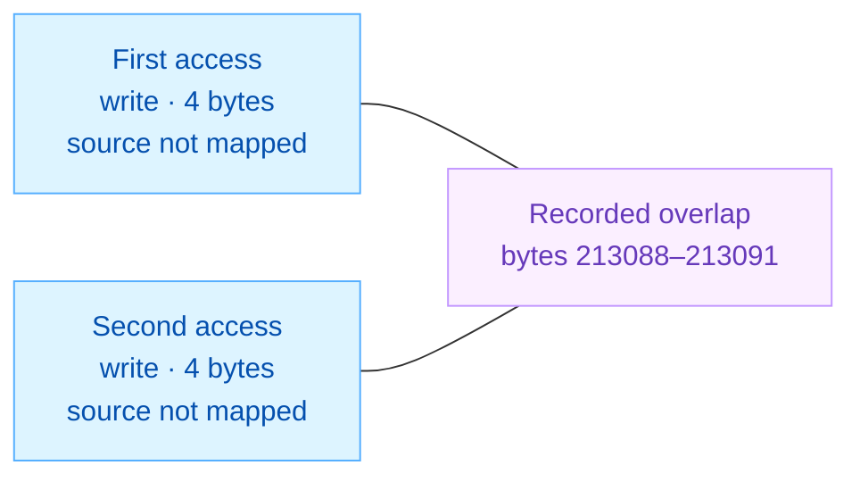

<!-- report-layout:v2 -->

<!-- verifier-result:start -->
<p align="center">Shared dispatch-word publication</p>
<h1 align="center">RACE CANDIDATE</h1>

**Inputs:** [PTX](https://github.com/gpu-verifier/sentryward/blob/94a6b26b1990a4b9df7ded3727acc4b4cc36f23c/corpus/tritongluon-08-ws-matmul-512.ptx) ([raw](https://github.com/gpu-verifier/sentryward/raw/94a6b26b1990a4b9df7ded3727acc4b4cc36f23c/corpus/tritongluon-08-ws-matmul-512.ptx)) · analyzed code; [input.json](https://github.com/gpu-verifier/sentryward/blob/94a6b26b1990a4b9df7ded3727acc4b4cc36f23c/examples/tritongluon-08-ws-matmul-512/input.json) · launch, arguments and assumptions.

**Result:** [output.json](https://github.com/gpu-verifier/sentryward/blob/94a6b26b1990a4b9df7ded3727acc4b4cc36f23c/examples/tritongluon-08-ws-matmul-512/output.json) · saved verifier findings.

<table>
<thead><tr><th align="left">VERIFIER RESULT · Potentially conflicting accesses</th></tr></thead>
<tbody><tr><td>

The verifier retained potentially conflicting memory accesses.

**Synchronization:** Passed · **Memory:** Failed · **Equivalence:** Not run

The synchronization check passed; the separate memory check still found a conflict. Passing one check does not clear the other.

**Recorded totals:** 1 races · 0 warnings · 0 unresolved.

The pair below is a race candidate to inspect, not an observed GPU failure.

**write / write overlap:** <code>4</code> bytes in <code>shared</code> memory, at byte offset <code>213088</code>.



Lines connect the two recorded accesses to their shared byte region; they do not show execution order.


**Source attribution:** this pair is not fully mapped to physical PTX; model IDs do not identify CUDA threads.


<details>
<summary><strong>Locate the accesses and check their recorded overlap</strong></summary>

| Access | Source operation | Model event / instruction | Actor ID |
| --- | --- | --- | --- |
| First access | source line <code>541</code> · PTX mapping unconfirmed | <code>149</code> / <code>59</code> | <code>0</code> |
| Second access | source line <code>541</code> · PTX mapping unconfirmed | <code>304</code> / <code>116</code> | <code>1</code> |

Actor IDs name verifier participants; this record does not itself establish CUDA thread coordinates. Event and instruction IDs identify model records, not source-line numbers.

**PTX mapping:** First access, Second access: no matching physical PTX location is established by the saved record.

**Saved record:** <a href="https://github.com/gpu-verifier/sentryward/blob/94a6b26b1990a4b9df7ded3727acc4b4cc36f23c/examples/tritongluon-08-ws-matmul-512/output.json#L344"><code>output.json#/races/0</code></a>. **Overlap check:** constant byte ranges intersect. **Allocation:** <code>cta:(0, 0, 0):shared:physical.shared.cta.0</code>. **Address space:** <code>shared</code>.

</details>

<details>
<summary><strong>Saved status and diagnostic codes</strong></summary>

**Saved result:** <code>potential_race</code> · <a href="https://github.com/gpu-verifier/sentryward/blob/94a6b26b1990a4b9df7ded3727acc4b4cc36f23c/examples/tritongluon-08-ws-matmul-512/output.json#L392"><code>output.json#/result</code></a>.

**Operation:** <code>kernel_verification</code>.

**First diagnostic:** <code>conflicting_accesses_unordered</code> · <code>memory_check</code> — Conflicting accesses have no proven required ordering · <a href="https://github.com/gpu-verifier/sentryward/blob/94a6b26b1990a4b9df7ded3727acc4b4cc36f23c/examples/tritongluon-08-ws-matmul-512/output.json#L69"><code>output.json#/diagnostics/0</code></a>.

**Checks:** Synchronization <code>passed</code> · Memory <code>failed</code> · Equivalence <code>not_run</code>.

</details>

</td></tr>
<tr><td>

### Analysis scope

**Coverage:** Memory analysis complete: yes · Search complete: **no** · Exhaustive search: **no**.

The memory analysis returned a result, but its search is not complete. This finding is available to inspect; the flags do not establish that all possible conflicts were examined.

**Assumption-dependent:** <code>true</code>. Triggered rules: Representative election.

This result applies to the supplied launch, arguments and enabled assumptions.

<details>
<summary><strong>Analysis records — open the saved evidence</strong></summary>

Each record link opens its field in the original `output.json`. Model summaries are not full execution traces.

**Check the finding**

- [Diagnostic messages and details · `diagnostics`](https://github.com/gpu-verifier/sentryward/blob/94a6b26b1990a4b9df7ded3727acc4b4cc36f23c/examples/tritongluon-08-ws-matmul-512/output.json#L68)
- [Individual check outcomes · `checks`](https://github.com/gpu-verifier/sentryward/blob/94a6b26b1990a4b9df7ded3727acc4b4cc36f23c/examples/tritongluon-08-ws-matmul-512/output.json#L56)

**Check how the model was built**

- [PTX translation · `frontend`](https://github.com/gpu-verifier/sentryward/blob/94a6b26b1990a4b9df7ded3727acc4b4cc36f23c/examples/tritongluon-08-ws-matmul-512/output.json#L115)
- [Model and source bindings · `semantic_program`](https://github.com/gpu-verifier/sentryward/blob/94a6b26b1990a4b9df7ded3727acc4b4cc36f23c/examples/tritongluon-08-ws-matmul-512/output.json#L406)
- [Synchronization-check setup · `synchronization_input`](https://github.com/gpu-verifier/sentryward/blob/94a6b26b1990a4b9df7ded3727acc4b4cc36f23c/examples/tritongluon-08-ws-matmul-512/output.json#L424)

**Check values separately**

- [Value-analysis status · `value_analysis`](https://github.com/gpu-verifier/sentryward/blob/94a6b26b1990a4b9df7ded3727acc4b4cc36f23c/examples/tritongluon-08-ws-matmul-512/output.json#L452)
- [Numerical comparison · `equivalence`](https://github.com/gpu-verifier/sentryward/blob/94a6b26b1990a4b9df7ded3727acc4b4cc36f23c/examples/tritongluon-08-ws-matmul-512/output.json#L79)

For the records explained in this report, see the [Evidence appendix](#evidence-appendix).

</details>

</td></tr></tbody>
</table>
<!-- verifier-result:end -->

<!-- code-explanation:start -->

## Code explanation

Interpretation from the PTX and saved inputs: how the reported operations fit together and what remains to check.

<a id="code-section-1" name="user-content-code-section-1"></a>

### 1. Dispatch-word publication: peer stores precede the barrier

The affected four-byte shared word tells each worker warp which role to run, then tells it to exit. Threads 0–127 publish that same word using ordinary `st.shared.b32` instructions. The following `barrier.sync 1` coordinates writers with worker readers; it does not order the peer writes before it.

This still matters in the supplied **zero-tile configuration**: the matrix-work loops are bypassed, but setup and exit publish the word. The saved pair has no event-to-PTX or actor-to-thread binding selecting either site. The view below therefore uses source-derived representative writers, not the retained pair.

**Possible interleaving.** Steps run downward; they are not a measured GPU clock or a hardware trace.

| Step | Thread 0 · warp 0 | Thread 32 · warp 1 |
| --- | --- | --- |
| 1 | Publish startup word at shared +213088 | — |
| 2 | — | Publish the same startup word |
| 3 | Reach barrier 1 with its warp | — |
| 4 | — | Reach barrier 1 with its warp |

<p><strong>Both representative threads execute this same startup store before their next barrier</strong> · <a href="https://github.com/gpu-verifier/sentryward/blob/94a6b26b1990a4b9df7ded3727acc4b4cc36f23c/corpus/tritongluon-08-ws-matmul-512.ptx#L170-L171" title="Open the original PTX">physical PTX 170–171</a></p>

<ul>
<li><code>16777730</code> — Packed worker-role bytes: 02 02 00 01</li>
</ul>

<pre><code><strong>st.shared.b32</strong> <strong>[global_smem+213088]</strong>, 16777730;
<strong>barrier.sync</strong> 1;</code></pre>


- **Participants:** Lane-zero representatives of two different writer warps. All lanes in warps 0–3 reach the unpredicated store; these representatives are not mapped from saved actor IDs.
- **Branches:** Both threads satisfy `warp index < 4` and fall through at L69. No branch or store predicate narrows the startup publication.
- **Iterations:** Single startup publication before the zero-work test. The supplied zero count bypasses matrix work, not this publication.
- **Completion:** Rows show a source-compatible schedule, not elapsed time. The other CTA threads also join barrier 1; neither representative passes before all participants arrive. The barrier supplies no order between their preceding peer stores.

<details>
<summary><strong>Sources for this interleaving</strong></summary>

- physical PTX 52,66-69: <code>%tid.x</code>, <code>shr.u32</code>, <code>shfl.sync.idx.b32</code>, <code>setp.lt.u32</code>, <code>@!%p2 bra</code>
- <a href="https://github.com/gpu-verifier/sentryward/blob/94a6b26b1990a4b9df7ded3727acc4b4cc36f23c/examples/tritongluon-08-ws-matmul-512/input.json#L10"><code>input.json#/launch/block_dim</code></a>: <code>[256,1,1]</code>
- physical PTX 170-171: <code>st.shared.b32</code>, <code>16777730</code>, <code>barrier.sync</code>
- physical PTX 71-171: <code>st.shared.b32</code>, <a href="https://docs.nvidia.com/cuda/archive/13.3.0/parallel-thread-execution/index.html#parallel-synchronization-and-communication-instructions-mbarrier-init"><code>mbarrier.init</code></a>
- <a href="https://github.com/gpu-verifier/sentryward/blob/94a6b26b1990a4b9df7ded3727acc4b4cc36f23c/examples/tritongluon-08-ws-matmul-512/input.json#L120"><code>input.json#/arguments/1/value</code></a>: <code>0</code>
- <a href="https://github.com/gpu-verifier/sentryward/blob/94a6b26b1990a4b9df7ded3727acc4b4cc36f23c/examples/tritongluon-08-ws-matmul-512/input.json#L125"><code>input.json#/arguments/2/value</code></a>: <code>0</code>
- <a href="https://github.com/gpu-verifier/sentryward/blob/94a6b26b1990a4b9df7ded3727acc4b4cc36f23c/examples/tritongluon-08-ws-matmul-512/input.json#L5"><code>input.json#/launch/grid_dim</code></a>: <code>[1,1,1]</code>
- physical PTX 42-43,178-213: <code>%r20</code>, <code>%r21</code>, <code>%r870</code>, <code>@%p54 bra</code>
- physical PTX 1242: <code>barrier.sync</code>

</details>

**Implication.** The common barrier makes the dispatch word available to readers without establishing an order between its writers. Equal literal values add no ordering edge, and the saved duplicate-TMA-store rule does not cover these ordinary shared stores. The retained pair’s source binding is needed to attribute it to startup or exit.

<details>
<summary><strong>Check writer ownership, dispatch bytes and zero-work barrier rounds</strong></summary>

#### Why are there 128 writers?

The role selector comes from `tid.x >> 5`, broadcast within each warp. The comparison selects warp indices 0–3, or threads 0–127 in the supplied block. These threads fall through to the publication; warps 4–7 branch to the dispatcher. The nearby elected-lane predicates gate only <a href="https://docs.nvidia.com/cuda/archive/13.3.0/parallel-thread-execution/index.html#parallel-synchronization-and-communication-instructions-mbarrier-init"><code>mbarrier.init</code></a> instructions. Neither control-word store has a predicate, so the election does not choose a single publisher.

<p><strong>Thread identity and the writer-versus-worker branch</strong> · <a href="https://github.com/gpu-verifier/sentryward/blob/94a6b26b1990a4b9df7ded3727acc4b4cc36f23c/corpus/tritongluon-08-ws-matmul-512.ptx#L52-L69" title="Open the original PTX">physical PTX 52, 66–69</a></p>

<pre><code><strong>mov.u32</strong> %r1, <strong>%tid.x</strong>;
…
<strong>shr.u32</strong> %r3, %r1, 5;
<strong>shfl.sync.idx.b32</strong> %r4, %r3, 0, 31, -1;
<strong>setp.lt.u32</strong> %p2, %r4, 4;
<strong>@!%p2</strong> <strong>bra</strong> $L__BB0_1;</code></pre>


#### What do the four bytes control?

Each worker reads one byte at shared base + 213084 + its warp index, so warps 4–7 consume bytes 213088–213091. The startup literal is `0x01000202`, whose little-endian bytes select idle, idle, input-copy and MMA roles. The exit literal is `0x03030303`, selecting the common exit for every worker. The address therefore holds dispatch control, not an A/B tile or the matrix result. The table below decodes the branch table; roles describe the code selected, while the saved zero-work conditions skip its computation.

| Worker warp | Byte offset | Startup selector / path | Exit selector / path |
| --- | --- | --- | --- |
| 4 | 213088 | 2 / idle | 3 / exit |
| 5 | 213089 | 2 / idle | 3 / exit |
| 6 | 213090 | 0 / input copies | 3 / exit |
| 7 | 213091 | 1 / MMA | 3 / exit |

<p><strong>A worker byte selects one of four branch targets</strong> · <a href="https://github.com/gpu-verifier/sentryward/blob/94a6b26b1990a4b9df7ded3727acc4b4cc36f23c/corpus/tritongluon-08-ws-matmul-512.ptx#L1243-L1254" title="Open the original PTX">physical PTX 1243–1254</a></p>

<ul>
<li><code>%r4</code> — Worker warp index, from <code>tid.x</code> &gt;&gt; 5</li>
<li><code>%r23</code> — This worker’s selector byte</li>
</ul>

<pre><code><strong>add.s32</strong> %r24, %r22, %r4;
<strong>ld.shared.b8</strong> <strong>%r23</strong>, [%r24+213084];
<strong>setp.gt.u32</strong> %p3, <strong>%r23</strong>, 3;
@%p3 <strong>bra</strong> $L__BB0_4;
// %bb.3:                               // %.preheader
//   in Loop: Header=BB0_2 Depth=1
$L_brx_0: .branchtargets
$L__BB0_7,
$L__BB0_14,
$L__BB0_25,
$L__BB0_5;
<strong>brx.idx</strong> <strong>%r23</strong>, $L_brx_0;</code></pre>


#### Why do setup and exit run when no matrix tile does?

The saved parameters 11 and 12 are both zero, and their loaded values have no later assignments. The main path computes `(0 + 127) >> 7 = 0` and `(0 + 255) >> 8 = 0`. With CTA index 0 and grid size 1, its work count is `(0 × 0 + 1 + ~0) / 1 = 0`. The branch at PTX 213 therefore enters the final drain at 1209, reaching the exit publication at 1216. The input-copy and MMA roles calculate the same zero outer count and return to dispatch through 1293 and 1460. Parameter 2 is also zero, but those outer exits already bypass the inner work. The descriptors’ 512-by-512 extents do not replace these scalar work counts.

#### What does barrier 1 order, and what does it leave unordered?

All eight warps participate in each of the four configured rounds below; the instruction omits a reduced participant count. The first round lets workers read the startup assignment. A second round starts the selected roles; a third rejoins their zero-work exits. The fourth publishes the exit selector, after which the workers branch to the final CTA barrier. These rounds separate startup publication from exit publication. The issue illustrated above is peer writes within one publication, not a startup write racing an exit write. No round inserts an ordering edge between peer stores that occur on its same side.

| Barrier-1 round | Writers: warps 0–3 | Idle: warps 4–5 | Input-copy: warp 6 | MMA: warp 7 |
| --- | --- | --- | --- | --- |
| Startup publication | 171, after store | 1242 | 1242 | 1242 |
| Enter role | 173 | 1419 | 1257 | 1425 |
| Finish role | 1213 | 1420 | 1232 | 1232 |
| Exit publication | 1217, after store | 1242 again | 1242 again | 1242 again |

<p><strong>The exit publication has the same peer-store pattern in a later barrier round</strong> · <a href="https://github.com/gpu-verifier/sentryward/blob/94a6b26b1990a4b9df7ded3727acc4b4cc36f23c/corpus/tritongluon-08-ws-matmul-512.ptx#L1213-L1217" title="Open the original PTX">physical PTX 1213–1217</a></p>

<pre><code><strong>barrier.sync</strong> 1;
<strong>setmaxnreg.inc.sync.aligned.u32</strong> 256;
.loc 1 541 1 // 08-warp-specialization.py:541:1
<strong>st.shared.b32</strong> [global_smem+213088], <strong>50529027</strong>;
<strong>barrier.sync</strong> 1;</code></pre>


<details>
<summary><strong>Sources: Check writer ownership, dispatch bytes and zero-work barrier rounds</strong></summary>

<blockquote>

##### Source references: Why are there 128 writers?

- physical PTX 52,66-69: <code>%tid.x</code>, <code>shr.u32</code>, <code>shfl.sync.idx.b32</code>, <code>setp.lt.u32</code>, <code>@!%p2 bra</code>
- <a href="https://github.com/gpu-verifier/sentryward/blob/94a6b26b1990a4b9df7ded3727acc4b4cc36f23c/examples/tritongluon-08-ws-matmul-512/input.json#L10"><code>input.json#/launch/block_dim</code></a>: <code>[256,1,1]</code>
- physical PTX 71-78,162-173,1213-1217: <code>@%p29 mbarrier.init</code>, <code>@%p40 mbarrier.init</code>, <code>st.shared.b32</code>

##### Source references: What do the four bytes control?

- physical PTX 170,1216,1242-1257,1369-1380,1416-1425,1566,1717-1724: <code>16777730</code>, <code>50529027</code>, <code>ld.shared.b8</code>, <code>brx.idx</code>, <a href="https://docs.nvidia.com/cuda/archive/13.3.0/parallel-thread-execution/index.html#data-movement-and-conversion-instructions-cp-async-bulk-tensor"><code>cp.async.bulk.tensor</code></a>, <a href="https://docs.nvidia.com/cuda/archive/13.3.0/parallel-thread-execution/index.html#tcgen05-mma-instructions"><code>tcgen05.mma</code></a>, <code>ret</code>

##### Source references: Why do setup and exit run when no matrix tile does?

- <a href="https://github.com/gpu-verifier/sentryward/blob/94a6b26b1990a4b9df7ded3727acc4b4cc36f23c/examples/tritongluon-08-ws-matmul-512/input.json#L120"><code>input.json#/arguments/1/value</code></a>: <code>0</code>
- <a href="https://github.com/gpu-verifier/sentryward/blob/94a6b26b1990a4b9df7ded3727acc4b4cc36f23c/examples/tritongluon-08-ws-matmul-512/input.json#L125"><code>input.json#/arguments/2/value</code></a>: <code>0</code>
- <a href="https://github.com/gpu-verifier/sentryward/blob/94a6b26b1990a4b9df7ded3727acc4b4cc36f23c/examples/tritongluon-08-ws-matmul-512/input.json#L5"><code>input.json#/launch/grid_dim</code></a>: <code>[1,1,1]</code>
- physical PTX 42-43,178-213: <code>%r20</code>, <code>%r21</code>, <code>%r870</code>, <code>@%p54 bra</code>
- <a href="https://github.com/gpu-verifier/sentryward/blob/94a6b26b1990a4b9df7ded3727acc4b4cc36f23c/examples/tritongluon-08-ws-matmul-512/input.json#L115"><code>input.json#/arguments/0/value</code></a>: <code>0</code>
- physical PTX 1209-1227,1262-1293,1429-1460: <a href="https://docs.nvidia.com/cuda/archive/13.3.0/parallel-thread-execution/index.html#data-movement-and-conversion-instructions-cp-async-bulk-wait-group"><code>cp.async.bulk.wait_group.read</code></a>, <code>%p22</code>, <code>@%p21 bra</code>, <code>@%p4 bra</code>
- <a href="https://github.com/gpu-verifier/sentryward/blob/94a6b26b1990a4b9df7ded3727acc4b4cc36f23c/examples/tritongluon-08-ws-matmul-512/input.json#L138"><code>input.json#/tma_descriptors/0/global_shape</code></a>: <code>[512,512]</code>

##### Source references: What does barrier 1 order, and what does it leave unordered?

- physical PTX 170-173,1211-1218,1229-1244,1255-1257,1292-1293,1416-1425,1459-1460,1717-1724: <code>barrier.sync</code>, <code>bar.sync</code>, <code>st.shared.b32</code>, <code>bra</code>

##### Additional section references

- physical PTX 170-171: <code>st.shared.b32</code>, <code>16777730</code>, <code>barrier.sync</code>
- physical PTX 1213-1217,1242-1254: <code>50529027</code>, <code>ld.shared.b8</code>, <code>brx.idx</code>
- <a href="https://github.com/gpu-verifier/sentryward/blob/94a6b26b1990a4b9df7ded3727acc4b4cc36f23c/examples/tritongluon-08-ws-matmul-512/output.json#L368"><code>output.json#/races/0/region/offset</code></a>: <code>213088</code>
- <a href="https://github.com/gpu-verifier/sentryward/blob/94a6b26b1990a4b9df7ded3727acc4b4cc36f23c/examples/tritongluon-08-ws-matmul-512/output.json#L367"><code>output.json#/races/0/region/bytes</code></a>: <code>4</code>
- <a href="https://github.com/gpu-verifier/sentryward/blob/94a6b26b1990a4b9df7ded3727acc4b4cc36f23c/examples/tritongluon-08-ws-matmul-512/output.json#L359"><code>output.json#/races/0/first/location/line</code></a>: <code>541</code>
- <a href="https://github.com/gpu-verifier/sentryward/blob/94a6b26b1990a4b9df7ded3727acc4b4cc36f23c/examples/tritongluon-08-ws-matmul-512/output.json#L384"><code>output.json#/races/0/second/location/line</code></a>: <code>541</code>
- <a href="https://github.com/gpu-verifier/sentryward/blob/94a6b26b1990a4b9df7ded3727acc4b4cc36f23c/examples/tritongluon-08-ws-matmul-512/output.json#L20"><code>output.json#/assumptions/0/text</code></a>: <code>&quot;Matching same-warp duplicate TMA stores are races in the model, but are reported as warnings under the assumption that their stored values agree.&quot;</code>

</blockquote>

</details>

</details>

### 2. Next check

Resolve the saved event/instruction-to-PTX binding to determine whether the retained pair comes from startup or exit publication. Then inspect the intended ownership of this compiler-generated dispatch word and the verifier’s treatment of equal-value ordinary shared stores. The source already identifies the writer set and the following barrier; an additional wait is not established as the needed change.

<details>
<summary><strong>Evidence for the next check</strong></summary>

- <a href="https://github.com/gpu-verifier/sentryward/blob/94a6b26b1990a4b9df7ded3727acc4b4cc36f23c/examples/tritongluon-08-ws-matmul-512/output.json#L355"><code>output.json#/races/0/first/instruction</code></a>: <code>59</code>
- <a href="https://github.com/gpu-verifier/sentryward/blob/94a6b26b1990a4b9df7ded3727acc4b4cc36f23c/examples/tritongluon-08-ws-matmul-512/output.json#L380"><code>output.json#/races/0/second/instruction</code></a>: <code>116</code>
- physical PTX 170-171,1216-1217: <code>st.shared.b32</code>, <code>barrier.sync</code>

</details>

<!-- code-explanation:end -->

<!-- verifier-evidence:start -->
## Evidence appendix

Use these records to check the verifier result and source explanation above. JSON pointers refer to the original saved files. Identical prerequisite copies use `same_records_as` to refer to the diagnostic evidence shown once; their original locations and content hashes remain recorded.

<details>
<summary><strong>Diagnostic records — verify the finding</strong></summary>

These are saved verifier records. Truncation flags describe missing records in the original result, not merely collapsed presentation.

#### Retained races

1 saved records. These are the retained sample, not necessarily all findings.

| Record | First / second event | Modes | Saved code |
| --- | --- | --- | --- |
| 0 | <code>149</code> / <code>304</code> | <code>write</code> / <code>write</code> | <code>not saved</code> |


Byte regions, endpoints and exact locations: <a href="https://github.com/gpu-verifier/sentryward/blob/94a6b26b1990a4b9df7ded3727acc4b4cc36f23c/examples/tritongluon-08-ws-matmul-512/output.json#L343"><code>output.json#/races</code></a>.

#### Diagnostics

- <code>conflicting_accesses_unordered</code>: Conflicting accesses have no proven required ordering

<details>
<summary><strong>Exact diagnostic records and metadata</strong></summary>

##### Flags and empty collections

These retain their original top-level keys in `output.json`.

```json
{
  "warnings": [],
  "source_violations": [],
  "verification_limitations": []
}
```

##### Races

<a href="https://github.com/gpu-verifier/sentryward/blob/94a6b26b1990a4b9df7ded3727acc4b4cc36f23c/examples/tritongluon-08-ws-matmul-512/output.json#L343"><code>output.json#/races</code></a>

**Retained records:** 1.

```json
[
  {
    "first": {
      "access_index": 0,
      "actor": 0,
      "bytes": 4,
      "effect_index": 0,
      "endpoint": {
        "address": 1,
        "kind": "memory"
      },
      "event": 149,
      "instruction": 59,
      "location": {
        "column": 1,
        "file": "/raid/user_data/ziweizho/wasp-cand-20260927/worktrees/triton-c01b6774/python/tutorials/gluon/08-warp-specialization.py",
        "line": 541
      },
      "mode": "write"
    },
    "overlap": "constant byte ranges intersect",
    "region": {
      "address_space": "shared",
      "allocation": "cta:(0, 0, 0):shared:physical.shared.cta.0",
      "bytes": 4,
      "offset": 213088
    },
    "second": {
      "access_index": 0,
      "actor": 1,
      "bytes": 4,
      "effect_index": 0,
      "endpoint": {
        "address": 1,
        "kind": "memory"
      },
      "event": 304,
      "instruction": 116,
      "location": {
        "column": 1,
        "file": "/raid/user_data/ziweizho/wasp-cand-20260927/worktrees/triton-c01b6774/python/tutorials/gluon/08-warp-specialization.py",
        "line": 541
      },
      "mode": "write"
    }
  }
]
```

##### Diagnostics

<a href="https://github.com/gpu-verifier/sentryward/blob/94a6b26b1990a4b9df7ded3727acc4b4cc36f23c/examples/tritongluon-08-ws-matmul-512/output.json#L68"><code>output.json#/diagnostics</code></a>

**Retained records:** 1.

```json
[
  {
    "code": "conflicting_accesses_unordered",
    "details": {
      "count": 1,
      "witnesses_path": "races"
    },
    "message": "Conflicting accesses have no proven required ordering",
    "stage": "memory_check"
  }
]
```

</details>

</details>

<details>
<summary><strong>Assumptions — what qualifies the result</strong></summary>

Enabled and triggered answer different questions: whether a rule was selected, and whether its applicability was recorded. `triggered: null` means unknown or unmeasured, not inactive.

#### Duplicate TMA stores

**Key:** <code>duplicate_tma_store_benign</code>

**Enabled:** <code>true</code> · **Triggered:** <code>false</code>

Matching same-warp duplicate TMA stores are races in the model, but are reported as warnings under the assumption that their stored values agree.

#### Representative election

**Key:** <code>representative_election</code>

**Enabled:** <code>true</code> · **Triggered:** <code>true</code>

Election selects lane zero when participating, otherwise the lowest participating lane.

#### Failed launch cancellation

**Key:** <code>clc_always_fails</code>

**Enabled:** <code>true</code> · **Triggered:** <code>false</code>

Every cluster launch cancellation request fails.

#### Representative branches

**Key:** <code>representative_branches</code>

**Enabled:** <code>false</code> · **Triggered:** <code>false</code>

Choose fallthrough for an unresolved structured if/else; unknown ordinary instruction guards execute. Terminal control uses CFG classification. Known control and explicit choices take precedence.

#### Bounded computation loops

**Key:** <code>bounded_computation_loops</code>

**Enabled:** <code>false</code> · **Triggered:** <code>false</code>

Execute a configured number of body iterations for unresolved recognized computation loops, counted separately per invocation. Polling and unclassified loops are never forced to complete.

<details>
<summary><strong>Exact assumption settings</strong></summary>

```json
{
  "assumptions": [
    {
      "category": "analysis assumption",
      "enabled": true,
      "key": "duplicate_tma_store_benign",
      "label": "Duplicate TMA stores",
      "text": "Matching same-warp duplicate TMA stores are races in the model, but are reported as warnings under the assumption that their stored values agree.",
      "triggered": false
    },
    {
      "category": "analysis assumption",
      "enabled": true,
      "key": "representative_election",
      "label": "Representative election",
      "text": "Election selects lane zero when participating, otherwise the lowest participating lane.",
      "triggered": true
    },
    {
      "category": "analysis assumption",
      "enabled": true,
      "key": "clc_always_fails",
      "label": "Failed launch cancellation",
      "text": "Every cluster launch cancellation request fails.",
      "triggered": false
    },
    {
      "category": "analysis assumption",
      "enabled": false,
      "key": "representative_branches",
      "label": "Representative branches",
      "text": "Choose fallthrough for an unresolved structured if/else; unknown ordinary instruction guards execute. Terminal control uses CFG classification. Known control and explicit choices take precedence.",
      "triggered": false
    },
    {
      "category": "analysis assumption",
      "enabled": false,
      "key": "bounded_computation_loops",
      "label": "Bounded computation loops",
      "text": "Execute a configured number of body iterations for unresolved recognized computation loops, counted separately per invocation. Polling and unclassified loops are never forced to complete.",
      "triggered": false
    }
  ],
  "semantic_assumptions": {
    "bounded_computation_loops": false,
    "clc_always_fails": true,
    "duplicate_tma_store_benign": true,
    "representative_branches": false,
    "representative_election": true
  },
  "frontend_assumptions": {
    "assertion_failure_forms": [
      "trap",
      "__assertfail"
    ],
    "assertion_uses": 0,
    "bounded_loop_uses": 0,
    "clc_failure": true,
    "clc_uses": 0,
    "data_branch_decisions": [],
    "election_policy": {
      "fallback": "lowest_member",
      "preferred_lane": 0,
      "strategy": "preferred_member"
    },
    "election_uses": 1536,
    "fixed_election": true,
    "isolated_launch": true,
    "noalias_unbounded": false,
    "opaque_compute_regions": [],
    "pointer_contract": {
      "aliasing": "distinct_objects_noalias",
      "extent_bytes": "unbounded"
    },
    "representative_branch_uses": 0,
    "trap_only_equality_assertions_hold": true
  },
  "assumption_reporting": "triggered=null means applicability was not measured or analysis was not reached",
  "assumption_dependent": true
}
```

</details>

</details>

<details>
<summary><strong>Value analysis — independent status</strong></summary>

Memory safety and numerical equivalence are separate results.

**Value analysis:** <code>unsupported</code> · <a href="https://github.com/gpu-verifier/sentryward/blob/94a6b26b1990a4b9df7ded3727acc4b4cc36f23c/examples/tritongluon-08-ws-matmul-512/output.json#L452"><code>output.json#/value_analysis</code></a>

**Checks:** Synchronization <code>not_requested</code> · Memory <code>not_requested</code> · Equivalence <code>not_requested</code>.

- **Prerequisite status:** <code>potential_race</code>
- **Scope:** {&quot;operation&quot;:&quot;<code>value_analysis</code>&quot;}
- **Diagnostic:** <code>prerequisite_check_not_passed</code> · <code>pipeline</code> · <a href="https://github.com/gpu-verifier/sentryward/blob/94a6b26b1990a4b9df7ded3727acc4b4cc36f23c/examples/tritongluon-08-ws-matmul-512/output.json#L459"><code>output.json#/value_analysis/diagnostics/0</code></a>

**Equivalence:** <code>unsupported</code> · <a href="https://github.com/gpu-verifier/sentryward/blob/94a6b26b1990a4b9df7ded3727acc4b4cc36f23c/examples/tritongluon-08-ws-matmul-512/output.json#L79"><code>output.json#/equivalence</code></a>

**Checks:** Synchronization <code>not_requested</code> · Memory <code>not_requested</code> · Equivalence <code>not_run</code>.

- **Scope:** {&quot;operation&quot;:&quot;equivalence&quot;}
- **Diagnostic:** <code>prerequisite_check_not_passed</code> · <code>pipeline</code> · <a href="https://github.com/gpu-verifier/sentryward/blob/94a6b26b1990a4b9df7ded3727acc4b4cc36f23c/examples/tritongluon-08-ws-matmul-512/output.json#L86"><code>output.json#/equivalence/diagnostics/0</code></a>

<details>
<summary><strong>Exact value-analysis fields and large-data references</strong></summary>

##### Value analysis

```json
{
  "equivalence_check": "blocked",
  "prerequisite_status": "potential_race",
  "result": "unsupported",
  "checks": {
    "equivalence": "not_requested",
    "memory": "not_requested",
    "synchronization": "not_requested"
  },
  "diagnostics": [
    {
      "code": "prerequisite_check_not_passed",
      "details": {
        "prerequisite_checks": {
          "equivalence": "not_run",
          "memory": "failed",
          "synchronization": "passed"
        },
        "prerequisite_diagnostics": [
          {
            "code": "conflicting_accesses_unordered",
            "details": {
              "count": 1,
              "witnesses_path": "races"
            },
            "message": "Conflicting accesses have no proven required ordering",
            "stage": "memory_check"
          }
        ],
        "prerequisite_result": "potential_race",
        "prerequisite_status": "potential_race"
      },
      "stage": "pipeline"
    }
  ],
  "scalar_fold": {
    "checks": {
      "equivalence": "not_requested",
      "memory": "not_requested",
      "synchronization": "not_requested"
    },
    "diagnostics": [
      {
        "code": "memory_elimination_not_completed",
        "stage": "pipeline"
      }
    ],
    "result": "unsupported",
    "scope": {
      "operation": "scalar_fold"
    }
  },
  "scope": {
    "operation": "value_analysis"
  }
}
```

##### Equivalence

```json
{
  "result": "unsupported",
  "checks": {
    "equivalence": "not_run",
    "memory": "not_requested",
    "synchronization": "not_requested"
  },
  "diagnostics": [
    {
      "code": "prerequisite_check_not_passed",
      "details": {
        "prerequisite_checks": {
          "equivalence": "not_run",
          "memory": "failed",
          "synchronization": "passed"
        },
        "prerequisite_diagnostics": [
          {
            "code": "conflicting_accesses_unordered",
            "details": {
              "count": 1,
              "witnesses_path": "races"
            },
            "message": "Conflicting accesses have no proven required ordering",
            "stage": "memory_check"
          }
        ],
        "prerequisite_result": "potential_race"
      },
      "stage": "pipeline"
    }
  ],
  "scope": {
    "operation": "equivalence"
  }
}
```

</details>

</details>

<details>
<summary><strong>Input configuration — reproduce this run</strong></summary>

**Launch and arguments define this run.** Tuple coordinates use `(x, y, z)`; grid and cluster dimensions count blocks, while block dimensions count threads.

| Launch quantity | Saved value |
| --- | --- |
| Grid · blocks | <code>[1,1,1]</code> |
| Block · threads | <code>[256,1,1]</code> |
| Cluster · blocks | <code>[1,1,1]</code> |
| Dynamic shared memory · bytes | <code>0</code> |

**Arguments:** 3 retained entries. Exact parameter bindings, descriptors and entry name: <a href="https://github.com/gpu-verifier/sentryward/blob/94a6b26b1990a4b9df7ded3727acc4b4cc36f23c/examples/tritongluon-08-ws-matmul-512/input.json#L1"><code>input.json#</code></a>.

<details>
<summary><strong>Exact input configuration</strong></summary>

```json
{
  "schema": "spverify.kernel-input/v1",
  "entry": "matmul_warp_specialized_kernel",
  "launch": {
    "grid_dim": [
      1,
      1,
      1
    ],
    "block_dim": [
      256,
      1,
      1
    ],
    "cluster_dim": [
      1,
      1,
      1
    ],
    "dynamic_shared_bytes": 0
  },
  "declarations": [
    {
      "parameter": 0,
      "offset": 0,
      "type": "tensor_map"
    },
    {
      "parameter": 1,
      "offset": 0,
      "type": "u32"
    },
    {
      "parameter": 2,
      "offset": 0,
      "type": "u32"
    },
    {
      "parameter": 3,
      "offset": 0,
      "type": "u64"
    },
    {
      "parameter": 4,
      "offset": 0,
      "type": "u64"
    },
    {
      "parameter": 5,
      "offset": 0,
      "type": "tensor_map"
    },
    {
      "parameter": 6,
      "offset": 0,
      "type": "u32"
    },
    {
      "parameter": 7,
      "offset": 0,
      "type": "u32"
    },
    {
      "parameter": 8,
      "offset": 0,
      "type": "u64"
    },
    {
      "parameter": 9,
      "offset": 0,
      "type": "u64"
    },
    {
      "parameter": 10,
      "offset": 0,
      "type": "tensor_map"
    },
    {
      "parameter": 11,
      "offset": 0,
      "type": "u32"
    },
    {
      "parameter": 12,
      "offset": 0,
      "type": "u32"
    },
    {
      "parameter": 13,
      "offset": 0,
      "type": "u64"
    },
    {
      "parameter": 14,
      "offset": 0,
      "type": "u64"
    },
    {
      "parameter": 15,
      "offset": 0,
      "type": "pointer",
      "object": "A"
    },
    {
      "parameter": 16,
      "offset": 0,
      "type": "pointer",
      "object": "B"
    }
  ],
  "arguments": [
    {
      "parameter": 2,
      "type": "u32",
      "value": 0
    },
    {
      "parameter": 11,
      "type": "u32",
      "value": 0
    },
    {
      "parameter": 12,
      "type": "u32",
      "value": 0
    }
  ],
  "tma_descriptors": [
    {
      "parameter": 0,
      "object": "A",
      "element_type": "f16",
      "rank": 2,
      "box_shape": [
        128,
        64
      ],
      "global_shape": [
        512,
        512
      ],
      "global_strides_bytes": [
        1024
      ],
      "element_strides": [
        512,
        1
      ],
      "swizzle": "128B",
      "interleave": "none",
      "oob_fill": "zero"
    },
    {
      "parameter": 5,
      "object": "B",
      "element_type": "f16",
      "rank": 2,
      "box_shape": [
        64,
        64
      ],
      "global_shape": [
        512,
        512
      ],
      "global_strides_bytes": [
        1024
      ],
      "element_strides": [
        512,
        1
      ],
      "swizzle": "128B",
      "interleave": "none",
      "oob_fill": "zero"
    },
    {
      "parameter": 10,
      "object": "C",
      "element_type": "f16",
      "rank": 2,
      "box_shape": [
        128,
        64
      ],
      "global_shape": [
        512,
        512
      ],
      "global_strides_bytes": [
        1024
      ],
      "element_strides": [
        512,
        1
      ],
      "swizzle": "128B",
      "interleave": "none",
      "oob_fill": "zero"
    }
  ],
  "assumptions": {
    "duplicate_tma_store_benign": true,
    "representative_election": true,
    "clc_always_fails": true
  }
}
```

</details>

</details>

<details>
<summary><strong>Provenance and coverage — check the saved run</strong></summary>

Use the original-file hashes to identify the run. Coverage flags describe what this result establishes; implementation statistics remain separate below.

**Coverage:** Memory analysis complete: yes · Search complete: **no** · Exhaustive search: **no**.

The memory analysis returned a result, but its search is not complete. This finding is available to inspect; the flags do not establish that all possible conflicts were examined.

**Assumption-dependent:** <code>true</code>. Triggered rules: Representative election.


#### Original artifacts

- **Input configuration:** [input.json](https://github.com/gpu-verifier/sentryward/blob/94a6b26b1990a4b9df7ded3727acc4b4cc36f23c/examples/tritongluon-08-ws-matmul-512/input.json) · <code>examples/tritongluon-08-ws-matmul-512/input.json</code> · SHA-256 <code>0df75aeb7790bb70c92f323560f5a7cc05c21d7d58fca44077571149ef8c4c20</code>
- **Verifier output:** [output.json](https://github.com/gpu-verifier/sentryward/blob/94a6b26b1990a4b9df7ded3727acc4b4cc36f23c/examples/tritongluon-08-ws-matmul-512/output.json) · <code>examples/tritongluon-08-ws-matmul-512/output.json</code> · SHA-256 <code>5408be97a3f775f1d897b50540fa9eb3fb2c3c5fd33df3f5293ba6c71d8c543d</code>
- **PTX:** [tritongluon-08-ws-matmul-512.ptx](https://github.com/gpu-verifier/sentryward/blob/94a6b26b1990a4b9df7ded3727acc4b4cc36f23c/corpus/tritongluon-08-ws-matmul-512.ptx) · <code>corpus/tritongluon-08-ws-matmul-512.ptx</code> · SHA-256 <code>505b4ba3c7c1c9ae51b6cff0e6c4fd1beb15319efd5d6edca01636c939c27d3f</code>

Large structures are referenced by exact JSON pointer, item count and SHA-256 of their canonical JSON (UTF-8, sorted keys, compact separators). Original-artifact hashes above are hashes of the file bytes.

<details>
<summary><strong>Exact coverage, implementation and provenance fields</strong></summary>

```json
{
  "address_model": {
    "address_invariants": [],
    "kind": "symbolic",
    "layers": [
      0,
      2
    ],
    "solver": "z3",
    "solver_timeout_ms": 100
  },
  "checks": {
    "equivalence": "not_run",
    "memory": "failed",
    "synchronization": "passed"
  },
  "counts": {
    "edges": 35697,
    "events": 23399,
    "instructions": 8845,
    "memory_accesses": 4353,
    "threads": 256
  },
  "frontend": {
    "address_value_bridge": {
      "diagnostics": [],
      "first_unavailable_reason": "",
      "queries": 0,
      "resolved": 0,
      "source": "value_lowering",
      "unavailable": 0,
      "value_view_complete": true
    },
    "cluster_completion_joins": 0,
    "cta_count": 1,
    "dependency_compression": {
      "bulk_read_wait": {
        "consumers": 128,
        "emitted_references": 0,
        "original_references": 0,
        "prefix_effects": 0
      }
    },
    "diagnostic_sample_count": 0,
    "executed_records": 17324,
    "frontend_assumptions": {
      "assertion_failure_forms": [
        "trap",
        "__assertfail"
      ],
      "assertion_uses": 0,
      "bounded_loop_uses": 0,
      "clc_failure": true,
      "clc_uses": 0,
      "data_branch_decisions": [],
      "election_policy": {
        "fallback": "lowest_member",
        "preferred_lane": 0,
        "strategy": "preferred_member"
      },
      "election_uses": 1536,
      "fixed_election": true,
      "isolated_launch": true,
      "noalias_unbounded": false,
      "opaque_compute_regions": [],
      "pointer_contract": {
        "aliasing": "distinct_objects_noalias",
        "extent_bytes": "unbounded"
      },
      "representative_branch_uses": 0,
      "trap_only_equality_assertions_hold": true
    },
    "implementation": "cpp",
    "input_objects": [
      {
        "bytes": 8,
        "object": "A",
        "offset": 0,
        "parameter": "matmul_warp_specialized_kernel_param_15",
        "source": "declaration"
      },
      {
        "bytes": 8,
        "object": "B",
        "offset": 0,
        "parameter": "matmul_warp_specialized_kernel_param_16",
        "source": "declaration"
      }
    ],
    "lowered_instruction_count": 8845,
    "reached_opcodes": {
      "add.s32": 2752,
      "and.pred": 1536,
      "bar.sync": 896,
      "barrier.sync": 1024,
      "bra": 320,
      "bra.uni": 320,
      "brx.idx": 256,
      "cp.async.bulk.wait_group.read": 128,
      "cvta.param.u64": 768,
      "div.s32": 192,
      "elect.sync": 1536,
      "ld.param.b32": 640,
      "ld.shared.b32": 256,
      "ld.shared.b8": 256,
      "mad.lo.s32": 192,
      "mbarrier.init.shared::cta.b64": 12,
      "mov.b32": 256,
      "mov.b64": 768,
      "mov.u32": 640,
      "not.b32": 192,
      "ret": 256,
      "setmaxnreg.dec.sync.aligned.u32": 128,
      "setmaxnreg.inc.sync.aligned.u32": 768,
      "setp.eq.b32": 128,
      "setp.gt.u32": 256,
      "setp.lt.s32": 320,
      "setp.lt.u32": 512,
      "shfl.sync.idx.b32": 256,
      "shr.s32": 768,
      "shr.u32": 640,
      "st.shared.b32": 256,
      "tcgen05.alloc.cta_group::1.sync.aligned.shared::cta.b32": 32,
      "tcgen05.dealloc.cta_group::1.sync.aligned.b32": 32,
      "tcgen05.relinquish_alloc_permit.cta_group::1.sync.aligned": 32
    },
    "shared_constant_propagation": {
      "read_from_dependencies": 256,
      "representation": "sparse_known_bytes",
      "validation": "pending_backend"
    },
    "source_binding_storage": {
      "binding_templates": 7,
      "generated_address_rows": 0,
      "generated_body_rows": 0,
      "generated_memory_instances": 0,
      "logical_instructions": 8845,
      "stored_bindings": 269
    },
    "source_edge_storage": {
      "binding_templates": 257,
      "logical_edges": 8589,
      "stored_bindings": 257
    },
    "thread_count": 256,
    "unsupported_occurrence_counts": {},
    "user_branch_decisions": []
  },
  "frontend_value_validation": {
    "required_orders": 256,
    "status": "pending"
  },
  "hb_queries": {
    "memory": {
      "algorithm": "not-built",
      "batches": 0,
      "cache_hits": 0,
      "dfs_queries": 0,
      "edge_visits": 0,
      "filtered_queries": 0,
      "queries": 0,
      "shared_peak_index_bytes": 0
    },
    "required_orders": {
      "algorithm": "member-relations",
      "batches": 1,
      "edge_visits": 18,
      "member_enumerations": 0,
      "request_construction": {
        "concrete_pair_materializations": 0,
        "endpoint_reads": 743,
        "family_requests": 263,
        "logical_orders": 480,
        "owner_bindings": 263,
        "stored_orders": 263
      }
    }
  },
  "implementation": "cpp",
  "memory_analysis": {
    "address_candidates": 30723,
    "address_model": {
      "cache_hits": 0,
      "ground_disjoint": 0,
      "ground_overlap": 0,
      "layer0_disjoint": 0,
      "refined_pairs": 0,
      "solver_queries": 0,
      "solver_sat": 0,
      "solver_unknown": 0,
      "solver_unsat": 0
    },
    "candidate_generation_fallback": false,
    "exhaustive": false,
    "family_analysis": {
      "access_families": 105,
      "affine_member_rows": 0,
      "candidate_relations": 116,
      "hb_frontier_pieces": 0,
      "hb_member_enumerations": 0,
      "logical_accesses": 4353
    },
    "first_race_seconds": 0.000456321,
    "hb_algorithm": "member-relations",
    "hb_batches": 2,
    "hb_cache_hits": 0,
    "hb_dfs_queries": 0,
    "hb_edge_visits": 236,
    "hb_filtered_queries": 0,
    "hb_peak_index_bytes": 0,
    "hb_queries": 30723,
    "hb_query_seconds": 0.00012606,
    "overlap_queries": 1,
    "strategy": "conflict-family",
    "unordered_candidates_examined": 1
  },
  "memory_analysis_complete": true,
  "mma_operand_ordering": {},
  "mode": "verify",
  "peak_footprint_mib": 27.37109375,
  "peak_rss_mib": 161.21875,
  "pipeline_elapsed_seconds": 0.138460123,
  "race_count": 1,
  "race_samples_truncated": false,
  "required_order_domains": 263,
  "required_orders": 480,
  "result": "potential_race",
  "rss_limit_mib": null,
  "schema": "spverify.native-result/v1",
  "scope": {
    "operation": "kernel_verification"
  },
  "search_complete": false,
  "semantic_program": {
    "binding_diagnostic_count": 0,
    "binding_diagnostics": [],
    "execution_cohorts": 10,
    "mapping_complete": true,
    "memory_binding_stored_rows": 28,
    "memory_binding_templates": 27,
    "memory_bindings": 769,
    "memory_linking_templates_used": true,
    "synchronization_groups": 182,
    "synchronization_groups_materialized": true,
    "synthetic_synchronization_nodes": 1,
    "thread_prefix_groups": 613,
    "value_diagnostic_count": 0,
    "value_diagnostics": []
  },
  "stage": "memory_check",
  "synchronization_input": {
    "compute_access_binding": "after_happens_before",
    "kind": "ordering_endpoints",
    "memory_address_payloads": false
  },
  "template_execution": {
    "completed_ctas": 1,
    "coordinate_bindings": 0,
    "logical_thread_steps": 19904,
    "path_entries": 430,
    "record_bindings": 281,
    "record_nodes": 324,
    "splits": 5,
    "template_steps": 360,
    "thread_memberships": 256,
    "value_nodes": 159
  },
  "thread_record_compression": {
    "completed_ctas": 1,
    "enabled": true,
    "estimated_pool_bytes_sum": 0,
    "intern_calls": 0,
    "logical_records": 17324,
    "record_handle_bytes": 32,
    "templates": 0,
    "unique_bindings": 0
  },
  "unresolved_count": 0,
  "value_ir_instance_count": 7332,
  "value_ir_node_count": 177,
  "value_view_complete": true,
  "warning_count": 0,
  "warning_samples_truncated": false,
  "wellsync_timeout_seconds": 500.0,
  "whole_pipeline_timeout_seconds": 500.0
}
```

</details>

</details>

<!-- verifier-evidence:end -->
